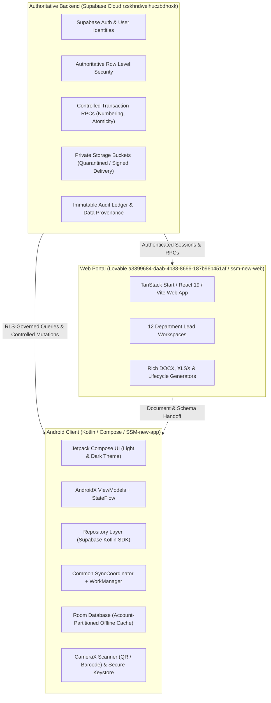
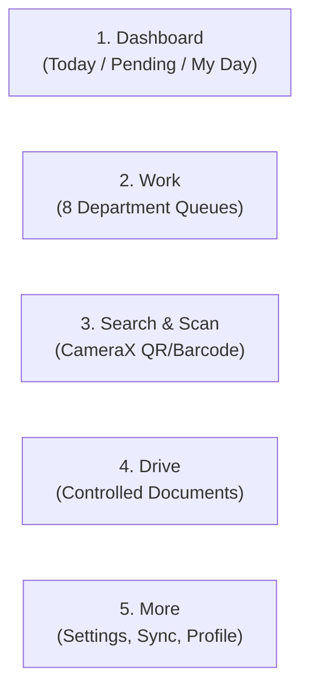
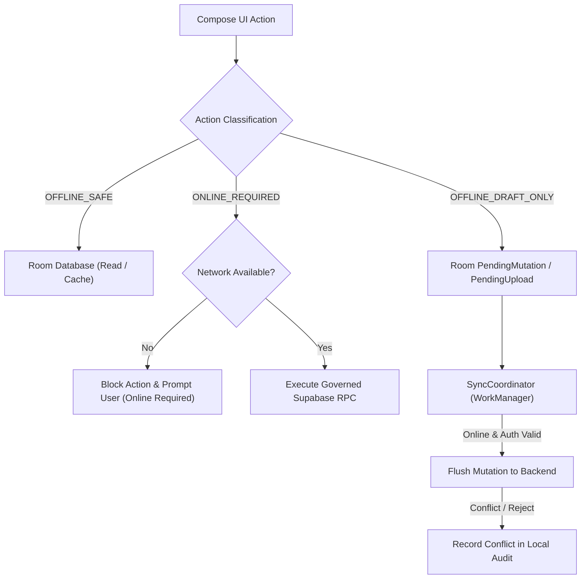
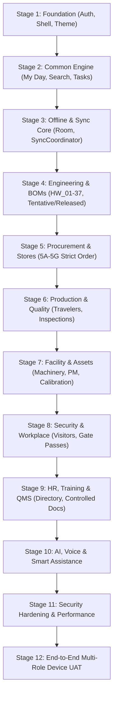

# SSM One — Android Mobile Managing Portal Master Plan

**Document Version:** 2.3 (Multi-Track Lifecycle View & Backend Contract Status Reconciliation)

**Date:** 31 October 2026

**Target Repository:** `C:/Users/Admin/AndroidStudioProjects/SSM-new/SSM-new-app`

**Cross-platform Master Plan Reference:** [SSM-new root master plan](../../../SSM_ONE_MASTER_PLAN.md). The [detailed web implementation plan](../../../ssm-new-web/SSM_ONE_WEB_PORTAL_MASTER_PLAN.md) is a subordinate web handoff; Android-local copies are historical references.
**Product lifecycle reference:** [Electronics Multi-Track Lifecycle and APQP Roadmap](../../../SSM_ONE_PLANNING_LIBRARY/Electronics%20Multi-Track%20Lifecycle%20and%20APQP%20Roadmap.md); consume the same project-pinned lifecycle/template and responsibility-matrix versions as web.
**Backend handoff authority:** [`mobile_backend_contract.json`](../backend-handoff/mobile_backend_contract.json) records verified status and must be checked against the current deployed environment. [`stage5-remediation-20260924154357.sql.txt`](../backend-handoff/evidence/stage5-remediation-20260924154357.sql.txt) is source evidence only; it does not establish deployment. The former `MOBILE_BACKEND_CONTRACT.md`, `ANDROID_BACKEND_HANDOFF.md`, and `VERIFIED_MATERIAL_ISSUE_RETURN_CONTRACT_2026-09-27.md` links are stale/missing and are not authoritative.

---

## 1. Executive Purpose & Architectural Authority

The **SSM One Android Mobile Application** serves as the authoritative on-the-move managing and operational client for the SSM One enterprise platform. It enables engineers, storekeepers, technicians, quality inspectors, facility managers, security guards, and executives to monitor operations, scan hardware/assets/lots, execute verified draft workflows, inspect document revisions, and perform controlled transactions from Android handheld devices and tablets.

### 1.1 System Authority Split



### 1.2 Non-Negotiable Architecture Rules

1. **Backend Owns Truth**: The Supabase backend owns users, profiles, employees, roles, permissions, projects, inventory stock, official numbering, and transaction atomicity. The Android client never creates local source-of-truth business tables (e.g. no `mobile_inventory`, no `mobile_purchase_orders`).
2. **Credential Boundary**: The APK receives strictly `SUPABASE_URL` and `SUPABASE_ANON_OR_PUBLISHABLE_KEY`. It never contains `service_role`, database passwords, JWT signing secrets, or private OAuth secrets.
3. **RLS Authorization**: Authorization is strictly enforced by backend Row-Level Security. Android never overrides or replaces backend RLS with client-side UI hiding or locally cached roles. An empty response from Supabase represents denied access.
4. **Controlled Mutation Atomicity**: Critical inventory, asset, and document state changes (Final GRN, Material Issue, Material Return, Stock Transfer, Stock Adjustment, Document Release) must invoke designated server RPCs with client-generated UUID `request_key` idempotency tokens. Critical mutations remain `ONLINE_REQUIRED`.
5. **Single Common Sync Engine**: All offline caching, mutation queues, and background synchronization must use the common `SyncCoordinator`, Room database, and WorkManager infrastructure. Feature-specific synchronization daemons (e.g., `GrnSyncWorker`, `InventorySyncWorker`) are strictly prohibited.
6. **Package Path Discipline**: Package paths must not use Kotlin reserved words (e.g. use `feature.stores.returns`, never `feature.stores.return`).

### 1.3 Mobile Companion vs. Web-Authoritative Architecture Philosophy & UI Uncluttering Strategy

The core architectural boundary of the SSM One ecosystem is defined by the operational principle:
> **"Mobile for Action on the Move; Web for Deep Authoring at the Desk"**

#### A. Mobile Companion Responsibilities (Fast, Thumb-Friendly, Action-Oriented)
The mobile application is deliberately designed as an agile operational companion for engineers, managers, inspectors, and storekeepers walking the plant floor or on the move:
1. **1-Tap Daily Task Approvals & Rejections**: Instant triage of pending operational assignments without traversing complex multi-level menus.
2. **Deal & Feasibility Review Sign-Off**: Sales and technical leads can review high-level feasibility criteria and provide decisive sign-offs from anywhere.
3. **Stage Gate Overview & APQP Freeze Reviews**: Real-time visibility into the 9-stage APQP lifecycle, active stage bottlenecks, and gate prerequisite completion.
   - Provide a graphical, project-aware workflow view from the shared lifecycle and responsibility-matrix contract. Show the signed-in user's authorized department stages, subtasks, dependencies, cross-department handoffs, approval states, and rework routes; Admin may see the complete authorized project flow.
   - Render progress only from persisted backend state. Use accessible labels and lightweight transitions/animation; never imply an unrecorded task completion, handoff, approval, or synchronization.
   - Android is a mobile viewer and contract-approved action surface. Workflow template editing, department/RACI routing, dependency configuration, versioning, and impact review remain web-authoritative. Do not add a second Android workflow model or infer permission from a visual assignment.
4. **Fast QR / Barcode Scan & Instant Part Lookup**: High-performance CameraX scanner resolving MPN barcodes, reels, storage bins, lots, asset tags, and employee badges in milliseconds.
5. **Real-Time Inventory Search**: Instant multi-field component filtering by MPN, description, manufacturer, category, and bin coordinate.
6. **Receiving Draft Creation & Photo Proof**: Rapid receiving voucher capture with camera photo attachment directly at the goods receiving dock.
7. **Equipment Breakdown & Urgent Incident Logging**: 30-second ticket submission with machine stoppage timers and priority classification.

#### B. Web-Authoritative Responsibilities (Desktop Workbench & Deep Governance)
Complex, document-heavy, and financially sensitive tasks belong exclusively on the Web Enterprise Portal and must **never** be crammed into mobile screens:
1. **Multi-Section A4 PDF & Controlled Document Generation**: Full 38-family document catalogue drafting, revision authoring, cryptographic hashing, and printable compilation.
2. **Multi-Column Engineering BOM Spreadsheets**: 40-column hierarchical BOM grids, Mouser parametric stock crawlers, and bulk alternate component matching.
3. **Pricing Models, Margins & Commercial Negotiation**: Proprietary cost breakdowns, profit margins, volume discounts, and payment terms.
4. **Vendor Quotation Comparison Matrices**: Side-by-side RFQ evaluation across multiple suppliers.
5. **Database Schema Administration & RLS Provisioning**: Row-level security policies, database migration execution, and enterprise role provisioning.

#### C. Mobile UI Uncluttering Rules
- **No Cluttered Megatables**: Mobile screens must never render 50-field desktop spreadsheets or unpaginated 500-row data tables.
- **Separation of Disparate Concerns**: Features belonging to distinct operational departments (e.g., Plant Maintenance, Security Gatehouse, HR Staff Matrices) must not be dumped into unrelated screens like the Parts Inventory Register.
- **Progressive Disclosure**: Mobile displays summary status, key metrics, and primary action buttons upfront. Secondary technical specifications and audit logs are accessible via bottom sheets on tap.

---

## 2. Android Experience & UI Architecture

### 2.1 Five-Tab Navigation Framework

The application implements a predictable, thumb-accessible five-tab bottom navigation structure supplemented by a dynamic top operational bar:



1. **Dashboard (My Day)**:
   - Role-aware daily cockpit showing *Today's Tasks*, *Pending Actions*, and *Overdue Items*.
   - Filtered by the active presentation department, with quick links to assigned project cards and task checklists.
   - Honest metric presentation: unavailable or restricted metrics are clearly badged as *Restricted* or *Unavailable* rather than rendering dummy zeroes.
2. **Work (Departmental Operational Queues)**:
   - Primary operational surface exposing the 12 enterprise department workflows based on user permissions.
   - Filterable by department, status, project, and priority.
3. **Search & Scan**:
   - High-performance barcode and QR scanner using CameraX and ML Kit / ZXing.
   - Instantly resolves physical items to authoritative records: components (MPN), reels, storage bins, lots, asset tags, employee badges, travelers, and purchase orders.
   - Deep-linking engine navigates directly to the resolved entity detail screen.
4. **Drive (Controlled Documents & BOMs)**:
   - Scoped departmental document roots mirroring the web portal Drive taxonomy.
   - Exposes controlled document registers, revision timelines, version tags, and project BOM linkages.
   - Native read-only previewers for PDF, images, and tabular XLSX/BOM data.
5. **More (Administration & Connectivity)**:
   - User profile, department switcher (presentation alias, without privilege elevation).
   - Sync Coordinator center: visual status of pending offline drafts, sync logs, cache size, network health.
   - App settings, theme toggle (Light / Dark / System default).

### 2.2 Dark Mode & Material 3 Theming

The application adheres to Material Design 3 with comprehensive Light and Dark theme implementations that visually align with the SSM One web portal:

- **Dynamic Theme Palette**:
  - Light Palette: High-contrast slate and industrial blue accents, clean white/gray surfaces (`#F8FAFC`, `#FFFFFF`), subtle borders (`#E2E8F0`).
  - Dark Palette: Deep charcoal surfaces (`#090D16`, `#111827`, `#1E293B`), subdued text tones (`#F1F5F9`, `#94A3B8`), and vibrant indicator accents for active, warning, and success states.
- **Theme State Management**: Integrated into `Theme.kt`, observing system theme changes and providing an explicit user override stored in encrypted preferences.

### 2.3 Governed Inventory Experience & Fast Search Architecture
In accordance with the uncluttering strategy, the mobile inventory experience (`GovernedInventoryScreen.kt`) is strictly focused on stores and material execution:
1. **Instant Real-Time Search**: An `OutlinedTextField` search bar embedded directly in `PartsRegisterTab` allows continuous filtering across MPN, description, manufacturer, category, storage location, and bin coordinates without modal friction.
2. **Clear Feedback & Zero-States**: Provides dynamic matching counts (`X parts found`), a 1-tap clear button (`✕`), and an informative empty state when search criteria yield no matches.
3. **Separation of Unrelated Domains**: Plant maintenance work orders, security gatehouse passes, and HR skill matrices are decoupled from the physical electronic components register and routed to their dedicated departmental surfaces.

### 2.4 Unified Test Persona & Authentication System (Shared Web & Android User Base)
To guarantee seamless, friction-free QA and executive demonstrations across platforms, the Android app shares the identical demo persona registry and test credentials as the web portal:
1. **1-Click Demo Persona Grid**: `AuthDialog.kt` provides a responsive quick-selection grid representing all 14 enterprise personas (Executive Admin, Tata Motors OEM client, and all 12 department leads). Tapping any persona chip auto-populates credentials and authenticates immediately.
2. **Dual-Mode Authentication**:
   - **Online Mode**: Authenticates against Supabase Cloud `/auth/v1/token?grant_type=password`.
   - **Offline / Local Demo Mode**: Gracefully issues a fully compliant local `AuthSession` populated with the persona's authentic full name, role title, and department code.
3. **Automatic Role & Signature Synchronization**: Successful login immediately dispatches `scmsRepository.switchRole(role)`, synchronizing the active actor name, authority permissions, and signature lines across the entire application.

---

## 3. Departmental Coverage & Mobile vs. Web Responsibilities Matrix (14 Entities)

The SSM One ecosystem provides unified operational coverage across 14 distinct roles and departments (Executive Admin, Tata Motors OEM Client, and 12 Enterprise Departments). Each department follows the strict separation between **Mobile Companion (pocket action)** and **Web Portal (desktop authoring)**:

### 3.0 Cross-Department Responsibility & Boundary Matrix

| # | Department Code & Name | Mobile App Scope (Action on the Move) | Web Portal Scope (Authoring & Administration) | What is Excluded from Mobile to Prevent Clutter |
| :- | :--- | :--- | :--- | :--- |
| **1** | **ADMIN** (Executive Command / MD) | • Critical Stage Gate 1–9 freeze sign-off<br>• High-value deal & CapEx approvals<br>• Cross-department bottleneck alert summary | • Enterprise settings & global policy authoring<br>• Master organization structure & permissions<br>• Comprehensive audit trail investigation | Raw SQL consoles, database migration tools, low-level server configuration |
| **2** | **CLIENT** (Tata Motors OEM Portal) | • Stage milestone acceptance & feedback<br>• Prototype dispatch delivery confirmation<br>• High-level project timeline overview | • Formal contract & statement of work (SOW) review<br>• Change request formal submission & negotiation<br>• Full engineering compliance dossier inspection | Internal cost breakdowns, proprietary supplier vendor lists, raw margins |
| **3** | **SAL** (Sales & Business Development) | • 1-tap Feasibility Review sign-off<br>• Stage 1 & 2 Deal approvals<br>• Customer contact directory & pipeline stage | • Detailed quotation authoring & price breakdown<br>• Commercial contract draft & redlining<br>• Profit margin and volume tier calculations | Financial margin spreadsheets, multi-page customer contract text editors |
| **4** | **EHW** (Hardware Engineering) | • Component inventory search & bin location<br>• Stock match review (Available vs Shortage)<br>• 1-tap schematic & layout review sign-off<br>• ECR / ECO approval queue | • Multi-sheet schematic & Gerber authoring<br>• Full 40-column BOM engineering spreadsheet<br>• Component alternative parametric comparison<br>• Thermal & signal integrity reports | Heavy CAD schematic viewers, massive 500-line unformatted BOM tables |
| **5** | **FW** (Firmware Engineering) | • Build approval & release gate review<br>• Flash programming checklist sign-off<br>• Bootloader version verification badge | • Git commit history & PR diff review<br>• Memory map & register configuration matrices<br>• Static analysis & MISRA compliance logs | In-app code editors, hex dump inspections, terminal build consoles |
| **6** | **SW** (Software Engineering) | • Daily task approval & board overview<br>• Mobile app & Cloud release sign-off<br>• API deployment status badge | • Database schema & API endpoint configuration<br>• Cloud architecture diagram authoring<br>• Deep telemetry & error log drill-down | Full API payload builders, complex database migration consoles |
| **7** | **MECH** (Mechanical Engineering) | • Enclosure fit & 3D sample sign-off<br>• Photo upload of physical test prototypes<br>• Tooling trial review approvals | • 3D CAD STEP/IGES model rendering & analysis<br>• Mold design tolerance & shrinkage spreadsheets<br>• CMM inspection coordinate reports | Heavy 3D WebGL CAD viewers, detailed dimension spreadsheets |
| **8** | **PUR** (Purchasing & SCM) | • Urgent PO sign-off & escalation queue<br>• Receiving draft creation via ASN barcode scan<br>• Part shortage alert review | • Vendor quotation comparison matrices<br>• Supplier payment terms & banking administration<br>• Global shipping & freight customs documentation | Vendor bank setup, multi-vendor pricing matrices, raw PO tax calculation |
| **9** | **QA** (Quality Assurance & APQP) | • IQC receiving inspection pass/hold tag<br>• Rapid defect logging with camera photo<br>• Stage-gate freeze sign-off & PPAP checklist | • 8D root-cause investigation authoring<br>• Full PFMEA / DFMEA risk priority matrix<br>• Gauge R&R and statistical process control (SPC) | Complex 50-row FMEA spreadsheets, statistical curve generators |
| **10** | **EMF** (Electronics Manufacturing) | • SMT reel barcode scan & feeder assignment<br>• Work traveler check-in / step completion<br>• Stencil wipe & reflow oven checklist sign-off | • SMT pick-and-place coordinate programming<br>• Production yield & scrap statistical trend charts<br>• Line balance & cycle time optimization models | Machine G-code / placement file loaders, cycle time simulation |
| **11** | **MMF** (Mechanical Manufacturing) | • CNC / stamping machine status toggle<br>• Rapid breakdown ticket logging<br>• Tool wear & lubrication daily check | • Tooling lifespan & sharpening lifecycle tracking<br>• Preventive maintenance master schedule<br>• Vendor spare parts procurement schedule | Master facility Gantt charts, deep machine telemetry diagnostics |
| **12** | **FIN** (Accounts & Finance) | • Capital expenditure (CapEx) PO approval<br>• Invoice payment release authorization<br>• Daily project budget burn summary | • General ledger reconciliation & balance sheet<br>• GST / Tax audit filings & e-invoicing<br>• Comprehensive project P&L and cash flow reports | Ledger account mapping, double-entry journal forms, tax returns |
| **13** | **SIT** (Service & IT Infrastructure) | • Urgent server/network outage alert push<br>• Physical asset quick scan & audit tag<br>• Security badge & laptop check-out | • Network topology & firewall rule management<br>• Active Directory / SSO provisioning console<br>• Cloud server infrastructure cost dashboards | Cloud CLI consoles, firewall routing tables, SSH terminals |
| **14** | **HROPS** (HR & Operations) | • Urgent leave request approval<br>• Operator station qualification scan<br>• Incident / safety hazard quick report | • Monthly payroll computation & deductions<br>• Full employee training & competency matrix<br>• Statutory compliance & labor law documentation | Full payroll spreadsheets, confidential salary review grids |

The Android app provides operational mobile clients for all enterprise departments:

```mermaid
graph TD
    SAL["SAL · Sales & Business Development"]
    EHW["EHW · Embedded Hardware"]
    FW["FW · Firmware"]
    SW["SW · Cloud & Application Software"]
    MECH["MECH · Mechanical Engineering"]
    PUR["PUR · Purchasing & SCM"]
    QA["QA · Quality Assurance & APQP"]
    EMF["EMF · Electronics Manufacturing"]
    MMF["MMF · Mechanical Manufacturing"]
    FIN["FIN · Accounts & Finance"]
    SIT["SIT · Service & IT"]
    HR["HR/OPS · HR & Operations"]
```



### 3.1 Sales & Customer Intake
- **Mobile Scope**: Read-only commercial pipeline, active customer directories, assigned enquiries, and feasibility review status.
- **Key Tables**: `customers`, `customer_contacts`, `customer_requirements`, `customer_requirement_revisions`, `customer_portal_shares`.
- **Boundaries**: Customer quotations, pricing models, and contract signing remain web-authoritative. Mobile displays operational project links without exposing confidential financial margins.

### 3.2 Hardware & R&D (Engineering & BOM Management)
- **Mobile Scope**:
  - Project repository exploration (`projects`, `project_members`, `project_process_stage_records`).
  - Company Process Stage Tracking (Taxonomy HW_01 to HW_37) with predecessor lock indicators and evidence links.
  - **Tentative BOM vs. Released BOM Inspection**:
    * Full line-level stock match status (Exact Match, Substitute Available, Shortage, Unstocked).
    * Alternate component review rationale and datasheet links (`datasheet_cache`).
    * Revision comparison between Draft/Tentative engineering BOMs and Released production BOMs (`project_boms`).
  - Engineering Changes: Review active ECR/ECO records, linked tasks, and impacted parts.

#### Project Lifecycle & Multi-Track Stage View

- Present a project-scoped overview phase timeline with applicable EHW, FW, SW, MECH, QA/certification, EMF/MMF, and shared-function gates. Multiple tracks may be active in parallel; do not force one serial all-department queue.
- Show the four-level hierarchy (project phase → track gate → substage/work package → task/checklist), multi-predecessor dependencies, blocked-by reason, pending handoff, evidence and authorized decision status.
- The department workspace shows that department's applicable stages and subtasks for the selected project; authorized Executive Admin sees the full project view. The selector uses stable project identity and respects record-level permissions.
- An animated stepper may aid navigation but must have an equivalent accessible text/table view and reduced-motion support. Progress and gate state derive from shared records, never from the animation or a local demo task.
- Pin the lifecycle and responsibility-matrix versions used by the project. A later configuration change cannot silently rewrite historical gates or approvals.
- **Backend gate:** this view is read-only until a verified shared lifecycle projection and authenticated authorization contract exist. Deployment and authorization must be verified per environment; the current Stage 5 inventory foundation is absent. Show an explicit unavailable state instead of sample status presented as live.

### 3.3 Procurement & Stores (Stage 5 Detailed Delivery)
Procurement and Stores follow the strict staged execution sequence (5A through 5G):

> **Deployment gate (2026-10-31):** Stage 5 is a product scope/implementation plan, not a claim of backend readiness. A read-only Lovable audit on Android's configured TEST target `rzskhndweihuczbdhoxk` reports the five stock RPCs and two receiving views absent. Its preflight also reports all 13 required procurement/inventory base tables and four permission/numbering helper functions absent, so the archived September SQL cannot be applied as-is. The archive also permits a null `create_grn` idempotency key and defines a `SECURITY DEFINER` request-result helper without an explicit PUBLIC/anon execute revocation or caller authorization check; require a security review and corrected contract. The separate Supabase management connector lacks access to this project; the stale handoff still names `yyrvduosyyaluifqvwkr`. Android posting methods remain disabled. Establish/restore the canonical base schema and migration ownership, then deploy reviewed contracts through a supported migration path, verify signatures/grants/RLS, and pass authenticated-session tests before implementation. See [`mobile_backend_contract.json`](../backend-handoff/mobile_backend_contract.json).

- **5A — Procurement Read-Only**:
  - Safe operational projections: `operational_purchase_requests`, `operational_purchase_request_items`, `operational_rfqs`, `operational_po_shipments`, `operational_vendors`.
  - Excludes unit costs, margins, payment terms, and vendor bank accounts.
- **5B — Receiving Drafts**:
  - Scan PO barcode or ASN to load expected items via `operational_receiving_purchase_orders`.
  - Component verification: MPN scanning, lot number, batch code, date code, reel ID, packaging condition, MSL/ESD flags.
  - Photo evidence capture attached to local draft receiving vouchers.
  - Drafts saved locally in Room; strictly no offline Final GRN posting.
- **5C — Inventory Read-Only**:
  - Component search by MPN, manufacturer, description, category, or bin location (`components`, `inventory_lots`, `storage_locations`).
  - Stock visibility categorized as Available, Quality Hold / Quarantine, or Reserved.
  - Explicit *Cached / May-be-outdated* freshness timestamp on every stock screen.
- **5D — Material Issue & Return**:
  - Material Issue: Online posting via `post_material_issue` against valid project work orders.
  - Material Return: Online posting via `post_material_return` (package `feature.stores.returns`), preventing over-return atomically.
- **5E — Cycle Counts & Blind Picking**:
  - Assigned cycle count sheets with blind count support (system stock quantity hidden from count operator).
  - Pick list execution with barcode confirmation per line.
- **5F — Final GRN & Critical Stock Transactions**:
  - Online-only execution of `create_grn`, `post_stock_transfer`, and `post_stock_adjustment`.
  - Enforces client UUID idempotency tokens, server numbering, row-locking concurrency, and immutable audit logs.
- **Review-Based Import / Draft Handling**:
  - When PO or invoice data is scanned or imported from external supplier manifests, records are placed into a *Draft Review Queue*.
  - No inventory stock movement occurs until formally approved and received through the controlled receiving inspection gate.

### 3.4 Production & Quality
- **Mobile Scope**:
  - Traveler & Work Order Execution: `work_orders`, `production_routes`, `routing_steps`, `production_units`.
  - Step check-in/check-out with operator badge scan.
  - Quality Inspection: In-process and final inspection checklists (`inspection_records`, `ncr_records`).
  - Defect logging with camera photo evidence and quarantine tagging.
  - PPAP / First Article Inspection review summaries and dispatch packaging verification.

### 3.5 Facility, Assets & Maintenance
- **Mobile Scope**:
  - Asset Directory & Quick Scan: `assets`, `asset_categories`, `asset_assignments`.
  - Machinery Registers: Operating state, maintenance history, and assigned operators.
  - Preventive Maintenance (PM): Scheduled PM checklists with step-by-step sign-off and photo upload.
  - Breakdown Work Orders: Rapid breakdown ticket creation with priority rating, machine stoppage timer, and technician dispatch.
  - Calibration Logs: Measuring equipment calibration dates, certificate inspection, and out-of-calibration warnings (`calibration_records`).

### 3.6 Security & Workplace
- **Mobile Scope**:
  - Gatehouse Cockpit: Visitor check-in/check-out with badge generation (`visitor_logs`).
  - Material Gate Pass Verification: Inward and outward pass scanning against approved store transfers (`gate_passes`).
  - Vehicle Logistics: Truck entry/exit logging, driver details, and loading bay assignment.
  - Workplace Incident Reports: Hazard identification, injury reporting, and facility security patrols.

### 3.7 HR, Training & Management
- **Mobile Scope**:
  - Organization Directory: Department employee list with contact shortcuts (`employees`, `departments`).
  - Training & Competency Matrix: Verification of operator certifications before authorizing specialized machinery operation.
  - Personal Workspace: Leave application status, assigned training modules, and policy acknowledgements.

### 3.8 Operations & QMS (Quality Management System)
- **Mobile Scope**:
  - Controlled Document Viewer: RLS-governed access to company SOPs, manuals, work instructions, and specifications (`document_control_registers`, `document_control_events`).
  - Audit Trail Timeline: Real-time inspection of document revisions and change histories.
  - Audit & CAPA Inspection: Internal audit checklists, corrective action tracking, and KPI dashboard monitoring.

---

## 4. Offline Engine & Sync Architecture



### 4.1 Action Classification Rules

Every user action in the mobile app is strictly classified:

| Classification | Meaning | Examples |
|---|---|---|
| `OFFLINE_SAFE` | Read-only operations against cached Room tables. Stale indicators are displayed. | Browsing downloaded SOPs, reviewing cached component lists, viewing project directories. |
| `OFFLINE_DRAFT_ONLY` | Data entry that creates a local draft. Never changes server state until synced and verified online. | Receiving draft vouchers, cycle count observations, breakdown reports, visitor entries, inspection checklists. |
| `ONLINE_REQUIRED` | Cannot be performed offline. Must execute synchronously against Supabase with server-side validation and locking. | Final GRN creation, Material Issue, Material Return, Stock Transfers, Stock Adjustments, Document Release. |

### 4.2 Room Partitioning & Security

- Room database schemas are isolated per authenticated user account (`account_id` column on all cached tables).
- Logging out or switching accounts flushes uncommitted non-draft caches and resets repository state.
- Sensitive credentials, auth tokens, and session keys are kept exclusively in Android EncryptedSharedPreferences (backed by Android Keystore), never in plain Room tables.

---

## 5. Technical Implementation Stack & Directory Structure

### 5.1 Android Technology Stack

- **Language**: Kotlin 2.0+ (100% Kotlin, Coroutines, Flow).
- **UI Toolkit**: Jetpack Compose + Material 3, Navigation Compose.
- **Architecture**: Clean Architecture (Presentation → Domain → Data) + MVI / Unidirectional Data Flow.
- **Backend SDK**: Supabase Kotlin Client (`gotrue-kt`, `postgrest-kt`, `storage-kt`, `realtime-kt`).
- **Local Persistence**: Androidx Room with SQLite KSP compiler.
- **Background Work**: Androidx WorkManager with CoroutineWorker.
- **Hardware Integration**: CameraX (preview & image analysis), ML Kit Barcode Scanning / ZXing.
- **Dependency Injection / Factory**: Lightweight Repository & ViewModel providers adhering to Android lifecycle guidelines.

### 5.2 Source Code Directory Layout

```text
app/src/main/java/com/example/ssmapplication3/
├── MainActivity.kt                      # App entry point, theme provider, root navigation
├── core/
│   ├── auth/                            # Session manager, secure token storage, Google OAuth
│   ├── network/                         # SupabaseClientProvider, error parsers, interceptors
│   ├── security/                        # Capabilities, permission checkers, device security
│   ├── sync/                            # SyncCoordinator, PendingMutation, WorkManager workers
│   ├── ui/                              # Common Compose components, status badges, dialogs
│   └── util/                            # Environment config, Flow helpers, date formatters
├── data/
│   ├── local/                           # Room database, DAOs, local entity models
│   └── repository/                      # Repository implementations connecting Supabase & Room
├── domain/
│   ├── model/                           # Pure Kotlin business models & domain entities
│   └── repository/                      # Domain repository interfaces
├── feature/
│   ├── auth/                            # Sign-in screen, SSO callback, session restore
│   ├── dashboard/                       # My Day cockpit, today/pending checklists
│   ├── documents/                       # Drive document browser, controlled register viewer
│   ├── engineering/                     # Projects, BOM dual-lifecycle, stage tracking HW_01-37
│   ├── facility/                        # Asset register, PM checklists, breakdown reporting
│   ├── inventory/                       # Component lookup, lot/reel details, stock freshness
│   ├── mywork/                          # Unified work queue across permitted departments
│   ├── notifications/                   # Notification center, alert routing
│   ├── procurement/                     # PR, RFQ, PO, shipment tracking (safe projections)
│   ├── production/                      # Travelers, work orders, routing inspection
│   ├── receiving/                       # Receiving draft vouchers, PO item matching
│   ├── scanner/                         # CameraX barcode/QR scanner, deep-link resolver
│   ├── security/                        # Visitor logging, gate passes, vehicle registers
│   └── stores/                          # Critical stock transactions
│       ├── adjustments/                 # Stock adjustments (ONLINE_REQUIRED)
│       ├── issues/                      # Material issue posting (ONLINE_REQUIRED)
│       ├── returns/                     # Material return posting (ONLINE_REQUIRED)
│       └── transfers/                   # Stock transfers (ONLINE_REQUIRED)
├── navigation/                          # AppNavigation, Screen routes, DeepLinkHandler
└── ui/theme/                            # Color, Theme (Dark/Light), Type, Shape
```

---

## 6. Authoritative Handoff Contract Index

The Android client directly implements data structures and calls corresponding to the generated backend specifications:

| Backend Contract Artifact | Purpose & Android Mapping |
|---|---|
| [`mobile_backend_contract.json`](../backend-handoff/mobile_backend_contract.json) | Complete machine-readable catalog of all 180+ tables, foreign keys, columns, RPC signatures, and bucket paths. |
| [`mobile_backend_contract.json`](../backend-handoff/mobile_backend_contract.json) | Machine-readable schema inventory and current source/deployment/Android status; catalog entries alone do not prove live signatures or permissions. |
| [`stage5-remediation-20260924154357.sql.txt`](../backend-handoff/evidence/stage5-remediation-20260924154357.sql.txt) | Archived source SQL for Stage 5. It is not deployment proof or a verified live contract. |
| [`LIFECYCLE_ANDROID_READ_CONTRACT_2026-10-02.md`](../backend-handoff/LIFECYCLE_ANDROID_READ_CONTRACT_RENDERED_2026-10-03.txt) | Specification for displaying HW_01–HW_37 stages, department templates, and dependency chains. |
| [`VERIFIED_SAFE_PROCUREMENT_CONTRACT_2026-09-26.md`](../backend-handoff/VERIFIED_SAFE_PROCUREMENT_CONTRACT_2026-09-26.md) | Contract for `operational_*` safe views omitting financial/commercial data. |
| [`SSM_ONE_WEB_TO_MOBILE_BACKEND_HANDOFF_REPORT.md`](../evidence/SSM_ONE_WEB_TO_MOBILE_BACKEND_HANDOFF_REPORT.md) | Historical handoff report, superseded where it conflicts with the current backend snapshot. |

---

## 7. Stage-by-Stage Implementation Roadmap

The mobile roadmap is organized into 12 controlled stages. Progress adheres to the strict engineering discipline: **INSPECT → IMPLEMENT → COMPILE → TEST → BUILD → DEVICE VERIFY → EVIDENCE → CONTINUE**.



### Stage 1: Foundation (COMPLETED / VERIFIED)
- Supabase auth integration (Email/Password, Google OAuth).
- Session manager with encrypted token storage.
- Navigation shell with 5-tab scaffold and top bar.
- Material 3 Theme foundation with Dark Mode and Light Mode support.

### Stage 2: Common Engine (COMPLETED / VERIFIED)
- Role-aware Dashboard / My Day cockpits with Today and Pending tasks.
- Unified task repository querying `project_tasks` partitioned by department.
- Deep link resolution foundation and notification badges.

### Stage 3: Offline & Sync Core (COMPLETED / VERIFIED)
- Room database schema with account isolation.
- Common `SyncCoordinator` handling draft queues (`PendingMutation`, `PendingUpload`).
- Network connectivity monitor and conflict resolution handlers.

### Stage 4: Engineering & R&D Workspace (IN PROGRESS / ACTIVE REFINEMENT)
- Project directory and project team exploration.
- Hardware process stages (HW_01 to HW_37) with predecessor lock indicators.
- **Tentative BOM vs Released BOM Inspection**:
  * Line-by-line stock match visualization (Exact, Substitute, Shortage).
  * Mouser component enrichment view (MPN, package, datasheet link).
  * Revision comparison between draft/tentative engineering BOMs and approved released production BOMs.
- Engineering Change Requests (ECR) and ECO impact review.

### Stage 5: Procurement, Stores & Receiving (STRICT 5A–5G SEQUENCE)
- **Current delivery status:** Planned scope only. The 2026-10-31 read-only backend audit plus project-info check confirmed that the required Stage 5 stock RPCs and receiving views are absent from Android's configured TEST backend. Keep Android posting and receiving-view calls disabled until live deployment and session acceptance are evidenced in `mobile_backend_contract.json`.
- **5A (Procurement Read-Only)**: PR, RFQ, PO, ASN, Vendor list using `operational_*` safe projections.
- **5B (Receiving Draft)**: PO/ASN selection, CameraX barcode scan matching, lot/batch/reel capture, draft voucher storage.
- **5C (Inventory Read-Only)**: MPN stock search, bin location lookup, stock freshness timestamps.
- **5D (Material Issue & Return)**: Online posting via `post_material_issue` and `post_material_return`.
- **5E (Cycle Counts & Picking)**: Blind count execution, pick lists with line-by-line verification.
- **5F (Final GRN & Critical Stock)**: Target online-only flows are `create_grn`, `post_stock_transfer`, and `post_stock_adjustment`; archived SQL is not a deployed contract, and the archived `create_grn` signature permits a null idempotency key.
- **5G (Integration & Acceptance)**: End-to-end scanner, notifications, and regression test suite.

### Stage 6: Production & Quality Assurance
- Route station tracking and electronic travelers.
- Component lot traceability during assembly.
- In-process inspection, NCR creation with photos, PPAP sign-offs.

### Stage 7: Facility, Assets, Maintenance & Calibration
- Asset QR scanning and metadata cards (`assets`).
- Machinery operational state and breakdown ticketing.
- Preventive maintenance schedules with step checklists.
- Instrument calibration validity and certificate viewing (`calibration_records`).

### Stage 8: Security, Visitors & Workplace Logistics
- Gatehouse visitor check-in, pass generation, and host notifications.
- Material gate pass verification (inward / outward).
- Loading bay vehicle logs and incident report logging.

### Stage 9: HR, Training & Controlled Documents (QMS)
- Department staff directory and contact integration.
- Operator skill matrix verification.
- Controlled Document Register: RLS-permitted viewing of SOPs, manuals, and revision timelines.

### Stage 10: AI, Voice & Mobile Automation
- Voice-assisted inventory lookup and notes transcription.
- Intelligent scanner recognition for damaged packaging or illegible supplier labels.
- Scoped AI assistant answering procedural questions against cached SOPs.

### Stage 11: Security Hardening, Performance & Recovery
- Memory optimization and list virtualization for large BOMs and component catalogs.
- Safe file handling, sandboxed PDF rendering, and zero-cache leakage on logout.
- ProGuard / R8 code shrinking and security audit.

### Stage 12: End-to-End Multi-Role Acceptance Testing
- Live testing on physical Android devices across distinct test identities (Engineer, Storekeeper, Inspector, Manager).
- Verification of parity between web changes and mobile viewports.
- Full regression passing `:app:testDebugUnitTest` and clean `:app:assembleDebug` packaging.

---

## 8. Verification & Execution Gates

Every implementation increment must provide documented evidence meeting these gates before marking complete:

1. **Static & Syntax Gate**: `:app:compileDebugKotlin` exits with code `0`.
2. **Unit Test Gate**: `:app:testDebugUnitTest` passes all unit tests across data, domain, and ViewModels.
3. **Packaging Gate**: `:app:assembleDebug` successfully produces a valid debug APK.
4. **Device / Emulator Gate**: Verified on an Android emulator or physical device; screenshot or CLI log preserved in `docs/evidence/`.
5. **Contract Conformance Gate**: Network calls must conform strictly to `mobile_backend_contract.json` without inventing endpoints, columns, or tables.


Company-name anonymization: current repository display labels, planning/reference snapshots and synthetic examples use XYZ Pvt Ltd. Live business records, identities, backend configuration, official document codes and published Git history were not changed. Sanitized schema/reference text is not a claim of an altered installed database. Image/binary contents and historical commits require separate review; a source sync is not deployment.


## 9. Web Cross-Department Audit and Android Acceptance Dependencies — 19 October 2026

### 9.1 Status qualification

This is a documentation/handoff update, not an Android implementation or device verification. Existing stage/build claims above describe historical checkpoints; they do not prove current live integration. No Kotlin, Gradle, APK or backend changes were made for this update, and Android tests/build were not rerun for documentation alone.

The [SSM-new root master plan](../../../SSM_ONE_MASTER_PLAN.md) is the cross-platform authority. The [detailed web checkpoint](../../../ssm-new-web/SSM_ONE_WEB_PORTAL_MASTER_PLAN.md#28-cross-department-portal-correction-and-production-acceptance--19-october-2026) records fixes to department scoping, navigation, document drafts, task field retention, serialized local edits, designated approvals and client routing. Fourteen web tests, TypeScript/build and a two-tab Hardware-to-Quality round trip passed locally. These results do not certify Android behavior or shared server persistence. [Web browser evidence](../../../ssm-new-web/docs/evidence/DEPARTMENT_SCOPE_FIX_2026-10-19.md).

Live Lovable inspection found no enabled sign-in method and no organization/users or operational rows in the inspected core tables. Real organization identity and first administrator work email are required for secure provisioning; no passwords belong in plans/chat. The user approved narendok/ssm-new-web main on 19 October; web fixes and the web plan were pushed through 3403586 and received by Lovable. Live-preview Service task navigation and Finance approval scoping passed. This resolves the earlier automatic-review push block. Production publishing and Android remote sync were not performed.

### 9.2 Required Android parity checks (pending, not implemented by this plan)

| Area | Required mobile behavior | Dependency / acceptance evidence |
|---|---|---|
| Trusted identity and department | Resolve organization, department and capabilities from authenticated protected membership. Cover SAL, EHW, FW, SW, MECH, PUR, QA, EMF, MMF, FIN, SIT and HR/OPS. TST/EOL testing is a production function with QA oversight, not an active department. | Verified Auth/RLS contract; separate authorized identities. Preview roles are never operational authority. |
| My Day / Tasks / deep links | Open the actual assigned queue and task; preserve project, due date and source fields on reassignment/update. Empty and denied states are explicit. | Verified task projection/mutation; device navigation and reload tests. |
| Projects and team | Show authorized linked projects and relevant department roster. A general directory/filter must not widen access beyond server permissions. | Protected project/roster reads, cross-department denial and correct detail destinations. |
| Approval / rework / notifications | Only designated signers act; pending gates block completion. Server rechecks current state, records rationale/audit, rejects duplicate or stale decisions, and notifies the requester. | Verified online transaction; web-to-mobile and mobile-to-web round trips on independent sessions. |
| Documents and references | Use actual project sources, correct document type/revision/reference target, and explicit missing fields. Unissued local drafts remain drafts; client release needs recipient grant. | Verified controlled-document contract, private signed links, expiry and denial tests. No synthetic certification/signature accepted as evidence. |
| Client boundary | Deny internal index, financial/HR detail and unreleased files unless explicitly authorized by the canonical backend. Filename/type matching is not an access grant. | Server projection/field stripping and negative access tests. |
| Session/cache isolation | Sign-out removes session and account-scoped sensitive cache; never fall back to Admin. Another login must not inherit cached role data. | Logout, expiry, user-switch, offline-cache and deep-link tests. |
| Lifecycle / floor work | Display authoritative predecessor gates and actual inspection/BOM/build/test/dispatch/service evidence. Keep simulation isolated and labeled. | Verified lifecycle contracts; stock/release actions remain ONLINE_REQUIRED and fail closed. |

### 9.3 Execution order and release gate

1. Web/backend owner confirms environment, organization/admin, authentication, canonical schema, RLS and private storage; supplies versioned verified contracts under docs/backend-handoff. Do not infer a migration was deployed from repository files.
2. Android owner maps existing repositories/models to those contracts, preserving Stage 5A–5G order and the common SyncCoordinator. Do not create a competing backend or enable transactions from browser-local web behavior.
3. Implement and test each affected operation only after its contract is verified. Keep unavailable operations disabled with a clear reason. Official numbering, stock, approvals and releases remain authoritative server operations.
4. Run compile, unit tests and debug packaging after source changes; verify on device/emulator. Capture per-role results and negative tests under docs/evidence. Historical test counts are not evidence of this new run.
5. Complete an authenticated web/mobile lifecycle round trip with actual persisted records and source-backed documents. Final acceptance remains pending until this evidence exists; neither a plan update nor a working web demo closes Android release gates.

#### 9.3.1 Current source checkpoint — 30 October 2026

This is a source audit, not device acceptance. The existing checkout is at `b572ba7` and includes uncommitted S10 model/test changes. `AppShell` routes authenticated Team & Chat and several authenticated department record sections through the generic `SharedBusinessScreen`; unauthenticated mode uses the original Compose screen. Two misleading demo cues were removed: the shell no longer says “Synced” without a successful shared-workspace read, and the authenticated workspace no longer labels itself “Shared TEST.” The status now distinguishes local demo, sign-in, loading cloud data, successful cloud read, failed cloud read and not-connected states; it does not claim live network monitoring. A1 still needs to restore original Compose presentation through typed adapters; data scope, account roles, device navigation, offline recovery and web/mobile round trips remain unaccepted. Preserve the active signer and app data; current device access must be restored before in-place installation can be confirmed.

#### 9.3.2 Contract-backed project review increment

Android now exposes a read-only project coordination review in the Shared TEST workspace, backed by the web-used `get_project_coordination()` source contract and typed response models. It shows authorized project/lifecycle records, related task status and linked document metadata; it does not author engineering records or retrieve document files. Malformed responses fail explicitly rather than appearing as empty data. The RPC requires authenticated non-viewer shared TEST membership, so it is not a general production organization endpoint. Its entry in `mobile_backend_contract.json` is explicitly source-defined; deployment must be verified in the target environment before live acceptance. The authenticated dashboard also no longer falls back to local demo tasks or exposes its local lifecycle-scenario cards as server records. Unauthenticated demo behavior remains separate. Unit tests and debug APK packaging passed for this increment; an emulator is available but was not installed to or used for live account/backend acceptance. XLC parity, the remaining approved mobile workflows, role/denial coverage and persisted web-to-Android round trips remain open.

#### 9.3.3 XLC reference mapping — 31 October 2026

These XLC examples are reference material only; current Android support is judged against the shared web/backend contract, not the presence of a sample file. The project coordination projection above does not implement any XLC-specific authoring, review, evidence-upload, or approval workflow.

| XLC example | Android status | Verified gap / mobile boundary |
|---|---|---|
| 4M change request | Partial | No typed 4M-specific record, signer, or review-action contract is connected. |
| Hardware verification checklist (`CLK` filename / `CKL` inside) | Partial | No checklist-specific Android adapter; resolve the identifier mismatch from the registered backend record, not its filename. |
| DFMEA | Partial | Web document family D12 exists, but no shared structured risk/action/closure review is connected to Android. |
| DVP&R | Partial | A local DVP&R screen is not evidence of shared persistence; no typed execution/review status and evidence contract is connected. |
| ECN | Partial | Web ECR/ECO family D14 exists, but no typed ECN review/release path is connected; resolve sample naming discrepancies against canonical records. |
| HSI signal/pin details | Partial | Web HSI family D09 exists, but Android has no verified shared pin/signal model; only an authorized registered revision could be reviewed. |
| KPA | Missing | No canonical subtype or mobile contract was identified; do not invent a local schema. |
| PRS | Partial | Web PRS family exists, but Android has no verified shared-record adapter; mobile review/status only, not authoring or baseline freeze. |
| SAR | Missing | No canonical subtype or mobile contract was identified; backend/web must define it before mobile support. |

Archive-only web CSVs can inform schema-shape and acceptance scenarios, but their customer, BOM, and project rows are not operational data and must not be imported directly. The canonical Sample Data and Test Plan remains authoritative for any shared non-production sample operation. The archived MP4 and WebM lifecycle walkthroughs have identical SHA-256 hashes and are duplicate evidence; neither is copied. The archived schematic PDF and STEP file are placeholders, not engineering artifacts.

#### 9.3.4 Shared TEST task and approval decision behavior — 31 October 2026

The Android shared TEST workspace now offers the source-defined task status `In review` in addition to the previously exposed status choices. It prevents marking a task complete while it is in review and directs the user to resolve its linked review first, matching the backend guard. Eligible-looking shared TEST record cards expose a review-request dialog with an active reviewer-department selection; actual requester authority, target-department validity, duplicate requests, and record scope are checked by the server, not inferred from the UI. Pending review-request and decision dialogs are cleared when the authentication state changes so a stale row or rationale cannot carry across an account switch. The TEST approval action presents approved, rejected, and returned outcomes; it submits the server-projected `updated_at` as the concurrency token and keeps the decision dialog open when the request fails. Rejections and returns require a rationale; approval notes are optional. The Android presentation check allows a non-viewer in the assigned reviewer department to submit, matching the latest source RPC's role/department check; the backend remains authoritative and rechecks permission, pending outcome, and current version.

These are shared TEST contract operations only, not a deployed production approvals capability. Migration source defines the RPC behavior, but target-environment deployment and live authorization remain unverified. No review request or decision was sent during this implementation. The full operational approval/rework notification workflow, mobile evidence capture/upload, and XLC-specific signer/evidence rules remain unimplemented until versioned production contracts and deployment evidence are supplied.

#### 9.3.5 Android build and emulator smoke check — 31 October 2026

The latest implementation passed `:app:testDebugUnitTest` (73 tests, zero failures/errors) and `:app:assembleDebug`. The debug APK was installed as an in-place update on the available emulator without clearing app data, then `MainActivity` was confirmed as the resumed activity. A screenshot showed the app opening in its explicitly labeled Local demo state. The emulator reports validated Wi-Fi connectivity and the latest APK was reinstalled/launched without a sampled fatal exception or ANR; however, no authorized shared-workspace account was used, so authentication, deployed RPC availability, shared persistence, and any web-to-Android round trip remain unverified. Connectivity does not establish backend deployment or application-level acceptance. Android release and cross-platform acceptance remain pending.

### 9.4 Standard task board parity — 19 October 2026

Web now uses one shared task board for all twelve department roles in My Tasks and department workspaces: Today / In Progress left, Review middle, To Do right, Completed collapsed by default with an expand arrow/count. Mobile should adopt the same task grouping and action semantics when verified task contracts are available. A task must occupy only one lane; approved/released and review take precedence over due-today/progress. Preserve assignee, project and due-date fields on updates; retain guarded approval completion. Web browser-local workStatus is not a newly verified backend column or Android contract. No Android source/build/device work is included in this board update.

### 9.5 Department project workspace parity — 19 October 2026

Web consolidates department home/summary and project navigation into one page controlled by an All projects / department-linked project dropdown. Android now builds the authenticated task-board picker from Project records in the server-authorized shared workspace snapshot and filters that queue only through explicit project IDs or linked-record project fields. Unresolved links remain outside a selected-project view; no title or filename matching is used. The Shared TEST Project Review separately uses the typed coordination projection to scope lifecycle records, tasks, and linked documents. A unified selector that scopes every mobile tab (including operational documents, approvals, and department records) is still pending because those tabs do not all have a verified project-link contract. Local demo project choices remain separate from authenticated project records.

### 9.6 Antigravity continuation plan

Continue using the [detailed portal completion handoff](../../../ssm-new-web/docs/ANTIGRAVITY_PORTAL_COMPLETION_HANDOFF_2026-10-19.md), especially sections 6–8 for backend prerequisites and Android acceptance. Workspace browser verification of web `8fabb5f` has passed (evidenced in `ssm-new-web` commit `46b1ac3` / `docs/evidence/WORKSPACE_CONSOLIDATION_2026-10-19.md`). Android runtime/source/build work was not performed in this increment. Preserve existing planning/context edits and the separate Android execution queue.

### 9.6 Canonical firmware and software department naming — 19 October 2026

Use **FW** for Firmware and **SW** for Cloud & Application Software in Android labels, role/deep-link identifiers, and new document IDs. EFW and CSW are retired transitional labels; ESW is a legacy merged-data alias only. Existing source document/entity IDs must remain intact until an explicit, reference-safe migration is approved. Legacy aliases may be normalized only through deterministic ownership mappings; ambiguous ESW records remain quarantined for owner review. Android must consume the canonical web/backend department contract and must not infer ownership from titles or filenames.


### 9.7 Production department parity — 19 October 2026

The canonical production departments are EMF (Electronics Manufacturing) and MMF (Mechanical Manufacturing). The former TST/EOL Testing department is not a separate active department; test execution belongs to the relevant production process, while QA owns criteria and independent disposition. Preserve historical TST data and identifiers pending explicit ownership mapping. EMF receives accepted outsourced PCBA and performs in-house box-build, checks and packaging; in-house SMT/PCBA assembly is out of scope. MMF owns mechanical manufacturing and assembly. PUR/QA/EHW retain their distinct supplier, quality, and design responsibilities.

### 9.8 Extensible departments and lifecycle responsibility matrix — 19 October 2026

The current 12 departments are an initial registry, not a product limit. Android must consume a backend-owned, stable-ID department registry and versioned responsibility matrix; do not encode department membership or stage owners as a closed enum or local source of truth. Lifecycle stage IDs remain stable and independent from the department chart. The matrix assigns department, role/capability, RACI, applicability, and any required signer capability to a stage and project context.

Each project uses the responsibility-matrix version accepted at its baseline. Later changes apply to new projects by default; changing an active project requires an authorized, audited change with impact review. Preserve historical stage decisions, assignments, signatures, and IDs. Department additions, splits, merges, renames, and deactivation require explicit mapping and effective dates; adding a department grants no project, document, team, or approval access by default.

Shared functions such as HR/OPS, Finance, SIT, and QA can contribute horizontally when the project/stage applicability says so. HR/OPS may manage staffing, onboarding, competency/training, and safety readiness while confidential personnel information stays restricted. RACI and notification membership never grant record access; Android must rely on server-enforced organization membership, project/record scope, and capability checks. “Informed” is notification eligibility only. Verify both old-project stability and new department routing on the same backend contract before claiming parity. This is a planning requirement; it does not claim Android implementation is complete.


### 9.9 Unified Demo Accounts and Inventory Search Implementation Checkpoint — 20 October 2026

1. **Shared Demo User Base Implemented**:
   - Updated `DepartmentRole` in `ScmsDataModels.kt` to carry authoritative demo credentials across all 14 personas (`admin@example.com`, `priya.sharma@example.com`, `morgan.reed@example.com`, etc.).
   - Integrated `signInWithPassword` and offline demo fallback into `SupabaseClient.kt` and `AuthRepository.kt`.
   - Overhauled `AuthDialog.kt` with 1-click test persona selection, explicit credential inputs, and auto-sync with `scmsRepository.switchRole(role)`.
   - Exposed demo emails directly in `RoleSwitcherDialog.kt` for instant identification.
2. **Instant Governed Inventory Search**:
   - Added real-time query filtering into `GovernedInventoryScreen.kt` (`PartsRegisterTab`) matching MPN, description, manufacturer, category, storage location, and bin coordinate.
   - Decoupled disparate facilities/security/HR tabs from the parts register to ensure a clean, uncluttered thumb-friendly UX.
3. **Verification**:
   - Android Unit Tests: `testDebugUnitTest` PASS (BUILD SUCCESSFUL).
   - Android APK Build: `assembleDebug` PASS (BUILD SUCCESSFUL, 0 errors).
   - Web Suite: `npm run test:department` PASS (82/82 PASS).
   - Synchronized with remote repository `SSM-new-app` on branch `main` at commit `b57665b`.


### 9.10 Cross-platform blocker verification checkpoint — 31 October 2026

This checkpoint records fresh verification of the current source, build, live TEST backend, and authenticated Pixel 7 AVD. It closes the project-coordination decoding blocker, but it does not certify all Android release gates.

1. **Shared read contract and runtime:** `public.get_project_coordination()` is installed as a no-argument `jsonb` RPC. Its active membership gate requires authenticated active TEST membership and rejects viewers. The returned `records`, `tasks`, and `documents` projection preserves restricted-record masking. Both the Android EHW Lead and EHW Employee sessions loaded cloud data and Project Review successfully. Project Review displayed the same shared project `HLPL-GEN-EHW-P10` and title/status as the Lovable web workspace. A different shared project displayed four lifecycle records. On the PoC, both EHW clients show zero authorized lifecycle records, tasks, and documents; a broader read-only lookup found two task rows linked by `tasks.record_id` to the PoC UUID, but they are not present in the EHW-permitted projection. Do not treat those globally linked rows as missing mobile data until their department/assignment authorization is confirmed.
2. **Null-linked document correction:** The one live document with nullable `documents.record_id` had been serialized by the RPC as `linkedRecordRefs: [null]`, which broke Kotlin decoding. The installed projection was corrected with a guarded, function-only migration: null links now serialize as `[]`; Lovable confirmed the authenticated active-membership guard, document scope, and grants were preserved, and no operational/document rows were written. The correction is recorded in `drizzle.__drizzle_migrations` row 17. Android now uses a null-safe list serializer and a regression fixture containing both `null` and a valid reference; `testDebugUnitTest` passes. The matching source migration is present as `ssm-new-web/supabase/migrations/20261031152000_null_safe_project_coordination_references.sql` in the working tree. Runtime correction is confirmed; migration-ledger provenance still needs reconciliation through an authorized standard migration owner/tool.
3. **Pre-project Sales writer correction:** Enquiry and Opportunity allow `project_id = null` only to an authenticated, non-client Sales lead or admin; other record types retain the project requirement. Lovable read-only verification confirmed the guard and no verification writes. The function correction is recorded in Drizzle row 16 (hash `6113b1cdba8f3702b5d8a2c0df0463f1b15ffd03775303975c943b91bf1d6d17`); version `20261029120000` is not present in `supabase_migrations.schema_migrations`. The authorized migration-management connector does not expose a safe reconciliation path. Do not hand-edit the ledger or describe migration histories as reconciled. The local web source migration remains untracked and must be preserved until ownership is reconciled.
4. **Fresh automated and device checks:** Android `testDebugUnitTest` passed 73 tests and `assembleDebug` succeeded after the parser change. The rebuilt APK was installed in place on the connected Pixel 7 AVD with `adb install -r`; app data was not cleared. The authenticated EHW Lead session and Project Review loaded from the live backend. A Client Viewer session received the explicit `COORDINATION_ACCESS_DENIED` RPC response and no project records, confirming the viewer denial path; the emulator was then restored to EHW Lead. A transient connection-abort message during account switching recovered after refresh. The app briefly showed an initial launch ANR earlier in this session, then recovered after closing the hung process; after the latest in-place update it launched, cloud data loaded, and Project Review displayed the shared project list and linked records without the JSON decode error. Web `npm run test:department` passed 211 tests and `npm run build` succeeded with existing deprecation/large-chunk warnings. `git diff --check` is clean in both repositories.
5. **Acceptance still open:** The project shell parity was verified by reading the same project from web, Android, then web. The TEST PoC remains `Draft / CM_01`; a scoped read-only lookup found no approval/review linked to it, so the previously reported feasibility sign-off is not persisted in this backend. No engineer/lead sign-off was performed by this verification. A complete persisted lifecycle write/read round trip was not performed. Only viewer denial was runtime-tested; other department-boundary negative cases, broad department parity, offline/cache isolation, production approval/evidence/document operations, and XLC acceptance remain open wherever a verified contract and authorized identity are not available. Android release and full cross-platform acceptance are **not complete**.

### 9.11 Authenticated project picker and task-board parity increment — 31 October 2026

The authenticated mobile task board now takes project choices only from Project records returned by the authorized shared workspace snapshot; demo catalog entries are used only while unauthenticated. Project selection filters shared tasks through explicit project IDs or explicit linked-record project fields. Tasks with no resolvable link appear in All permitted projects and are excluded from a specific project selection. The board maps server task states to Today / In Progress, Review, To Do, and Completed (collapsed by default). Task movement uses the existing guarded task-status mutation with the server `updated_at` token; a task in review cannot be completed from the task card, and the UI does not describe task completion as approval sign-off. Authenticated local-only task creation and delegation controls are hidden rather than writing demo state or implying an unsupported backend operation.

Fresh verification after this increment: `:app:testDebugUnitTest` passed **75 tests** with zero failures/errors, `:app:assembleDebug` succeeded, the backend contract JSON parsed, and `git diff --check` passed (the plan file retains the existing LF/CRLF warning only). The new APK is at `app/build/outputs/apk/debug/app-debug.apk`. Android Studio's Run action installed the APK successfully on the Pixel_7 AVD and started its run session; the emulator window could not be captured for a visual screen check in this run, and standalone ADB commands remained unavailable after IDE install. This closes the authenticated project-source and task-lane UI gap in the main task board; all-tab project scoping, release signing, backend authorization coverage, and the broader acceptance items in 9.10 remain open.

### 9.12 Local staging profile and data-parity gate — 1 November 2026

The restored database copy is the separate active Supabase staging project `jiqbxcqlywvvmhbgirzl`; the primary Lovable backend remains `rzskhndweihuczbdhoxk`. Android's normal build remains pinned to production. Local staging builds require `-PssmBackend=staging`, use `SUPABASE_STAGING_URL` and `SUPABASE_STAGING_PUBLISHABLE_KEY` from ignored `local.properties`, append `.staging` to the app ID, and fail for release tasks. No privileged key is placed in the APK.

**Verified this date:** `:app:assembleDebug -PssmBackend=staging` succeeded. The generated BuildConfig contains the staging URL, and the `.staging` package installed and launched on the emulator. The screen remained labeled **Local demo**; its TEST sign-in dialog says prototype screens remain local even after sign-in. The restored backend currently has 27 users/identities, 27 memberships, 13 departments, 36 operational records, 31 tasks, 21 approvals, and 2 documents. The user has not supplied credentials for a staging TEST login, and no authenticated app read was performed.

**Acceptance remains open:** use an owner-provided TEST account locally, then verify `resolve_test_membership`, the authenticated shared workspace read, and whether the app's cloud-backed projection matches the web. Do not treat a successful build, installed APK, or local DEMO records as cloud synchronization. Keep prototype screens clearly labeled until their reads/writes use a verified authenticated contract. Never include account passwords in plans or chat.

### 9.13 Multi-track and sample-flow source checkpoint — 1 November 2026

This is local implementation/test evidence only; it does not mark Android or the portal complete. The following 9.14 checkpoint records the later staging migration application and current backend audit.

**Implemented in source:**
- Authenticated project choices come from the shared authorized workspace snapshot. The Records and task-board project selection now resolves a stale or unauthorized local project ID to “All permitted projects,” and task-project association follows explicit project IDs or linked-record project fields. An empty Records project catalog says no authorized projects rather than presenting a synthetic project.
- The Shared TEST task surface can request/decide generic reviews, return a pending item for rework, and carries the server-projected revision/concurrency token. The project coordination surface is read-only. These use source-defined shared TEST mutations/projections; they are not confirmed deployed production APIs.
- The admin sample-pack action calls the same `sync_canonical_sample_pack` RPC and run ID as web. It is labeled synthetic TEST data and explicitly not real customer work or proof of stage completion. No Android-only fixtures, local operational writes, or reset endpoint were added. Current staging audit found zero manifests for run `LC2-2026-10-28`, so the shared pack still needs an authenticated TEST admin/lead sync.

**Verification (1 November 2026):**
- `.\gradlew.bat :app:testDebugUnitTest :app:assembleDebug :app:compileDebugAndroidTestKotlin -PssmBackend=staging --no-daemon` — successful; 80 unit tests, zero failures/errors; instrumentation test Kotlin compiled.
- APK: `app/build/outputs/apk/debug/app-debug.apk`; output metadata reports `com.example.myapplication.staging` (`debug`, `1.0-staging`).
- At the 9.13 checkpoint, `adb devices` reported no connected devices. No instrumentation execution, screenshot, authenticated read, mutation, sample load, or cross-platform persisted round trip was performed. No database migration had yet been applied at that checkpoint; 9.14 records the later staging-only change.

**Remaining blockers at the 9.13 checkpoint:** no owner-provided TEST login/device was available; lifecycle gate/dependency/handoff behavior and the shared sample load were not accepted as persisted operational flows. The typed customer change/feedback impact-and-revision loop had no verified end-to-end mobile contract. Stage 5 receiving/inventory remains blocked by the absent views/RPCs recorded in `mobile_backend_contract.json`. Current status and migration deployment are updated in 9.14; keep unsupported Android actions unavailable until authenticated cross-platform acceptance.

### 9.14 Customer requirements-change contract checkpoint — 1 November 2026

Android includes only serializable DTOs and a unit test for decoding the `get_customer_change_requests` projection. It adds no repository method, RPC call, authoring, review, or decision action. The additive web migration is applied to isolated staging as version `20261101023755`, and table grants/RPC exposure are verified; mobile must remain unavailable until role authorization and persisted records are checked with authenticated users across web and Android. Impact scope references are not canonical artifact links. No customer-change data or local mock fixtures were created.

**Verification (1 November 2026):** Copilot's previous run of `:app:testDebugUnitTest :app:assembleDebug :app:compileDebugAndroidTestKotlin -PssmBackend=staging --no-daemon` passed 81 unit tests, assembled the APK, and compiled instrumentation sources. A fresh rerun during this pass could not write the wrapper lock under `C:\Users\Admin\.gradle`; the JSON handoff parsed successfully. `adb devices` could not reach its daemon, so no UI or authenticated device round trip was run. `CustomerChangeContractTest` validates projection decoding only and does not call either RPC.

### 9.15 Stage review and customer-change mobile gate — 1 November 2026

**Stage overview improvement:** the read-only Project Review groups returned lifecycle records by the backend-provided `lifecycleStage`/`stage` fields and displays each record's explicitly linked permitted tasks, including returned status, department, assignee, and due date. Tasks linked directly to the project are shown separately; linked document metadata remains read-only. No grouping is inferred from titles or sample templates. `ProjectCoordinationReviewTest` in `SharedTestRepositoryTest` covers explicit ID/code links, grouping, task associations, and isolation from unrelated records.

**Contract boundary:** the verified `get_project_coordination` projection has records/tasks/documents only. It does not expose a typed project track registry, four-level subtask hierarchy, dependency edges/block reasons, cross-department handoff state, or stage-specific approval/evidence actions. Android therefore provides a grouped stage/record overview, not the full planned multi-track overview; those features remain blocked until the shared backend projection persists and returns those contracts.

The customer change RPCs are reported deployed to isolated staging, but the mobile handoff explicitly still requires authenticated role-authorization and persisted web-to-Android round-trip acceptance. Android remains decoder-only and does not invoke either RPC. Do not enable customer-change visibility/actions until authenticated tests confirm requester/admin versus assigned-department projection scope, client/viewer denial, mutation role boundaries, stale request/impact/baseline versions, and persisted audit/revision behavior. No staging API call, customer fixture, write, or migration action was performed in this checkpoint.

**Verification (1 November 2026):** `.\gradlew.bat :app:testDebugUnitTest :app:assembleDebug :app:compileDebugAndroidTestKotlin -PssmBackend=staging --no-daemon` succeeded; 82 unit tests passed with zero failures/errors, and instrumentation Kotlin compiled. APK `app/build/outputs/apk/debug/app-debug.apk` is `com.example.myapplication.staging` / `debug`. The APK was installed in place on the available emulator and `MainActivity` resumed; a screenshot confirmed the app launched in its explicitly labeled Local demo state. No authenticated account was used, so this is UI smoke verification only, not staging-workflow acceptance. Mobile contract JSON parsed and `git diff --check` passed (pre-existing line-ending warning only).

### 9.16 Shared completed-task reopen routing — 1 November 2026

The Completed task section now sends authenticated shared tasks through the existing guarded `onSharedTaskMove` path with status `Open`; it no longer calls the local demo repository for a shared task. The action is labeled “Reopen” for shared data and remains “Restore” for unauthenticated demo tasks. The callback checks task update capability and allowed status before invoking the shared TEST mutation with the server `updated_at` token. This is a source change only; no tests, build, emulator action, or backend call were run for this increment. Authenticated persistence remains unverified.


### 9.17 Department-scoped document metadata and client-side project view filter increment — 1 November 2026

**Contract and scope clarification:**
- The checked-in backend contract (`supabase/migrations/20261020034857_shared_test_workspace.sql` lines 89-90 and line 157) authorizes and scopes documents strictly by TEST department membership (`private.shared_test_scope(organization_id, department_id)`).
- There is no server policy, RPC parameter, or schema column (`documents` has no `project_id` column) that enforces project-level document access or isolation.
- Consequently, project filtering on Android operates strictly as a client-side view filter over the department-scoped snapshot returned by `get_shared_test_workspace()`. It does not grant, restrict, or imply server-level project authorization.
- "All" explicitly designates all documents returned within the user's authorized department scope.

**Implemented in source:**
- `ProjectDocumentsScreen` supports authenticated and local demo modes with explicit boundaries:
- In authenticated mode (`authState is AuthState.Authenticated`):
  - Uses the server-authorized `projectCatalog` from the `get_shared_test_workspace` snapshot via `ProjectFilterDropdown` as a client-side view filter; hard-coded demo project choices are removed.
  - Displays only metadata for documents returned in the department-scoped `documents` array; local demo documents are completely hidden.
  - Resolves document-to-project links client-side exclusively through explicit project IDs or explicit linked-record project fields via `SharedAccess.projectIdForDocument`; no relationships are inferred from titles, numbers, or filenames.
  - When the project view filter is set to "ALL", it displays all documents returned within the user's department scope. When a specific project is selected, only documents explicitly linked to that project are displayed; unlinked documents appear only when the filter is "ALL".
  - UI labels clearly describe the project selector as a client-side view filter ("PROJECT VIEW FILTER (CLIENT-SIDE):") and title "Department Documents · All Projects View" when unfiltered.
  - Shows clear empty / unavailable states ("Shared document metadata unavailable" or "No department documents linked to this project") rather than falling back to demo records.
  - Hides the local-only document drafting dialog.
  - Suppresses mock signed storage URL generation and token notices; inspection displays server metadata fields only (title, documentType, department, linked record reference, linked project ID, ID, createdAt) with no byte retrieval, storage tokens, or pretend file paths.
- In local demo mode (`!isAuthenticated`):
  - Retains existing sample documents and hard-coded project choices, explicitly labeled with a "Local demo · Offline prototype" badge.
- `AppShell` wires `isAuthenticated`, `projectCatalog`, `selectedProjectId`, and `sharedSnapshot` to `ProjectDocumentsScreen`.
- `SharedAccessTest` adds unit tests covering `projectIdForDocument` resolution (direct and indirect), filter behavior by project ID, and unlinked document handling.

**Verification (1 November 2026):**
- `.\gradlew.bat :app:testDebugUnitTest --no-daemon`: 83 unit tests passed with zero failures/errors.


### 9.18 Future Android Refinements and Contract-Boundary Roadmap — 1 November 2026

This section establishes the forward-looking plan for mobile refinements while enforcing the non-negotiable architectural boundary between mobile companion presentation and web-authoritative governance. In accordance with the Root Master Plan, no UI filter enforces security, no preview visual constitutes a signature, and no build or emulator launch claims live authenticated acceptance.

---

#### 9.18.1 Boundary Classification

To prevent unauthorized assumptions and local feature bloat, all planned mobile refinements are strictly audited against `docs/backend-handoff/mobile_backend_contract.json` and active Android source, and classified into three tiers:

1. **Current Verified Behavior (Part A Coverage)**:
   - Authenticated Documents displays department-scoped metadata returned by the verified `get_shared_test_workspace()` projection (`mobile_backend_contract.json:67-71`, `SharedAccess.kt:103-129`, `ProjectDocumentsScreen.kt:115-122`).
   - Project selection is explicitly labeled as an in-memory client-side view filter (`"PROJECT VIEW FILTER (CLIENT-SIDE):"`, `"All projects (view filter)"`) that grants or implies no server authorization (`ProjectFilterDropdown.kt:61-72, 138`, `ProjectDocumentsScreen.kt:215-224`).
   - When set to "ALL", the screen renders all documents returned within the caller's authorized department scope. When a specific project is selected, the list filters client-side to records with explicit project links (`SharedAccess.kt:86-101, 125-128`, `ProjectDocumentsScreenTest.kt:73-98`).
   - Clear empty and unavailable states are displayed when the server snapshot is unavailable or when a project has no linked documents (`ProjectDocumentsScreen.kt:394-439`, `ProjectDocumentsScreenTest.kt:100-155`).
   - Authenticated mode strictly hides local demo documents, draft dialogs, and mock 300s signed URL token banners (`ProjectDocumentsScreen.kt:198-210, 328-350`, `ProjectDocumentsScreenTest.kt:66-71`).
   - **Verification**: Verified by 5 focused Compose UI tests in `ProjectDocumentsScreenTest.kt` passing on `emulator-5554` (API 35) and 83 unit tests passing in `:app:testDebugUnitTest`.
   - **Classification**: `implemented+contracted` (for metadata viewing and client view filtering).

2. **Safe UI Refinements (Client-Only / No Backend Authorization Changes)**:
   - Ergonomic card compacting (reducing padding from 12–16dp to 8dp/6dp, tightening vertical rhythm, removing redundant full-width informational banners).
   - In-memory search and filter text input within `ProjectFilterDropdown` operating over the already-returned server project catalog (`SharedAccess.projects(sharedSnapshot)`).
   - Visually distinguishing auto-generated drafts from externally uploaded deliverables based on existing metadata fields (`document_type`, `metadata`).
   - Compact one-tap approval triage card with expandable evidence and diff details.
   - **Classification**: `planned/needed` (pure client UI presentation improvements).

3. **Contract-Dependent Features (Blocked Pending Shared Backend Contracts)**:
   - Binary document file downloads, private storage access, and multipart uploads.
   - Document drafting mutations, version incrementing, comment threads, and lead/HOD review routing.
   - Project RACI matrix assignments, cross-department handoff state tracking, and HW/FW/SW synchronization gates.
   - Production approval mutations with audit event persistence and cryptographic legal signatures.
   - Operational HR requisitions, skills assessments, and training records.
   - Persistent team chat channels, mentions, unread badges, and user avatar/signature uploads.
   - **Classification**: `absent/blocked` (no Android-callable RPCs, tables, or Realtime contracts exist).

---

#### 9.18.2 Detailed Refinement Areas and Contract Audit

##### 1. Compact Mobile Ergonomics
- **Current App Support & Source Evidence**:
  - Implemented in `ProjectDocumentsScreen.kt` (lines 170–260), `CommandCenterScreen.kt` (lines 100–160), `DepartmentRecordsScreen.kt` (lines 200–260), and `ProjectFilterDropdown.kt` (lines 50–280).
  - Cards currently feature large paddings (12–16dp), duplicate explanatory banners (`"Server Document Metadata..."`, `"PROJECT VIEW FILTER..."`), and tall tab headers.
  - Dropdown catalog is backed by server-returned `records` (record_type = "Project") from `get_shared_test_workspace()` (`mobile_backend_contract.json:67-71`) via `SharedAccess.projects()` (`SharedAccess.kt:12-28`).
- **Mobile Behavior & Priority**: **High Priority**. Tighten card padding to 8dp/6dp, replace full-width informational banners with compact status pills/badges, remove redundant header texts, and add a quick text search bar to `ProjectFilterDropdown` for catalogs with many projects. Explicitly maintain that project selection is a client-side view filter and grants no server access.
- **Contract Evidence & Audit Finding**:
  - Uses existing server-returned project records in the workspace snapshot. View filtering remains strictly client-side. No new backend contract is needed.
- **Required Tests & Cross-Platform Acceptance**: Compose UI layout tests verifying no text clipping or overflow across standard phone (360–411dp) and tablet widths. Regression tests confirming project view filter behavior is preserved.
- **Master Plan & Authority Boundary**: Aligns with Master Plan Section 1.3 C ("Mobile UI Uncluttering Rules") and Section 9.5 ("Department project workspace parity"). No desktop responsibilities are infringed.
- **Classification**:
  - Catalog-backed dropdown view filter: `implemented+contracted`.
  - Searchable in-memory project text filter & card compacting: `planned/needed`.

##### 2. Documents
- **Current App Support & Source Evidence**:
  - Read-only metadata viewing is implemented in `ProjectDocumentsScreen.kt` (lines 115–122, 359–512) and `SharedAccess.kt` (lines 103–129) backed by `get_shared_test_workspace()` (`mobile_backend_contract.json:67-71`).
  - Local demo mode has a synthetic APQP dossier, mock signed storage URL (300s token), and draft document dialog (`ProjectDocumentsScreen.kt:198-210, 328-350`).
- **Mobile Behavior & Priority**: **High Priority** for metadata presentation; **Deferred/Blocked** for file transfer. Split presentation into two tabs/sections:
  1. *Uploaded Binary Deliverables*: Externally authored customer files, schematics, datasheets, test reports.
  2. *Auto-Drafted Controlled Documents*: System-generated specifications, stage-gate checklists, and APQP forms.
  Distinguish generated drafts from external uploads using `document_type` and `metadata`. Authenticated documents must remain strictly metadata-only.
- **Contract Evidence & Audit Finding**:
  - **Android-callable signed-URL / download contract**: `absent/blocked`. While `mobile_backend_contract.json` line 34 notes generic storage access policy (`"Permission-scoped private objects; signed URLs when download delivery requires it."`), there is **NO** Android-callable signed-URL RPC, download endpoint, or storage API defined in `functions` or `edge_routes`.
  - **Document revision mutations**: `absent/blocked`. `mobile_backend_contract.json` lines 3012–3016 contains only `next_document_number` ("Central document-number allocator; do not call from mobile"). In `mutate_shared_test_workspace` (`20261028120000_lifecycle_and_sample_pack_sync.sql:1398`), only `create_document` exists (inserting an initial metadata row); there are **no** mobile endpoints for document revision freeze, revision history, or document updates.
- **Required Tests & Cross-Platform Acceptance**: Negative UI tests asserting that no download token or byte retrieval is attempted without a verified contract. Cross-platform round-trip tests on staging verifying that authorized files uploaded on web render metadata in mobile.
- **Master Plan & Authority Boundary**: Desktop/web remains authoritative for document authoring, template binding, revision freezing, and official numbering (Master Plan Section 1.1). Mobile is a metadata-first companion viewer.
- **Classification**:
  - Department-scoped document metadata viewing: `implemented+contracted`.
  - Separate view for binary deliverables vs. auto-drafts: `planned/needed` (metadata-only).
  - Android-callable signed-URL / file download contract: `absent/blocked`.
  - Document revision mutations / authoring: `absent/blocked`.

##### 3. Project RACI and Handoffs
- **Current App Support & Source Evidence**:
  - Read-only stage overview is implemented in `SharedTestScreen.kt` (lines 70–180) and `ProjectCoordinationReview.kt` (lines 20–80) backed by the `get_project_coordination` projection (`mobile_backend_contract.json:72-77`).
  - Groups returned lifecycle records by stage and shows linked tasks and documents.
- **Mobile Behavior & Priority**: **Medium Priority**. Provide a compact, project-filtered mobile view showing applicable lifecycle stages, cross-department handoffs (e.g., EHW schematic release to ESW/FW board bring-up), HW/FW and FW/SW sync gates, and QA milestones. Display clear R/A/C/I responsibility labels next to assigned departments. Show persisted, server-authorized state only; do not compute or synthesize unrecorded handoffs.
- **Contract Evidence & Audit Finding**:
  - **RACI matrix, handoff tokens, and sync gates**: `absent/blocked`. In `mobile_backend_contract.json:72-77`, `get_project_coordination` returns sanitized project/lifecycle records, tasks, and linked document metadata only. It exposes **no** RACI matrix, cross-department handoffs, dependency edges, or HW/FW/SW synchronization gates.
- **Required Tests & Cross-Platform Acceptance**: Deserialization unit tests for RACI/handoff models; Compose UI tests asserting correct stage grouping and badge rendering; end-to-end verification that web lifecycle updates reflect in the mobile projection.
- **Master Plan & Authority Boundary**: Workflow-template editing, dependency configuration, stage definition changes, and RACI routing are strictly web-authoritative desktop functions (Master Plan Section 3.0 & 9.8). Mobile is a read-only viewer.
- **Classification**:
  - Read-only stage grouping via `get_project_coordination`: `implemented+contracted`.
  - Project RACI labels, handoff tracking, HW/FW/SW syncs: `absent/blocked` (needed backend contract).
  - Template editing and RACI administration: web-authoritative desktop responsibility.

##### 4. Approvals
- **Current App Support & Source Evidence**:
  - Shared TEST review request and approval decision flows are implemented in `SharedTestScreen.kt` (lines 250–380) with `updated_at` concurrency checks, and `SharedAccess.canDecide` (`SharedAccess.kt:76-83`).
  - Backed by `mutate_shared_test_workspace` (`actions: request_approval, decide_approval`) in `20261028120000_lifecycle_and_sample_pack_sync.sql:1347, 1404` and `mobile_backend_contract.json:62-66`.
- **Mobile Behavior & Priority**: **High Priority**. Reformat the pending approval item into a compact one-tap triage row with quick actions for authorized reviewers. An expand-for-details action will reveal evidence references, diff summaries, and decision notes. Visual signatures on mobile are UI previews only; do not treat visual previews as cryptographic or legal signatures unless backed by a registered backend signature record.
- **Contract Evidence & Audit Finding**:
  - **Shared TEST approval mutations**: `source-only/unverified`. In `mobile_backend_contract.json:62-66`, `mutate_shared_test_workspace` is defined as a source-defined shared TEST RPC, not a verified production approvals API.
  - **Production approvals & cryptographic signatures**: `absent/blocked`. No production approvals RPC, multi-signature contract, or legal cryptographic signature verification exists in `mobile_backend_contract.json`.
- **Required Tests & Cross-Platform Acceptance**: Negative tests verifying that non-reviewers or viewers cannot trigger approval actions; concurrency tests asserting rejection of stale tokens (`DECISION_ALREADY_SAVED`); web-to-mobile round trips verifying persisted approval state.
- **Master Plan & Authority Boundary**: Desktop/web owns legal signature registration, multi-signatory policy configuration, and formal gate sign-off (Master Plan Section 1.3 B). Mobile provides fast triage for authorized department leads.
- **Classification**:
  - Shared TEST review request & decision flow: `source-only/unverified`.
  - Compact triage row & expandable diff: `planned/needed`.
  - Production approval workflow & cryptographic signatures: `absent/blocked`.

##### 5. HR and Operations
- **Current App Support & Source Evidence**:
  - Prototype UI exists in `DepartmentRecordsScreen.kt` (lines 280–360) for HR/OPS (manpower requisitions, training logs, contractor badges) backed by local in-memory state.
  - Profile metadata display exists in `SharedBusinessScreen.kt` (lines 67–73).
- **Mobile Behavior & Priority**: **Medium / Low Priority**. Build compact views/forms for field-applicable HR and operational tasks: manpower requisition requests, skills/competency tracking, training check-ins, and onboarding checklists. Project selection may only scope records where a verified backend contract explicitly links the HR record to a `project_id`.
- **Contract Evidence & Audit Finding**:
  - **`ManpowerRequisition` and `TrainingRecord` operations**: `absent/blocked`. While `mobile_backend_contract.json` lists database table schemas for `hr_job_requisitions` (line 2176), `hr_training_programs` (line 2500), and `hr_training_enrollments` (line 2471), there are **NO** mobile-callable operational records contracts, RPCs, or mutation endpoints for manpower requisitions or training logs.
  - **Confidential HR & Payroll Boundary**: Payroll authoring, compensation details, salary bands, performance gradings, and disciplinary records are strictly excluded from mobile by architecture (Master Plan Section 3.7 & 9.8).
- **Required Tests & Cross-Platform Acceptance**: Negative unit tests asserting confidential fields are never serialized or requested; permission tests asserting non-HR users receive access denied.
- **Master Plan & Authority Boundary**: Master Plan Section 3.7 & 9.8 restrict confidential personnel, compensation, and payroll governance to desktop web HR administrators. Mobile focuses on thumb-friendly training check-ins and manpower requests.
- **Classification**:
  - Read-only profile metadata display in SharedBusinessScreen: `implemented+contracted`.
  - Local HR/OPS prototype: `source-only/unverified`.
  - Manpower requisition & training mobile operations: `absent/blocked` (needed contract).
  - Payroll authoring & confidential compensation: `absent/blocked` (forbidden by architecture).

##### 6. Profile and Team Chat
- **Current App Support & Source Evidence**:
  - Profile display is implemented in `SharedBusinessScreen.kt` (lines 67–73) rendering `display_name`, `employeeCode`, `email`, `phone`, `roleTitle`, `joiningDate` from snapshot actor/profile records.
  - `TeamAndChatScreen.kt` (lines 96–150) provides local mock chat channels (`general`, `engineering`, `quality`, `procurement`) using in-memory lists in `ScmsRepositoryImpl`.
- **Mobile Behavior & Priority**: **Low Priority**.
  - *Profile*: Read-only display of employee profile, assigned department, active role, and notification preferences. Editable profile fields (contact phone, avatar, signature preview) require explicit contract backing.
  - *Team Chat*: Must strictly quarantine local demo chat from authenticated workspaces. Never present local mock messages as shared persisted communications. Mobile team chat is deferred until a verified backend messaging contract (channels, mentions, unread counters, task/document deep links) is delivered.
- **Contract Evidence & Audit Finding**:
  - **`update_my_profile` RPC**: `absent/blocked`. `update_my_profile` does **NOT** exist anywhere in `mobile_backend_contract.json`. The table `profiles` exists in identity tables (line 21) and schema definitions (line 3177), but no mobile mutation RPC is contracted.
  - **Persisted chat / Realtime messaging**: `absent/blocked`. In `mobile_backend_contract.json`, there are **NO** chat tables, messaging RPCs, or Realtime channel subscriptions. Chat in `TeamAndChatScreen.kt` is purely client-side prototype code.
- **Required Tests & Cross-Platform Acceptance**: Audit verification proving local mock messages are hidden when authenticated; persistence tests verifying messages sent on mobile appear on web and vice versa.
- **Master Plan & Authority Boundary**: Presenting local demo chat as real team communications violates Master Plan Section 1.2 ("Never fake synchronization"). Shared chat requires production infrastructure before mobile deployment.
- **Classification**:
  - Profile read-only display in SharedBusinessScreen: `implemented+contracted`.
  - Profile mutation (`update_my_profile`): `absent/blocked` (needed contract).
  - Local demo chat in TeamAndChatScreen: `source-only/unverified` (quarantined prototype).
  - Persistent team chat & real-time messaging: `absent/blocked` (needed contract).

##### 7. Local Lifecycle Reference Fixtures & Connected Operational Test Workspace (Scenario S10 & Review Authenticity)
- **Current App Support & Source Evidence**:
  - `DEMO-PROJ-010` is registered in `AutomotiveProjects.all` (`ScmsDataModels.kt`) with natural, businesslike titles avoiding repetitive "DEMO ONLY" prefixes while preserving full simulation transparency:
    - Title: `"Northstar Field Systems — Offline-Capable 4G/GNSS Telematics Tracker PoC"`
    - Client: `"Northstar Field Systems (fictional client)"`
    - Volume: `"10 units (PoC prototypes · preliminary)"`
    - Total Value: `"₹4.85 Lakh (PoC budget estimate · unapproved)"`
    - Stage: `"Stage 2: Feasibility & Requirements Review"`
    - Status: `"Pending Feasibility"`
    - Deliverable: `"Field Telematics Gateway (4G LTE Cat-1 / NavIC GNSS / LoRa Research · Unfrozen)"`
  - Scenario S10 in `LifecycleScenarios.all` (`ScmsDataModels.kt`) models the pre-freeze gate with explicit test workspace assumptions (`TEST WORKSPACE ASSUMPTION: 4G Cat-1 connectivity, NavIC/IRNSS receiver integration, and local LoRa offline mesh/relay topology are candidate concepts under active feasibility evaluation. Architecture, band allocation, and power budgets are unapproved test-fixture assumptions...`), assigned named engineering roster leads (`Avery Vale`, `Siddharth Roy`, `Morgan Reed`, `Jordan Blake`).
  - **S10 Review Authenticity & Unsigned Assessment**:
    - Feasibility reviews for S10 (`DEMO-PROJ-010`) have synthetic signature hashes and timestamps removed (`signatureHash = null`, `signedAt = null`).
    - Feasibility reviews are explicitly modeled as `UNSIGNED_DRAFT_ASSESSMENT` awaiting HOD review, with no approval, commitment, or baseline freeze implied.
    - `CommandCenterScreen.kt` renders an `UNSIGNED DRAFT` status badge and `Signature: Unsigned Draft Assessment · Awaiting HOD Review` banner, avoiding any appearance of completed HOD sign-off.
  - **Simulated Test Request Labeling**:
    - Customer change ticket `tkt-10-01` (`TKT-2026-1010`) is explicitly labeled with prefix `[SIMULATED TEST REQUEST · NOT FROM REAL CUSTOMER]`, clearly stating in its description that it was created as a fictional simulation and was not received from a real customer.
    - Internal engineering sizing, memory estimates, and power calculations are explicitly marked as editable, unapproved test assumptions.
  - `ProjectFilterDropdown.kt` renders a prominent `TEST WORKSPACE · SIMULATION ENVIRONMENT` card with a functioning `Reset Workspace` button and an `ARCHITECTURE CANDIDATE EVALUATION (UNRESOLVED)` panel clarifying 4G Cat-1 vs 2G fallback and LoRa mesh trade-offs pending requirements freeze.
  - `CommandCenterScreen.kt` connects `onResetWorkspace` to `scmsRepository.resetSampleWorkspace()`.
  - `ScmsRepositoryImpl` in `ScmsRepository.kt` connects:
    - 8 connected tasks across 4 lifecycle lanes (`Completed`, `Today`, `Review`, `Tomorrow` / Blocked) reflecting an active operational company: `TSK-10-01` (SAL enquiry intake), `TSK-10-02` (EHW power budget), `TSK-10-03` (EHW NavIC/GPS RF matching), `TSK-10-04` (SW LoRa data-flow research), `TSK-10-05` (FW cellular backhaul fallback), `TSK-10-06` (PUR component lead times), `TSK-10-07` (EHW Rev A schematic netlist, BLOCKED on freeze gate), and `TSK-10-08` (FW flash partitioning, BLOCKED on packet schema freeze).
    - 4 cross-department handoffs (`HND-10-01` SAL -> EHW, `HND-10-02` EHW -> SW, `HND-10-03` PUR -> EHW, `HND-10-04` QA -> EHW).
    - Client feedback ticket `tkt-10-01` (`TKT-2026-1010`) with internal engineering calculations from Avery Vale (16MB NOR flash, 48k packets, 42 uA standby) and client explanation from Siddharth Roy.
    - 4 unsigned draft feasibility reviews for EHW, SW, PUR, QA loaded dynamically upon project selection.
    - `resetSampleWorkspace()` implementation restoring initial tasks, handoffs, tickets, reviews, and selecting `DEMO-PROJ-010`.
  - Strict quarantine: authenticated mode in `AppShell.kt` derives project metadata solely from `SharedAccess.projects(sharedSnapshot)`, and `resolveProjectSelection` safely defaults unknown selections to `"ALL"`.
- **Mobile Behavior & Priority**: **Local Simulation / Test Workspace Only**.
  - Provides a realistic, operational-looking environment demonstrating how multi-department workflows operate before an authorized freeze gate.
  - Interactive actions (moving lanes, toggling completion, accepting handoffs, updating tickets) update local state immediately; `Reset Workspace` restores baseline state at any time.
- **Contract Evidence & Quarantine Boundary**:
  - **Shared backend S10 persistence**: `absent/blocked`. S10 and `DEMO-PROJ-010` are synthetic local-demo simulation fixtures only; no shared backend record exists in `get_shared_test_workspace` or `get_project_coordination`.
  - **Quarantine enforcement**: Authenticated mode completely isolates shared snapshot data from local simulation records.
- **Required Tests & Verification**:
  - `S10LifecycleScenarioTest.kt`: Unit tests verifying (1) enquiry/project/stage identity consistency; (2) departmental dependency scoping; (3) pending feasibility / pre-freeze gating blocking downstream production; (4) project selection as a client-side view filter; (5) strict isolation from authenticated shared state; (6) linked sample records across lifecycle with unsigned draft assessments (`signedAt == null`, `signatureHash == null`, `verdict == "UNSIGNED_DRAFT_ASSESSMENT"`); (7) `resetSampleWorkspace()` simulation state reset; (8) simulated customer-change ticket explicitly labeled not received from a real customer with editable unapproved test calculations; (9) local portfolio covering 6 distinct lifecycle situations and track combinations; (10) hardware master-data view supporting feasibility, modular assets, tentative BOM lines linked to inventory items, and budget analysis while separating component certification from configuration certification and marking binary deliverables as absent metadata.
  - `S10ProjectSelectionUiTest.kt`: Compose UI test verifying dropdown selection of `DEMO-PROJ-010`, display of the `TEST WORKSPACE` banner and `Reset Workspace` action, and strict quarantine in authenticated mode.
- **Classification**:
  - Connected test workspace & operational simulation: `implemented+contracted` (local reference / test workspace scope).
  - State reset / reload (`resetSampleWorkspace`): `implemented+contracted` (local simulation scope).
  - Shared backend persistence for S10 / offline telematics: `absent/blocked` (synthetic reference scenario only).

##### 8. Coherent Local Test Portfolio (6 Distinct Lifecycle Situations & Track Combinations)
- **Current App Support & Source Evidence**:
  - `AutomotiveProjects.all` in `ScmsDataModels.kt` defines a small, coherent local test portfolio covering 6 distinct lifecycle situations across multi-track electronics developments:
    1. **Stage 1 (Enquiry only)**: `DEMO-PORT-01-ENQ` — Smart Irrigation Sensor Node (Track: Hardware only, Stage 1: Customer Inquiry & Concept Definition).
    2. **Stage 2 (Active Feasibility / Requirements Review, Unfrozen)**: `DEMO-PROJ-010` — Northstar Offline-Capable 4G/GNSS Field Telematics Tracker PoC (Tracks: Hardware + Firmware + Software research, Stage 2: Feasibility & Requirements Review).
    3. **Stage 3/4 (Requirements Frozen, HW Development Kickoff)**: `DEMO-PORT-03-FRZ` — AIS-140 Two-Wheeler Telematics Unit (Track: Hardware + Firmware, Stage 3: Architecture & High-Level Design).
    4. **Stage 4 (HW + FW Integration)**: `DEMO-PORT-04-HF` — High-Voltage BMS Telemetry Module (Track: Hardware + Firmware, Stage 4: Detailed Engineering & Prototyping).
    5. **Stage 4/5 (HW + FW + SW Integration)**: `HLPL-AI4T-01` — Tata Ace EV 4G Telematics Gateway (Track: Hardware + Firmware + Software cloud integration, Stage 4: Detailed Engineering & Prototyping).
    6. **Stage 6 (QA / PoC Validation & Field RMA Feedback Loop)**: `DEMO-PORT-06-QA` — Cold-Chain Temperature Logger & Telematics (Track: Hardware + Firmware + Quality RMA loop, Stage 6: Pilot Run & Customer Validation).
  - Distinct stable test IDs, stage-appropriate tasks in varied lanes (`Completed`, `Today`, `Review`, `Tomorrow`/Blocked), and cross-department handoffs are populated in `ScmsRepositoryImpl` (`buildInitialTasks()`, `buildInitialHandoffs()`).
- **Mobile Behavior & Priority**: **Local Simulation / Test Portfolio Only**.
  - Provides realistic coverage across all APQP stages and track combinations for offline testing, UI verification, and ergonomics validation.
  - Strict local/demo quarantine from authenticated project lists and snapshots; selection operates as a local client-side view filter.
- **Contract Evidence & Quarantine Boundary**:
  - **Shared backend portfolio persistence**: `absent/blocked`. Portfolio projects are local simulation models only; authenticated mode derives project lists strictly from `SharedAccess.projects(sharedSnapshot)`.
- **Required Tests & Verification**:
  - `S10LifecycleScenarioTest.kt` (`test9_portfolioCoversDistinctLifecycleSituationsAndTrackCombinations`): Unit test verifying all 6 projects exist with distinct stable test IDs, unique stage assignments, valid stage titles, and stage-appropriate task distributions.
- **Classification**:
  - Local test portfolio coverage: `implemented+contracted` (local simulation scope).
  - Shared backend persistence for portfolio items: `absent/blocked` (synthetic reference scenario only).

##### 9. Project-Specific Hardware Documents & Master Data View
- **Current App Support & Source Evidence**:
  - `ScmsDataModels.kt` defines structured hardware master-data models:
    - `HardwareMasterData`: top-level container linking project ID to requirements provenance, assets, BOM lines, budget summary, and deliverables.
    - `HardwareRequirementsProvenance`: documents customer requirements reference (strictly labeled as local draft reference, not customer-issued), engineering specification ID, and requirements baseline status.
    - `HardwareAssetItem`: modular reusable PCB, enclosure, antenna, and wiring harness assets with revision codes and certification statuses.
    - `HardwareBomLineItem`: tentative engineering BOM items with internal MPN, supplier name, lead times (weeks), estimated unit cost (USD), and catalog-linked MPN.
    - `HardwareBudgetSummary`: prototype lot size, estimated BOM cost per unit (USD/INR) dynamically reconciled with line arithmetic, NRE and tooling estimate, target mass-production BOM cost, partial status flag (`isPartial`), explicit exclusion enumeration (`excludedItemsNote`), and disclaimer that numbers are editable unapproved test assumptions.
    - `HardwareBinaryDeliverable`: metadata for uploaded design artifacts (schematic `.kicad_sch`, Gerber `.zip`, CAD/STEP `.step`, firmware `.bin`, 2D drawings `.dwg`, test certificates `.pdf`).
  - `ProjectDocumentsScreen.kt` integrates a `"Hardware Master Data"` sub-tab into the demo-mode document workspace rendering `HardwareMasterDataView`:
    - Displays requirements provenance with customer reference explicitly labeled: `"Local TEST draft reference — not customer-issued (Draft preliminary SOR-010)"`.
    - Displays a prominent amber **Configuration Certification Warning Banner**: `"Component-level qualification (e.g. AEC-Q100, UL94-V0, USCAR-2) does NOT constitute certification of the complete vehicle/system project configuration."`
    - Displays reusable modular hardware assets with unsupported pass/qualified claims removed: items are displayed as `"Proposed test / result pending (Target: ... — no test evidence attached)"` and system configuration as `"System Configuration: Not verified — no evidence attached"`. Component qualification is clearly separated from complete-project certification and displayed in neutral styling rather than misleading passing green.
    - Displays tentative engineering BOM table resolving inventory links against the existing `mouserCatalog` using exact stable MPNs (`EG915N-EU`, `STM32G0B1VCT6`). No aliases or invented catalog rows are created; items without an exact catalog match display `"No catalogue match"` with link left unset (`null`).
    - Reconciles displayed BOM subtotal from quantity × unit cost for included lines ($31.10 for S10; $32.30 for fallback), distinctly labeled as `(Partial)` alongside explicit enumeration of exclusions (passives, connectors, 4-layer FR4 PCB fabrication, enclosure tooling, antenna, and wiring harness).
    - Separates editable generated drafts (requirements synthesis, tentative BOM, budget spreadsheet) from uploaded binary deliverables.
    - Uploaded binary deliverables are strictly displayed as `"Absent Metadata / File Not Uploaded"` unless real metadata exists; no fake upload state, fabricated local files, or signed download tokens are generated.
  - `ScmsRepository.kt` defines `getHardwareMasterData(projectId: String): HardwareMasterData` providing project-specific hardware master data for `DEMO-PROJ-010` and fallback portfolio projects.
- **Mobile Behavior & Priority**: **High Priority for Field/Hardware Ergonomics (Local Simulation View)**.
  - Enables field engineers, hardware leads, and sourcing specialists to inspect hardware provenance, modular assets, lead times, and tentative BOM costs on mobile without conflating component qualification with full system approval.
  - Authenticated documents path strictly excludes all local fixtures; local test data is never added to authenticated catalogs.
- **Contract Evidence & Quarantine Boundary**:
  - **Shared backend hardware documents contract**: `absent/blocked`. Shared authenticated documents (`get_shared_test_workspace`) provide only general document metadata (`DocumentMetadata`). Hardware-specific BOM and engineering master-data RPCs do not exist in `mobile_backend_contract.json`. The Hardware Master Data view is strictly scoped to local demo mode.
- **Required Tests & Verification**:
  - `S10LifecycleScenarioTest.kt`:
    - `test10_hardwareMasterDataSupportsFeasibilityAndBudgetAnalysis`: Unit test verifying hardware master data retrieval, requirements provenance labeled as local draft reference, removal of unsupported pass/qualified claims with proposed test / pending evidence status, exact inventory matching against registered parts with unset link for non-matches, reconciled subtotal arithmetic matching line sums, partial BOM labeling with exclusions, and absence of fabricated binary download URLs for both S10 and fallback portfolio projects.
    - `test11_authenticatedDocumentsPathQuarantinesLocalHardwareFixtures`: Unit test asserting all 6 local test portfolio fixtures and local hardware master data records are strictly quarantined from authenticated snapshots and project catalogs.
  - `ProjectDocumentsScreenTest.kt`: Compose UI test verifying that in authenticated mode `"Hardware Master Data"` is hidden, and in demo mode displays unverified evidence statuses, exact inventory matches / "No catalogue match", and reconciled subtotal with partial exclusions.
- **Classification**:
  - Local Hardware Master Data view and models: `implemented+contracted` (local simulation scope).
  - Shared backend hardware BOM/master-data mutations & storage downloads: `absent/blocked` (needed contract).

### 9.19 Project documents and stage-exit verification on Pixel 7 — 2 November 2026

The local TEST Documents flow now scopes the register, stage-exit checklist, and client deliverables to the selected project. Department filtering defaults from the local role mapping; only the local Admin role can select All. Draft editing remains local and does not approve or release a document. File-picker selections are recorded as `local://` references with status `Local file attached (not uploaded)` and an explicit on-device-only warning. Authenticated mode remains limited to department-authorized metadata from `get_shared_test_workspace()` and hides local fixtures and local edit/upload actions.

**Verification reported by Antigravity:** `:app:connectedDebugAndroidTest --no-daemon` passed 11/11 on `emulator-5554` (Pixel_7, Android 15/API 35), including 6 `ProjectDocumentsScreenTest`, 2 `S10ProjectSelectionUiTest`, 2 `Stage5ReceivingScreenTest`, and 1 context test. `:app:testDebugUnitTest --no-daemon` also passed, including `test12_documentsPageVerificationScope`; `git diff --check` passed. The report corrected an earlier “no device attached” status: the Pixel 7 emulator was subsequently started and the full connected suite executed. These are local UI/unit checks, not authenticated staging acceptance.

**Limits:** the mobile contract has no binary-upload or signed-URL operation. Project document filtering is a client-side view over department-authorized metadata; it does not establish project-level RLS. Local file references are not synced or shared, and no remote storage or database was touched.

### 9.20 Canonical Multi-Track Lifecycle Portfolio and Local TEST Documents Coverage — 2 November 2026

To align the local TEST Workspace with the canonical company lifecycle scenarios while preserving strict isolation from authenticated backend snapshots, the Android local simulation model maps 1:1 to the web's canonical test scenarios without project duplication:

1. **Web `LC2-E02` ↔ Android `DEMO-PORT-01-ENQ`**: Northstar Agritech, Smart Irrigation Sensor Node (Track: Hardware only, Stage 1: Customer Inquiry & Concept Definition). Unapproved opportunity brief, solar harvesting sizing, IP67 enclosure constraints.
2. **Web `DEMO-PROJ-010` ↔ Android `DEMO-PROJ-010`**: Northstar Field Systems, Offline 4G/GNSS Field Telematics Tracker PoC (Track: Hardware + Firmware + Software research, Stage 2: Feasibility & Requirements Review, Unfrozen). 4 unsigned draft assessments awaiting review (no approval implied), simulated test ticket, tentative BOM ($31.10 partial), local test draft SOR reference.
3. **Web `LC2-P01` ↔ Android `DEMO-PORT-03-FRZ`**: Select Motors, Two-Wheeler Telematics Unit (Track: Hardware only, Stage 3: Architecture & High-Level Design). Requirements frozen; PRS locked; kick-off schematic capture.
4. **Web `LC2-P03` ↔ Android `DEMO-PORT-04-HF`**: Bharat E-Mobility, High-Voltage BMS Telemetry Module (Track: Hardware + Firmware, Stage 4: Detailed Engineering & Prototyping). CAN-FD transceiver validation, isolated power supply schematics, FreeRTOS bootloader.
5. **Web `LC2-P04` ↔ Android `HLPL-AI4T-01`**: Tata Motors, Tata Ace EV 4G Telematics Gateway (Track: Hardware + Firmware + Software cloud integration, Stage 4: Detailed Engineering & Prototyping). 6 signed HOD reviews, multi-track MQTT telemetry ingestion, line 2 pilot build preparation.
6. **Web `LC2-P05` ↔ Android `DEMO-PORT-06-QA`**: TransFresh Logistics, Cold-Chain Temperature Logger & Telematics (Track: Hardware + Firmware + Quality RMA loop, Stage 6: Pilot Run & Customer Validation). Stage 6 DVP&R environmental chamber testing linked to Stage 9 field RMA thermal drift feedback loop.

**Operational Data & Documents Implementation:**
- `ScmsRepositoryImpl` populates connected tasks across all APQP stages with explicit dependency blocker markers (`[BLOCKED BY ...]`), cross-department handoffs for every portfolio project, scoped feasibility reviews, and tailored client deliverables.
- `resetSampleWorkspace()` resets all simulation collections (tasks, handoffs, deliverables, reviews, documents) deterministically back to initial canonical state.
- Stage-exit checklist distinguishes auto-drafted records (`AUTO_DRAFT`, Edit button / local draft modal) from externally authored binary files (`UPLOAD_BINARY`, Upload button / device file picker).
- File references are strictly device-local (`local://`) with an explicit on-device warning banner; no mock storage tokens or fabricated binary files are generated.
- Saving a draft updates local test state only and never marks a document approved, released, frozen, or gate-passed.
- Department and project selections operate as client-side view filters; selecting "All" displays an explicit advisory that stage-exit checklists require selecting a specific project.
- Authenticated mode remains strictly metadata-only from `get_shared_test_workspace()`, quarantining all local fixtures and hiding local edit/upload actions.

**Verification Results:**
- Unit suite (`:app:testDebugUnitTest --rerun-tasks --no-daemon`): **99/99 tests passed (100% green, 0 failures, 0 skipped)**, including `CanonicalLifecycleTest` (all 4 tests verifying web-to-Android ID mapping, task/handoff integrity, doc kind separation, and workspace reset), `S10LifecycleScenarioTest` (12 tests), `ScmsRepositoryTest`, `SharedAccessTest`, and `SharedTestRepositoryTest`.
- Connected instrumentation on Pixel 7 emulator (`emulator-5554`, Android 15 / API 35):
  - Verified `ProjectDocumentsScreenTest`: department-authorized metadata, client-side project filtering, unavailable snapshot empty state, empty project filter state, demo hardware master data with unverified statuses and reconciled BOM subtotal, "All projects" checklist advisory, and stage-exit deliverable Edit/Upload distinctions.
  - Verified `S10ProjectSelectionUiTest` and `Stage5ReceivingScreenTest` on `emulator-5554`.
- Formatting & Hygiene: `git diff --check` passed with zero errors or trailing whitespace issues.

**Contract Boundaries & Remaining Limits:**
- The mobile Supabase contract (`mobile_backend_contract.json`) has no binary upload RPC or storage signed-URL generation RPC.
- Document and project filtering remain client-side view filters over department-authorized metadata; project-level RLS does not exist on the mobile backend.
- Local file selections remain strictly device-local (`local://`) and are never sent to remote storage or shared across devices.

### 9.21 Pixel 7 Resumed Verification and Orchestration Diagnosis — 2 November 2026

**Orchestration Root Cause Analysis:**
- The prior orphaned wait on `connectedDebugAndroidTest` was diagnosed through device process inspection and logcat logs (`/data/anr/anr_2026-11-02-06-55-54-214`): on `emulator-5554` (Pixel 7, Android 15 / API 35), the cold runtime encountered an uncompiled dex verification stall compounded by background emulator HAL load (86% CPU, sensor multihal taking 75% kernel CPU), exceeding the Android process startup timeout and causing `ActivityManager` to terminate the process before instrumentation attached (`INSTRUMENTATION_RESULT: shortMsg=failed to attach` / `Reason: Process failed to complete startup`).
- Resolution: Ran dex2oat pre-compilation (`cmd package compile -m speed -f com.example.myapplication` and `com.example.myapplication.test`). Both compiled with `Success`.

**Pixel 7 Connected Compose Instrumentation Verification:**
- Executed `ProjectDocumentsScreenTest` via direct Android instrumentation on `emulator-5554`: **8/8 tests passed (OK, Time: 182.698s)**:
  1. `authenticatedDocumentsDisplaysDepartmentMetadataAndClientSideViewFilter`: PASSED (department metadata, view filter header, and quarantine of demo docs verified).
  2. `unavailableSnapshotAndEmptyProjectFilterShowClearStates`: PASSED (null snapshot displays clear unavailable advisory; hides demo records/actions).
  3. `projectWithNoLinkedDocumentsShowsEmptyFilterState`: PASSED (unlinked project displays clear notice; hides unrelated department documents).
  4. `clickingAuthenticatedDocumentOpensMetadataOnlySheet`: PASSED (metadata inspection bottom sheet shows record link without binary paths/tokens).
  5. `localDemoPortfolioProjectSelectionDisplaysStageExitDeliverablesAndActions`: PASSED (stage-exit checklist renders AUTO_DRAFT Edit vs UPLOAD_BINARY Upload distinctions, and displays device-local warning banner).
  6. `demoModeHardwareMasterDataDisplaysUnverifiedStatusAndReconciledBom`: PASSED (reconciled BOM subtotal arithmetic, partial labeling with exclusions, exact inventory links, unverified configuration banner).
  7. `localDemoAllProjectsSelectionShowsSpecificProjectChecklistNotice`: PASSED (All projects selection presents explicit advisory requiring project selection).
  8. `projectSelectionFiltersAlreadyReturnedListClientSide`: PASSED (client-side filtering isolates project documents without touching network).
- Additional connected suite execution: **4/4 tests passed (Time: 157.533s)**:
  - `Stage5ReceivingScreenTest`: 2/2 passed (`receivingTabShowsUnavailableStateWithoutLocalSampleRecords`, `projectDropdownSelectsCatalogProject`).
  - `S10ProjectSelectionUiTest`: 2/2 passed (`authenticatedModeStrictlyExcludesDemoProj010FromProjectCatalog`, `selectingDemoProj010RetainsProjectAndDisplaysTestWorkspaceBannerAndResetAction`).
- Total connected instrumentation: **12/12 passed (100% green on Pixel 7 / Android 15)**.

**Unit Test Suite Parity:**
- Executed `:app:testDebugUnitTest`: **99/99 tests passed (100% green across 12 test suites)**:
  - `CanonicalLifecycleTest`: 10/10 passed (7 tracks normalization, stage invariants, pre-project feasibility, release readiness, sample catalogue, web-to-Android ID crosswalk, task/handoff integrity, doc kind separation, workspace reset).
  - `S10LifecycleScenarioTest`: 12/12 passed (S10 identity, isolated dependencies, unapproved draft reviews, demo ticket, local draft SOR reference, quarantined hardware master data).
  - `ScmsRepositoryTest`: 48/48 passed.
  - `SharedAccessTest`: 8/8 passed.
  - `SharedTestRepositoryTest`: 8/8 passed.
  - `ProjectFilterDropdownTest`: 4/4 passed.
  - `SharedBusinessRepositoryTest`: 3/3 passed.
  - `TestAccountsTest`: 2/2 passed.
  - `CustomerChangeContractTest`: 1/1 passed.
  - `Stage5ReceivingAvailabilityTest`: 1/1 passed.
  - `SessionExpiryTest`: 1/1 passed.
  - `ExampleUnitTest`: 1/1 passed.

**Explicit Operational Limits Reaffirmed:**
- No remote storage upload, binary file mutation, or signed download URL exists in `mobile_backend_contract.json`.
- File attachments remain strictly device-local (`local://`) with on-device warning and are never shared.
- Draft saving updates local in-memory/test state only and never approves, freezes, or advances APQP gates.
- Authenticated mode strictly enforces metadata-only quarantine from `get_shared_test_workspace()`.

### 9.22 Final local TEST Documents verification — 2 November 2026

The device-local preview clearly labels its fictional draft and missing evidence; the local portfolio and hardware examples remain unverified and cannot signify customer acceptance or certification. In the Documents screen, the all-project stage-exit advisory was moved out of the lazy list so the checklist limitation stays in the fixed visible area when a project-specific checklist cannot be shown. Generated drafts retain Edit/Save Draft behavior; externally authored schematic, manufacturing, test, and certification artifacts remain file-picker entries with device-local metadata only.

**Independent verification:** `:app:connectedDebugAndroidTest --no-daemon -Pandroid.testInstrumentationRunnerArguments.class=com.example.myapplication.ProjectDocumentsScreenTest` passed **8/8 on Pixel_7 (Android 15/API 35)** after the final screen layout change. A dedicated `allProjectsViewExplainsThatChecklistNeedsSpecificProject` run also passed **1/1**, verifying the concise fixed-area advisory after switching the local view to All projects. The eight class checks covered authenticated metadata-only inspection and project filtering, empty/unavailable states, the local warning banner, stage-exit Edit versus Upload actions, hardware master-data unverified status and inventory-linked partial BOM, and the generated preview's fictional/unverified wording. The final unit suite passed **99/99**, and `git diff --check` passed for this tree (Git emitted CRLF normalization notices only).

**Coverage note:** the all-project advisory is now verified separately from the main class. Earlier test attempts exposed that long advisory text could fall below the visible header area; it was shortened and placed above the tabs to keep the instruction visible on phone layouts.

**Boundaries:** no backend or production writes occurred. Mobile has no verified binary-upload or signed-URL endpoint; selected files remain device-local and authenticated documents remain metadata-only. Local UI checks do not establish backend authorization, server-side project RLS, shared uploads, or customer acceptance.

### 9.23 Shared fictional TEST portfolio target and reset contract gap — 2 November 2026

The user confirmed that the fictional active-company-like sample portfolio should be common to web and Android and resettable before finalization. Android currently has two distinct paths: device-local demo fixtures (reset locally only) and the authenticated Shared TEST workspace. `SharedTestScreen.kt` invokes the same `sync_canonical_sample_pack` action/run ID (`LC2-2026-10-28`) as web and reads `get_shared_test_workspace`; this is source-level contract parity, not proof that a shared pack is populated or that either local demo is shared.

No shared reset RPC/action exists in the current contract. The existing shared seed contains legacy example identities and approval/production-style values that must be revised into clearly fictional, active/in-review sample states before use for this requirement. Next Android work should expose a guarded shared reset/reseed action only after a versioned run-scoped backend contract and reset-scope tests exist. Keep the current device-local reset explicitly local; do not label it as resetting web or server records. No Android source/tests were changed or run for this follow-up, and no shared TEST RPC or backend was invoked.

**Acceptance gate:** verify admin/authorized TEST membership, exact run-ID scoping and unrelated-record preservation, a deterministic reset-and-reseed cycle in isolated PostgreSQL tests, then web-to-Android and Android-to-web readback on an authorized non-production TEST environment. Until those pass, report shared sample availability and reset as unverified.

### 9.24 Reset control visibility correction — 2 November 2026

The device-local demo `Reset Workspace` action is now supplied to the overview banner only when the app is unauthenticated, the selected local role is Admin, and `DEMO-PROJ-010` is selected. Other local roles (including EHW) and authenticated sessions receive no reset action. The reset remains device-local and does not reset the shared TEST workspace or web data. Added `nonAdminDemoRoleSeesTestBannerButNotResetAction` alongside the Admin reset visibility assertion in `S10ProjectSelectionUiTest`.

**Verification for this follow-up:** `git diff --check` passed for the Android source changes. The attempted `:app:testDebugUnitTest :app:compileDebugAndroidTestKotlin --no-daemon` did not reach compilation or tests because the existing Gradle wrapper distribution lock under `C:\Users\Admin\.gradle\wrapper\dists\...gradle-9.5.0-bin.zip.lck` was denied; `adb devices -l` also could not start the ADB server, so no emulator run was available. The new visibility test is present but remains unverified by execution. No backend or production data was accessed.

## Service ticket handoff and recurring-issue parity — 8 November 2026

The web TEST flow now demonstrates explicit department-help requests, a receiving-department inbox with a sanitized request-only projection, linked replies that do not resolve the source ticket, and a Service & IT recurring-issue signal. The signal threshold is two distinct tickets with matching normalized subject/category; the suggested department is a review prompt, not an automatic diagnosis or version-plan decision. The web may create an editable ticket-linked operational follow-up draft only after an explicit action.

Android does not yet implement this ticket handoff, recurring-signal view, or linked operational draft. Before implementation, confirm a shared authenticated backend contract for request ownership, request-only projections, responses, and department-scoped access. Then mirror the web semantics in Android, keep local demo tickets isolated from shared data, and verify that unrelated departments cannot read the source thread, customer identity, project/asset links, or private notes. A technical reviewer must validate evidence before a version-plan candidate or controlled QA/service document is created. Do not imply ticket resolution, diagnosis, customer acceptance, approval, release, or binary generation from a signal.

**Acceptance gate:** add tests for distinct-ticket counting, duplicate/idempotent submission, request-only privacy projection, department authorization, response linkage without source-status mutation, and role-based Android rendering. Verify a non-production shared TEST request round-trip across web and Android before claiming parity. No Android code or backend was changed for this planning update.
