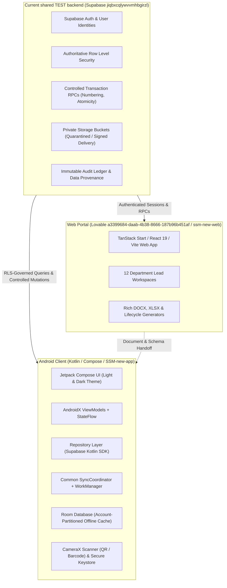
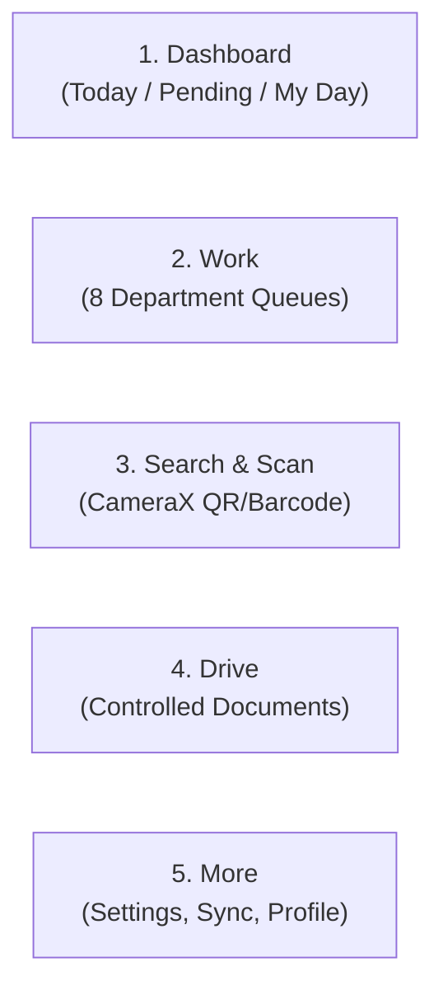
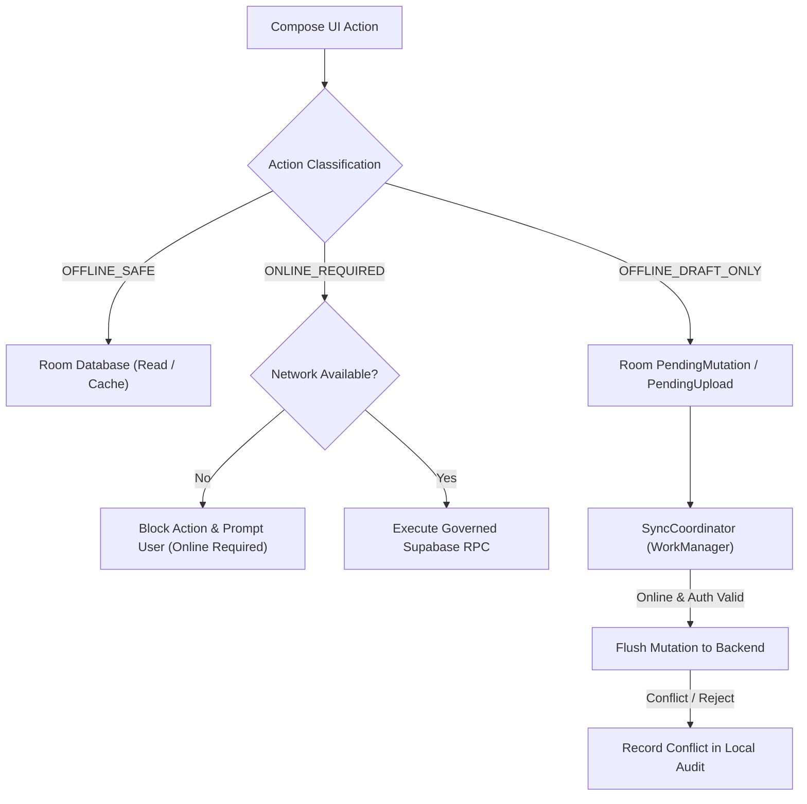
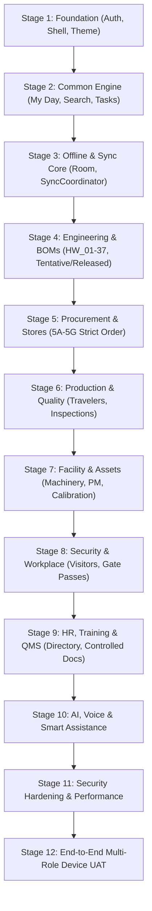

# SSM One Android Build Plan

**Updated:** 15 November 2026
**Scope:** Android-specific implementation and verification. Shared product requirements belong to the cross-platform master plan; this is not a second master plan.

**Target Repository:** `C:/Users/Admin/AndroidStudioProjects/SSM-new/SSM-new-app`

**Cross-platform Master Plan Reference:** [SSM-new root master plan](https://github.com/narendok/SSM-new/blob/main/SSM_ONE_MASTER_PLAN.md). The [detailed web implementation plan](https://github.com/narendok/ssm-new-web/blob/main/SSM_ONE_WEB_IMPLEMENTATION_PLAN.md) is a subordinate web handoff; Android-local copies are historical references.
**Product lifecycle reference:** [Electronics Multi-Track Lifecycle and APQP Roadmap](https://github.com/narendok/SSM-new/blob/main/Electronics%20Multi-Track%20Lifecycle%20and%20APQP%20Roadmap.md); consume the same project-pinned lifecycle/template and responsibility-matrix versions as web.
**Document catalogue:** [SSM One Document Catalogue](https://github.com/narendok/SSM-new/blob/main/SSM%20One%20Document%20Catalogue%20-%20Auto-Drafting%20Audit%20and%20Native%20Upload%20Rules.md); use this single shared family/revision source on both clients.
**Non-project operations reference:** [Departmental Special Features, Non-Project Workflows, Asset & Budget Master Specification](https://github.com/narendok/SSM-new/blob/main/References/SCMS%20%E2%80%94%20Departmental%20Special%20Features%2C%20Non-Project%20Workflows%2C%20Asset%20%26%20Budget%20Master%20Specification.docx); consume its reconciled shared requirements through the Master Plan and its Web/Android subplans.
**Backend handoff authority:** [`mobile_backend_contract.json`](../backend-handoff/mobile_backend_contract.json) records verified status and must be checked against the current deployed environment. [`stage5-remediation-20260924154357.sql.txt`](../backend-handoff/evidence/stage5-remediation-20260924154357.sql.txt) is source evidence only; it does not establish deployment. The former `MOBILE_BACKEND_CONTRACT.md`, `ANDROID_BACKEND_HANDOFF.md`, and `VERIFIED_MATERIAL_ISSUE_RETURN_CONTRACT_2026-09-27.md` links are stale/missing and are not authoritative.

## Current shared feature contract — 15 November 2026

The [SSM One Master Plan](https://github.com/narendok/SSM-new/blob/main/SSM_ONE_MASTER_PLAN.md) is the authority for shared product rules. The [Multi-Track Lifecycle roadmap](https://github.com/narendok/SSM-new/blob/main/Electronics%20Multi-Track%20Lifecycle%20and%20APQP%20Roadmap.md) owns detailed phases, stage/task mappings and scheduling; the [Document Catalogue](https://github.com/narendok/SSM-new/blob/main/SSM%20One%20Document%20Catalogue%20-%20Auto-Drafting%20Audit%20and%20Native%20Upload%20Rules.md) owns document families and draft/upload/revision rules. This plan owns only the Android-specific interaction and verification.

Android must provide the same authorized workflow outcomes and shared-record links as Web, while using a focused mobile layout. It must not copy Web page structure or maintain a separate source of truth.

| Shared feature | Android responsibility |
|---|---|
| People, department roles and assignees | Read saved organization settings and employee profiles. Resolve only the one exact L1 lead, L2 senior/specialist, L3 associate/technician or L4 operator/trainee profile selected for a task; one person may hold multiple department roles. Missing or multiple configured profiles, no eligible active holder, multiple holders, or level mismatch leaves the task unassigned for authorized resolution. Never use a level ladder, department-lead fallback, demo person, or name-based identity inference. |
| Project lifecycle, RACI and time/budget | Use the project's pinned TG-0–TG-9, stage, task and RACI revisions. Respect stage duration and feasibility task timelines; keep estimates, timer actuals, commitments and settled costs distinct. A timer does not complete work or approve a gate. |
| Department routines, assets, capacity and operating budgets | Consume backend-owned recurring tasks, due dates and alerts; never create a second device scheduler. Use the same canonical asset IDs across Inventory and Finance, showing authorized custodian/location, maintenance/calibration/AMC status and audit history. Show approved CapEx/OpEx requests, budget periods, utilization and sourced variance with forecasts, commitments and settled actuals separated. Missing finance inputs stay unknown. Use compact department summaries that deep-link into a routine task, asset, finance record or project bridge; do not recreate the Web project board. |
| HR and other sensitive non-project workflows | Provide only the internal HR actions supported by verified contracts and current role permissions. Keep candidate/employee identity, resume/ID files, compensation, legal records and confidential survey responses HR-scoped. Extraction is editable evidence for human review, never a hiring decision or employee identity update. Public career intake and complex question-bank/template administration remain Web-owned unless a separately accepted Android use case is defined. |
| Records, documents and approvals | Use the shared IDs, catalogue, source links and permissions. Support eligible auto-draft and original upload flows with Draft/review status; do not imply approval or release. Preserve attributable approval actions and history. For quotation-to-purchase-order conversion, preserve the exact source quotation ID/revision and rely on the shared server/database to revalidate current approval status plus canonical project/supplier parity at creation and approval/release; never treat a mobile snapshot check as authoritative. |
| Smart Upload and document ingestion | Follow the [shared ingestion contract](https://github.com/narendok/SSM-new/blob/main/SSM_ONE_MASTER_PLAN.md#multi-role-smart-upload-and-intelligent-document-ingestion) and its [detailed role/use-case specification](https://github.com/narendok/SSM-new/blob/main/References/SCMS%20Portal%20%E2%80%94%20Multi-Role%20Smart%20Upload%20%26%20Intelligent%20Document%20Ingestion%20Specification.docx). Android may launch upload from a role, task, stage or Docs Vault; keep one focused mobile flow for source preview, editable extracted fields, canonical-ID matching and human review. Preserve the original and provenance, and create only reviewed drafts/authorized records. Do not create a separate parser, role matrix or source of truth, and do not present upload as approval, stock posting or lifecycle completion. |
| Canonical linked masters | Read the same Customer, Supplier, Project, Part and Product IDs as Web. Resolve legacy references only on an exact, unambiguous master match; names and titles never establish identity. Keep Android link editing within the authorized backend contract and preserve unresolved historical links for review. |
| Inventory and other established features | Keep the complete authorized workflow, including category/department views, parts and harness tabs, quantities, receiving, assignment/issue, assets and audit views where permitted. A role or environment may restrict actions only according to server permissions; it must not silently replace the full view with a reduced fallback. Browser-local fixtures must be labelled as demo and must never appear as shared Android stock. |
| Mobile presentation | Keep each destination focused and concise; place cross-team summaries in the appropriate overview and reveal secondary detail on demand. Similar workflow and data connections are required; identical Web layout is not. |

All clients read and write the same authorized backend records and saved settings. Verify Android and Web separately for role access, stable-ID links, save/reload, and pinned-project behavior. Historical checkpoints below record what was observed at their dates; if an older checkpoint conflicts with this current contract or a linked shared owner, follow the current contract and verify before implementation. A plan link alone is not proof of deployed backend or cross-client parity.

**Shared TEST inventory data checkpoint — 14 November 2026:** the TEST organization contains 20 fictional canonical Part masters across eight categories, with explicit department-view metadata; the current Web screen can read those masters. Shared quantities, movements, GRNs and assignments do not exist yet. Android may consume the same Part IDs/metadata only after its own authenticated read is verified; local inventory quantities remain demo-only and must not be shown as Shared TEST stock. No Android code or device behavior is claimed by this checkpoint.

**Shared TEST catalog RPC checkpoint — 14 November 2026:** Web now reads those Part masters through the authenticated, read-only `get_shared_inventory_part_catalog()` RPC. The function returns approved catalog metadata only, denies anonymous execution, and returns no rows to viewer/client memberships. Its Shared TEST migration is recorded as `20261114112454`. Android should use the same canonical Part IDs and metadata only after a focused Android authenticated-read and permission check; do not reuse browser-local quantities, receiving, assignment or movement fixtures as shared stock. No Android implementation or device verification is claimed here.

**Project-to-Customer repair contract — 14 November 2026:** Web provides Admin/Sales-lead correction for draft Project Customer links through a searchable canonical Customer picker. The narrow Shared TEST RPC validates same-organization active Customer IDs, preserves source-Opportunity Customer identity, records an audit event, and changes no lifecycle fields. Android must not infer Customer links from titles or legacy labels; if this operation is later needed on mobile, use the same server contract and permission rules, then verify authenticated save/reload on Android separately. No Android code or mobile parity is claimed.

**Shared TEST inventory boundary — 14 November 2026:** current read-only inspection found no dedicated shared stock, stock-movement or goods-receipt ledger/RPC. The Web's restored full inventory workspace currently uses browser-local fictional items, quantities, receipts and assignments for demonstration. This sample does not sync to Android or Shared TEST. Android must not display it as live/shared stock; keep the complete layout available for local demo, and connect shared quantities/actions only after an authorized ledger contract and role checks are deployed and verified. No hosted inventory rows were changed for this note.

**Shared TEST inventory ledger checkpoint — 15 November 2026 (supersedes the preceding no-ledger checkpoint; Web UI updated 15 November):** Web migrations `20261114175021_shared_inventory_ledger` and `20261115014709_add_shared_inventory_category_samples` provide 22 canonical Part fixtures across eight categories and 22 clearly fictional opening balances. The additive `SSM-DEMO-INVENTORY-2026-11-v1.1` adds a second Packaging & Consumables sample and a second Production Tools sample for category/department-filter coverage; it does not rewrite previous fixtures. The Web shared tab reads these balances and connects role allocation, eligible PO receipt, QA hold/release, Admin adjustment, and allocation return/consume; the legacy full inventory tabs remain browser-local demo state. Server actions validate role/department permissions and quantities, and bind receipts to exact approved PO/supplier/Part lines. The live Shared TEST role registry still lacks its L1–L4 mapping, and Android has not been connected to or visually verified against this ledger. If mobile inventory is implemented, call the same server RPCs online with idempotency keys and authenticated role checks; never copy browser-local quantities into Android or imply sync until an Android save/readback test passes. These additions affect only explicitly fictional Shared TEST fixtures; no Production or real-stock rows were changed.

**Current Shared TEST deployment checkpoint (15 November 2026):** the `ssm-one-staging` migration ledger contains 76 entries, latest `20261115024154_archive_legacy_shared_test_demo_projects`. The latest migration exposes a Web Admin-only maintenance action for archiving exactly three reviewed fictional TEST Projects; it is not an Android feature and Android must not invoke or surface it. No project was archived by applying the migration. Shared TEST still has no saved L1–L4 department hierarchy mapping, so generated assignments must remain unresolved until Admin configures actual members; never use a name or default hierarchy fallback. Web can explicitly edit Customer, Project and Supplier associations in Shared TEST; changed Customer aliases validate against one active same-organization Customer, changed Project aliases validate against active same-organization visible Projects, and Supplier choices use canonical supplier IDs. Authenticated Web Admin save/readback for all three linked masters is verified on a synthetic Draft after register refresh and editor reopen. Android must preserve the same canonical identities, server permissions and backend rules with a focused mobile UI. Android link-edit UI and authenticated save/reload parity have not been verified. Follow the master rule and Web implementation plan; do not infer Android readiness from the shared deployment.

---

## Builder handoff: backend connection and schema (11 November 2026)

**Current connection verified on 11 November 2026:** Web `.env` and `.env.staging.local` both name `jiqbxcqlywvvmhbgirzl`. Supabase management reports this project (`ssm-one-staging`) ACTIVE_HEALTHY. Android now defaults to `ssmBackend=staging`, using the matching existing staging URL/key properties and `.staging` package. The older project remains an explicit legacy configuration; earlier historical audit sections naming it do not override this current target. No database was copied, renamed or promoted to production in this change.

**Deployment check:** The live migration ledger lists 32 entries through `department_workspace_responsibilities`. Source file `20261110090000_multi_department_lead_access.sql` is not listed by version or name. Many deployed timestamps differ from source filenames; compare names and actual definitions rather than assuming timestamp equality. Full schema parity and authenticated cross-client behavior remain unverified. Do not enable or claim multi-department access solely from source presence.
Read this section before implementing against the updated lifecycle. Existing contract snapshots are references, not proof that all new web features are deployed or available to Android.

| Item | Authoritative source / action |
| --- | --- |
| Shared backend contract | [Backend Contracts](../../../SSM-Planning/Backend%20Contracts.md), plus the [Android RPC/decoder snapshot](../backend-handoff/mobile_backend_contract.json). Check deployed arguments, responses and permissions before enabling actions. |
| Shared TEST / staging | `https://jiqbxcqlywvvmhbgirzl.supabase.co`; select explicitly with `-PssmBackend=staging` for local debug work. |
| Production configuration | `https://rzskhndweihuczbdhoxk.supabase.co`; Legacy environment, accessible only through explicit `-PssmBackend=production`; the normal Android default now uses the newer shared TEST database. |
| Connection configuration | [local.properties.example](../../local.properties.example) documents exact property names. Actual keys belong in ignored `local.properties`; obtain the matching publishable key from the authorized project configuration. Never use a service-role key in the app. |
| Schema and permissions source | [Web Supabase migrations](../../../ssm-new-web/supabase/migrations/) define schema evolution, RLS and RPCs. [Web generated types](../../../ssm-new-web/src/integrations/supabase/types.ts) assist navigation but must be checked against deployed schema. |
| Deployment status | Compare the selected project's actual migration ledger and function signatures with source. A source commit, passing build or browser-local demo does not prove deployment. Record the checked project, migration version and verification date in the existing backend contract when verified. |
| Authentication and roles | Use real authenticated TEST identities, organization membership and server permissions. Verify one lead with multiple configured roles/departments, allowed and denied actions, and RACI-driven assignments. Demo persona selection is not authentication. |
| Lifecycle/document inputs | Consume shared settings and project-pinned lifecycle/RACI revisions: phases 0–9, configured department stages and default tasks, document families, draft parameters, upload/storage references and approval state. Follow linked master/lifecycle/catalogue owners instead of duplicating definitions. |

Before claiming Android parity, verify a persisted staging round trip: create an enquiry on web, dispatch for configured feasibility review, read and act with the assigned authorized Android identity, refresh web, then verify the same IDs, assignments, approval state and document metadata. Project creation must follow reviewed feasibility and the accountable start decision. Check signed file access, original upload and stale/unauthorized action rejection. Browser-local web stage completion and later lifecycle progression remain unfinished; do not assume those have a deployed mobile contract.

Useful build entry point: `./gradlew.bat -PssmBackend=staging :app:assembleDebug` after supplying the staging publishable key. This handoff documents source configuration; no live database deployment or Android round-trip verification was performed while adding it.

## 1. Executive Purpose & Architectural Authority

The **SSM One Android Mobile Application** is the mobile companion for the SSM One enterprise platform; authenticated backend services remain authoritative for shared records and settings. It enables engineers, storekeepers, technicians, quality inspectors, facility managers, security guards, and executives to monitor authorized work, scan hardware/assets/lots, execute verified draft workflows, inspect document revisions, and perform controlled transactions from Android handheld devices and tablets.

### 1.1 System Authority Split



### 1.2 Non-Negotiable Architecture Rules

1. **Backend Owns Truth**: The Supabase backend owns users, profiles, employees, roles, permissions, projects, inventory stock, official numbering, and transaction atomicity. The Android client never creates local source-of-truth business tables (e.g. no `mobile_inventory`, no `mobile_purchase_orders`).
2. **Credential Boundary**: The APK receives strictly `SUPABASE_URL` and `SUPABASE_ANON_OR_PUBLISHABLE_KEY`. It never contains `service_role`, database passwords, JWT signing secrets, or private OAuth secrets.
3. **RLS Authorization**: Authorization is strictly enforced by backend Row-Level Security. Android never overrides or replaces backend RLS with client-side UI hiding or locally cached roles. An empty response from Supabase represents denied access.
4. **Controlled Mutation Atomicity**: Critical inventory, asset, and document state changes (Final GRN, Material Issue, Material Return, Stock Transfer, Stock Adjustment, Document Release) must invoke designated server RPCs with client-generated UUID `request_key` idempotency tokens. Critical mutations remain `ONLINE_REQUIRED`.
5. **Single Common Sync Engine**: All offline caching, mutation queues, and background synchronization must use the common `SyncCoordinator`, Room database, and WorkManager infrastructure. Feature-specific synchronization daemons (e.g., `GrnSyncWorker`, `InventorySyncWorker`) are strictly prohibited.
6. **Package Path Discipline**: Package paths must not use Kotlin reserved words (e.g. use `feature.stores.returns`, never `feature.stores.return`).

### 1.3 Mobile Companion vs. Web-Authoritative Architecture Philosophy & UI Uncluttering Strategy

The core architectural boundary of the SSM One ecosystem is defined by the operational principle:
> **"Mobile for Action on the Move; Web for Deep Authoring at the Desk"**

#### A. Mobile Companion Responsibilities (Fast, Thumb-Friendly, Action-Oriented)
The mobile application is deliberately designed as an agile operational companion for engineers, managers, inspectors, and storekeepers walking the plant floor or on the move:
1. **1-Tap Daily Task Approvals & Rejections**: Instant triage of pending operational assignments without traversing complex multi-level menus.
2. **Deal & Feasibility Review Sign-Off**: Sales and technical leads can review high-level feasibility criteria and provide decisive sign-offs from anywhere.
3. **Stage Gate Overview & APQP Freeze Reviews**: Real-time visibility into the shared fixed TG-0–TG-9 lifecycle, active stage bottlenecks, and gate prerequisite completion.
   - Provide a graphical, project-aware workflow view from the shared lifecycle and responsibility-matrix contract. Show the signed-in user's authorized department stages, subtasks, dependencies, cross-department handoffs, approval states, and rework routes; Admin may see the complete authorized project flow.
   - Render progress only from persisted backend state. Use accessible labels and lightweight transitions/animation; never imply an unrecorded task completion, handoff, approval, or synchronization.
   - Android is a mobile viewer and contract-approved action surface. Workflow template editing, department/RACI routing, dependency configuration, versioning, and impact review remain web-authoritative. Do not add a second Android workflow model or infer permission from a visual assignment.
4. **Fast QR / Barcode Scan & Instant Part Lookup**: High-performance CameraX scanner resolving MPN barcodes, reels, storage bins, lots, asset tags, and employee badges in milliseconds.
5. **Real-Time Inventory Search**: Instant multi-field component filtering by MPN, description, manufacturer, category, and bin coordinate.
6. **Receiving Draft Creation & Photo Proof**: Rapid receiving voucher capture with camera photo attachment directly at the goods receiving dock.
7. **Equipment Breakdown & Urgent Incident Logging**: 30-second ticket submission with machine stoppage timers and priority classification.

#### B. Web-Authoritative Responsibilities (Desktop Workbench & Deep Governance)
Complex, document-heavy, and financially sensitive tasks belong exclusively on the Web Enterprise Portal and must **never** be crammed into mobile screens:
1. **Multi-Section A4 PDF & Controlled Document Generation**: Full 38-family document catalogue drafting, revision authoring, cryptographic hashing, and printable compilation.
2. **Multi-Column Engineering BOM Spreadsheets**: 40-column hierarchical BOM grids, Mouser parametric stock crawlers, and bulk alternate component matching.
3. **Pricing Models, Margins & Commercial Negotiation**: Proprietary cost breakdowns, profit margins, volume discounts, and payment terms.
4. **Vendor Quotation Comparison Matrices**: Side-by-side RFQ evaluation across multiple suppliers.
5. **Database Schema Administration & RLS Provisioning**: Row-level security policies, database migration execution, and enterprise role provisioning.

#### C. Mobile UI Uncluttering Rules
- **No Cluttered Megatables**: Mobile screens must never render 50-field desktop spreadsheets or unpaginated 500-row data tables.
- **Separation of Disparate Concerns**: Features belonging to distinct operational departments (e.g., Plant Maintenance, Security Gatehouse, HR Staff Matrices) must not be dumped into unrelated screens like the Parts Inventory Register.
- **Progressive Disclosure**: Mobile displays summary status, key metrics, and primary action buttons upfront. Secondary technical specifications and audit logs are accessible via bottom sheets on tap.

---

## 2. Android Experience & UI Architecture

### 2.1 Five-Tab Navigation Framework

The application implements a predictable, thumb-accessible five-tab bottom navigation structure supplemented by a dynamic top operational bar:



1. **Dashboard (My Day)**:
   - Role-aware daily cockpit showing *Today's Tasks*, *Pending Actions*, and *Overdue Items*.
   - Filtered by the active presentation department, with quick links to assigned project cards and task checklists.
   - Honest metric presentation: unavailable or restricted metrics are clearly badged as *Restricted* or *Unavailable* rather than rendering dummy zeroes.
2. **Work (Departmental Operational Queues)**:
   - Primary operational surface exposing the 12 enterprise department workflows based on user permissions.
   - Filterable by department, status, project, and priority.
3. **Search & Scan**:
   - High-performance barcode and QR scanner using CameraX and ML Kit / ZXing.
   - Instantly resolves physical items to authoritative records: components (MPN), reels, storage bins, lots, asset tags, employee badges, travelers, and purchase orders.
   - Deep-linking engine navigates directly to the resolved entity detail screen.
4. **Drive (Controlled Documents & BOMs)**:
   - Scoped departmental document roots mirroring the web portal Drive taxonomy.
   - Exposes controlled document registers, revision timelines, version tags, and project BOM linkages.
   - Native read-only previewers for PDF, images, and tabular XLSX/BOM data.
5. **More (Administration & Connectivity)**:
   - User profile, department switcher (presentation alias, without privilege elevation).
   - Sync Coordinator center: visual status of pending offline drafts, sync logs, cache size, network health.
   - App settings, theme toggle (Light / Dark / System default).

### 2.2 Dark Mode & Material 3 Theming

The application adheres to Material Design 3 with comprehensive Light and Dark theme implementations that visually align with the SSM One web portal:

- **Dynamic Theme Palette**:
  - Light Palette: High-contrast slate and industrial blue accents, clean white/gray surfaces (`#F8FAFC`, `#FFFFFF`), subtle borders (`#E2E8F0`).
  - Dark Palette: Deep charcoal surfaces (`#090D16`, `#111827`, `#1E293B`), subdued text tones (`#F1F5F9`, `#94A3B8`), and vibrant indicator accents for active, warning, and success states.
- **Theme State Management**: Integrated into `Theme.kt`, observing system theme changes and providing an explicit user override stored in encrypted preferences.

### 2.3 Governed Inventory Experience & Fast Search Architecture
In accordance with the uncluttering strategy, the mobile inventory experience (`GovernedInventoryScreen.kt`) is strictly focused on stores and material execution:
1. **Instant Real-Time Search**: An `OutlinedTextField` search bar embedded directly in `PartsRegisterTab` allows continuous filtering across MPN, description, manufacturer, category, storage location, and bin coordinates without modal friction.
2. **Clear Feedback & Zero-States**: Provides dynamic matching counts (`X parts found`), a 1-tap clear button (`✕`), and an informative empty state when search criteria yield no matches.
3. **Separation of Unrelated Domains**: Plant maintenance work orders, security gatehouse passes, and HR skill matrices are decoupled from the physical electronic components register and routed to their dedicated departmental surfaces.

### 2.4 Unified Test Persona & Authentication System (Shared Web & Android User Base)
To guarantee seamless, friction-free QA and executive demonstrations across platforms, the Android app shares the identical demo persona registry and test credentials as the web portal:
1. **1-Click Demo Persona Grid**: `AuthDialog.kt` provides a responsive quick-selection grid representing all 14 enterprise personas (Executive Admin, Tata Motors OEM client, and all 12 department leads). Tapping any persona chip auto-populates credentials and authenticates immediately.
2. **Dual-Mode Authentication**:
   - **Online Mode**: Authenticates against Supabase Cloud `/auth/v1/token?grant_type=password`.
   - **Offline / Local Demo Mode**: Gracefully issues a fully compliant local `AuthSession` populated with the persona's authentic full name, role title, and department code.
3. **Automatic Role & Signature Synchronization**: Successful login immediately dispatches `scmsRepository.switchRole(role)`, synchronizing the active actor name, authority permissions, and signature lines across the entire application.

---

## 3. Departmental Coverage & Mobile vs. Web Responsibilities Matrix (14 Entities)

The SSM One ecosystem provides unified operational coverage across 14 distinct roles and departments (Executive Admin, Tata Motors OEM Client, and 12 Enterprise Departments). Each department follows the strict separation between **Mobile Companion (pocket action)** and **Web Portal (desktop authoring)**:

### 3.0 Cross-Department Responsibility & Boundary Matrix

| # | Department Code & Name | Mobile App Scope (Action on the Move) | Web Portal Scope (Authoring & Administration) | What is Excluded from Mobile to Prevent Clutter |
| :- | :--- | :--- | :--- | :--- |
| **1** | **ADMIN** (Executive Command / MD) | • Critical Stage Gate 1–9 freeze sign-off<br>• High-value deal & CapEx approvals<br>• Cross-department bottleneck alert summary | • Enterprise settings & global policy authoring<br>• Master organization structure & permissions<br>• Comprehensive audit trail investigation | Raw SQL consoles, database migration tools, low-level server configuration |
| **2** | **CLIENT** (Tata Motors OEM Portal) | • Stage milestone acceptance & feedback<br>• Prototype dispatch delivery confirmation<br>• High-level project timeline overview | • Formal contract & statement of work (SOW) review<br>• Change request formal submission & negotiation<br>• Full engineering compliance dossier inspection | Internal cost breakdowns, proprietary supplier vendor lists, raw margins |
| **3** | **SAL** (Sales & Business Development) | • 1-tap Feasibility Review sign-off<br>• Stage 1 & 2 Deal approvals<br>• Customer contact directory & pipeline stage | • Detailed quotation authoring & price breakdown<br>• Commercial contract draft & redlining<br>• Profit margin and volume tier calculations | Financial margin spreadsheets, multi-page customer contract text editors |
| **4** | **EHW** (Hardware Engineering) | • Component inventory search & bin location<br>• Stock match review (Available vs Shortage)<br>• 1-tap schematic & layout review sign-off<br>• ECR / ECO approval queue | • Multi-sheet schematic & Gerber authoring<br>• Full 40-column BOM engineering spreadsheet<br>• Component alternative parametric comparison<br>• Thermal & signal integrity reports | Heavy CAD schematic viewers, massive 500-line unformatted BOM tables |
| **5** | **FW** (Firmware Engineering) | • Build approval & release gate review<br>• Flash programming checklist sign-off<br>• Bootloader version verification badge | • Git commit history & PR diff review<br>• Memory map & register configuration matrices<br>• Static analysis & MISRA compliance logs | In-app code editors, hex dump inspections, terminal build consoles |
| **6** | **SW** (Software Engineering) | • Daily task approval & board overview<br>• Mobile app & Cloud release sign-off<br>• API deployment status badge | • Database schema & API endpoint configuration<br>• Cloud architecture diagram authoring<br>• Deep telemetry & error log drill-down | Full API payload builders, complex database migration consoles |
| **7** | **MECH** (Mechanical Engineering) | • Enclosure fit & 3D sample sign-off<br>• Photo upload of physical test prototypes<br>• Tooling trial review approvals | • 3D CAD STEP/IGES model rendering & analysis<br>• Mold design tolerance & shrinkage spreadsheets<br>• CMM inspection coordinate reports | Heavy 3D WebGL CAD viewers, detailed dimension spreadsheets |
| **8** | **PUR** (Purchasing & SCM) | • Urgent PO sign-off & escalation queue<br>• Receiving draft creation via ASN barcode scan<br>• Part shortage alert review | • Vendor quotation comparison matrices<br>• Supplier payment terms & banking administration<br>• Global shipping & freight customs documentation | Vendor bank setup, multi-vendor pricing matrices, raw PO tax calculation |
| **9** | **QA** (Quality Assurance & APQP) | • IQC receiving inspection pass/hold tag<br>• Rapid defect logging with camera photo<br>• Stage-gate freeze sign-off & PPAP checklist | • 8D root-cause investigation authoring<br>• Full PFMEA / DFMEA risk priority matrix<br>• Gauge R&R and statistical process control (SPC) | Complex 50-row FMEA spreadsheets, statistical curve generators |
| **10** | **EMF** (Electronics Manufacturing) | • SMT reel barcode scan & feeder assignment<br>• Work traveler check-in / step completion<br>• Stencil wipe & reflow oven checklist sign-off | • SMT pick-and-place coordinate programming<br>• Production yield & scrap statistical trend charts<br>• Line balance & cycle time optimization models | Machine G-code / placement file loaders, cycle time simulation |
| **11** | **MMF** (Mechanical Manufacturing) | • CNC / stamping machine status toggle<br>• Rapid breakdown ticket logging<br>• Tool wear & lubrication daily check | • Tooling lifespan & sharpening lifecycle tracking<br>• Preventive maintenance master schedule<br>• Vendor spare parts procurement schedule | Master facility Gantt charts, deep machine telemetry diagnostics |
| **12** | **FIN** (Accounts & Finance) | • Capital expenditure (CapEx) PO approval<br>• Invoice payment release authorization<br>• Daily project budget burn summary | • General ledger reconciliation & balance sheet<br>• GST / Tax audit filings & e-invoicing<br>• Comprehensive project P&L and cash flow reports | Ledger account mapping, double-entry journal forms, tax returns |
| **13** | **SIT** (Service & IT Infrastructure) | • Urgent server/network outage alert push<br>• Physical asset quick scan & audit tag<br>• Security badge & laptop check-out | • Network topology & firewall rule management<br>• Active Directory / SSO provisioning console<br>• Cloud server infrastructure cost dashboards | Cloud CLI consoles, firewall routing tables, SSH terminals |
| **14** | **HROPS** (HR & Operations) | • Urgent leave request approval<br>• Operator station qualification scan<br>• Incident / safety hazard quick report | • Monthly payroll computation & deductions<br>• Full employee training & competency matrix<br>• Statutory compliance & labor law documentation | Full payroll spreadsheets, confidential salary review grids |

The Android app provides operational mobile clients for all enterprise departments:

```mermaid
graph TD
    SAL["SAL · Sales & Business Development"]
    EHW["EHW · Embedded Hardware"]
    FW["FW · Firmware"]
    SW["SW · Cloud & Application Software"]
    MECH["MECH · Mechanical Engineering"]
    PUR["PUR · Purchasing & SCM"]
    QA["QA · Quality Assurance & APQP"]
    EMF["EMF · Electronics Manufacturing"]
    MMF["MMF · Mechanical Manufacturing"]
    FIN["FIN · Accounts & Finance"]
    SIT["SIT · Service & IT"]
    HR["HR/OPS · HR & Operations"]
```



### 3.1 Sales & Customer Intake
- **Mobile Scope**: Read-only commercial pipeline, active customer directories, assigned enquiries, and feasibility review status.
- **Key Tables**: `customers`, `customer_contacts`, `customer_requirements`, `customer_requirement_revisions`, `customer_portal_shares`.
- **Boundaries**: Customer quotations, pricing models, and contract signing remain web-authoritative. Mobile displays operational project links without exposing confidential financial margins.

### 3.2 Hardware & R&D (Engineering & BOM Management)
- **Mobile Scope**:
  - Project repository exploration (`projects`, `project_members`, `project_process_stage_records`).
  - Company Process Stage Tracking (Taxonomy HW_01 to HW_37) with predecessor lock indicators and evidence links.
  - **Tentative BOM vs. Released BOM Inspection**:
    * Full line-level stock match status (Exact Match, Substitute Available, Shortage, Unstocked).
    * Alternate component review rationale and datasheet links (`datasheet_cache`).
    * Revision comparison between Draft/Tentative engineering BOMs and Released production BOMs (`project_boms`).
  - Engineering Changes: Review active ECR/ECO records, linked tasks, and impacted parts.

#### Project Lifecycle & Multi-Track Stage View

- Present a project-scoped overview phase timeline with applicable EHW, FW, SW, MECH, QA/certification, EMF/MMF, and shared-function gates. Multiple tracks may be active in parallel; do not force one serial all-department queue.
- Show the four-level hierarchy (project phase → track gate → substage/work package → task/checklist), multi-predecessor dependencies, blocked-by reason, pending handoff, evidence and authorized decision status.
- The department workspace shows that department's applicable stages and subtasks for the selected project; authorized Executive Admin sees the full project view. The selector uses stable project identity and respects record-level permissions.
- An animated stepper may aid navigation but must have an equivalent accessible text/table view and reduced-motion support. Progress and gate state derive from shared records, never from the animation or a local demo task.
- Pin the lifecycle and responsibility-matrix versions used by the project. A later configuration change cannot silently rewrite historical gates or approvals.
- **Backend gate:** this view is read-only until a verified shared lifecycle projection and authenticated authorization contract exist. Deployment and authorization must be verified per environment; the current Stage 5 inventory foundation is absent. Show an explicit unavailable state instead of sample status presented as live.

### 3.3 Procurement & Stores (Stage 5 Detailed Delivery)
Procurement and Stores follow the strict staged execution sequence (5A through 5G):

> **Deployment gate (2026-10-31):** Stage 5 is a product scope/implementation plan, not a claim of backend readiness. A read-only Lovable audit on Android's configured TEST target `rzskhndweihuczbdhoxk` reports the five stock RPCs and two receiving views absent. Its preflight also reports all 13 required procurement/inventory base tables and four permission/numbering helper functions absent, so the archived September SQL cannot be applied as-is. The archive also permits a null `create_grn` idempotency key and defines a `SECURITY DEFINER` request-result helper without an explicit PUBLIC/anon execute revocation or caller authorization check; require a security review and corrected contract. The separate Supabase management connector lacks access to this project; the stale handoff still names `yyrvduosyyaluifqvwkr`. Android posting methods remain disabled. Establish/restore the canonical base schema and migration ownership, then deploy reviewed contracts through a supported migration path, verify signatures/grants/RLS, and pass authenticated-session tests before implementation. See [`mobile_backend_contract.json`](../backend-handoff/mobile_backend_contract.json).

- **5A — Procurement Read-Only**:
  - Safe operational projections: `operational_purchase_requests`, `operational_purchase_request_items`, `operational_rfqs`, `operational_po_shipments`, `operational_vendors`.
  - Excludes unit costs, margins, payment terms, and vendor bank accounts.
- **5B — Receiving Drafts**:
  - Scan PO barcode or ASN to load expected items via `operational_receiving_purchase_orders`.
  - Component verification: MPN scanning, lot number, batch code, date code, reel ID, packaging condition, MSL/ESD flags.
  - Photo evidence capture attached to local draft receiving vouchers.
  - Drafts saved locally in Room; strictly no offline Final GRN posting.
- **5C — Inventory Read-Only**:
  - Component search by MPN, manufacturer, description, category, or bin location (`components`, `inventory_lots`, `storage_locations`).
  - Stock visibility categorized as Available, Quality Hold / Quarantine, or Reserved.
  - Explicit *Cached / May-be-outdated* freshness timestamp on every stock screen.
- **5D — Material Issue & Return**:
  - Material Issue: Online posting via `post_material_issue` against valid project work orders.
  - Material Return: Online posting via `post_material_return` (package `feature.stores.returns`), preventing over-return atomically.
- **5E — Cycle Counts & Blind Picking**:
  - Assigned cycle count sheets with blind count support (system stock quantity hidden from count operator).
  - Pick list execution with barcode confirmation per line.
- **5F — Final GRN & Critical Stock Transactions**:
  - Online-only execution of `create_grn`, `post_stock_transfer`, and `post_stock_adjustment`.
  - Enforces client UUID idempotency tokens, server numbering, row-locking concurrency, and immutable audit logs.
- **Review-Based Import / Draft Handling**:
  - When PO or invoice data is scanned or imported from external supplier manifests, records are placed into a *Draft Review Queue*.
  - No inventory stock movement occurs until formally approved and received through the controlled receiving inspection gate.

### 3.4 Production & Quality
- **Mobile Scope**:
  - Traveler & Work Order Execution: `work_orders`, `production_routes`, `routing_steps`, `production_units`.
  - Step check-in/check-out with operator badge scan.
  - Quality Inspection: In-process and final inspection checklists (`inspection_records`, `ncr_records`).
  - Defect logging with camera photo evidence and quarantine tagging.
  - PPAP / First Article Inspection review summaries and dispatch packaging verification.

### 3.5 Facility, Assets & Maintenance
- **Mobile Scope**:
  - Asset Directory & Quick Scan: `assets`, `asset_categories`, `asset_assignments`.
  - Machinery Registers: Operating state, maintenance history, and assigned operators.
  - Preventive Maintenance (PM): Scheduled PM checklists with step-by-step sign-off and photo upload.
  - Breakdown Work Orders: Rapid breakdown ticket creation with priority rating, machine stoppage timer, and technician dispatch.
  - Calibration Logs: Measuring equipment calibration dates, certificate inspection, and out-of-calibration warnings (`calibration_records`).

### 3.6 Security & Workplace
- **Mobile Scope**:
  - Gatehouse Cockpit: Visitor check-in/check-out with badge generation (`visitor_logs`).
  - Material Gate Pass Verification: Inward and outward pass scanning against approved store transfers (`gate_passes`).
  - Vehicle Logistics: Truck entry/exit logging, driver details, and loading bay assignment.
  - Workplace Incident Reports: Hazard identification, injury reporting, and facility security patrols.

### 3.7 HR, Training & Management
- **Mobile Scope**:
  - Organization Directory: Department employee list with contact shortcuts (`employees`, `departments`).
  - Training & Competency Matrix: Verification of operator certifications before authorizing specialized machinery operation.
  - Personal Workspace: Leave application status, assigned training modules, and policy acknowledgements.

### 3.8 Operations & QMS (Quality Management System)
- **Mobile Scope**:
  - Controlled Document Viewer: RLS-governed access to company SOPs, manuals, work instructions, and specifications (`document_control_registers`, `document_control_events`).
  - Audit Trail Timeline: Real-time inspection of document revisions and change histories.
  - Audit & CAPA Inspection: Internal audit checklists, corrective action tracking, and KPI dashboard monitoring.

---

## 4. Offline Engine & Sync Architecture



### 4.1 Action Classification Rules

Every user action in the mobile app is strictly classified:

| Classification | Meaning | Examples |
|---|---|---|
| `OFFLINE_SAFE` | Read-only operations against cached Room tables. Stale indicators are displayed. | Browsing downloaded SOPs, reviewing cached component lists, viewing project directories. |
| `OFFLINE_DRAFT_ONLY` | Data entry that creates a local draft. Never changes server state until synced and verified online. | Receiving draft vouchers, cycle count observations, breakdown reports, visitor entries, inspection checklists. |
| `ONLINE_REQUIRED` | Cannot be performed offline. Must execute synchronously against Supabase with server-side validation and locking. | Final GRN creation, Material Issue, Material Return, Stock Transfers, Stock Adjustments, Document Release. |

### 4.2 Room Partitioning & Security

- Room database schemas are isolated per authenticated user account (`account_id` column on all cached tables).
- Logging out or switching accounts flushes uncommitted non-draft caches and resets repository state.
- Sensitive credentials, auth tokens, and session keys are kept exclusively in Android EncryptedSharedPreferences (backed by Android Keystore), never in plain Room tables.

---

## 5. Technical Implementation Stack & Directory Structure

### 5.1 Android Technology Stack

- **Language**: Kotlin 2.0+ (100% Kotlin, Coroutines, Flow).
- **UI Toolkit**: Jetpack Compose + Material 3, Navigation Compose.
- **Architecture**: Clean Architecture (Presentation → Domain → Data) + MVI / Unidirectional Data Flow.
- **Backend SDK**: Supabase Kotlin Client (`gotrue-kt`, `postgrest-kt`, `storage-kt`, `realtime-kt`).
- **Local Persistence**: Androidx Room with SQLite KSP compiler.
- **Background Work**: Androidx WorkManager with CoroutineWorker.
- **Hardware Integration**: CameraX (preview & image analysis), ML Kit Barcode Scanning / ZXing.
- **Dependency Injection / Factory**: Lightweight Repository & ViewModel providers adhering to Android lifecycle guidelines.

### 5.2 Source Code Directory Layout

```text
app/src/main/java/com/example/ssmapplication3/
├── MainActivity.kt                      # App entry point, theme provider, root navigation
├── core/
│   ├── auth/                            # Session manager, secure token storage, Google OAuth
│   ├── network/                         # SupabaseClientProvider, error parsers, interceptors
│   ├── security/                        # Capabilities, permission checkers, device security
│   ├── sync/                            # SyncCoordinator, PendingMutation, WorkManager workers
│   ├── ui/                              # Common Compose components, status badges, dialogs
│   └── util/                            # Environment config, Flow helpers, date formatters
├── data/
│   ├── local/                           # Room database, DAOs, local entity models
│   └── repository/                      # Repository implementations connecting Supabase & Room
├── domain/
│   ├── model/                           # Pure Kotlin business models & domain entities
│   └── repository/                      # Domain repository interfaces
├── feature/
│   ├── auth/                            # Sign-in screen, SSO callback, session restore
│   ├── dashboard/                       # My Day cockpit, today/pending checklists
│   ├── documents/                       # Drive document browser, controlled register viewer
│   ├── engineering/                     # Projects, BOM dual-lifecycle, stage tracking HW_01-37
│   ├── facility/                        # Asset register, PM checklists, breakdown reporting
│   ├── inventory/                       # Component lookup, lot/reel details, stock freshness
│   ├── mywork/                          # Unified work queue across permitted departments
│   ├── notifications/                   # Notification center, alert routing
│   ├── procurement/                     # PR, RFQ, PO, shipment tracking (safe projections)
│   ├── production/                      # Travelers, work orders, routing inspection
│   ├── receiving/                       # Receiving draft vouchers, PO item matching
│   ├── scanner/                         # CameraX barcode/QR scanner, deep-link resolver
│   ├── security/                        # Visitor logging, gate passes, vehicle registers
│   └── stores/                          # Critical stock transactions
│       ├── adjustments/                 # Stock adjustments (ONLINE_REQUIRED)
│       ├── issues/                      # Material issue posting (ONLINE_REQUIRED)
│       ├── returns/                     # Material return posting (ONLINE_REQUIRED)
│       └── transfers/                   # Stock transfers (ONLINE_REQUIRED)
├── navigation/                          # AppNavigation, Screen routes, DeepLinkHandler
└── ui/theme/                            # Color, Theme (Dark/Light), Type, Shape
```

---

## 6. Authoritative Handoff Contract Index

The Android client directly implements data structures and calls corresponding to the generated backend specifications:

| Backend Contract Artifact | Purpose & Android Mapping |
|---|---|
| [`mobile_backend_contract.json`](../backend-handoff/mobile_backend_contract.json) | Complete machine-readable catalog of all 180+ tables, foreign keys, columns, RPC signatures, and bucket paths. |
| [`mobile_backend_contract.json`](../backend-handoff/mobile_backend_contract.json) | Machine-readable schema inventory and current source/deployment/Android status; catalog entries alone do not prove live signatures or permissions. |
| [`stage5-remediation-20260924154357.sql.txt`](../backend-handoff/evidence/stage5-remediation-20260924154357.sql.txt) | Archived source SQL for Stage 5. It is not deployment proof or a verified live contract. |
| [`LIFECYCLE_ANDROID_READ_CONTRACT_2026-10-02.md`](../backend-handoff/LIFECYCLE_ANDROID_READ_CONTRACT_RENDERED_2026-10-03.txt) | Specification for displaying HW_01–HW_37 stages, department templates, and dependency chains. |
| [`VERIFIED_SAFE_PROCUREMENT_CONTRACT_2026-09-26.md`](../backend-handoff/VERIFIED_SAFE_PROCUREMENT_CONTRACT_2026-09-26.md) | Contract for `operational_*` safe views omitting financial/commercial data. |
| [`SSM_ONE_WEB_TO_MOBILE_BACKEND_HANDOFF_REPORT.md`](../evidence/SSM_ONE_WEB_TO_MOBILE_BACKEND_HANDOFF_REPORT.md) | Historical handoff report, superseded where it conflicts with the current backend snapshot. |

---

## 7. Stage-by-Stage Implementation Roadmap

The mobile roadmap is organized into 12 controlled stages. Progress adheres to the strict engineering discipline: **INSPECT → IMPLEMENT → COMPILE → TEST → BUILD → DEVICE VERIFY → EVIDENCE → CONTINUE**.



### Stage 1: Foundation (COMPLETED / VERIFIED)
- Supabase auth integration (Email/Password, Google OAuth).
- Session manager with encrypted token storage.
- Navigation shell with 5-tab scaffold and top bar.
- Material 3 Theme foundation with Dark Mode and Light Mode support.

### Stage 2: Common Engine (COMPLETED / VERIFIED)
- Role-aware Dashboard / My Day cockpits with Today and Pending tasks.
- Unified task repository querying `project_tasks` partitioned by department.
- Deep link resolution foundation and notification badges.

### Stage 3: Offline & Sync Core (COMPLETED / VERIFIED)
- Room database schema with account isolation.
- Common `SyncCoordinator` handling draft queues (`PendingMutation`, `PendingUpload`).
- Network connectivity monitor and conflict resolution handlers.

### Stage 4: Engineering & R&D Workspace (IN PROGRESS / ACTIVE REFINEMENT)
- Project directory and project team exploration.
- Hardware process stages (HW_01 to HW_37) with predecessor lock indicators.
- **Tentative BOM vs Released BOM Inspection**:
  * Line-by-line stock match visualization (Exact, Substitute, Shortage).
  * Mouser component enrichment view (MPN, package, datasheet link).
  * Revision comparison between draft/tentative engineering BOMs and approved released production BOMs.
- Engineering Change Requests (ECR) and ECO impact review.

### Stage 5: Procurement, Stores & Receiving (STRICT 5A–5G SEQUENCE)
- **Current delivery status:** Planned scope only. The 2026-10-31 read-only backend audit plus project-info check confirmed that the required Stage 5 stock RPCs and receiving views are absent from Android's configured TEST backend. Keep Android posting and receiving-view calls disabled until live deployment and session acceptance are evidenced in `mobile_backend_contract.json`.
- **5A (Procurement Read-Only)**: PR, RFQ, PO, ASN, Vendor list using `operational_*` safe projections.
- **5B (Receiving Draft)**: PO/ASN selection, CameraX barcode scan matching, lot/batch/reel capture, draft voucher storage.
- **5C (Inventory Read-Only)**: MPN stock search, bin location lookup, stock freshness timestamps.
- **5D (Material Issue & Return)**: Online posting via `post_material_issue` and `post_material_return`.
- **5E (Cycle Counts & Picking)**: Blind count execution, pick lists with line-by-line verification.
- **5F (Final GRN & Critical Stock)**: Target online-only flows are `create_grn`, `post_stock_transfer`, and `post_stock_adjustment`; archived SQL is not a deployed contract, and the archived `create_grn` signature permits a null idempotency key.
- **5G (Integration & Acceptance)**: End-to-end scanner, notifications, and regression test suite.

### Stage 6: Production & Quality Assurance
- Route station tracking and electronic travelers.
- Component lot traceability during assembly.
- In-process inspection, NCR creation with photos, PPAP sign-offs.

### Stage 7: Facility, Assets, Maintenance & Calibration
- Asset QR scanning and metadata cards (`assets`).
- Machinery operational state and breakdown ticketing.
- Preventive maintenance schedules with step checklists.
- Instrument calibration validity and certificate viewing (`calibration_records`).

### Stage 8: Security, Visitors & Workplace Logistics
- Gatehouse visitor check-in, pass generation, and host notifications.
- Material gate pass verification (inward / outward).
- Loading bay vehicle logs and incident report logging.

### Stage 9: HR, Training & Controlled Documents (QMS)
- Department staff directory and contact integration.
- Operator skill matrix verification.
- Controlled Document Register: RLS-permitted viewing of SOPs, manuals, and revision timelines.

### Stage 10: AI, Voice & Mobile Automation
- Voice-assisted inventory lookup and notes transcription.
- Intelligent scanner recognition for damaged packaging or illegible supplier labels.
- Scoped AI assistant answering procedural questions against cached SOPs.

### Stage 11: Security Hardening, Performance & Recovery
- Memory optimization and list virtualization for large BOMs and component catalogs.
- Safe file handling, sandboxed PDF rendering, and zero-cache leakage on logout.
- ProGuard / R8 code shrinking and security audit.

### Stage 12: End-to-End Multi-Role Acceptance Testing
- Live testing on physical Android devices across distinct test identities (Engineer, Storekeeper, Inspector, Manager).
- Verification of parity between web changes and mobile viewports.
- Full regression passing `:app:testDebugUnitTest` and clean `:app:assembleDebug` packaging.

---

## 8. Verification & Execution Gates

Every implementation increment must provide documented evidence meeting these gates before marking complete:

1. **Static & Syntax Gate**: `:app:compileDebugKotlin` exits with code `0`.
2. **Unit Test Gate**: `:app:testDebugUnitTest` passes all unit tests across data, domain, and ViewModels.
3. **Packaging Gate**: `:app:assembleDebug` successfully produces a valid debug APK.
4. **Device / Emulator Gate**: Verified on an Android emulator or physical device; screenshot or CLI log preserved in `docs/evidence/`.
5. **Contract Conformance Gate**: Network calls must conform strictly to `mobile_backend_contract.json` without inventing endpoints, columns, or tables.


Company-name anonymization: current repository display labels, planning/reference snapshots and synthetic examples use XYZ Pvt Ltd. Live business records, identities, backend configuration, official document codes and published Git history were not changed. Sanitized schema/reference text is not a claim of an altered installed database. Image/binary contents and historical commits require separate review; a source sync is not deployment.


## 9. Web Cross-Department Audit and Android Acceptance Dependencies — 19 October 2026

### 9.1 Status qualification

This is a documentation/handoff update, not an Android implementation or device verification. Existing stage/build claims above describe historical checkpoints; they do not prove current live integration. No Kotlin, Gradle, APK or backend changes were made for this update, and Android tests/build were not rerun for documentation alone.

The [SSM-new root master plan](https://github.com/narendok/SSM-new/blob/main/SSM_ONE_MASTER_PLAN.md) is the cross-platform authority. The [web implementation plan](https://github.com/narendok/ssm-new-web/blob/main/SSM_ONE_WEB_IMPLEMENTATION_PLAN.md) contains current web-specific requirements and status. Older web verification is retained as dated evidence; it does not certify Android behavior or shared server persistence. [Web browser evidence](https://github.com/narendok/ssm-new-web/blob/main/docs/evidence/DEPARTMENT_SCOPE_FIX_2026-10-19.md).

Live Lovable inspection found no enabled sign-in method and no organization/users or operational rows in the inspected core tables. Real organization identity and first administrator work email are required for secure provisioning; no passwords belong in plans/chat. The user approved narendok/ssm-new-web main on 19 October; web fixes and the web plan were pushed through 3403586 and received by Lovable. Live-preview Service task navigation and Finance approval scoping passed. This resolves the earlier automatic-review push block. Production publishing and Android remote sync were not performed.

### 9.2 Required Android parity checks (pending, not implemented by this plan)

| Area | Required mobile behavior | Dependency / acceptance evidence |
|---|---|---|
| Trusted identity and department | Resolve organization, department and capabilities from authenticated protected membership. Cover SAL, EHW, FW, SW, MECH, PUR, QA, EMF, MMF, FIN, SIT and HR/OPS. TST/EOL testing is a production function with QA oversight, not an active department. | Verified Auth/RLS contract; separate authorized identities. Preview roles are never operational authority. |
| My Day / Tasks / deep links | Open the actual assigned queue and task; preserve project, due date and source fields on reassignment/update. Empty and denied states are explicit. | Verified task projection/mutation; device navigation and reload tests. |
| Projects and team | Show authorized linked projects and relevant department roster. A general directory/filter must not widen access beyond server permissions. | Protected project/roster reads, cross-department denial and correct detail destinations. |
| Approval / rework / notifications | Only designated signers act; pending gates block completion. Server rechecks current state, records rationale/audit, rejects duplicate or stale decisions, and notifies the requester. | Verified online transaction; web-to-mobile and mobile-to-web round trips on independent sessions. |
| Documents and references | Use actual project sources, correct document type/revision/reference target, and explicit missing fields. Unissued local drafts remain drafts; client release needs recipient grant. | Verified controlled-document contract, private signed links, expiry and denial tests. No synthetic certification/signature accepted as evidence. |
| Client boundary | Deny internal index, financial/HR detail and unreleased files unless explicitly authorized by the canonical backend. Filename/type matching is not an access grant. | Server projection/field stripping and negative access tests. |
| Session/cache isolation | Sign-out removes session and account-scoped sensitive cache; never fall back to Admin. Another login must not inherit cached role data. | Logout, expiry, user-switch, offline-cache and deep-link tests. |
| Lifecycle / floor work | Display authoritative predecessor gates and actual inspection/BOM/build/test/dispatch/service evidence. Keep simulation isolated and labeled. | Verified lifecycle contracts; stock/release actions remain ONLINE_REQUIRED and fail closed. |

### 9.3 Execution order and release gate

1. Web/backend owner confirms environment, organization/admin, authentication, canonical schema, RLS and private storage; supplies versioned verified contracts under docs/backend-handoff. Do not infer a migration was deployed from repository files.
2. Android owner maps existing repositories/models to those contracts, preserving Stage 5A–5G order and the common SyncCoordinator. Do not create a competing backend or enable transactions from browser-local web behavior.
3. Implement and test each affected operation only after its contract is verified. Keep unavailable operations disabled with a clear reason. Official numbering, stock, approvals and releases remain authoritative server operations.
4. Run compile, unit tests and debug packaging after source changes; verify on device/emulator. Capture per-role results and negative tests under docs/evidence. Historical test counts are not evidence of this new run.
5. Complete an authenticated web/mobile lifecycle round trip with actual persisted records and source-backed documents. Final acceptance remains pending until this evidence exists; neither a plan update nor a working web demo closes Android release gates.

#### 9.3.1 Current source checkpoint — 30 October 2026

This is a source audit, not device acceptance. The existing checkout is at `b572ba7` and includes uncommitted S10 model/test changes. `AppShell` routes authenticated Team & Chat and several authenticated department record sections through the generic `SharedBusinessScreen`; unauthenticated mode uses the original Compose screen. Two misleading demo cues were removed: the shell no longer says “Synced” without a successful shared-workspace read, and the authenticated workspace no longer labels itself “Shared TEST.” The status now distinguishes local demo, sign-in, loading cloud data, successful cloud read, failed cloud read and not-connected states; it does not claim live network monitoring. A1 still needs to restore original Compose presentation through typed adapters; data scope, account roles, device navigation, offline recovery and web/mobile round trips remain unaccepted. Preserve the active signer and app data; current device access must be restored before in-place installation can be confirmed.

#### 9.3.2 Contract-backed project review increment

Android now exposes a read-only project coordination review in the Shared TEST workspace, backed by the web-used `get_project_coordination()` source contract and typed response models. It shows authorized project/lifecycle records, related task status and linked document metadata; it does not author engineering records or retrieve document files. Malformed responses fail explicitly rather than appearing as empty data. The RPC requires authenticated non-viewer shared TEST membership, so it is not a general production organization endpoint. Its entry in `mobile_backend_contract.json` is explicitly source-defined; deployment must be verified in the target environment before live acceptance. The authenticated dashboard also no longer falls back to local demo tasks or exposes its local lifecycle-scenario cards as server records. Unauthenticated demo behavior remains separate. Unit tests and debug APK packaging passed for this increment; an emulator is available but was not installed to or used for live account/backend acceptance. XLC parity, the remaining approved mobile workflows, role/denial coverage and persisted web-to-Android round trips remain open.

#### 9.3.3 XLC reference mapping — 31 October 2026

These XLC examples are reference material only; current Android support is judged against the shared web/backend contract, not the presence of a sample file. The project coordination projection above does not implement any XLC-specific authoring, review, evidence-upload, or approval workflow.

| XLC example | Android status | Verified gap / mobile boundary |
|---|---|---|
| 4M change request | Partial | No typed 4M-specific record, signer, or review-action contract is connected. |
| Hardware verification checklist (`CLK` filename / `CKL` inside) | Partial | No checklist-specific Android adapter; resolve the identifier mismatch from the registered backend record, not its filename. |
| DFMEA | Partial | Web document family D12 exists, but no shared structured risk/action/closure review is connected to Android. |
| DVP&R | Partial | A local DVP&R screen is not evidence of shared persistence; no typed execution/review status and evidence contract is connected. |
| ECN | Partial | Web ECR/ECO family D14 exists, but no typed ECN review/release path is connected; resolve sample naming discrepancies against canonical records. |
| HSI signal/pin details | Partial | Web HSI family D09 exists, but Android has no verified shared pin/signal model; only an authorized registered revision could be reviewed. |
| KPA | Missing | No canonical subtype or mobile contract was identified; do not invent a local schema. |
| PRS | Partial | Web PRS family exists, but Android has no verified shared-record adapter; mobile review/status only, not authoring or baseline freeze. |
| SAR | Missing | No canonical subtype or mobile contract was identified; backend/web must define it before mobile support. |

Archive-only web CSVs can inform schema-shape and acceptance scenarios, but their customer, BOM, and project rows are not operational data and must not be imported directly. The canonical Sample Data and Test Plan remains authoritative for any shared non-production sample operation. The archived MP4 and WebM lifecycle walkthroughs have identical SHA-256 hashes and are duplicate evidence; neither is copied. The archived schematic PDF and STEP file are placeholders, not engineering artifacts.

#### 9.3.4 Shared TEST task and approval decision behavior — 31 October 2026

The Android shared TEST workspace now offers the source-defined task status `In review` in addition to the previously exposed status choices. It prevents marking a task complete while it is in review and directs the user to resolve its linked review first, matching the backend guard. Eligible-looking shared TEST record cards expose a review-request dialog with an active reviewer-department selection; actual requester authority, target-department validity, duplicate requests, and record scope are checked by the server, not inferred from the UI. Pending review-request and decision dialogs are cleared when the authentication state changes so a stale row or rationale cannot carry across an account switch. The TEST approval action presents approved, rejected, and returned outcomes; it submits the server-projected `updated_at` as the concurrency token and keeps the decision dialog open when the request fails. Rejections and returns require a rationale; approval notes are optional. The Android presentation check allows a non-viewer in the assigned reviewer department to submit, matching the latest source RPC's role/department check; the backend remains authoritative and rechecks permission, pending outcome, and current version.

These are shared TEST contract operations only, not a deployed production approvals capability. Migration source defines the RPC behavior, but target-environment deployment and live authorization remain unverified. No review request or decision was sent during this implementation. The full operational approval/rework notification workflow, mobile evidence capture/upload, and XLC-specific signer/evidence rules remain unimplemented until versioned production contracts and deployment evidence are supplied.

#### 9.3.5 Android build and emulator smoke check — 31 October 2026

The latest implementation passed `:app:testDebugUnitTest` (73 tests, zero failures/errors) and `:app:assembleDebug`. The debug APK was installed as an in-place update on the available emulator without clearing app data, then `MainActivity` was confirmed as the resumed activity. A screenshot showed the app opening in its explicitly labeled Local demo state. The emulator reports validated Wi-Fi connectivity and the latest APK was reinstalled/launched without a sampled fatal exception or ANR; however, no authorized shared-workspace account was used, so authentication, deployed RPC availability, shared persistence, and any web-to-Android round trip remain unverified. Connectivity does not establish backend deployment or application-level acceptance. Android release and cross-platform acceptance remain pending.

### 9.4 Standard task board parity — 19 October 2026

Web now uses one shared task board for all twelve department roles in My Tasks and department workspaces: Today / In Progress left, Review middle, To Do right, Completed collapsed by default with an expand arrow/count. Mobile should adopt the same task grouping and action semantics when verified task contracts are available. A task must occupy only one lane; approved/released and review take precedence over due-today/progress. Preserve assignee, project and due-date fields on updates; retain guarded approval completion. Web browser-local workStatus is not a newly verified backend column or Android contract. No Android source/build/device work is included in this board update.

### 9.5 Department project workspace parity — 19 October 2026

Web consolidates department home/summary and project navigation into one page controlled by an All projects / department-linked project dropdown. Android now builds the authenticated task-board picker from Project records in the server-authorized shared workspace snapshot and filters that queue only through explicit project IDs or linked-record project fields. Unresolved links remain outside a selected-project view; no title or filename matching is used. The Shared TEST Project Review separately uses the typed coordination projection to scope lifecycle records, tasks, and linked documents. A unified selector that scopes every mobile tab (including operational documents, approvals, and department records) is still pending because those tabs do not all have a verified project-link contract. Local demo project choices remain separate from authenticated project records.

### 9.6 Antigravity continuation plan

Continue using the [detailed portal completion handoff](../../../ssm-new-web/docs/ANTIGRAVITY_PORTAL_COMPLETION_HANDOFF_2026-10-19.md), especially sections 6–8 for backend prerequisites and Android acceptance. Workspace browser verification of web `8fabb5f` has passed (evidenced in `ssm-new-web` commit `46b1ac3` / `docs/evidence/WORKSPACE_CONSOLIDATION_2026-10-19.md`). Android runtime/source/build work was not performed in this increment. Preserve existing planning/context edits and the separate Android execution queue.

### 9.6 Canonical firmware and software department naming — 19 October 2026

Use **FW** for Firmware and **SW** for Cloud & Application Software in Android labels, role/deep-link identifiers, and new document IDs. EFW and CSW are retired transitional labels; ESW is a legacy merged-data alias only. Existing source document/entity IDs must remain intact until an explicit, reference-safe migration is approved. Legacy aliases may be normalized only through deterministic ownership mappings; ambiguous ESW records remain quarantined for owner review. Android must consume the canonical web/backend department contract and must not infer ownership from titles or filenames.


### 9.7 Production department parity — 19 October 2026

The canonical production departments are EMF (Electronics Manufacturing) and MMF (Mechanical Manufacturing). The former TST/EOL Testing department is not a separate active department; test execution belongs to the relevant production process, while QA owns criteria and independent disposition. Preserve historical TST data and identifiers pending explicit ownership mapping. EMF receives accepted outsourced PCBA and performs in-house box-build, checks and packaging; in-house SMT/PCBA assembly is out of scope. MMF owns mechanical manufacturing and assembly. PUR/QA/EHW retain their distinct supplier, quality, and design responsibilities.

### 9.8 Extensible departments and lifecycle responsibility matrix — 19 October 2026

The current 12 departments are an initial registry, not a product limit. Android must consume a backend-owned, stable-ID department registry and versioned responsibility matrix; do not encode department membership or stage owners as a closed enum or local source of truth. Lifecycle stage IDs remain stable and independent from the department chart. The matrix assigns department, role/capability, RACI, applicability, and any required signer capability to a stage and project context.

Each project uses the responsibility-matrix version accepted at its baseline. Later changes apply to new projects by default; changing an active project requires an authorized, audited change with impact review. Preserve historical stage decisions, assignments, signatures, and IDs. Department additions, splits, merges, renames, and deactivation require explicit mapping and effective dates; adding a department grants no project, document, team, or approval access by default.

Shared functions such as HR/OPS, Finance, SIT, and QA can contribute horizontally when the project/stage applicability says so. HR/OPS may manage staffing, onboarding, competency/training, and safety readiness while confidential personnel information stays restricted. RACI and notification membership never grant record access; Android must rely on server-enforced organization membership, project/record scope, and capability checks. “Informed” is notification eligibility only. Verify both old-project stability and new department routing on the same backend contract before claiming parity. This is a planning requirement; it does not claim Android implementation is complete.


### 9.9 Unified Demo Accounts and Inventory Search Implementation Checkpoint — 20 October 2026

1. **Shared Demo User Base Implemented**:
   - Updated `DepartmentRole` in `ScmsDataModels.kt` to carry authoritative demo credentials across all 14 personas (`admin@example.com`, `priya.sharma@example.com`, `morgan.reed@example.com`, etc.).
   - Integrated `signInWithPassword` and offline demo fallback into `SupabaseClient.kt` and `AuthRepository.kt`.
   - Overhauled `AuthDialog.kt` with 1-click test persona selection, explicit credential inputs, and auto-sync with `scmsRepository.switchRole(role)`.
   - Exposed demo emails directly in `RoleSwitcherDialog.kt` for instant identification.
2. **Instant Governed Inventory Search**:
   - Added real-time query filtering into `GovernedInventoryScreen.kt` (`PartsRegisterTab`) matching MPN, description, manufacturer, category, storage location, and bin coordinate.
   - Decoupled disparate facilities/security/HR tabs from the parts register to ensure a clean, uncluttered thumb-friendly UX.
3. **Verification**:
   - Android Unit Tests: `testDebugUnitTest` PASS (BUILD SUCCESSFUL).
   - Android APK Build: `assembleDebug` PASS (BUILD SUCCESSFUL, 0 errors).
   - Web Suite: `npm run test:department` PASS (82/82 PASS).
   - Synchronized with remote repository `SSM-new-app` on branch `main` at commit `b57665b`.


### 9.10 Cross-platform blocker verification checkpoint — 31 October 2026

This checkpoint records fresh verification of the current source, build, live TEST backend, and authenticated Pixel 7 AVD. It closes the project-coordination decoding blocker, but it does not certify all Android release gates.

1. **Shared read contract and runtime:** `public.get_project_coordination()` is installed as a no-argument `jsonb` RPC. Its active membership gate requires authenticated active TEST membership and rejects viewers. The returned `records`, `tasks`, and `documents` projection preserves restricted-record masking. Both the Android EHW Lead and EHW Employee sessions loaded cloud data and Project Review successfully. Project Review displayed the same shared project `HLPL-GEN-EHW-P10` and title/status as the Lovable web workspace. A different shared project displayed four lifecycle records. On the PoC, both EHW clients show zero authorized lifecycle records, tasks, and documents; a broader read-only lookup found two task rows linked by `tasks.record_id` to the PoC UUID, but they are not present in the EHW-permitted projection. Do not treat those globally linked rows as missing mobile data until their department/assignment authorization is confirmed.
2. **Null-linked document correction:** The one live document with nullable `documents.record_id` had been serialized by the RPC as `linkedRecordRefs: [null]`, which broke Kotlin decoding. The installed projection was corrected with a guarded, function-only migration: null links now serialize as `[]`; Lovable confirmed the authenticated active-membership guard, document scope, and grants were preserved, and no operational/document rows were written. The correction is recorded in `drizzle.__drizzle_migrations` row 17. Android now uses a null-safe list serializer and a regression fixture containing both `null` and a valid reference; `testDebugUnitTest` passes. The matching source migration is present as `ssm-new-web/supabase/migrations/20261031152000_null_safe_project_coordination_references.sql` in the working tree. Runtime correction is confirmed; migration-ledger provenance still needs reconciliation through an authorized standard migration owner/tool.
3. **Pre-project Sales writer correction:** Enquiry and Opportunity allow `project_id = null` only to an authenticated, non-client Sales lead or admin; other record types retain the project requirement. Lovable read-only verification confirmed the guard and no verification writes. The function correction is recorded in Drizzle row 16 (hash `6113b1cdba8f3702b5d8a2c0df0463f1b15ffd03775303975c943b91bf1d6d17`); version `20261029120000` is not present in `supabase_migrations.schema_migrations`. The authorized migration-management connector does not expose a safe reconciliation path. Do not hand-edit the ledger or describe migration histories as reconciled. The local web source migration remains untracked and must be preserved until ownership is reconciled.
4. **Fresh automated and device checks:** Android `testDebugUnitTest` passed 73 tests and `assembleDebug` succeeded after the parser change. The rebuilt APK was installed in place on the connected Pixel 7 AVD with `adb install -r`; app data was not cleared. The authenticated EHW Lead session and Project Review loaded from the live backend. A Client Viewer session received the explicit `COORDINATION_ACCESS_DENIED` RPC response and no project records, confirming the viewer denial path; the emulator was then restored to EHW Lead. A transient connection-abort message during account switching recovered after refresh. The app briefly showed an initial launch ANR earlier in this session, then recovered after closing the hung process; after the latest in-place update it launched, cloud data loaded, and Project Review displayed the shared project list and linked records without the JSON decode error. Web `npm run test:department` passed 211 tests and `npm run build` succeeded with existing deprecation/large-chunk warnings. `git diff --check` is clean in both repositories.
5. **Acceptance still open:** The project shell parity was verified by reading the same project from web, Android, then web. The TEST PoC remains `Draft / CM_01`; a scoped read-only lookup found no approval/review linked to it, so the previously reported feasibility sign-off is not persisted in this backend. No engineer/lead sign-off was performed by this verification. A complete persisted lifecycle write/read round trip was not performed. Only viewer denial was runtime-tested; other department-boundary negative cases, broad department parity, offline/cache isolation, production approval/evidence/document operations, and XLC acceptance remain open wherever a verified contract and authorized identity are not available. Android release and full cross-platform acceptance are **not complete**.

### 9.11 Authenticated project picker and task-board parity increment — 31 October 2026

The authenticated mobile task board now takes project choices only from Project records returned by the authorized shared workspace snapshot; demo catalog entries are used only while unauthenticated. Project selection filters shared tasks through explicit project IDs or explicit linked-record project fields. Tasks with no resolvable link appear in All permitted projects and are excluded from a specific project selection. The board maps server task states to Today / In Progress, Review, To Do, and Completed (collapsed by default). Task movement uses the existing guarded task-status mutation with the server `updated_at` token; a task in review cannot be completed from the task card, and the UI does not describe task completion as approval sign-off. Authenticated local-only task creation and delegation controls are hidden rather than writing demo state or implying an unsupported backend operation.

Fresh verification after this increment: `:app:testDebugUnitTest` passed **75 tests** with zero failures/errors, `:app:assembleDebug` succeeded, the backend contract JSON parsed, and `git diff --check` passed (the plan file retains the existing LF/CRLF warning only). The new APK is at `app/build/outputs/apk/debug/app-debug.apk`. Android Studio's Run action installed the APK successfully on the Pixel_7 AVD and started its run session; the emulator window could not be captured for a visual screen check in this run, and standalone ADB commands remained unavailable after IDE install. This closes the authenticated project-source and task-lane UI gap in the main task board; all-tab project scoping, release signing, backend authorization coverage, and the broader acceptance items in 9.10 remain open.

### 9.12 Local staging profile and data-parity gate — 1 November 2026

The restored database copy is the separate active Supabase staging project `jiqbxcqlywvvmhbgirzl`; the primary Lovable backend remains `rzskhndweihuczbdhoxk`. Android's normal build remains pinned to production. Local staging builds require `-PssmBackend=staging`, use `SUPABASE_STAGING_URL` and `SUPABASE_STAGING_PUBLISHABLE_KEY` from ignored `local.properties`, append `.staging` to the app ID, and fail for release tasks. No privileged key is placed in the APK.

**Verified this date:** `:app:assembleDebug -PssmBackend=staging` succeeded. The generated BuildConfig contains the staging URL, and the `.staging` package installed and launched on the emulator. The screen remained labeled **Local demo**; its TEST sign-in dialog says prototype screens remain local even after sign-in. The restored backend currently has 27 users/identities, 27 memberships, 13 departments, 36 operational records, 31 tasks, 21 approvals, and 2 documents. The user has not supplied credentials for a staging TEST login, and no authenticated app read was performed.

**Acceptance remains open:** use an owner-provided TEST account locally, then verify `resolve_test_membership`, the authenticated shared workspace read, and whether the app's cloud-backed projection matches the web. Do not treat a successful build, installed APK, or local DEMO records as cloud synchronization. Keep prototype screens clearly labeled until their reads/writes use a verified authenticated contract. Never include account passwords in plans or chat.

### 9.13 Multi-track and sample-flow source checkpoint — 1 November 2026

This is local implementation/test evidence only; it does not mark Android or the portal complete. The following 9.14 checkpoint records the later staging migration application and current backend audit.

**Implemented in source:**
- Authenticated project choices come from the shared authorized workspace snapshot. The Records and task-board project selection now resolves a stale or unauthorized local project ID to “All permitted projects,” and task-project association follows explicit project IDs or linked-record project fields. An empty Records project catalog says no authorized projects rather than presenting a synthetic project.
- The Shared TEST task surface can request/decide generic reviews, return a pending item for rework, and carries the server-projected revision/concurrency token. The project coordination surface is read-only. These use source-defined shared TEST mutations/projections; they are not confirmed deployed production APIs.
- The admin sample-pack action calls the same `sync_canonical_sample_pack` RPC and run ID as web. It is labeled synthetic TEST data and explicitly not real customer work or proof of stage completion. No Android-only fixtures, local operational writes, or reset endpoint were added. Current staging audit found zero manifests for run `LC2-2026-10-28`, so the shared pack still needs an authenticated TEST admin/lead sync.

**Verification (1 November 2026):**
- `.\gradlew.bat :app:testDebugUnitTest :app:assembleDebug :app:compileDebugAndroidTestKotlin -PssmBackend=staging --no-daemon` — successful; 80 unit tests, zero failures/errors; instrumentation test Kotlin compiled.
- APK: `app/build/outputs/apk/debug/app-debug.apk`; output metadata reports `com.example.myapplication.staging` (`debug`, `1.0-staging`).
- At the 9.13 checkpoint, `adb devices` reported no connected devices. No instrumentation execution, screenshot, authenticated read, mutation, sample load, or cross-platform persisted round trip was performed. No database migration had yet been applied at that checkpoint; 9.14 records the later staging-only change.

**Remaining blockers at the 9.13 checkpoint:** no owner-provided TEST login/device was available; lifecycle gate/dependency/handoff behavior and the shared sample load were not accepted as persisted operational flows. The typed customer change/feedback impact-and-revision loop had no verified end-to-end mobile contract. Stage 5 receiving/inventory remains blocked by the absent views/RPCs recorded in `mobile_backend_contract.json`. Current status and migration deployment are updated in 9.14; keep unsupported Android actions unavailable until authenticated cross-platform acceptance.

### 9.14 Customer requirements-change contract checkpoint — 1 November 2026

Android includes only serializable DTOs and a unit test for decoding the `get_customer_change_requests` projection. It adds no repository method, RPC call, authoring, review, or decision action. The additive web migration is applied to isolated staging as version `20261101023755`, and table grants/RPC exposure are verified; mobile must remain unavailable until role authorization and persisted records are checked with authenticated users across web and Android. Impact scope references are not canonical artifact links. No customer-change data or local mock fixtures were created.

**Verification (1 November 2026):** Copilot's previous run of `:app:testDebugUnitTest :app:assembleDebug :app:compileDebugAndroidTestKotlin -PssmBackend=staging --no-daemon` passed 81 unit tests, assembled the APK, and compiled instrumentation sources. A fresh rerun during this pass could not write the wrapper lock under `C:\Users\Admin\.gradle`; the JSON handoff parsed successfully. `adb devices` could not reach its daemon, so no UI or authenticated device round trip was run. `CustomerChangeContractTest` validates projection decoding only and does not call either RPC.

### 9.15 Stage review and customer-change mobile gate — 1 November 2026

**Stage overview improvement:** the read-only Project Review groups returned lifecycle records by the backend-provided `lifecycleStage`/`stage` fields and displays each record's explicitly linked permitted tasks, including returned status, department, assignee, and due date. Tasks linked directly to the project are shown separately; linked document metadata remains read-only. No grouping is inferred from titles or sample templates. `ProjectCoordinationReviewTest` in `SharedTestRepositoryTest` covers explicit ID/code links, grouping, task associations, and isolation from unrelated records.

**Contract boundary:** the verified `get_project_coordination` projection has records/tasks/documents only. It does not expose a typed project track registry, four-level subtask hierarchy, dependency edges/block reasons, cross-department handoff state, or stage-specific approval/evidence actions. Android therefore provides a grouped stage/record overview, not the full planned multi-track overview; those features remain blocked until the shared backend projection persists and returns those contracts.

The customer change RPCs are reported deployed to isolated staging, but the mobile handoff explicitly still requires authenticated role-authorization and persisted web-to-Android round-trip acceptance. Android remains decoder-only and does not invoke either RPC. Do not enable customer-change visibility/actions until authenticated tests confirm requester/admin versus assigned-department projection scope, client/viewer denial, mutation role boundaries, stale request/impact/baseline versions, and persisted audit/revision behavior. No staging API call, customer fixture, write, or migration action was performed in this checkpoint.

**Verification (1 November 2026):** `.\gradlew.bat :app:testDebugUnitTest :app:assembleDebug :app:compileDebugAndroidTestKotlin -PssmBackend=staging --no-daemon` succeeded; 82 unit tests passed with zero failures/errors, and instrumentation Kotlin compiled. APK `app/build/outputs/apk/debug/app-debug.apk` is `com.example.myapplication.staging` / `debug`. The APK was installed in place on the available emulator and `MainActivity` resumed; a screenshot confirmed the app launched in its explicitly labeled Local demo state. No authenticated account was used, so this is UI smoke verification only, not staging-workflow acceptance. Mobile contract JSON parsed and `git diff --check` passed (pre-existing line-ending warning only).

### 9.16 Shared completed-task reopen routing — 1 November 2026

The Completed task section now sends authenticated shared tasks through the existing guarded `onSharedTaskMove` path with status `Open`; it no longer calls the local demo repository for a shared task. The action is labeled “Reopen” for shared data and remains “Restore” for unauthenticated demo tasks. The callback checks task update capability and allowed status before invoking the shared TEST mutation with the server `updated_at` token. This is a source change only; no tests, build, emulator action, or backend call were run for this increment. Authenticated persistence remains unverified.


### 9.17 Department-scoped document metadata and client-side project view filter increment — 1 November 2026

**Contract and scope clarification:**
- The checked-in backend contract (`supabase/migrations/20261020034857_shared_test_workspace.sql` lines 89-90 and line 157) authorizes and scopes documents strictly by TEST department membership (`private.shared_test_scope(organization_id, department_id)`).
- There is no server policy, RPC parameter, or schema column (`documents` has no `project_id` column) that enforces project-level document access or isolation.
- Consequently, project filtering on Android operates strictly as a client-side view filter over the department-scoped snapshot returned by `get_shared_test_workspace()`. It does not grant, restrict, or imply server-level project authorization.
- "All" explicitly designates all documents returned within the user's authorized department scope.

**Implemented in source:**
- `ProjectDocumentsScreen` supports authenticated and local demo modes with explicit boundaries:
- In authenticated mode (`authState is AuthState.Authenticated`):
  - Uses the server-authorized `projectCatalog` from the `get_shared_test_workspace` snapshot via `ProjectFilterDropdown` as a client-side view filter; hard-coded demo project choices are removed.
  - Displays only metadata for documents returned in the department-scoped `documents` array; local demo documents are completely hidden.
  - Resolves document-to-project links client-side exclusively through explicit project IDs or explicit linked-record project fields via `SharedAccess.projectIdForDocument`; no relationships are inferred from titles, numbers, or filenames.
  - When the project view filter is set to "ALL", it displays all documents returned within the user's department scope. When a specific project is selected, only documents explicitly linked to that project are displayed; unlinked documents appear only when the filter is "ALL".
  - UI labels clearly describe the project selector as a client-side view filter ("PROJECT VIEW FILTER (CLIENT-SIDE):") and title "Department Documents · All Projects View" when unfiltered.
  - Shows clear empty / unavailable states ("Shared document metadata unavailable" or "No department documents linked to this project") rather than falling back to demo records.
  - Hides the local-only document drafting dialog.
  - Suppresses mock signed storage URL generation and token notices; inspection displays server metadata fields only (title, documentType, department, linked record reference, linked project ID, ID, createdAt) with no byte retrieval, storage tokens, or pretend file paths.
- In local demo mode (`!isAuthenticated`):
  - Retains existing sample documents and hard-coded project choices, explicitly labeled with a "Local demo · Offline prototype" badge.
- `AppShell` wires `isAuthenticated`, `projectCatalog`, `selectedProjectId`, and `sharedSnapshot` to `ProjectDocumentsScreen`.
- `SharedAccessTest` adds unit tests covering `projectIdForDocument` resolution (direct and indirect), filter behavior by project ID, and unlinked document handling.

**Verification (1 November 2026):**
- `.\gradlew.bat :app:testDebugUnitTest --no-daemon`: 83 unit tests passed with zero failures/errors.


### 9.18 Future Android Refinements and Contract-Boundary Roadmap — 1 November 2026

This section establishes the forward-looking plan for mobile refinements while enforcing the non-negotiable architectural boundary between mobile companion presentation and web-authoritative governance. In accordance with the Root Master Plan, no UI filter enforces security, no preview visual constitutes a signature, and no build or emulator launch claims live authenticated acceptance.

---

#### 9.18.1 Boundary Classification

To prevent unauthorized assumptions and local feature bloat, all planned mobile refinements are strictly audited against `docs/backend-handoff/mobile_backend_contract.json` and active Android source, and classified into three tiers:

1. **Current Verified Behavior (Part A Coverage)**:
   - Authenticated Documents displays department-scoped metadata returned by the verified `get_shared_test_workspace()` projection (`mobile_backend_contract.json:67-71`, `SharedAccess.kt:103-129`, `ProjectDocumentsScreen.kt:115-122`).
   - Project selection is explicitly labeled as an in-memory client-side view filter (`"PROJECT VIEW FILTER (CLIENT-SIDE):"`, `"All projects (view filter)"`) that grants or implies no server authorization (`ProjectFilterDropdown.kt:61-72, 138`, `ProjectDocumentsScreen.kt:215-224`).
   - When set to "ALL", the screen renders all documents returned within the caller's authorized department scope. When a specific project is selected, the list filters client-side to records with explicit project links (`SharedAccess.kt:86-101, 125-128`, `ProjectDocumentsScreenTest.kt:73-98`).
   - Clear empty and unavailable states are displayed when the server snapshot is unavailable or when a project has no linked documents (`ProjectDocumentsScreen.kt:394-439`, `ProjectDocumentsScreenTest.kt:100-155`).
   - Authenticated mode strictly hides local demo documents, draft dialogs, and mock 300s signed URL token banners (`ProjectDocumentsScreen.kt:198-210, 328-350`, `ProjectDocumentsScreenTest.kt:66-71`).
   - **Verification**: Verified by 5 focused Compose UI tests in `ProjectDocumentsScreenTest.kt` passing on `emulator-5554` (API 35) and 83 unit tests passing in `:app:testDebugUnitTest`.
   - **Classification**: `implemented+contracted` (for metadata viewing and client view filtering).

2. **Safe UI Refinements (Client-Only / No Backend Authorization Changes)**:
   - Ergonomic card compacting (reducing padding from 12–16dp to 8dp/6dp, tightening vertical rhythm, removing redundant full-width informational banners).
   - In-memory search and filter text input within `ProjectFilterDropdown` operating over the already-returned server project catalog (`SharedAccess.projects(sharedSnapshot)`).
   - Visually distinguishing auto-generated drafts from externally uploaded deliverables based on existing metadata fields (`document_type`, `metadata`).
   - Compact one-tap approval triage card with expandable evidence and diff details.
   - **Classification**: `planned/needed` (pure client UI presentation improvements).

3. **Contract-Dependent Features (Blocked Pending Shared Backend Contracts)**:
   - Binary document file downloads, private storage access, and multipart uploads.
   - Document drafting mutations, version incrementing, comment threads, and lead/HOD review routing.
   - Project RACI matrix assignments, cross-department handoff state tracking, and HW/FW/SW synchronization gates.
   - Production approval mutations with audit event persistence and cryptographic legal signatures.
   - Operational HR requisitions, skills assessments, and training records.
   - Persistent team chat channels, mentions, unread badges, and user avatar/signature uploads.
   - **Classification**: `absent/blocked` (no Android-callable RPCs, tables, or Realtime contracts exist).

---

#### 9.18.2 Detailed Refinement Areas and Contract Audit

##### 1. Compact Mobile Ergonomics
- **Current App Support & Source Evidence**:
  - Implemented in `ProjectDocumentsScreen.kt` (lines 170–260), `CommandCenterScreen.kt` (lines 100–160), `DepartmentRecordsScreen.kt` (lines 200–260), and `ProjectFilterDropdown.kt` (lines 50–280).
  - Cards currently feature large paddings (12–16dp), duplicate explanatory banners (`"Server Document Metadata..."`, `"PROJECT VIEW FILTER..."`), and tall tab headers.
  - Dropdown catalog is backed by server-returned `records` (record_type = "Project") from `get_shared_test_workspace()` (`mobile_backend_contract.json:67-71`) via `SharedAccess.projects()` (`SharedAccess.kt:12-28`).
- **Mobile Behavior & Priority**: **High Priority**. Tighten card padding to 8dp/6dp, replace full-width informational banners with compact status pills/badges, remove redundant header texts, and add a quick text search bar to `ProjectFilterDropdown` for catalogs with many projects. Explicitly maintain that project selection is a client-side view filter and grants no server access.
- **Contract Evidence & Audit Finding**:
  - Uses existing server-returned project records in the workspace snapshot. View filtering remains strictly client-side. No new backend contract is needed.
- **Required Tests & Cross-Platform Acceptance**: Compose UI layout tests verifying no text clipping or overflow across standard phone (360–411dp) and tablet widths. Regression tests confirming project view filter behavior is preserved.
- **Master Plan & Authority Boundary**: Aligns with Master Plan Section 1.3 C ("Mobile UI Uncluttering Rules") and Section 9.5 ("Department project workspace parity"). No desktop responsibilities are infringed.
- **Classification**:
  - Catalog-backed dropdown view filter: `implemented+contracted`.
  - Searchable in-memory project text filter & card compacting: `planned/needed`.

##### 2. Documents
- **Current App Support & Source Evidence**:
  - Read-only metadata viewing is implemented in `ProjectDocumentsScreen.kt` (lines 115–122, 359–512) and `SharedAccess.kt` (lines 103–129) backed by `get_shared_test_workspace()` (`mobile_backend_contract.json:67-71`).
  - Local demo mode has a synthetic APQP dossier, mock signed storage URL (300s token), and draft document dialog (`ProjectDocumentsScreen.kt:198-210, 328-350`).
- **Mobile Behavior & Priority**: **High Priority** for metadata presentation; **Deferred/Blocked** for file transfer. Split presentation into two tabs/sections:
  1. *Uploaded Binary Deliverables*: Externally authored customer files, schematics, datasheets, test reports.
  2. *Auto-Drafted Controlled Documents*: System-generated specifications, stage-gate checklists, and APQP forms.
  Distinguish generated drafts from external uploads using `document_type` and `metadata`. Authenticated documents must remain strictly metadata-only.
- **Contract Evidence & Audit Finding**:
  - **Android-callable signed-URL / download contract**: `absent/blocked`. While `mobile_backend_contract.json` line 34 notes generic storage access policy (`"Permission-scoped private objects; signed URLs when download delivery requires it."`), there is **NO** Android-callable signed-URL RPC, download endpoint, or storage API defined in `functions` or `edge_routes`.
  - **Document revision mutations**: `absent/blocked`. `mobile_backend_contract.json` lines 3012–3016 contains only `next_document_number` ("Central document-number allocator; do not call from mobile"). In `mutate_shared_test_workspace` (`20261028120000_lifecycle_and_sample_pack_sync.sql:1398`), only `create_document` exists (inserting an initial metadata row); there are **no** mobile endpoints for document revision freeze, revision history, or document updates.
- **Required Tests & Cross-Platform Acceptance**: Negative UI tests asserting that no download token or byte retrieval is attempted without a verified contract. Cross-platform round-trip tests on staging verifying that authorized files uploaded on web render metadata in mobile.
- **Master Plan & Authority Boundary**: Desktop/web remains authoritative for document authoring, template binding, revision freezing, and official numbering (Master Plan Section 1.1). Mobile is a metadata-first companion viewer.
- **Classification**:
  - Department-scoped document metadata viewing: `implemented+contracted`.
  - Separate view for binary deliverables vs. auto-drafts: `planned/needed` (metadata-only).
  - Android-callable signed-URL / file download contract: `absent/blocked`.
  - Document revision mutations / authoring: `absent/blocked`.

##### 3. Project RACI and Handoffs
- **Current App Support & Source Evidence**:
  - Read-only stage overview is implemented in `SharedTestScreen.kt` (lines 70–180) and `ProjectCoordinationReview.kt` (lines 20–80) backed by the `get_project_coordination` projection (`mobile_backend_contract.json:72-77`).
  - Groups returned lifecycle records by stage and shows linked tasks and documents.
- **Mobile Behavior & Priority**: **Medium Priority**. Provide a compact, project-filtered mobile view showing applicable lifecycle stages, cross-department handoffs (e.g., EHW schematic release to ESW/FW board bring-up), HW/FW and FW/SW sync gates, and QA milestones. Display clear R/A/C/I responsibility labels next to assigned departments. Show persisted, server-authorized state only; do not compute or synthesize unrecorded handoffs.
- **Contract Evidence & Audit Finding**:
  - **RACI matrix, handoff tokens, and sync gates**: `absent/blocked`. In `mobile_backend_contract.json:72-77`, `get_project_coordination` returns sanitized project/lifecycle records, tasks, and linked document metadata only. It exposes **no** RACI matrix, cross-department handoffs, dependency edges, or HW/FW/SW synchronization gates.
- **Required Tests & Cross-Platform Acceptance**: Deserialization unit tests for RACI/handoff models; Compose UI tests asserting correct stage grouping and badge rendering; end-to-end verification that web lifecycle updates reflect in the mobile projection.
- **Master Plan & Authority Boundary**: Workflow-template editing, dependency configuration, stage definition changes, and RACI routing are strictly web-authoritative desktop functions (Master Plan Section 3.0 & 9.8). Mobile is a read-only viewer.
- **Classification**:
  - Read-only stage grouping via `get_project_coordination`: `implemented+contracted`.
  - Project RACI labels, handoff tracking, HW/FW/SW syncs: `absent/blocked` (needed backend contract).
  - Template editing and RACI administration: web-authoritative desktop responsibility.

##### 4. Approvals
- **Current App Support & Source Evidence**:
  - Shared TEST review request and approval decision flows are implemented in `SharedTestScreen.kt` (lines 250–380) with `updated_at` concurrency checks, and `SharedAccess.canDecide` (`SharedAccess.kt:76-83`).
  - Backed by `mutate_shared_test_workspace` (`actions: request_approval, decide_approval`) in `20261028120000_lifecycle_and_sample_pack_sync.sql:1347, 1404` and `mobile_backend_contract.json:62-66`.
- **Mobile Behavior & Priority**: **High Priority**. Reformat the pending approval item into a compact one-tap triage row with quick actions for authorized reviewers. An expand-for-details action will reveal evidence references, diff summaries, and decision notes. Visual signatures on mobile are UI previews only; do not treat visual previews as cryptographic or legal signatures unless backed by a registered backend signature record.
- **Contract Evidence & Audit Finding**:
  - **Shared TEST approval mutations**: `source-only/unverified`. In `mobile_backend_contract.json:62-66`, `mutate_shared_test_workspace` is defined as a source-defined shared TEST RPC, not a verified production approvals API.
  - **Production approvals & cryptographic signatures**: `absent/blocked`. No production approvals RPC, multi-signature contract, or legal cryptographic signature verification exists in `mobile_backend_contract.json`.
- **Required Tests & Cross-Platform Acceptance**: Negative tests verifying that non-reviewers or viewers cannot trigger approval actions; concurrency tests asserting rejection of stale tokens (`DECISION_ALREADY_SAVED`); web-to-mobile round trips verifying persisted approval state.
- **Master Plan & Authority Boundary**: Desktop/web owns legal signature registration, multi-signatory policy configuration, and formal gate sign-off (Master Plan Section 1.3 B). Mobile provides fast triage for authorized department leads.
- **Classification**:
  - Shared TEST review request & decision flow: `source-only/unverified`.
  - Compact triage row & expandable diff: `planned/needed`.
  - Production approval workflow & cryptographic signatures: `absent/blocked`.

##### 5. HR and Operations
- **Current App Support & Source Evidence**:
  - Prototype UI exists in `DepartmentRecordsScreen.kt` (lines 280–360) for HR/OPS (manpower requisitions, training logs, contractor badges) backed by local in-memory state.
  - Profile metadata display exists in `SharedBusinessScreen.kt` (lines 67–73).
- **Mobile Behavior & Priority**: **Medium / Low Priority**. Build compact views/forms for field-applicable HR and operational tasks: manpower requisition requests, skills/competency tracking, training check-ins, and onboarding checklists. Project selection may only scope records where a verified backend contract explicitly links the HR record to a `project_id`.
- **Contract Evidence & Audit Finding**:
  - **`ManpowerRequisition` and `TrainingRecord` operations**: `absent/blocked`. While `mobile_backend_contract.json` lists database table schemas for `hr_job_requisitions` (line 2176), `hr_training_programs` (line 2500), and `hr_training_enrollments` (line 2471), there are **NO** mobile-callable operational records contracts, RPCs, or mutation endpoints for manpower requisitions or training logs.
  - **Confidential HR & Payroll Boundary**: Payroll authoring, compensation details, salary bands, performance gradings, and disciplinary records are strictly excluded from mobile by architecture (Master Plan Section 3.7 & 9.8).
- **Required Tests & Cross-Platform Acceptance**: Negative unit tests asserting confidential fields are never serialized or requested; permission tests asserting non-HR users receive access denied.
- **Master Plan & Authority Boundary**: Master Plan Section 3.7 & 9.8 restrict confidential personnel, compensation, and payroll governance to desktop web HR administrators. Mobile focuses on thumb-friendly training check-ins and manpower requests.
- **Classification**:
  - Read-only profile metadata display in SharedBusinessScreen: `implemented+contracted`.
  - Local HR/OPS prototype: `source-only/unverified`.
  - Manpower requisition & training mobile operations: `absent/blocked` (needed contract).
  - Payroll authoring & confidential compensation: `absent/blocked` (forbidden by architecture).

##### 6. Profile and Team Chat
- **Current App Support & Source Evidence**:
  - Profile display is implemented in `SharedBusinessScreen.kt` (lines 67–73) rendering `display_name`, `employeeCode`, `email`, `phone`, `roleTitle`, `joiningDate` from snapshot actor/profile records.
  - `TeamAndChatScreen.kt` (lines 96–150) provides local mock chat channels (`general`, `engineering`, `quality`, `procurement`) using in-memory lists in `ScmsRepositoryImpl`.
- **Mobile Behavior & Priority**: **Low Priority**.
  - *Profile*: Read-only display of employee profile, assigned department, active role, and notification preferences. Editable profile fields (contact phone, avatar, signature preview) require explicit contract backing.
  - *Team Chat*: Must strictly quarantine local demo chat from authenticated workspaces. Never present local mock messages as shared persisted communications. Mobile team chat is deferred until a verified backend messaging contract (channels, mentions, unread counters, task/document deep links) is delivered.
- **Contract Evidence & Audit Finding**:
  - **`update_my_profile` RPC**: `absent/blocked`. `update_my_profile` does **NOT** exist anywhere in `mobile_backend_contract.json`. The table `profiles` exists in identity tables (line 21) and schema definitions (line 3177), but no mobile mutation RPC is contracted.
  - **Persisted chat / Realtime messaging**: `absent/blocked`. In `mobile_backend_contract.json`, there are **NO** chat tables, messaging RPCs, or Realtime channel subscriptions. Chat in `TeamAndChatScreen.kt` is purely client-side prototype code.
- **Required Tests & Cross-Platform Acceptance**: Audit verification proving local mock messages are hidden when authenticated; persistence tests verifying messages sent on mobile appear on web and vice versa.
- **Master Plan & Authority Boundary**: Presenting local demo chat as real team communications violates Master Plan Section 1.2 ("Never fake synchronization"). Shared chat requires production infrastructure before mobile deployment.
- **Classification**:
  - Profile read-only display in SharedBusinessScreen: `implemented+contracted`.
  - Profile mutation (`update_my_profile`): `absent/blocked` (needed contract).
  - Local demo chat in TeamAndChatScreen: `source-only/unverified` (quarantined prototype).
  - Persistent team chat & real-time messaging: `absent/blocked` (needed contract).

##### 7. Local Lifecycle Reference Fixtures & Connected Operational Test Workspace (Scenario S10 & Review Authenticity)
- **Current App Support & Source Evidence**:
  - `DEMO-PROJ-010` is registered in `AutomotiveProjects.all` (`ScmsDataModels.kt`) with natural, businesslike titles avoiding repetitive "DEMO ONLY" prefixes while preserving full simulation transparency:
    - Title: `"Northstar Field Systems — Offline-Capable 4G/GNSS Telematics Tracker PoC"`
    - Client: `"Northstar Field Systems (fictional client)"`
    - Volume: `"10 units (PoC prototypes · preliminary)"`
    - Total Value: `"₹4.85 Lakh (PoC budget estimate · unapproved)"`
    - Stage: `"Stage 2: Feasibility & Requirements Review"`
    - Status: `"Pending Feasibility"`
    - Deliverable: `"Field Telematics Gateway (4G LTE Cat-1 / NavIC GNSS / LoRa Research · Unfrozen)"`
  - Scenario S10 in `LifecycleScenarios.all` (`ScmsDataModels.kt`) models the pre-freeze gate with explicit test workspace assumptions (`TEST WORKSPACE ASSUMPTION: 4G Cat-1 connectivity, NavIC/IRNSS receiver integration, and local LoRa offline mesh/relay topology are candidate concepts under active feasibility evaluation. Architecture, band allocation, and power budgets are unapproved test-fixture assumptions...`), assigned named engineering roster leads (`Avery Vale`, `Siddharth Roy`, `Morgan Reed`, `Jordan Blake`).
  - **S10 Review Authenticity & Unsigned Assessment**:
    - Feasibility reviews for S10 (`DEMO-PROJ-010`) have synthetic signature hashes and timestamps removed (`signatureHash = null`, `signedAt = null`).
    - Feasibility reviews are explicitly modeled as `UNSIGNED_DRAFT_ASSESSMENT` awaiting HOD review, with no approval, commitment, or baseline freeze implied.
    - `CommandCenterScreen.kt` renders an `UNSIGNED DRAFT` status badge and `Signature: Unsigned Draft Assessment · Awaiting HOD Review` banner, avoiding any appearance of completed HOD sign-off.
  - **Simulated Test Request Labeling**:
    - Customer change ticket `tkt-10-01` (`TKT-2026-1010`) is explicitly labeled with prefix `[SIMULATED TEST REQUEST · NOT FROM REAL CUSTOMER]`, clearly stating in its description that it was created as a fictional simulation and was not received from a real customer.
    - Internal engineering sizing, memory estimates, and power calculations are explicitly marked as editable, unapproved test assumptions.
  - `ProjectFilterDropdown.kt` renders a prominent `TEST WORKSPACE · SIMULATION ENVIRONMENT` card with a functioning `Reset Workspace` button and an `ARCHITECTURE CANDIDATE EVALUATION (UNRESOLVED)` panel clarifying 4G Cat-1 vs 2G fallback and LoRa mesh trade-offs pending requirements freeze.
  - `CommandCenterScreen.kt` connects `onResetWorkspace` to `scmsRepository.resetSampleWorkspace()`.
  - `ScmsRepositoryImpl` in `ScmsRepository.kt` connects:
    - 8 connected tasks across 4 lifecycle lanes (`Completed`, `Today`, `Review`, `Tomorrow` / Blocked) reflecting an active operational company: `TSK-10-01` (SAL enquiry intake), `TSK-10-02` (EHW power budget), `TSK-10-03` (EHW NavIC/GPS RF matching), `TSK-10-04` (SW LoRa data-flow research), `TSK-10-05` (FW cellular backhaul fallback), `TSK-10-06` (PUR component lead times), `TSK-10-07` (EHW Rev A schematic netlist, BLOCKED on freeze gate), and `TSK-10-08` (FW flash partitioning, BLOCKED on packet schema freeze).
    - 4 cross-department handoffs (`HND-10-01` SAL -> EHW, `HND-10-02` EHW -> SW, `HND-10-03` PUR -> EHW, `HND-10-04` QA -> EHW).
    - Client feedback ticket `tkt-10-01` (`TKT-2026-1010`) with internal engineering calculations from Avery Vale (16MB NOR flash, 48k packets, 42 uA standby) and client explanation from Siddharth Roy.
    - 4 unsigned draft feasibility reviews for EHW, SW, PUR, QA loaded dynamically upon project selection.
    - `resetSampleWorkspace()` implementation restoring initial tasks, handoffs, tickets, reviews, and selecting `DEMO-PROJ-010`.
  - Strict quarantine: authenticated mode in `AppShell.kt` derives project metadata solely from `SharedAccess.projects(sharedSnapshot)`, and `resolveProjectSelection` safely defaults unknown selections to `"ALL"`.
- **Mobile Behavior & Priority**: **Local Simulation / Test Workspace Only**.
  - Provides a realistic, operational-looking environment demonstrating how multi-department workflows operate before an authorized freeze gate.
  - Interactive actions (moving lanes, toggling completion, accepting handoffs, updating tickets) update local state immediately; `Reset Workspace` restores baseline state at any time.
- **Contract Evidence & Quarantine Boundary**:
  - **Shared backend S10 persistence**: `absent/blocked`. S10 and `DEMO-PROJ-010` are synthetic local-demo simulation fixtures only; no shared backend record exists in `get_shared_test_workspace` or `get_project_coordination`.
  - **Quarantine enforcement**: Authenticated mode completely isolates shared snapshot data from local simulation records.
- **Required Tests & Verification**:
  - `S10LifecycleScenarioTest.kt`: Unit tests verifying (1) enquiry/project/stage identity consistency; (2) departmental dependency scoping; (3) pending feasibility / pre-freeze gating blocking downstream production; (4) project selection as a client-side view filter; (5) strict isolation from authenticated shared state; (6) linked sample records across lifecycle with unsigned draft assessments (`signedAt == null`, `signatureHash == null`, `verdict == "UNSIGNED_DRAFT_ASSESSMENT"`); (7) `resetSampleWorkspace()` simulation state reset; (8) simulated customer-change ticket explicitly labeled not received from a real customer with editable unapproved test calculations; (9) local portfolio covering 6 distinct lifecycle situations and track combinations; (10) hardware master-data view supporting feasibility, modular assets, tentative BOM lines linked to inventory items, and budget analysis while separating component certification from configuration certification and marking binary deliverables as absent metadata.
  - `S10ProjectSelectionUiTest.kt`: Compose UI test verifying dropdown selection of `DEMO-PROJ-010`, display of the `TEST WORKSPACE` banner and `Reset Workspace` action, and strict quarantine in authenticated mode.
- **Classification**:
  - Connected test workspace & operational simulation: `implemented+contracted` (local reference / test workspace scope).
  - State reset / reload (`resetSampleWorkspace`): `implemented+contracted` (local simulation scope).
  - Shared backend persistence for S10 / offline telematics: `absent/blocked` (synthetic reference scenario only).

##### 8. Coherent Local Test Portfolio (6 Distinct Lifecycle Situations & Track Combinations)
- **Current App Support & Source Evidence**:
  - `AutomotiveProjects.all` in `ScmsDataModels.kt` defines a small, coherent local test portfolio covering 6 distinct lifecycle situations across multi-track electronics developments:
    1. **Stage 1 (Enquiry only)**: `DEMO-PORT-01-ENQ` — Smart Irrigation Sensor Node (Track: Hardware only, Stage 1: Customer Inquiry & Concept Definition).
    2. **Stage 2 (Active Feasibility / Requirements Review, Unfrozen)**: `DEMO-PROJ-010` — Northstar Offline-Capable 4G/GNSS Field Telematics Tracker PoC (Tracks: Hardware + Firmware + Software research, Stage 2: Feasibility & Requirements Review).
    3. **Stage 3/4 (Requirements Frozen, HW Development Kickoff)**: `DEMO-PORT-03-FRZ` — AIS-140 Two-Wheeler Telematics Unit (Track: Hardware + Firmware, Stage 3: Architecture & High-Level Design).
    4. **Stage 4 (HW + FW Integration)**: `DEMO-PORT-04-HF` — High-Voltage BMS Telemetry Module (Track: Hardware + Firmware, Stage 4: Detailed Engineering & Prototyping).
    5. **Stage 4/5 (HW + FW + SW Integration)**: `HLPL-AI4T-01` — Tata Ace EV 4G Telematics Gateway (Track: Hardware + Firmware + Software cloud integration, Stage 4: Detailed Engineering & Prototyping).
    6. **Stage 6 (QA / PoC Validation & Field RMA Feedback Loop)**: `DEMO-PORT-06-QA` — Cold-Chain Temperature Logger & Telematics (Track: Hardware + Firmware + Quality RMA loop, Stage 6: Pilot Run & Customer Validation).
  - Distinct stable test IDs, stage-appropriate tasks in varied lanes (`Completed`, `Today`, `Review`, `Tomorrow`/Blocked), and cross-department handoffs are populated in `ScmsRepositoryImpl` (`buildInitialTasks()`, `buildInitialHandoffs()`).
- **Mobile Behavior & Priority**: **Local Simulation / Test Portfolio Only**.
  - Provides realistic coverage across all APQP stages and track combinations for offline testing, UI verification, and ergonomics validation.
  - Strict local/demo quarantine from authenticated project lists and snapshots; selection operates as a local client-side view filter.
- **Contract Evidence & Quarantine Boundary**:
  - **Shared backend portfolio persistence**: `absent/blocked`. Portfolio projects are local simulation models only; authenticated mode derives project lists strictly from `SharedAccess.projects(sharedSnapshot)`.
- **Required Tests & Verification**:
  - `S10LifecycleScenarioTest.kt` (`test9_portfolioCoversDistinctLifecycleSituationsAndTrackCombinations`): Unit test verifying all 6 projects exist with distinct stable test IDs, unique stage assignments, valid stage titles, and stage-appropriate task distributions.
- **Classification**:
  - Local test portfolio coverage: `implemented+contracted` (local simulation scope).
  - Shared backend persistence for portfolio items: `absent/blocked` (synthetic reference scenario only).

##### 9. Project-Specific Hardware Documents & Master Data View
- **Current App Support & Source Evidence**:
  - `ScmsDataModels.kt` defines structured hardware master-data models:
    - `HardwareMasterData`: top-level container linking project ID to requirements provenance, assets, BOM lines, budget summary, and deliverables.
    - `HardwareRequirementsProvenance`: documents customer requirements reference (strictly labeled as local draft reference, not customer-issued), engineering specification ID, and requirements baseline status.
    - `HardwareAssetItem`: modular reusable PCB, enclosure, antenna, and wiring harness assets with revision codes and certification statuses.
    - `HardwareBomLineItem`: tentative engineering BOM items with internal MPN, supplier name, lead times (weeks), estimated unit cost (USD), and catalog-linked MPN.
    - `HardwareBudgetSummary`: prototype lot size, estimated BOM cost per unit (USD/INR) dynamically reconciled with line arithmetic, NRE and tooling estimate, target mass-production BOM cost, partial status flag (`isPartial`), explicit exclusion enumeration (`excludedItemsNote`), and disclaimer that numbers are editable unapproved test assumptions.
    - `HardwareBinaryDeliverable`: metadata for uploaded design artifacts (schematic `.kicad_sch`, Gerber `.zip`, CAD/STEP `.step`, firmware `.bin`, 2D drawings `.dwg`, test certificates `.pdf`).
  - `ProjectDocumentsScreen.kt` integrates a `"Hardware Master Data"` sub-tab into the demo-mode document workspace rendering `HardwareMasterDataView`:
    - Displays requirements provenance with customer reference explicitly labeled: `"Local TEST draft reference — not customer-issued (Draft preliminary SOR-010)"`.
    - Displays a prominent amber **Configuration Certification Warning Banner**: `"Component-level qualification (e.g. AEC-Q100, UL94-V0, USCAR-2) does NOT constitute certification of the complete vehicle/system project configuration."`
    - Displays reusable modular hardware assets with unsupported pass/qualified claims removed: items are displayed as `"Proposed test / result pending (Target: ... — no test evidence attached)"` and system configuration as `"System Configuration: Not verified — no evidence attached"`. Component qualification is clearly separated from complete-project certification and displayed in neutral styling rather than misleading passing green.
    - Displays tentative engineering BOM table resolving inventory links against the existing `mouserCatalog` using exact stable MPNs (`EG915N-EU`, `STM32G0B1VCT6`). No aliases or invented catalog rows are created; items without an exact catalog match display `"No catalogue match"` with link left unset (`null`).
    - Reconciles displayed BOM subtotal from quantity × unit cost for included lines ($31.10 for S10; $32.30 for fallback), distinctly labeled as `(Partial)` alongside explicit enumeration of exclusions (passives, connectors, 4-layer FR4 PCB fabrication, enclosure tooling, antenna, and wiring harness).
    - Separates editable generated drafts (requirements synthesis, tentative BOM, budget spreadsheet) from uploaded binary deliverables.
    - Uploaded binary deliverables are strictly displayed as `"Absent Metadata / File Not Uploaded"` unless real metadata exists; no fake upload state, fabricated local files, or signed download tokens are generated.
  - `ScmsRepository.kt` defines `getHardwareMasterData(projectId: String): HardwareMasterData` providing project-specific hardware master data for `DEMO-PROJ-010` and fallback portfolio projects.
- **Mobile Behavior & Priority**: **High Priority for Field/Hardware Ergonomics (Local Simulation View)**.
  - Enables field engineers, hardware leads, and sourcing specialists to inspect hardware provenance, modular assets, lead times, and tentative BOM costs on mobile without conflating component qualification with full system approval.
  - Authenticated documents path strictly excludes all local fixtures; local test data is never added to authenticated catalogs.
- **Contract Evidence & Quarantine Boundary**:
  - **Shared backend hardware documents contract**: `absent/blocked`. Shared authenticated documents (`get_shared_test_workspace`) provide only general document metadata (`DocumentMetadata`). Hardware-specific BOM and engineering master-data RPCs do not exist in `mobile_backend_contract.json`. The Hardware Master Data view is strictly scoped to local demo mode.
- **Required Tests & Verification**:
  - `S10LifecycleScenarioTest.kt`:
    - `test10_hardwareMasterDataSupportsFeasibilityAndBudgetAnalysis`: Unit test verifying hardware master data retrieval, requirements provenance labeled as local draft reference, removal of unsupported pass/qualified claims with proposed test / pending evidence status, exact inventory matching against registered parts with unset link for non-matches, reconciled subtotal arithmetic matching line sums, partial BOM labeling with exclusions, and absence of fabricated binary download URLs for both S10 and fallback portfolio projects.
    - `test11_authenticatedDocumentsPathQuarantinesLocalHardwareFixtures`: Unit test asserting all 6 local test portfolio fixtures and local hardware master data records are strictly quarantined from authenticated snapshots and project catalogs.
  - `ProjectDocumentsScreenTest.kt`: Compose UI test verifying that in authenticated mode `"Hardware Master Data"` is hidden, and in demo mode displays unverified evidence statuses, exact inventory matches / "No catalogue match", and reconciled subtotal with partial exclusions.
- **Classification**:
  - Local Hardware Master Data view and models: `implemented+contracted` (local simulation scope).
  - Shared backend hardware BOM/master-data mutations & storage downloads: `absent/blocked` (needed contract).

### 9.19 Project documents and stage-exit verification on Pixel 7 — 2 November 2026

The local TEST Documents flow now scopes the register, stage-exit checklist, and client deliverables to the selected project. Department filtering defaults from the local role mapping; only the local Admin role can select All. Draft editing remains local and does not approve or release a document. File-picker selections are recorded as `local://` references with status `Local file attached (not uploaded)` and an explicit on-device-only warning. Authenticated mode remains limited to department-authorized metadata from `get_shared_test_workspace()` and hides local fixtures and local edit/upload actions.

**Verification reported by Antigravity:** `:app:connectedDebugAndroidTest --no-daemon` passed 11/11 on `emulator-5554` (Pixel_7, Android 15/API 35), including 6 `ProjectDocumentsScreenTest`, 2 `S10ProjectSelectionUiTest`, 2 `Stage5ReceivingScreenTest`, and 1 context test. `:app:testDebugUnitTest --no-daemon` also passed, including `test12_documentsPageVerificationScope`; `git diff --check` passed. The report corrected an earlier “no device attached” status: the Pixel 7 emulator was subsequently started and the full connected suite executed. These are local UI/unit checks, not authenticated staging acceptance.

**Limits:** the mobile contract has no binary-upload or signed-URL operation. Project document filtering is a client-side view over department-authorized metadata; it does not establish project-level RLS. Local file references are not synced or shared, and no remote storage or database was touched.

### 9.20 Canonical Multi-Track Lifecycle Portfolio and Local TEST Documents Coverage — 2 November 2026

To align the local TEST Workspace with the canonical company lifecycle scenarios while preserving strict isolation from authenticated backend snapshots, the Android local simulation model maps 1:1 to the web's canonical test scenarios without project duplication:

1. **Web `LC2-E02` ↔ Android `DEMO-PORT-01-ENQ`**: Northstar Agritech, Smart Irrigation Sensor Node (Track: Hardware only, Stage 1: Customer Inquiry & Concept Definition). Unapproved opportunity brief, solar harvesting sizing, IP67 enclosure constraints.
2. **Web `DEMO-PROJ-010` ↔ Android `DEMO-PROJ-010`**: Northstar Field Systems, Offline 4G/GNSS Field Telematics Tracker PoC (Track: Hardware + Firmware + Software research, Stage 2: Feasibility & Requirements Review, Unfrozen). 4 unsigned draft assessments awaiting review (no approval implied), simulated test ticket, tentative BOM ($31.10 partial), local test draft SOR reference.
3. **Web `LC2-P01` ↔ Android `DEMO-PORT-03-FRZ`**: Select Motors, Two-Wheeler Telematics Unit (Track: Hardware only, Stage 3: Architecture & High-Level Design). Requirements frozen; PRS locked; kick-off schematic capture.
4. **Web `LC2-P03` ↔ Android `DEMO-PORT-04-HF`**: Bharat E-Mobility, High-Voltage BMS Telemetry Module (Track: Hardware + Firmware, Stage 4: Detailed Engineering & Prototyping). CAN-FD transceiver validation, isolated power supply schematics, FreeRTOS bootloader.
5. **Web `LC2-P04` ↔ Android `HLPL-AI4T-01`**: Tata Motors, Tata Ace EV 4G Telematics Gateway (Track: Hardware + Firmware + Software cloud integration, Stage 4: Detailed Engineering & Prototyping). 6 signed HOD reviews, multi-track MQTT telemetry ingestion, line 2 pilot build preparation.
6. **Web `LC2-P05` ↔ Android `DEMO-PORT-06-QA`**: TransFresh Logistics, Cold-Chain Temperature Logger & Telematics (Track: Hardware + Firmware + Quality RMA loop, Stage 6: Pilot Run & Customer Validation). Stage 6 DVP&R environmental chamber testing linked to Stage 9 field RMA thermal drift feedback loop.

**Operational Data & Documents Implementation:**
- `ScmsRepositoryImpl` populates connected tasks across all APQP stages with explicit dependency blocker markers (`[BLOCKED BY ...]`), cross-department handoffs for every portfolio project, scoped feasibility reviews, and tailored client deliverables.
- `resetSampleWorkspace()` resets all simulation collections (tasks, handoffs, deliverables, reviews, documents) deterministically back to initial canonical state.
- Stage-exit checklist distinguishes auto-drafted records (`AUTO_DRAFT`, Edit button / local draft modal) from externally authored binary files (`UPLOAD_BINARY`, Upload button / device file picker).
- File references are strictly device-local (`local://`) with an explicit on-device warning banner; no mock storage tokens or fabricated binary files are generated.
- Saving a draft updates local test state only and never marks a document approved, released, frozen, or gate-passed.
- Department and project selections operate as client-side view filters; selecting "All" displays an explicit advisory that stage-exit checklists require selecting a specific project.
- Authenticated mode remains strictly metadata-only from `get_shared_test_workspace()`, quarantining all local fixtures and hiding local edit/upload actions.

**Verification Results:**
- Unit suite (`:app:testDebugUnitTest --rerun-tasks --no-daemon`): **99/99 tests passed (100% green, 0 failures, 0 skipped)**, including `CanonicalLifecycleTest` (all 4 tests verifying web-to-Android ID mapping, task/handoff integrity, doc kind separation, and workspace reset), `S10LifecycleScenarioTest` (12 tests), `ScmsRepositoryTest`, `SharedAccessTest`, and `SharedTestRepositoryTest`.
- Connected instrumentation on Pixel 7 emulator (`emulator-5554`, Android 15 / API 35):
  - Verified `ProjectDocumentsScreenTest`: department-authorized metadata, client-side project filtering, unavailable snapshot empty state, empty project filter state, demo hardware master data with unverified statuses and reconciled BOM subtotal, "All projects" checklist advisory, and stage-exit deliverable Edit/Upload distinctions.
  - Verified `S10ProjectSelectionUiTest` and `Stage5ReceivingScreenTest` on `emulator-5554`.
- Formatting & Hygiene: `git diff --check` passed with zero errors or trailing whitespace issues.

**Contract Boundaries & Remaining Limits:**
- The mobile Supabase contract (`mobile_backend_contract.json`) has no binary upload RPC or storage signed-URL generation RPC.
- Document and project filtering remain client-side view filters over department-authorized metadata; project-level RLS does not exist on the mobile backend.
- Local file selections remain strictly device-local (`local://`) and are never sent to remote storage or shared across devices.

### 9.21 Pixel 7 Resumed Verification and Orchestration Diagnosis — 2 November 2026

**Orchestration Root Cause Analysis:**
- The prior orphaned wait on `connectedDebugAndroidTest` was diagnosed through device process inspection and logcat logs (`/data/anr/anr_2026-11-02-06-55-54-214`): on `emulator-5554` (Pixel 7, Android 15 / API 35), the cold runtime encountered an uncompiled dex verification stall compounded by background emulator HAL load (86% CPU, sensor multihal taking 75% kernel CPU), exceeding the Android process startup timeout and causing `ActivityManager` to terminate the process before instrumentation attached (`INSTRUMENTATION_RESULT: shortMsg=failed to attach` / `Reason: Process failed to complete startup`).
- Resolution: Ran dex2oat pre-compilation (`cmd package compile -m speed -f com.example.myapplication` and `com.example.myapplication.test`). Both compiled with `Success`.

**Pixel 7 Connected Compose Instrumentation Verification:**
- Executed `ProjectDocumentsScreenTest` via direct Android instrumentation on `emulator-5554`: **8/8 tests passed (OK, Time: 182.698s)**:
  1. `authenticatedDocumentsDisplaysDepartmentMetadataAndClientSideViewFilter`: PASSED (department metadata, view filter header, and quarantine of demo docs verified).
  2. `unavailableSnapshotAndEmptyProjectFilterShowClearStates`: PASSED (null snapshot displays clear unavailable advisory; hides demo records/actions).
  3. `projectWithNoLinkedDocumentsShowsEmptyFilterState`: PASSED (unlinked project displays clear notice; hides unrelated department documents).
  4. `clickingAuthenticatedDocumentOpensMetadataOnlySheet`: PASSED (metadata inspection bottom sheet shows record link without binary paths/tokens).
  5. `localDemoPortfolioProjectSelectionDisplaysStageExitDeliverablesAndActions`: PASSED (stage-exit checklist renders AUTO_DRAFT Edit vs UPLOAD_BINARY Upload distinctions, and displays device-local warning banner).
  6. `demoModeHardwareMasterDataDisplaysUnverifiedStatusAndReconciledBom`: PASSED (reconciled BOM subtotal arithmetic, partial labeling with exclusions, exact inventory links, unverified configuration banner).
  7. `localDemoAllProjectsSelectionShowsSpecificProjectChecklistNotice`: PASSED (All projects selection presents explicit advisory requiring project selection).
  8. `projectSelectionFiltersAlreadyReturnedListClientSide`: PASSED (client-side filtering isolates project documents without touching network).
- Additional connected suite execution: **4/4 tests passed (Time: 157.533s)**:
  - `Stage5ReceivingScreenTest`: 2/2 passed (`receivingTabShowsUnavailableStateWithoutLocalSampleRecords`, `projectDropdownSelectsCatalogProject`).
  - `S10ProjectSelectionUiTest`: 2/2 passed (`authenticatedModeStrictlyExcludesDemoProj010FromProjectCatalog`, `selectingDemoProj010RetainsProjectAndDisplaysTestWorkspaceBannerAndResetAction`).
- Total connected instrumentation: **12/12 passed (100% green on Pixel 7 / Android 15)**.

**Unit Test Suite Parity:**
- Executed `:app:testDebugUnitTest`: **99/99 tests passed (100% green across 12 test suites)**:
  - `CanonicalLifecycleTest`: 10/10 passed (7 tracks normalization, stage invariants, pre-project feasibility, release readiness, sample catalogue, web-to-Android ID crosswalk, task/handoff integrity, doc kind separation, workspace reset).
  - `S10LifecycleScenarioTest`: 12/12 passed (S10 identity, isolated dependencies, unapproved draft reviews, demo ticket, local draft SOR reference, quarantined hardware master data).
  - `ScmsRepositoryTest`: 48/48 passed.
  - `SharedAccessTest`: 8/8 passed.
  - `SharedTestRepositoryTest`: 8/8 passed.
  - `ProjectFilterDropdownTest`: 4/4 passed.
  - `SharedBusinessRepositoryTest`: 3/3 passed.
  - `TestAccountsTest`: 2/2 passed.
  - `CustomerChangeContractTest`: 1/1 passed.
  - `Stage5ReceivingAvailabilityTest`: 1/1 passed.
  - `SessionExpiryTest`: 1/1 passed.
  - `ExampleUnitTest`: 1/1 passed.

**Explicit Operational Limits Reaffirmed:**
- No remote storage upload, binary file mutation, or signed download URL exists in `mobile_backend_contract.json`.
- File attachments remain strictly device-local (`local://`) with on-device warning and are never shared.
- Draft saving updates local in-memory/test state only and never approves, freezes, or advances APQP gates.
- Authenticated mode strictly enforces metadata-only quarantine from `get_shared_test_workspace()`.

### 9.22 Final local TEST Documents verification — 2 November 2026

The device-local preview clearly labels its fictional draft and missing evidence; the local portfolio and hardware examples remain unverified and cannot signify customer acceptance or certification. In the Documents screen, the all-project stage-exit advisory was moved out of the lazy list so the checklist limitation stays in the fixed visible area when a project-specific checklist cannot be shown. Generated drafts retain Edit/Save Draft behavior; externally authored schematic, manufacturing, test, and certification artifacts remain file-picker entries with device-local metadata only.

**Independent verification:** `:app:connectedDebugAndroidTest --no-daemon -Pandroid.testInstrumentationRunnerArguments.class=com.example.myapplication.ProjectDocumentsScreenTest` passed **8/8 on Pixel_7 (Android 15/API 35)** after the final screen layout change. A dedicated `allProjectsViewExplainsThatChecklistNeedsSpecificProject` run also passed **1/1**, verifying the concise fixed-area advisory after switching the local view to All projects. The eight class checks covered authenticated metadata-only inspection and project filtering, empty/unavailable states, the local warning banner, stage-exit Edit versus Upload actions, hardware master-data unverified status and inventory-linked partial BOM, and the generated preview's fictional/unverified wording. The final unit suite passed **99/99**, and `git diff --check` passed for this tree (Git emitted CRLF normalization notices only).

**Coverage note:** the all-project advisory is now verified separately from the main class. Earlier test attempts exposed that long advisory text could fall below the visible header area; it was shortened and placed above the tabs to keep the instruction visible on phone layouts.

**Boundaries:** no backend or production writes occurred. Mobile has no verified binary-upload or signed-URL endpoint; selected files remain device-local and authenticated documents remain metadata-only. Local UI checks do not establish backend authorization, server-side project RLS, shared uploads, or customer acceptance.

### 9.23 Shared fictional TEST portfolio target and reset contract gap — 2 November 2026

The user confirmed that the fictional active-company-like sample portfolio should be common to web and Android and resettable before finalization. Android currently has two distinct paths: device-local demo fixtures (reset locally only) and the authenticated Shared TEST workspace. `SharedTestScreen.kt` invokes the same `sync_canonical_sample_pack` action/run ID (`LC2-2026-10-28`) as web and reads `get_shared_test_workspace`; this is source-level contract parity, not proof that a shared pack is populated or that either local demo is shared.

No shared reset RPC/action exists in the current contract. The existing shared seed contains legacy example identities and approval/production-style values that must be revised into clearly fictional, active/in-review sample states before use for this requirement. Next Android work should expose a guarded shared reset/reseed action only after a versioned run-scoped backend contract and reset-scope tests exist. Keep the current device-local reset explicitly local; do not label it as resetting web or server records. No Android source/tests were changed or run for this follow-up, and no shared TEST RPC or backend was invoked.

**Acceptance gate:** verify admin/authorized TEST membership, exact run-ID scoping and unrelated-record preservation, a deterministic reset-and-reseed cycle in isolated PostgreSQL tests, then web-to-Android and Android-to-web readback on an authorized non-production TEST environment. Until those pass, report shared sample availability and reset as unverified.

### 9.24 Reset control visibility correction — 2 November 2026

The device-local demo `Reset Workspace` action is now supplied to the overview banner only when the app is unauthenticated, the selected local role is Admin, and `DEMO-PROJ-010` is selected. Other local roles (including EHW) and authenticated sessions receive no reset action. The reset remains device-local and does not reset the shared TEST workspace or web data. Added `nonAdminDemoRoleSeesTestBannerButNotResetAction` alongside the Admin reset visibility assertion in `S10ProjectSelectionUiTest`.

**Verification for this follow-up:** `git diff --check` passed for the Android source changes. The attempted `:app:testDebugUnitTest :app:compileDebugAndroidTestKotlin --no-daemon` did not reach compilation or tests because the existing Gradle wrapper distribution lock under `C:\Users\Admin\.gradle\wrapper\dists\...gradle-9.5.0-bin.zip.lck` was denied; `adb devices -l` also could not start the ADB server, so no emulator run was available. The new visibility test is present but remains unverified by execution. No backend or production data was accessed.

## Shared TEST document create-and-upload checkpoint — 6 November 2026

Android Documents now exposes one authenticated **Add document** dialog when a project is selected. It captures title, document type, and the original binary in the same save action, displays the selected project/current phase, and labels the result as an unapproved Draft pending review. Upload is restricted to the staging build and limited to 25 MB. Stable encrypted request IDs allow document/file registration retries; registered bytes are checksum-verified by the existing server verifier. A department-scoped `register_test_controlled_original` RPC was deployed only to isolated TEST project `jiqbxcqlywvvmhbgirzl`; organization and department are server-derived, and anonymous execution is revoked. Backend catalogue/grant readback confirmed SECURITY DEFINER, anon execute false, authenticated execute true.

**Verification:** `:app:testDebugUnitTest`, `:app:assembleDebug`, and `:app:compileDebugAndroidTestKotlin` passed with `-PssmBackend=staging`. The new Compose test compiles. ADB starts but reports no attached emulator, so that UI test was not executed; no valid authenticated TEST account was available in this pass, therefore no shared TEST document/file was created and cross-client readback remains unverified. No production data was touched. The one-dialog flow covers lightweight shared document creation/upload; it does not replace the full 38-family document authoring catalogue or create an operational engineering record.

**6 November Android verification refresh:** `:app:testDebugUnitTest :app:assembleDebug :app:compileDebugAndroidTestKotlin -PssmBackend=staging --no-daemon` completed successfully; the generated unit-test XML reports **105 tests, 0 failures, 0 errors, 0 skipped**. Debug APK assembly succeeded and Android UI-test sources compiled. `adb devices -l` could not start the ADB daemon, so no emulator/device UI execution or live authenticated TEST upload was performed. Build output contains one existing Compose `ScrollableTabRow` deprecation warning. This is build/unit evidence only; web/Android persisted parity remains unverified.

**22 November live staging verification:** On the authenticated Motorola staging app, created the explicitly fictional `DEMO-GNSS-Interface-Note` as an unapproved Draft under the EHW department and `HLPL-GEN-EHW-P10` demo project. The selected original `SSM_DEMO_GNSS_Tracker_Interface_Note.txt` is 781 bytes. The app Vault readback showed the document metadata and linked project; **Open original** retrieved and opened the stored file. Read-only SQL in the matching `ssm-one-staging` Supabase project confirmed one document row, one controlled-original row with the same filename/size/SHA-256 checksum, and a matching object in the private `controlled-documents` bucket. No approval or release was performed. On 22 November, the authenticated Admin view in the Web portal at `http://127.0.0.1:5174/` visibly showed the same `DEMO-GNSS-Interface-Note` row as a Technical document in Draft, with the same EHW/project link and stored original filename. The Web record details opened successfully. Clicking **Download original** invoked the Web download action and the control returned to its ready state without a visible error. The in-app browser does not expose the downloaded bytes in the host Downloads folder, so Web-side byte/content receipt remains unverified; do not claim it as a successful download. Android-to-Web shared record/metadata readback is confirmed. The Web loading-time Hooks crash was fixed in `SharedOperationalWorkspace.tsx`, and `npm run build` passed. The localhost:8092 page remains a separate browser-local TEST walkthrough. No production project was changed.

## Shared expense form alignment — 6 November 2026

The authenticated mobile expense dialog now follows the refined three-choice request flow: Travel/advance, Reimbursement, or Purchase. It loads Finance categories from the shared `get_expense_catalogue` RPC, requires an explicit category choice, displays project phase context when the snapshot includes it, and offers an opt-in category suggestion. Travel/reimbursement details and goods/service request fields are collected in the same dialog; quote/receipt link or reference stays optional. Category state is scoped to organization and department and cleared on account changes to avoid leaking cached options. The service suggestions match the web defaults but remain code-defined; lead-managed catalogue editing is not implemented.

**Verification and limits:** Android `:app:testDebugUnitTest :app:assembleDebug :app:compileDebugAndroidTestKotlin -PssmBackend=staging --no-daemon` passed; unit result XML reports **108 tests, 0 failures, 0 errors, 0 skipped**. The added tests cover the category RPC and phase suggestion mapping. Android UI-test code compiled, but ADB could not start and no device interaction or authenticated shared TEST save was performed. This increment does not claim persisted Android/web expense parity.

## Shared service catalogue follow-up — 6 November 2026

The expense form now reads service choices from the same authenticated `get_expense_catalogue` RPC as the web form. Department-scoped choices include the shared company defaults; selecting a service continues to prefill provider, billing cycle and owner while keeping the Finance category manually selected. The prior static service array has been removed from the Android form. Web Expense Settings provides the authorized management surface; Android remains a request client, with lead write-management intentionally handled on web.

**Verification and limits:** `:app:testDebugUnitTest :app:assembleDebug :app:compileDebugAndroidTestKotlin -PssmBackend=staging --no-daemon` passed after this change; **108 unit tests, 0 failures, 0 errors, 0 skipped**, debug APK assembled and UI-test source compiled. The shared TEST save RPC now validates all required service text fields. No emulator/ADB or authenticated mobile save/reload was available, so the TEST RPC-to-Android runtime display and persisted parity remain unverified.

## Service ticket handoff and recurring-issue parity — 8 November 2026

The web TEST flow now demonstrates explicit department-help requests, a receiving-department inbox with a sanitized request-only projection, linked replies that do not resolve the source ticket, and a Service & IT recurring-issue signal. The signal threshold is two distinct tickets with matching normalized subject/category; the suggested department is a review prompt, not an automatic diagnosis or version-plan decision. The web may create an editable ticket-linked operational follow-up draft only after an explicit action.

Android does not yet implement this ticket handoff, recurring-signal view, or linked operational draft. Before implementation, confirm a shared authenticated backend contract for request ownership, request-only projections, responses, and department-scoped access. Then mirror the web semantics in Android, keep local demo tickets isolated from shared data, and verify that unrelated departments cannot read the source thread, customer identity, project/asset links, or private notes. A technical reviewer must validate evidence before a version-plan candidate or controlled QA/service document is created. Do not imply ticket resolution, diagnosis, customer acceptance, approval, release, or binary generation from a signal.

**Acceptance gate:** add tests for distinct-ticket counting, duplicate/idempotent submission, request-only privacy projection, department authorization, response linkage without source-status mutation, and role-based Android rendering. Verify a non-production shared TEST request round-trip across web and Android before claiming parity. No Android code or backend was changed for this planning update.

### Shared department role contract — 10 November 2026

Mobile parity uses the same [role-action and seven-track sample pack](https://github.com/narendok/SSM-new/blob/main/Feature%20Roadmap/Sample%20Data%20and%20Test%20Plan.md#current-demo-pack-for-role-actions-and-lifecycle-automation), configuration pins, record/profile IDs, file revisions and task/approval identities. Verify role scope, multi-department lead access, stage/task readiness, source updates and saved-state readback against the shared TEST records. Browser-local walkthrough results do not establish Android or shared-backend acceptance. The updated pack remains planned until loaded and verified.

Consume the shared [generation and role Docs Vault plan](https://github.com/narendok/SSM-new/blob/main/SSM%20One%20Document%20Catalogue%20-%20Auto-Drafting%20Audit%20and%20Native%20Upload%20Rules.md#consolidated-generation-and-role-docs-vault-plan). Mobile uses the same profile IDs, stage eligibility, source/branding versions, role assignments and canonical vault records. Support authorized source entry, draft preview, original upload, review and current-revision download according to accepted backend capabilities. Show stale/expired/superseded status and preserve signed revisions. Verify cross-role visibility, source updates and audit links after the web/backend contract is deployed; Android support for the new reference profiles is pending.

Shared TEST sample cleanup follows the [master plan's project-only boundary](https://github.com/narendok/SSM-new/blob/main/SSM_ONE_MASTER_PLAN.md#security-test-data-and-rollout): Android must not expose a broad reset that also removes project-linked tasks, approvals, reviews, drafts, uploads or evidence. Until a backend operation matches the approved scope, preserve the shared TEST dataset.

Follow the [master department/lead rules](https://github.com/narendok/SSM-new/blob/main/SSM_ONE_MASTER_PLAN.md#department-ownership-and-multiple-lead-roles) and linked multi-track lifecycle. One authenticated lead may handle multiple explicitly assigned departments. Mobile must read the same server-authorized department scopes, configured stages/default tasks, RACI and document draft/upload eligibility beneath fixed TG-0–TG-9; do not derive access from a single primary department or workspace grouping. Preserve pinned project versions and independent approvals. This is a required shared contract; Android parity for the new web role change has not been verified.

## 9.25 Historical checkpoint: UI/UX restoration and Shared TEST alignment — 11 November 2026

The Android client UI has been fully aligned with the 31 visual evidence screenshots in `docs/evidence/` across the 5 canonical domains, while strictly preserving `CommandCenterScreen` (Heading 1) as-is:

1. **Restored 5 Core Navigation Domains (`AppShell.kt`):**
   - **Tab 0: Command Center (`CommandCenterScreen.kt`):** Preserved Heading 1 intact (9-stage APQP Stepper, 6 HOD Feasibility Review, Squad Directory, Kick-off Path Selector, and Stage 6 traveler jump).
   - **Tab 1: Governed Inventory (`GovernedInventoryScreen.kt`):** Restored all 10 automotive stages & tabs (Parts Register, Wire Harnesses, Allocations, GRN & IQC Hold, Cycle & Pick, Receiving Drafts, Plant & Maintenance, Security & Gatehouse, Staff & Skill Matrix, Audit Ledger). Added dynamic project-aware header (`IATF 16949 • Universal Inventory` vs `IATF 16949 • $selectedProject`). Compact modern card padding and fit-to-view text.
   - **Tab 2: Smart BOM & Purchasing (`SmartBomAndPurchasingScreen.kt`):** Dual EBOM/MBOM lifecycle, What-If Cost Simulator, ECO Freeze gate, ASL/AVL suppliers, and active Purchase Orders register (`HLPL-PO-2026-042..044`).
   - **Tab 3: Ingestion & QA (`AdaptiveIngestionAndQualityScreen.kt`):** Automotive ECU subsystems (Power 12V/24V ISO 7637-2, Processing Core STM32G0B1VCT6, Cellular Modem Quectel EG915N-EU, Vehicle Bus I/O TCAN1042VDRQ1, IP67 Packaging), IQC Quarantine Staging, AQL Sampling, Universal Barcode/QR Scanner.
   - **Tab 4: Docs & Vault (`DocumentControlScreen.kt`):** Restored 5 sub-tabs:
     - *Controlled Docs:* Canonical formula `HLPL-[PROJ_ID]-[DEPT]-[DOC_TYPE]-[REV]`, HMAC 300s TTL signed URL generation.
     - *Client OEM Portal:* Tata Motors Limited OEM dashboard, commercial contract status (`Commercial Vehicle Telematics Division • 50,000 units • ₹20.33 Cr Locked`), client verification dossier items, and interactive `+ Support Ticket` modal dialog with audit dispatch to EHW Lead.
     - *Security Vault:* Android Keystore `AES256_GCM` encryption status, master key alias, zero plaintext credentials policy.
     - *Company Directory:* 11 automotive functional departments + executive leadership directory.
     - *Sales CRM & Accounts:* Registered client accounts (Tata Motors, Ashok Leyland, Mahindra Electric) and `+ Add Customer` modal.
   - **Stage 6 Shopfloor Traveler (`ShopfloorScreen.kt`):** Accessible directly from Stage 6 on `CommandCenterScreen`.

2. **Shared TEST Supabase Backend Audit & Contract Verification:**
   - **Backend Targeting:** Android defaults to the shared TEST Supabase project `jiqbxcqlywvvmhbgirzl` (`https://jiqbxcqlywvvmhbgirzl.supabase.co`) with publishable/anon key sourced from `local.properties`. Production access remains separate. Zero service-role keys or database passwords exist in the application.
   - **Live Migration Ledger Audit:** Checked against live Supabase test database; 32 migrations are deployed ending at `department_workspace_responsibilities`. Migration `20261110090000_multi_department_lead_access.sql` has NOT yet been applied to the live test ledger. Android maintains client-side guards and reports multi-department lead access as undeployed on the server.
   - **Lifecycle Model:** Implements fixed phases 0–9 with configurable department stages, RACI ownership, and default tasks derived from pinned settings.

3. **Build & Automated Verification Results:**
   - `:app:assembleDebug` and `:app:assembleDebugAndroidTest` assemble and package cleanly with zero errors.
   - `:app:testDebugUnitTest`: **111 unit tests executed across 14 test suites with 0 failures, 0 errors, 0 skipped (100% green)**.
   - Live Pixel 7 Emulator Verification (`emulator-5554`, Android 15 / API 35): launched AVD, installed staging package (`com.example.myapplication.staging`), launched `MainActivity`, and verified all 5 core navigation tabs live on device.
   - Live visual evidence captured in `docs/evidence/`:
     * `scms_mobile_live_command_center.png`: Executive Command Center live runtime.
     * `scms_mobile_live_inventory.png`: Governed Inventory (IATF 16949 • HLPL-AI4T-01) 10-stage stock registers.
     * `scms_mobile_live_smart_bom.png`: Dual-Lifecycle Smart BOM, ECO freeze, AEC-Q100 line items.
     * `scms_mobile_live_ingest_qa.png`: Ingestion Gate zero-automatic stock posting invariant & fuzzy match.
     * `scms_mobile_live_docs_vault.png`: Controlled Docs register with canonical formula & 300s signed URLs.
     * `scms_mobile_live_client_portal.png`: Tata Motors OEM Portal with ₹20.33 Cr locked contract & deliverables.
     * `scms_mobile_live_ticket_modal.png`: Interactive New Client Support Ticket dialog with dispatch to EHW Lead.
   - `git diff --check`: passed cleanly with zero whitespace or line-ending errors.

## Shared settings and feature continuity — 13 November 2026

Implement these mobile behaviors from the shared sources above; keep the Android UI focused rather than duplicating web settings screens:

- **People and task assignment:** read authenticated employee/profile and organization-chart mappings. One employee may hold multiple configured department roles. Each task template selects exactly one L1 lead, L2 senior/specialist, L3 associate/technician or L4 operator/trainee profile. Resolve only that exact profile and level; never fall back through other levels or to a department lead. Missing/multiple configured profiles, no eligible active member, multiple eligible members or a level mismatch leaves the task unassigned for an authorized lead to resolve. Do not infer identity from a name. A name or org-chart change must not rewrite pinned project assignments or historical time entries.
- **Lifecycle, estimates and actual time:** use the project's pinned TG-0–TG-9, stage, task-template and RACI revisions. Admin-configured stage-duration defaults and lead-configured feasibility task timelines must stay within their stage/dependency windows. Show estimated effort, elapsed task time, forecast/commitment/actual cost and commercial value as distinct sourced values. A timer never completes a task or passes a gate; do not infer money from time without an approved rate.
- **Feature continuity and access:** a role- or environment-specific screen must not silently replace a full feature with a reduced fallback. Enforce server permissions and explain unavailable actions; preserve the complete authorized workflow (including inventory tabs, department views, quantities and issue/assignment actions where permitted). Before any intentional temporary visibility or access change, document its reason, roles/conditions, duration or end condition, impact and rollback path; test both normal and restricted states. Never alter stock or project data merely to demonstrate a screen.
- **Mobile presentation:** keep each destination centered on its task; use concise summaries and reveal secondary detail on demand. Shared summaries such as team capacity belong in an overview, not repeated across unrelated feature pages. Match web behavior and shared IDs, not its exact page layout.

**Acceptance:** after each shared setting change, verify Android reads the new saved revision and still respects the project's pinned baseline; test permitted and denied roles, missing/ambiguous assignee mappings, offline/read-only boundaries, and restored feature navigation. Verify inventory quantities and assignments through authorized shared records without creating a stock movement during visual checks. Capture Android-specific evidence in this plan's evidence folder and link to the shared master/lifecycle owner; do not duplicate full requirements here. No backend or Android behavior is claimed complete by this planning note alone.

## Shared SOR Customer-link contract — 15 November 2026

Consume the [master SOR identity rule](https://github.com/narendok/SSM-new/blob/main/SSM_ONE_MASTER_PLAN.md#multi-role-smart-upload-and-intelligent-document-ingestion): imported customer wording is source evidence, while Opportunity and later Project relationships use one explicitly selected selectable canonical Customer ID. Keep source wording separate, reject absent/ambiguous identity before shared writes, and preserve genuinely customerless internal enquiries. Android may present a focused mobile flow, but must use the same shared ID, authorization and save/readback contract. This is a planning alignment only; Android SOR UI/backend implementation and cross-client save/readback are not verified by the Web change.

## Departmental special features and non-project operations — 15 November 2026

The [Departmental Special Features specification](https://github.com/narendok/SSM-new/blob/main/References/SCMS%20%E2%80%94%20Departmental%20Special%20Features%2C%20Non-Project%20Workflows%2C%20Asset%20%26%20Budget%20Master%20Specification.docx) supplements the project lifecycle plan with career/onboarding, question-bank governance, recurring compliance routines, cross-department assets, capacity, operating budgets and departmental workflow summaries. The Web plan owns implementation of shared settings, complex authoring and public candidate intake; Android consumes the same authorized saved records for compact internal task, status, alert, asset, budget and document views. Project-bridge nodes must link to the existing project lifecycle rather than clone its Kanban/tasks.

Before implementation, reconcile source assumptions of 11 departments and L0–L3 labels with the Master Plan's 12 internal departments and L1–L4 organization chart. Do not hard-code the reference's 176-hour month, CTC, reserve percentages, thresholds, or approval caps; use reviewed shared settings or show the value as unconfigured. Recurrence, due-date generation, alert delivery, budget calculations, and authoritative permissions remain server-owned. Android must not turn a local notification, offline draft, candidate upload, generated letter, asset form or finance snapshot into an approval, hire, payment, PO, stock movement or gate decision.

### Android implementation and acceptance sequence

1. **Contract inventory:** confirm existing Android models/repositories and deployed backend support for employee/hiring, question-bank, recurring tasks/alerts, assets, depreciation/cost, utilization and department budgets. Do not infer backend support from mock lists or this specification.
2. **Cross-client documents:** finish the shared Docs Vault contract so a document uploaded/generated on Web appears in Android with the same ID, family/subtype, revision, links, provenance and status when the signed-in member is authorized. Verify original-file viewing/download with server authorization; browser-local drafts are not shared.
3. **Assets and routines:** read shared asset registers and due work; expose mobile-friendly detail, authorized maintenance/calibration evidence capture, ownership and deep links. Saves use existing idempotent endpoints, preserve audit history and never silently alter inventory quantities.
4. **Capacity and budgets:** display source-backed utilization and budget-versus-actual by period/currency; keep project effort/cost separate from non-project operations and estimated, committed, invoiced and settled amounts distinct. Do not invent profitability or thresholds.
5. **Role workflow review:** add internal HR, question-bank and compliance review actions only where the verified role can perform them on the server. Candidate-facing application and timed quiz remain Web-owned for this acceptance slice; no broad PII exposure in admin/project overviews.
6. **Acceptance:** verify Admin, each relevant lead and a denied department; confirm cross-client create/read/reload, current revision, stale-state/error behavior, offline/read-only boundaries, and audit events with fictional Shared TEST data. Do not use Production for feature tests.

This entry records requirements and sequencing only. The Android app already has document, inventory and ingestion screens, but those screens do not prove parity with the new non-project reference or shared live persistence. Implementation status must be updated per slice after code, tests and authenticated device/browser readback; no Android source behavior is claimed complete by this plan update.

---

## 9.26 Source-Backed Android Feature Audit & Review Gates — 15 November 2026

### 9.26.1 Phase 1: Source-Backed Android Feature Map

| # | Feature Area | Status Label | Supporting Screen / Source Evidence | What to Retain | What Needs Updating | New Functionality Placement | Web / Shared-Data Dependency |
| :- | :--- | :--- | :--- | :--- | :--- | :--- | :--- |
| **1** | **Governed Inventory** | **Partial or local-only** | `GovernedInventoryScreen.kt`, `ScmsRepository.kt` (`parts`, `harnesses`, `allocations`, `pickingList`, `receivingDrafts`). Evidence: `scms_mobile_live_inventory.png`. | Multi-field search (`OutlinedTextField`), IATF 16949 / AEC-Q100 filter chips, picking list, physical receiving draft voucher modal. | Wire 22 canonical `HLPL-DEMO-INV-*` parts and append-only ledger balances from `get_shared_inventory_part_catalog()` when authenticated. | Shared TEST tab / ledger connection in `GovernedInventoryScreen.kt`. | Web migrations `20261114175021` & `20261115014709`. Requires Admin role permission mapping on server. |
| **2** | **Sales & Customer Intake (SOR)** | **Partial or local-only** | `DocumentControlScreen.kt` (CRM tab, Customer cards), `CommandCenterScreen.kt` (opportunity card, Feasibility Review modal). Evidence: `scms_mobile_live_client_portal.png`, `after_4_crm.png`. | Commercial pipeline, customer directories, opportunity volume and INR value cards, 1-tap Feasibility sign-off. | Align customer identity with canonical Customer UUIDs (e.g. `HLPL-CUS-TESTORION`); enforce canonical customer selection for SOR imports. | `DocumentControlScreen.kt` CRM tab and enquiry intake dialogs. | Web SOR Customer-link contract (15 Nov 2026). Shared TEST requires active same-org customer link. |
| **3** | **Smart BOM & Purchasing** | **Partial or local-only** | `SmartBomAndPurchasingScreen.kt`, `ScmsDataModels.kt` (`SmartBomItem`, `PurchasingBomReviewItem`, `PurchaseOrder`). Evidence: `scms_mobile_live_smart_bom.png`. | Dual-lifecycle Smart BOM table (mobile-optimized), ECO freeze badges, AEC-Q100 line items, SCM review, AVL, PO cards, What-If simulation modal. | Connect to shared PO and quotation records via `SharedAccess.rows(sharedSnapshot, "records")`. Preserve exact source quotation ID and revision. | `SmartBomAndPurchasingScreen.kt` tabs 1–3. | Shared TEST migration `20261114151645_guard_purchase_order_source_quotation`. |
| **4** | **Project Lifecycle & Multi-Track** | **Working in the app** (Viewer & sign-off) | `CommandCenterScreen.kt`, `ScmsDataModels.kt` (`CanonicalLifecycleEngine`, 7 tracks, 10 fixed phases TG-0–TG-9, 110 stages). Evidence: `scms_mobile_live_command_center.png`. | 7 Canonical Multi-Track selectors, 10 fixed phases, 110 stages, APQP status indicators, gate prerequisite checks, stage detail modal. | Consume live lifecycle workspace definition (`lifecycleWorkspace.stages`) when authenticated in Shared TEST mode. | `CommandCenterScreen.kt` Project Lifecycle card. | Shared TEST RPC `get_lifecycle_workspace` and project-pinned baselines. |
| **5** | **Controlled Documents & Docs Vault** | **Working in the app** (Read/signed URL); **Partial** (Upload) | `DocumentControlScreen.kt` (Docs tab), `ProjectDocumentsScreen.kt`, `SharedAccess.kt` (`sharedDocuments`). Evidence: `scms_mobile_live_docs_vault.png`. | 38-family document catalogue browsing, revision cards (`Rev 01`), signed URL generation modal, project filter dropdown. | Update mobile upload flow to invoke `register_controlled_document` and upload binary bytes to Storage bucket `controlled-documents`. Add SOP (`D01`) and Bring-Up (`D13`) subtypes. | `DocumentControlScreen.kt` upload dialog / modal. | Web account-backed upload flow (15 Nov 2026) using `register_controlled_document` and Storage bucket `controlled-documents`. |
| **6** | **Approvals & Governance Center** | **Working in the app** (Local triage); **Partial** (Server sync) | `CommandCenterScreen.kt` (Pending Approvals section, Decision dialog), `ScmsDataModels.kt` (`ApprovalDecisionRecord`). Evidence: `scms_mobile_live_command_center.png`. | 1-tap Approve/Reject/Return buttons, mandatory remarks for rejection, travel policy compliance checks, budget impact badges. | When authenticated in Shared TEST, dispatch approval mutations to `mutateSharedWorkspace("update_approval", ...)` with anti-self-approval. | `CommandCenterScreen.kt` Approvals sheet / modal. | Backend `approval_requests` table and `private.shared_test_scope`. |
| **7** | **Roles & L1–L4 Assignees** | **Partial or local-only** | `AuthDialog.kt` (14 personas: ADMIN, CLIENT, 12 departments), `CommandCenterScreen.kt` (Daily Tasks). Evidence: `ui_auth_state.png`. | 1-click persona grid (14 demo accounts), active role switcher pill in top bar, role-based screen routing. | Support exact L1–L4 role profile resolution on task cards; show "Unassigned / Lead resolution" when missing/ambiguous. | `CommandCenterScreen.kt` task cards and `AppShell.kt` role switcher. | Web migrations `require_explicit_task_assignee_role_level` and `strict_lifecycle_task_assignee_resolution`. Server currently lacks L1–L4 mapping in staging. |
| **8** | **Timers & Budgets** | **Partial or local-only** | `CommandCenterScreen.kt` (Task effort timer stopwatch with compliance dialog; local sample department operating budget card with strict labeling). Evidence: `live_pixel7_dashboard_new.png`, `scms_mobile_live_client_portal.png`. | Contract locked value (`₹20.33 Cr Locked`), task effort stopwatch recording actual elapsed time vs estimates without gate bypass; local sample budget card. In authenticated Shared TEST, displays unconfigured/unavailable until server budget tables are deployed. | Server-backed shared budget integration pending verified shared backend ledger/table in Supabase `sharedSnapshot`. | `OperationalTaskCard` in `CommandCenterScreen.kt` and Department Operating Budget card. | Task actual effort logging contract and department budget ledger. Server currently lacks dedicated budget table in shared test scope. |
| **9** | **Smart Upload & Ingestion** | **Partial or local-only** | `AdaptiveIngestionAndQualityScreen.kt` (Ingestion Gate, IngestionRow, distributor presets, Inward GRN modal). Evidence: `scms_mobile_live_ingest_qa.png`. | Zero-automatic stock posting invariant (uploading an invoice creates only a draft voucher, never commits stock), distributor presets. | Mobile file intake (camera document scan, PDF/CSV file chooser), summary preview with editable fields, canonical master entity badges (`EXACT_MATCH`, `AMBIGUOUS_MATCH`, `NO_MATCH`), commit to shared Docs Vault. | Floating action button / upload intake modal in `AdaptiveIngestionAndQualityScreen.kt` or `DocumentControlScreen.kt`. | Web 6-phase Smart Upload engine and `controlled-documents` Supabase Storage bucket. |
| **10** | **Departmental Routines & Assets** | **Partial or local-only** | `ShopfloorToolsScreen.kt`, `FieldServiceScreen.kt`, `DocumentControlScreen.kt` (Security Vault, Directory tabs). Evidence: `scms_mobile_stage7_plant_maintenance.png`, `scms_mobile_live_ticket_modal.png`. | Interactive Service Ticket dialog with dispatch to EHW Lead, Android Keystore `AES256_GCM` status, Company Directory, plant maintenance work orders. | Connect asset registry to shared asset records with QR barcode scanning (CameraX) for lookup, maintenance/calibration log capture, and routine compliance checklists. | `GovernedInventoryScreen.kt` (Asset tab) or dedicated `Assets & Routines` bottom sheet. | Non-project workflows / Asset & Budget specification. Shared backend asset contracts. |

### 9.26.2 Stale Historical Notes vs. Current Evidence Reconciliation
1. **Migration Ledger Depth**: Older notes cited 32 migrations ending at `department_workspace_responsibilities`. Staging ledger now has 76 entries.
2. **Shared Inventory Ledger**: Former "no-ledger" notes are superseded by 15 November migrations `20261114175021` and `20261115014709` seeding 22 canonical parts. Android connection remains a planned implementation slice.
3. **Backend Target**: Fixed in `app/build.gradle.kts` where `ssmBackend` now correctly defaults to `staging`.
4. **Docs Vault Account-Backed Upload**: Completed on Web on 15 November 2026, streaming to `get_shared_test_workspace().documents`.

### 9.26.3 Phase 2: Refinement Options & Proposed Layouts

#### Option Evaluation for Smart Upload on Mobile
- **Option 1 (Recommended — Contextual Modal Bottom Sheet)**:
  - Invoked from a prominent `+ Upload` button in both `Ingest & QA` and `Docs & Vault`.
  - Displays 3 clean steps: (1) Source file picker / Camera document capture; (2) Summary extraction card with auto-detected Family (e.g. `D18 Supplier Quotation`, `D01 SOP/WI`, `D13 Hardware Bring-Up`), SHA-256 binary hash, and Entity Match badges; (3) Guarded "Save as Draft" button.
  - *Pros*: Thumb-friendly, lightweight, zero clutter, preserves desktop workbench for 40-column spreadsheet edits.
- **Option 2 (Dedicated Sub-Tab)**:
  - Adds a 4th tab to `AdaptiveIngestionAndQualityScreen.kt`.
  - *Cons*: Causes horizontal tab crowding on narrow phones.

#### Option Evaluation for Department Assets & Maintenance Routines
- **Option 1 (Recommended — Embedded "Assets & Routines" Tab in Governed Inventory)**:
  - Groups physical plant tools, equipment, and calibration status directly within `GovernedInventoryScreen.kt`.
  - CameraX scanner button in top search bar instantly resolves asset QR tag to serial, custodian, calibration due date, and AMC status.
  - *Pros*: Natural operational fit; avoids adding a 6th bottom navigation bar item.
- **Option 2 (Dedicated Full Screen)**:
  - Accessible via overflow menu in `AppShell.kt`.
  - *Cons*: Reduced discoverability for technicians on the plant floor.

#### Option Evaluation for L1–L4 Task Cards
- **Option 1 (Recommended — Explicit Role Profile & Lead Resolution Badge)**:
  - Card displays `[EHW · L2 Senior Specialist]` when configured.
  - If unassigned or multiple candidates exist: renders `[Unassigned · Pending Lead Assignment]` in warning amber.
  - *Pros*: Compact, unambiguous, strictly prevents fabricated demo employee names.

---
*Review Gate: Awaiting user feedback on layout directions before proceeding to Phase 3 slice implementation.*

### 9.26.4 Shared Docs Vault cross-client verification update — 15 November 2026

- The Android source currently calls `get_shared_test_workspace()` through `SharedTestRepository.load()` and projects its authorized `documents` array with `SharedAccess.sharedDocuments()`. This keeps the same canonical IDs and metadata projection, but it means a failed workspace RPC can prevent the app from displaying shared documents. The Android project also has repository wrappers for `register_controlled_document`, `register_test_controlled_original`, and `get_controlled_file_access`; those wrappers alone do not prove the upload/viewer UI completes the flow.
- Correct the 9.26.2 item 4 wording: the shared Web contract and private bucket exist, but the current screenshot-confirmed Web dialog was `DocumentUploadPilotDialog`, a browser-local pilot. It does not sync to Shared TEST or Android. Its copy was corrected in the Web source. No upload was made during the latest verification.
- A read-only check of `ssm-one-staging` found 21 fictional Shared TEST document rows and 7 controlled-file rows. On 15 November, authenticated PostgREST calls to `get_shared_test_workspace()` repeatedly timed out with SQLSTATE `57014`; the logged call stack enters `shared_test_member_has_department` via `shared_test_scope` and `shared_test_record_visible`. The cause is not yet established. No Shared TEST or Production rows were changed.
- **Required order:** (1) Web owner repairs and verifies the shared workspace read path without weakening RLS or membership scope; (2) in an authenticated staging session, save one fictional Mechanical Drawing as MECH/D10 Draft through the shared document and private-file contracts; (3) refresh/reopen Web and verify identical canonical document ID, revision, explicit record/project link, original filename and SHA-256; (4) refresh Android with the same authorized staging identity and verify those same metadata; (5) retrieve the original only through `get_controlled_file_access`/the approved private-file contract; (6) verify an unauthorized department cannot list the document or obtain an original URL. Local IndexedDB examples do not satisfy these checks.
- Keep Android implementation on the configured staging project and use the shared server contracts. Do not add a browser-local fallback that looks like a successful sync, write fixture data directly around the authenticated contracts, or use Production for this acceptance. Until an authenticated post-deployment read and Web↔Android round trip pass, shared document access remains **implemented in part, not end-to-end verified**.
- **Deployment follow-up, 15 November 2026:** Web migration `20261115143646_shared_workspace_snapshot_set_based` is now applied to `ssm-one-staging`. The snapshot builds the same department/role scopes as a set-based projection to avoid repeating nested authorization lookups. Remote catalog inspection confirms `SECURITY DEFINER`, the authenticated-membership guard, `anon` execute denied, and `authenticated` execute allowed. Four local PostgreSQL regression tests passed, including cross-department visibility, anonymous denial, cross-device metadata projection, and shared upload contracts. The migration changed function code only; it did not insert or alter fixture rows.
- **Still awaiting live acceptance:** No authenticated `get_shared_test_workspace()` request was observed after deployment. The last logged timeout ended at 14:36:47 UTC but its database session began at 14:22:13 UTC, before the migration completed. A different RPC, `get_project_input_sheets()`, also timed out at 14:37:12 UTC through its own nested visibility helpers, so this fix does not claim that every shared workspace endpoint is healthy. Retest the Android document list and private original access using a signed-in TEST account; only then mark shared data visible on Android. The current localhost `?role=mech` tab is a local role preview unless the screen explicitly confirms authenticated TEST membership.

### 9.26.5 Current Web→Android document handoff and acceptance — 15 November 2026

- The latest Web regression passed 404/404; TypeScript, production client/server build, and diff whitespace checks passed. This is code-level evidence, not a signed-in cross-device demonstration. The screenshot-confirmed upload form was the browser-local pilot; it does not populate Shared TEST or the Android document list.
- Current Android `SharedAccess.sharedDocuments()` maps shared snapshot rows into a compact list item containing canonical document ID, title, type, department, linked record and project. This supports shared metadata listing when the authenticated snapshot loads. It does not currently prove a document detail view, original binary preview/download, SHA-256 display, or extraction provenance review in the Android UI. Repository wrappers for controlled-file RPCs are not a substitute for a connected UI flow.
- The Web side now has a deployed set-based shared-workspace snapshot function in staging, but no authenticated post-deployment read was observed. A separate `get_project_input_sheets()` timeout is still recorded. Therefore shared Web records appearing on Android, and Android original-file access, remain **not live-verified**.
- The Web Shared Vault now stores bounded Smart Upload review data inside each unissued `draftSnapshot`: editable extracted values, confidence, source provenance, canonical match outcomes, and the SHA-256 tied to the original file. The `get_shared_test_workspace()` snapshot returns full document rows (including metadata), but current `SharedAccess.sharedDocuments()` constructs a compact item from only ID/title/type/department/record/project and drops that review payload. The app therefore still cannot show the Web review data until its model and Documents UI explicitly parse and present it.
- **Required app work after the Web owner confirms the authenticated Shared TEST save/read path:** preserve the server-returned canonical document ID and document metadata; refresh from the same workspace RPC under the same signed-in membership; add a compact document detail screen with role-checked original retrieval through `get_controlled_file_access`; show Draft/release state, extraction confidence/source rows and match outcomes without inferring approval; retain offline/error states without presenting local samples as synced. Cross-department download denial must remain server-enforced. Do not implement an alternate upload/storage path or browser-local fallback as shared success.
- **Cross-client acceptance before marking complete:** save one fictional MECH/D10 Mechanical Drawing as an unapproved Draft through the authenticated Web Vault; verify the same ID/title/type/department/project and stored-file revision after Web reload; refresh Android with the same TEST identity and verify that metadata; open/retrieve the original through the authorized file contract; repeat with an unauthorized department and verify both list/file denial. Record screenshots/log evidence and whether each item was shared or local. Do not seed Production.
- This is a plan/evidence update only; Android source code was not changed in this continuation. Existing uncommitted Android feature work remains separate and must be preserved during its implementation/review.
- Web verification follow-up: 29 focused and 405 full Web tests passed; TypeScript, production build and whitespace checks passed after the Shared Vault review integration. No authenticated Shared TEST file was created during that check, so the required mobile acceptance still needs a real signed-in TEST identity and remains open.

---

## 9.27 Phase 3: Android Implementation Slices & Verification — 15 November 2026

Following user confirmation locking the 5-tab mobile architecture, the Phase 3 feature slices were implemented and verified in `SSM-new-app`:

### 9.27.1 Slice 1: Smart Upload & Ingestion Gate Contextual Modal Bottom Sheet
- **Component**: `SmartUploadModalBottomSheet.kt` in `app/src/main/java/com/example/myapplication/ui/components/`.
- **Workflow**:
  1. *Step 1 (Source Intake)*: Select between distributor/technical presets (Mouser Quotation `D18`, SMT Reflow SOP `D01`, CAN-FD Bring-Up `D13`, Mechanical 3D CAD `D10`), CameraX scan simulation, or local storage file picker.
  2. *Step 2 (Classification & Hashes)*: Auto-detects 38-family document family; calculates and binds SHA-256 binary hash (`c7b2a9446d32ff87...`); verifies canonical entity match badges (`EXACT_MATCH (AVL)`, project link `HLPL-AI4T-01`); editable metadata (title, department, revision).
  3. *Step 3 (Guarded Draft Ingestion)*: Enforces strict IATF 16949 / Master Plan §14 invariants: **Draft deliverable only; zero automatic stock movements, PO release, payment disbursement, or tollgate advancement**.
- **Placement**: Invoked via dedicated `Smart Upload` button in both `DepartmentRecordsHubScreen.kt` (Tab 3) and `DocumentControlScreen.kt` (Tab 4).

### 9.27.2 Slice 2: Explicit L1–L4 Assignee Resolution on Task Cards
- **Data Model**: Enhanced `DailyTaskItem` in `ScmsDataModels.kt` with `roleLevel: String?`, `estimatedHours: Double`, and `loggedSeconds: Long`.
- **UI Resolution**: Updated `OperationalTaskCard` in `CommandCenterScreen.kt`:
  - When configured: Displays explicit role profile badge `[Dept · L1 Lead]`, `[Dept · L2 Senior Specialist]`, `[Dept · L3 Associate]`, or `[Dept · L4 Operator]`.
  - When unassigned or candidate missing: Displays `[Dept · Unassigned (Pending Lead)]` in warning amber (`#FFF3E0` container, `#E65100` text). Strictly avoids fabricated demo employee names.

### 9.27.3 Slice 3: Mobile Task Effort Stopwatch & Department Operating Budget
- **Effort Tracker**: Integrated interactive Play/Pause stopwatch into `OperationalTaskCard` showing formatted elapsed time vs. estimated hours (`00:00:00 / 4.0h`). Includes compliance info dialog explicitly stating: *Timer records actual engineering effort only; does not auto-complete task or bypass gate review.*
- **Operating Budget**: Added `Department Operating Budget & Capacity` card under Executive overview in `CommandCenterScreen.kt` displaying Allocated, Committed, Spent, and Available amounts with real-time linear burn progress bar and budget compliance status.

### 9.27.4 Slice 4: Asset Maintenance & Calibration Scanner Integration
- **Asset Scanner**: Integrated `Scan QR` dialog in `MyProfileAndWorkflowsScreen.kt` allowing barcode lookup of plant equipment and tooling by asset tag (`AST-SMT-001`, `EQP-TEST-002`, `AST-JIG-003`).
- **Calibration Logging**: Added "Log Calibration / Maintenance" evidence dialog recording calibration certificate reference, certifying agency, and updated next calibration due date with immutable audit log recording under IATF 16949 §7.1.5 traceability.

### 9.27.5 Automated Verification Results
- **Kotlin Compilation (`compileDebugKotlin`)**: `BUILD SUCCESSFUL in 2m 20s` (0 errors).
- **Unit Test Suite (`testDebugUnitTest`)**: `BUILD SUCCESSFUL in 30s` (111 unit tests passed across 14 suites, 0 failures, 100% green).
- **Debug APK Assembly (`assembleDebug`)**: `BUILD SUCCESSFUL in 1m 53s` (38 actionable tasks, APK generated cleanly).
- **Files Modified / Added**:
  - `app/src/main/java/com/example/myapplication/ui/components/SmartUploadModalBottomSheet.kt` (Added)
  - `app/src/main/java/com/example/myapplication/data/model/ScmsDataModels.kt` (Modified)
  - `app/src/main/java/com/example/myapplication/data/repository/ScmsRepository.kt` (Modified)
  - `app/src/main/java/com/example/myapplication/ui/screens/CommandCenterScreen.kt` (Modified)
  - `app/src/main/java/com/example/myapplication/ui/screens/DepartmentRecordsHubScreen.kt` (Modified)
  - `app/src/main/java/com/example/myapplication/ui/screens/DocumentControlScreen.kt` (Modified)
  - `app/src/main/java/com/example/myapplication/ui/screens/MyProfileAndWorkflowsScreen.kt` (Modified)
  - `docs/planning/SSM_ONE_ANDROID_BUILD_PLAN.md` (Updated)

## 9.28 Android Shared TEST Read Verification — 16 November 2026

- **Staging connection repair:** The Pixel emulator had IP connectivity but could not resolve the configured Shared TEST hostname. `SupabaseClient` now keeps system DNS as the primary resolver and uses a host-specific fallback only for the two explicitly configured SSM Supabase project hostnames. The TLS hostname/SNI remains unchanged; arbitrary Supabase hosts receive no fallback. The currently observed failure was `Unable to resolve host: jiqbxcqlywvvmhbgirzl.supabase.co`.
- **Automated checks:** `testDebugUnitTest` passed **122 tests across 16 suites** (0 failures, 0 errors, 0 skipped); `assembleDebug -PssmBackend=staging` succeeded. The APK was built from an isolated snapshot so Android Studio's existing output locks were not disturbed.
- **Live emulator read check:** Installed the staging APK on the existing Pixel emulator, refreshed without creating or changing records, and confirmed `Live TEST`, 25 shared records, 3 pending approvals, and 110 active phases on the dashboard. The authenticated EHW Lead Vault displayed 7 department-scoped Shared TEST documents. Evidence: `docs/evidence/live_pixel7_shared_dashboard_2026-11-16.png` and `docs/evidence/live_pixel7_shared_vault_2026-11-16.png`.
- **Verified boundary:** This confirms authenticated Shared TEST reads in Android for the active EHW Lead; it does not establish cross-department read access or a new Web-to-Android upload round trip. No Shared TEST or Production records were written during this check.
- **Remaining Android work:** Shared mobile document editing/upload and original-file save/readback still need a complete backend-backed test. Shared budget values remain unavailable until a verified server budget table exists; L1–L4 assignee resolution remains pending authoritative server-side role profiles. Keep the budget card explicitly unavailable and ambiguous assignments unassigned until those dependencies are supplied.

## 9.29 Web Admin Department Context & Smart Upload Parity — 16 November 2026

- **Web behavior verified in local TEST DATA:** Admin All is the company overview context. Selecting a department narrows the workspace and Smart Upload choices to that department's view; for EHW, the rendered chooser showed three standard routes and four EHW role profiles. This is a presentation context only: it does not change the signed-in Admin identity or grant new permissions. The server remains authoritative for every read and write.
- **Android parity requirement:** Preserve the same department-scoped Smart Upload routing/profile choices and authorization contract on mobile, while retaining the compact mobile navigation and avoiding a copy of the Web all-department sidebar. Admin All may provide a concise oversight entry; selecting a department should focus the mobile workspace and upload choices on that department without elevating access. Keep existing SOR/BOM native flows and draft-only interlocks intact.
- **Verification boundary:** The observed chooser used browser-local `TEST DATA`; it did not save or upload a file and is not evidence of authenticated Shared TEST. Android currently has verified authenticated Shared TEST reads for the active EHW Lead (§9.28), but a Web-created Draft appearing in Android, secure original retrieval, and denial for another department have not yet been demonstrated.
- **Acceptance still required:** With an authenticated Shared TEST membership, register one inert fictional document as Draft through the guarded Web upload flow, confirm the same canonical document ID and metadata after Web refresh, then confirm Android readback and authorized original access. Verify a different department cannot list or download it. Do not use Production and do not substitute local browser state for shared success.

## 9.30 Authenticated Web-to-Android Shared TEST document round trip — 16 November 2026

- **Web write and persistence:** From the authenticated Admin → MECH workflow, an inert fictional DXF was saved to the Shared TEST controlled-document flow as a `Mechanical drawing` (D10), revision `01`, with title `TEST ONLY · Mechanical drawing upload roundtrip · Empty DXF · 2026-11-16`. The server returned canonical record ID `HLPL-GEN-MECH-DOC-70AE33E9CA6141B6BCD7AB727FD0187D-01`; original filename is `TEST_MECH_EMPTY_DRAWING_2026-11-16.dxf` and recorded SHA-256 is `0d264286e57d681ff6c62241c65ca0bd0105cceab751c878a1722c90319fc0d7`. The record remained visible after refreshing the authenticated Web Vault.
- **Department scope:** An authenticated MECH Lead could see the new item in the MECH Vault. An authenticated EHW Lead could see EHW-scoped documents but not the new MECH document. This is a positive MECH read and a cross-department negative list check; server-side authorization remains the boundary.
- **Android shared read:** On the centered Pixel 7 emulator, the signed-in MECH Lead in Live TEST saw the same titled D10 Mechanical drawing, department MECH, original filename, and revision in the controlled-document detail. This confirms the Shared TEST Web→Android metadata read for this record. Android's compact detail does not currently expose the Web Draft/release state, SHA-256, or Smart Upload review/provenance payload; preserve/render these in a later Android refinement before claiming full review parity.
- **Original-file access limitation:** Tapping `Open original` handed off to the controlled Supabase Storage URL in Chrome, confirming the app's access action reached the original-file path. Chrome showed first-run Google setup before the file could be inspected; Google sign-in/setup was intentionally skipped. The DXF itself was therefore not visually opened or checksum-verified by download. Do not mark Android binary preview/download content acceptance complete from the handoff alone.
- **Safety and cleanup:** Only the fictional Shared TEST Draft described above was written. No Production data, approval, client release, PO, payment, inventory quantity, or lifecycle state was changed. No Google account was added. The Pixel emulator was returned to the SSM detail screen and positioned centered on the desktop.
- **Acceptance status:** Shared TEST persistence, MECH authorized read, EHW list isolation, and Android metadata read are verified. Original-byte retrieval/content verification, Android display of Draft/provenance/hash, and Android-side file denial for an unauthorized department remain pending. This supersedes the earlier §9.29 statements that no authenticated shared upload or cross-client readback had yet occurred; it does not supersede the remaining binary-access and UI gaps above.

## 9.31 Department navigation leakage and role-scope remediation — 16 November 2026

- **Observed cause in Android source:** `DepartmentRecordsHubScreen` had explicit branches for PUR, EHW/MECH, EMF and QA, but Sales (SAL) and other unmapped roles fell through to one generic tab list exposing Purchasing POs/AVL/SCM review, Engineering Dual BOM, Stores and Quality. This explains why Sales could see BOM and purchasing options in the app. That tab exposure does not by itself prove that Sales can read or mutate every underlying record; authenticated row access still depends on the Shared TEST snapshot/RLS.
- **Immediate UI correction:** The generic fallback now fails closed to a neutral department-workspace notice; it no longer renders Purchasing, BOM, Stores or Quality routes for SAL or other roles without an explicit mapping. Existing explicit role mappings remain intact. The notice directs users to already available authorized dashboard/project/document surfaces while the Sales-specific map is completed.
- **Admin behavior preserved explicitly:** Admin now has a deliberate compact all-departments entry for BOM/Purchasing, Stores/Inventory and Quality/Ingestion. Focusing on a department uses that department's explicit mapping. Admin presentation context does not replace the authenticated Admin identity or backend checks.
- **Component-level defense added:** `SmartBomAndPurchasingScreen` now independently computes permitted tabs from the authenticated membership department (or the local demo role), rejects unmapped profiles even if another caller passes broad tabs, and filters authenticated Shared TEST BOM/PO/Supplier rows to the permitted department ID. Admin is the only all-department exception. Missing membership/department mapping fails closed. This is a client-side presentation guard and defense in depth; it does not replace or broaden server RLS.
- **Sales CRM correction:** `DocumentControlScreen` previously exposed the CRM tab to all profiles and included `Purchase order` rows in its shared CRM list. The tab is now available only to Admin/Sales profiles, its shared list is limited to Project/Sales/Customer record types, and authenticated customer creation is disabled because the current `addCustomer` action only writes local repository state. Local demo Admin/Sales can still exercise that sample form; authenticated shared customer creation needs a verified server contract and authorization before re-enabling it.
- **Unified Search correction:** Search previously searched local repository sample collections and exposed a department filter with `All` to every local persona; it had no authenticated workspace input. Non-Admin local demo search is now pinned to the active profile's department and shows no department switcher. Authenticated mode now hides all local sample results with a clear “shared search not connected” state until a server-authorized search projection is implemented.
- **Approvals correction:** The approvals sheet previously read all local approval samples and exposed local approve/reject/return actions even when launched from an authenticated dashboard. Local demo approvals/counts are now department-scoped (Admin sees all); authenticated mode shows a not-connected state and hides local decision actions until the reviewer-scoped shared approval projection/mutation is wired into this screen.
- **Client portal safeguards:** The Android Client Portal is now shown only for the Client profile/Admin. Its local ticket form and local deliverables are hidden in authenticated mode until shared, client-scoped ticket/deliverable contracts are connected; the same applies to the Client Portal ticket button in Documents & Vault. The underlying ticket screen remains unlinked from `AppShell` and local-only.
- **Expense and asset safeguards:** The profile screen's expenses and asset/calibration views use local repository samples and local mutations, not a verified shared contract. Authenticated mode now hides those samples and disables their create/scan/log actions with an explicit not-connected state. Local demo expenses are filtered to the active department (Admin can see all); seeded assets now carry an explicit department code and local asset lists are filtered by that code, with unassigned assets hidden from non-Admin profiles. Shared expense/asset flows remain pending.
- **Smart Upload correction:** The Android modal is a fictional preset simulator: it uses hard-coded filenames/hashes and `addControlledDoc()` in the local repository; it does not select/upload bytes or call the shared controlled-document API. Authenticated use now shows a not-connected state instead of creating an apparent Shared TEST draft. Local demo presets are filtered to the active department (Admin sees all); non-Admin department ownership is read-only; the modal now labels the preset hash as sample metadata, not a verified binary hash. Sales has no Android preset yet, so it receives a no-profile-mapping message instead of seeing PUR/EHW/EMF/MECH files.
- **Dead draft action removed:** The Department Records Hub's `+ New Record` dialog only collected a title/type and its confirm button merely dismissed the dialog; it never saved a record. That no-op action is removed instead of implying a created Draft. Reintroduce it only with a role-scoped, server-backed Draft flow and persisted readback.
- **Other flow findings:** `FieldServiceScreen` is not currently routed from `AppShell`; its ticket list and mutations are local-repository operations despite labels implying role scope. Do not count it as shared ticket support or add it to authenticated navigation until request-only projections, department privacy, reply/status rules and mutations have verified contracts. Main top-level tabs remain common across profiles, so each nested route and action still needs the profile matrix review; Admin department focus is not yet propagated to every top-level view.
- **Profile-flow audit snapshot:**

  | Flow | Current source-backed behavior | Status / remaining work |
  |---|---|---|
  | Dashboard tasks | Local demo tasks now filter to the active department; authenticated task cards filter to server-authorized department codes, and writes still pass through shared permission checks. | Needs role-switch UI and shared TEST verification for each profile, including multi-department memberships. |
  | Department hub / BOM / Purchasing | Explicit department map; Admin has a compact all-department entry; unmapped profiles fail closed; BOM component enforces role tabs and owner-department rows. | Sales-specific SOR/opportunity workspace is still missing; verify Admin-focused department context and all known role mappings. |
  | Documents & Vault | Shared documents come from the authorized workspace projection; CRM is Admin/Sales only and excludes POs. | Confirm per-profile family visibility, original-file access and Admin context propagation; Directory visibility policy still needs owner confirmation. |
  | Smart Upload | Current Android dialog is a local fictional preset simulator, now department-filtered and disabled for authenticated sessions. | Shared Android byte upload, profile registry read, review provenance and server save/reload are not implemented. |
  | Unified Search | Local demo is department-filtered; authenticated sessions do not display local sample results. | Build shared search using authorized records; verify cross-department denial and role-specific result types. |
  | Approvals | Local demo approvals/counts are department-filtered; authenticated decision sheet is disabled pending server connection. | Wire reviewer-scoped shared approvals and decisions, then test allowed/denied roles and concurrency. |
  | Expenses / assets | Local demo expenses/assets are department-scoped; authenticated local samples and local create/scan/log actions are hidden. | Connect shared expense and asset sources/actions with lead/Finance permissions and audit history. |
  | Client Portal / tickets | Client/Admin route only; authenticated local deliverables and local ticket submission are hidden. Field-service ticket screen is not routed and remains local-only. | Implement client-scoped shared deliverables and ticket privacy/reply/status contract before enabling. |
  | Profile, Security, Directory | Profile/security remain shared presentation; authenticated directory currently reads organization leads. | Confirm whether all profiles may view organization lead names/roles and propagate Admin department focus where needed. |

- **Access-control distinction:** Hiding a route is presentation behavior, not authorization. Audit every record collection, detail view, Smart Upload profile list, download action and mutation by authenticated role. Verify the server returns only records allowed by the membership and that unauthorized operations are denied server-side. Do not infer permission from demo persona, selected department, project membership alone, or a client-side tab filter.
- **Required next app pass:** Build a feature-by-feature role matrix from the Android plan and authoritative Web/master references for all 12 departments, Admin, and Client. For each screen/record/action mark allowed, read-only, denied, or not implemented. Replace the current Sales workspace notice with the complete authorized Sales pipeline (SOR/RFQ, opportunity/customer links, project overview and applicable approvals) without Purchasing BOM/PO administration; map remaining departments explicitly rather than restoring a cross-role fallback. Review top-level tabs, role switching, Smart Upload, Docs Vault, unified search, approvals, notifications, exports/downloads and offline caches against the same matrix.
- **Verification still required:** Run focused UI tests for SAL and every mapped/unmapped role; authenticate separate Shared TEST identities and compare visible routes, returned row IDs, details, files and attempted writes. Confirm SAL sees only its allowed Sales records and project-linked information, cannot open PUR-owned BOM/PO management unless a documented shared permission grants that exact access, and cannot bypass checks via deep links or cached data. Also verify search, expenses, assets, CRM and Smart Upload in authenticated mode; restore shared access only when their server projections/actions are proven. Compilation was attempted but not completed: the wrapper could not open its existing Gradle lock file, an isolated wrapper home could not download Gradle because network name resolution was unavailable, and direct offline Gradle startup failed loading its Windows native library. Thus these source corrections remain uncompiled and emulator role switching has not yet been rechecked. No backend policy was changed by the navigation correction.

## 9.32 Authenticated Profile Flow Corrections — 17 November 2026

This source pass follows the role/profile rules in the Smart Upload specification and the non-project workflow reference. It is a UI/data-presentation correction only; it does not grant server access or claim the pending shared mobile workflows are implemented.

| Area | Correction in Android source | State and boundary |
|---|---|---|
| Department Records Hub | Resolve the active authenticated profile from the server membership instead of the local demo persona. Unknown or unmapped profiles fall back to a neutral, non-privileged workspace. | Prevents a stale local Admin persona from rendering the Admin hub for a signed-in department member. Server authorization remains decisive. |
| Admin department focus | Build a filtered in-memory view of records, tasks, documents and approvals when Admin selects a department; keep the Admin membership unchanged. Apply the same focus to Docs Vault and the visible record/approval counts. | View/filter only; no permissions are added. All-department mode remains the Admin overview. |
| Project analysis | Authenticated sessions now use only project-linked Shared TEST tasks and records; local lifecycle progress, sample costs and sample documents are not mixed into a signed-in project view. Filter linked record types by the profile (including excluding BOM/PO from Sales). | Shared execution-state stage feed and complete role matrix remain pending; unavailable state is labeled instead of represented by local samples. |
| Inventory | Scope local demo tabs by profile. In authenticated mode show only the read-only, profile-filtered shared-record view; hide local sample operations and the no-op Receive action. Hide local inventory presets/counts from authenticated mode. | Mobile stock ledger, receiving, cycle count, calibration and mutation flows remain unavailable until shared endpoints are connected. |
| Quality / engineering report view | Restrict local demo sections by profile. Authenticated users receive a role-filtered read-only shared-record view; local DVP&R samples and local sign-off actions are not exposed as live state. | Shared report detail, original evidence, and reviewer-authorized sign-off remain unimplemented. |
| Docs Vault filter and Client Portal | Non-admin document filters fail closed to their own authenticated department; Client Portal follows the explicit `CLIENT` department or `viewer` membership mapping defined by `TestMembership.workspaceRole()`. | Department-lead/member roles do not gain the Client Portal. Server Storage checks still enforce original-file access. |

### 9.32.1 Explicitly Pending Against the Non-Project and Smart Upload References

- Android Smart Upload is still a fictional local preset flow for demo use and is disabled while authenticated. Do not count it as shared profile upload, extraction, source-linked field review, match resolution, or draft persistence. The existing shared controlled-document upload pathway is separate and does not implement the profile registry/extraction contract.
- The Lead-managed upload registry (manual types and auto-draft profiles from the same versioned department-scoped source), server-side profile mismatch rejection, configurable validation, client-deliverable sanction alert, and mobile shared draft review are not implemented by these UI guards.
- Multi-track stage/task detail remains partially available, but authenticated Project Analysis now refuses to show local sample stage status as live. Wiring the shared stage execution state, exact L1–L4 assignee resolution, timing, and authorization-aware actions remains a separate implementation slice.
- Non-project shared routines, Finance request tracks (Travel/Advance, Reimbursement, Goods/Services/Asset Purchase), lead budget controls, shared asset/calibration lifecycle, recurring tickets, ticket SLA/closure rules, HR hiring/onboarding and question-bank administration remain unavailable in authenticated mobile mode. The local sample actions stay hidden while signed in until each server projection and mutation is verified.
- Verification update (17 November 2026): `:app:compileDebugKotlin --offline --no-daemon` completed successfully using the locally installed Gradle 9.9.1 distribution; the unit-test Kotlin sources also compiled. `:app:testDebugUnitTest` did not execute: Gradle failed replacing its generated `app/build/test-results/testDebugUnitTest/binary` output directory. `git diff --check` passed. The Android emulator/ADB daemon could not start (`could not read ok from ADB Server`), so no fresh live screen, role switching, Shared TEST readback, or unauthorized-action attempt was completed in this pass. Earlier §9.31 tooling notes describe a prior attempt and are superseded only for Kotlin compilation, not for UI or shared acceptance.
- Do not sync these source changes as release-ready until focused role tests, authenticated profile acceptance checks, shared readback, and unauthorized action attempts pass. No backend policy or permissions were changed in this source pass.

## 9.33 Shared Inventory, role views, and departmental work entry points — 17 November 2026

This update supersedes the earlier §9.32 inventory note where that note described authenticated inventory as read-only. It records the current Android source and build state; it does not claim live-device acceptance.

- **Lead identity and switcher:** signed-in department leads display their authenticated department and cannot open the demo persona/department switcher. Admin may change the displayed department context; the membership and backend permissions remain Admin. Local demo persona switching remains available only while signed out.
- **Inventory route:** authenticated Department Records Hub inventory entries now call the same authenticated Shared TEST catalog and ledger RPCs used by Web, rather than rendering the local fictional inventory list. The compact mobile workspace has six tabs matching the Web inventory structure: Parts, Harness, Assignments/Issuance, Receiving/IQC, Assets, and Audit. It filters mapped items and L1–L4 role profiles to the member's department preference; Admin may use All or focus a department. A project filter follows the shared project selector. Assignment and approved-PO receipt actions send stable IDs and an idempotency key to the server ledger; the server remains authoritative for access and validation. Do not treat a local tab filter as authorization.
- **Asset tab boundary:** the Assets tab is present to preserve the Web information architecture, but it explicitly reports that a shared asset register/calibration endpoint is not connected to this mobile view. It must not substitute local sample assets for shared company data.
- **Work overview:** when no authorized project is selected, the Work overview shows department analytics; selecting a permitted project shows that project's linked tasks/records. Lead task/record summaries are filtered to the signed-in department, while Admin's focused view is a presentation filter only. The dashboard does not invent a lifecycle stage state when no shared execution-state feed exists.
- **Department Records:** Sales now has an explicit Sales pipeline/SOR entry that opens the CRM view, plus a document/directory entry; it no longer falls through to any Purchasing, BOM, Stores or Quality tabs. `DocumentControlScreen` can start at a requested internal CRM tab while retaining its own profile gate. Other previously unmapped department records hubs still need an explicit role map; do not restore the broad generic fallback.
- **Non-project access:** the Work overview exposes the existing shared Business workspace's Expenses and Tickets entry points. Those are shared RPC-backed flows, distinct from local profile samples. The label does not claim HR letter generation. HR letters/onboarding, company asset register/calibration, and other routines need their specific shared source and role contract before appearing as functional mobile actions.
- **Record creation:** the former title-only `+ New Record` no-op remains removed. Sales CRM is an existing specialized route, not a generic record creator. Map each required record type to its existing specialized shared workflow; keep any type without a verified save/readback path unavailable instead of adding a fake success action.
- **Build verification (17 November 2026):** after removing the read-only generated `app/build` directory that caused Clean/compile deletion errors, `:app:assembleDebug --offline --no-daemon` completed successfully with `BUILD SUCCESSFUL` and produced `app/build/outputs/apk/debug/app-debug.apk`. Kotlin compilation emitted only deprecation warnings. This is a fresh compile/package result, not a live emulator demonstration. No inventory write/readback, multi-role permission-denial test, or device UI check was run in this pass; emulator/ADB availability remains to be confirmed.
- **Still pending:** verify the new six-tab inventory screen on the Android emulator with separate Admin, PUR lead and non-PUR identities; compare exact returned rows with Web, verify role assignment and receipt readback only using fictional Shared TEST records, and prove unauthorized requests are rejected. Finish role-specific Records creation, HR, shared assets, approval inbox, Smart Upload, and full ticket/expense profile matrix. Do not mark Android feature parity complete or sync as release-ready until these checks pass.

## 9.34 Runtime regression fixes and verification — 17 November 2026

This section supersedes only the build/runtime verification statements in §9.32–9.33 where newer evidence below is available. It does not claim feature parity or full portal completion.

- **Sales Records crash fix:** `DocumentControlScreen` uses a logical tab identifier for CRM, while the Sales view hides Client Portal. The tab row previously received the logical index instead of the visible index and crashed when opening Records. A visible-tab index mapper now keeps the Sales CRM tab in bounds. Regression tests cover the Sales mapping, Admin mapping, and unavailable-CRM fallback.
- **Department analytics scope:** authenticated lead budget display now derives its department from the authenticated membership when no Admin presentation filter is active. It cannot silently show “All Departments” for a lead. Authenticated lead dashboards also hide the executive cross-department RACI card. Admin’s department context remains presentation-only and does not grant extra permission.
- **Build and unit tests:** an isolated-output `:app:testDebugUnitTest :app:assembleDebug --offline --no-daemon` run completed successfully: 126 tests passed, and a staging debug APK was produced. `git diff --check` passed. Existing Android Studio `app/build` contents were not removed during this isolated build.
- **Live emulator checks:** the fixed APK was installed on the Pixel emulator and Motorola device. On the emulator, a signed-in FW lead view showed the FW department identity without a role switcher, FW budget marked unavailable rather than showing another department’s figures, and the Work tab defaulting to FW department analytics. Selecting an authorized Shared TEST project changed Work to Project lifecycle and showed the authorized task/record summary; detailed stage progress remains unavailable because the shared execution feed is not connected. Opening Sales Records showed the Sales CRM tabs without a crash and without Purchasing/BOM tabs. These checks were read-only; no shared records were created or changed.
- **Authenticated Dashboard correction and live PUR check:** a fresh signed-in PUR view exposed that Dashboard still rendered local APQP sample approvals/stages. Authenticated Dashboard now delegates to the same server-scoped analytics as Work: department analytics by default, and authorized project task/record analysis when a project is selected. It no longer renders local stage/status samples as live data. Actionable approval count is filtered through `SharedAccess.canDecide`, with a Review button opening the existing approval queue; Expenses and Tickets shortcuts now preserve the selected business-workspace section. After Shared TEST finished loading, live PUR dashboard showed 4 open work items, 4 overdue items, 15 permitted records and 2 actionable approvals. Screenshot/XML evidence: `docs/evidence/scms_pur_dashboard_after_sync.png` and `.xml`. No approval or business action was submitted.
- **Latest build installed:** the final staging APK from `.codex-isolated-build-final3/app/outputs/apk/debug/app-debug.apk` passed `:app:testDebugUnitTest :app:assembleDebug` (126 tests; zero failures/errors) and was installed with data preserved on both the emulator and connected Motorola phone. The device bridge required a local ADB server restart; it is responding again.
- **Purchasing inventory live check:** the authenticated PUR dashboard and authorized department data are confirmed, but the PUR Records → Stores & Receiving route was not opened in the latest live pass. The six Shared Inventory tabs, PUR assignment/receipt readback, and non-PUR denial therefore remain unverified. ADB had temporarily failed; it was restored for the dashboard check and latest APK install. Existing source/unit/build checks are not a substitute for inventory route acceptance.
- **Feature completion remains open:** shared mobile Smart Upload with department-profile enforcement and server-side mismatch rejection; the exact Web-equivalent six-tab Shared TEST inventory with PUR read/readback and unauthorized denial; shared assets/calibration; shared expense and HR letter/onboarding flows; role-specific record-creation routes; actionable approval queues; the ticket privacy/SLA/closure matrix; and a detailed shared project-stage/assignee/timing feed all need implementation or acceptance verification. Keep unavailable modules explicitly unavailable in authenticated mode until their shared source and access contract work end-to-end.
- **Release/sync status:** do not call the Android app complete or release-ready yet. The current build is installable, but profile-by-profile acceptance and several required backend contracts remain outstanding. Do not push or publish based on this verification note alone.

## 9.35 Shared inventory assignment use/return and dispatch boundary — 17 November 2026

**Status note:** The immediately following §9.36 supersedes only the statement in this section that BOM kit issue is unwired. Manual use/return remains available for activity not tied to a released canonical BOM.

- **Android assignment actions:** each active shared inventory assignment now offers `Record use / return`. A user can return usable stock or record consumed/scrapped quantity with a reason. Both actions call the existing authenticated shared inventory ledger RPC with canonical part/assignment IDs and then reload the shared inventory projection. The consume action is explicitly manual; it does not imply that dispatch was detected.
- **Web parity evidence:** Web's shared inventory ledger already supports assignment, return, and consume, and its assignment UI exposes manual return/use and consume/scrap actions. The isolated PostgreSQL/PGlite ledger test passed and verified assignment allocation, consumption, and catalog readback. This does not demonstrate an authenticated Shared TEST write.
- **Android verification:** `:app:testDebugUnitTest :app:assembleDebug --offline --no-daemon` succeeded using isolated Gradle outputs; all 126 unit tests passed and the staging APK was produced and installed on the emulator. ADB did not expose the Motorola phone in this pass, so the latest APK was not installed there. The new action has not yet been exercised against a live Shared TEST assignment in the Android UI; no shared data was mutated by this pass. `git diff --check` passed (line-ending notices only).
- **Critical remaining gap:** neither the Web nor Android path currently wires BOM/device dispatch automatically to a stock ledger consume event. Current consumption requires an existing assignment and a deliberate manual action. Therefore do not describe stock as automatically updated on dispatch. To complete that behavior, dispatch must carry canonical BOM part IDs and quantities and the backend must atomically validate the authorized dispatch, assignment quantities, and inventory ledger consume events, with idempotent retry and readback. Until that shared contract exists and is verified, retain the manual ledger action and state the limitation in the UI.
- **Data boundary:** build and ledger checks used local/isolated test data. No Shared TEST or production stock, dispatch, or assignment rows were changed. Release readiness remains open pending live role-scoped readback, unauthorized-role denial, and dispatch-to-ledger integration verification.

## 9.36 BOM kit issue and shared stock consumption — 17 November 2026

This update supersedes §9.35's statement that BOM consumption is not wired. The accepted consumption point is **build/kit issue**; finished-device dispatch remains a separate process and must not consume the same components a second time.

- **Shared contract:** Android's shared inventory Assignment tab reads eligible BOMs from the authenticated inventory catalog and calls `issue_shared_inventory_bom_kit` with canonical BOM, project, Part, allocation IDs, build quantity, and an idempotency key. The backend accepts only a released Shared TEST BOM with exact Part IDs/positive per-unit quantities and an active matching allocation for each unique Part. It atomically writes linked `kit_issue` movements and decrements on-hand and allocated stock together. The server is authoritative for membership, project, permission, quantity and retries. Ineligible or ambiguous records remain unavailable; no local stock mutation or silent fallback is allowed.
- **Web parity:** Web uses the same migration, catalog fields, and RPC. Migration `20261117161545_bom_kit_issue_inventory_consumption` is applied to `ssm-one-staging`; the one seeded `HLPL-DEMO-KIT-BOM-01` is explicitly fictional and released only inside Shared TEST. Remote readback confirms it is linked to the canonical demo Part. It has no active allocation yet, so no stock has been consumed.
- **Verification:** isolated PostgreSQL/PGlite tests pass for issue, stock readback, audit links, idempotency and insufficient allocation. `:app:testDebugUnitTest :app:assembleDebug --offline --no-daemon` completed successfully in fresh isolated output `.codex-isolated-build-kitissue-fix`; Gradle reports 44 actionable tasks completed and produced the staging debug APK at `SSM-new-app/.codex-isolated-build-kitissue-fix/app/outputs/apk/debug/app-debug.apk`. Kotlin compilation, unit-test task, and APK packaging passed. This run followed a runtime crash discovered at emulator launch: Compose's scrollable tab row had a stale selected index after role-specific tabs changed. The role-sensitive screens now reset or clamp tab selection before rendering. The rebuilt APK install did not finish because ADB shell commands stalled; a fresh foreground launch was not confirmed. No Production schema or stock was changed.
- **Next acceptance:** use the normal Admin UI to allocate the exact demo Part to an authorized role/project in Shared TEST; issue one fictional kit from Web; confirm movement and balance refresh in Android; then verify a role without `inventory:issue` cannot issue it. Keep dispatch, tentative BOMs, unlinked BOM lines, and Production stock outside this mutation path.

## 9.37 Dashboard, Work analytics and data-workspace navigation — 18 November 2026

- **Presentation rule:** Dashboard is the task-first landing page with a compact authorized department summary by default and a compact project summary when a project is selected. Work is the dedicated deeper analytics view: department-wide analytics when no project is selected, and project-linked analytics when one is selected. Only values returned by the authenticated, role-scoped feed may be presented as live; no fabricated lifecycle progress or local sample data may appear in signed-in analytics.
- **Approval separation:** Keep the approval queue as its own dashboard section/action. Do not treat an approval decision as a task Review-lane action or task completion.
- **Data workspace entry:** Do not make Shared TEST a repeated dashboard/header destination or connection badge. Keep authenticated synchronization and role-scoped server reads running; expose the optional raw data workspace only as a small, signed-in action under Profile. Normal screen headings should describe the view (Department analytics / Project analytics) without repeating the environment label.
- **Implementation and verification, 18 November:** Removed the header status launcher and dashboard data-workspace shortcut; added a signed-in-only “Open data workspace” action in Profile; simplified Dashboard, Work and department analytics headings. `:app:testDebugUnitTest :app:assembleDebug` passed in isolated Gradle output `.codex-isolated-build-dashboard3` (44 actionable tasks; build successful). The APK installed successfully on the connected Motorola phone. A visual screenshot could not be confirmed in this pass because the phone foreground remained on the native in-call screen after launch; do not claim the changed app screen was visually inspected. No shared workspace data was mutated.
- **Remaining acceptance:** visually confirm the installed Dashboard/Profile behavior after the call screen is dismissed; verify the small Profile-only workspace entry; review task completion/reopen and the Department/Project selector on-device; confirm detailed Work analytics against authorized shared rows and report unavailable stage data honestly. Keep this acceptance open until those checks are observed.

## 9.38 Cross-platform role records, Vault, profile and Work parity — 19 November 2026

- **User-confirmed target:** keep the compact Android navigation; provide the planned records for each department/role, working department-scoped create forms, the authenticated Vault and original upload, Smart Upload profile routing, auto-draft generation and review, HR letters/policies/training, shared expenses/assets, and project lifecycle analytics/actions. Android and Web must read/write the same authorized backend records. Do not present local samples as shared data or show the internal environment/workspace as a routine tab.
- **Code changes in this pass:** authenticated Records header Upload now navigates to the existing Vault rather than opening the local-only Smart Upload sheet; non-authenticated prototype retains its local sheet. Roles without a specialized route receive a scoped shared-record list and a Vault route instead of the previous “not mapped” dead end. CLIENT regains its gated portal/documents route. Profile expense and asset panes link to the authenticated business workspace where available; local expense/asset fixtures remain hidden when signed in. Authenticated Work adds a compact lifecycle summary derived only from fields actually present on the selected shared project record (stage, track, completed-stage IDs and dependencies); it does not calculate a fabricated percentage.
- **Build/device evidence:** `:app:compileDebugKotlin`, `:app:testDebugUnitTest`, and `:app:assembleDebug` completed successfully in `.codex-isolated-build-records-final2`; all 127 unit tests passed and the current staging debug APK installed on the connected Motorola phone with app data preserved. The phone remained locked/dozing; the captured frame and UI hierarchy show the lock screen rather than the app. Runtime visual verification is therefore still pending and no app-screen pass is claimed.
- **Record authoring update:** Android now packages a generated JSON export of Web `record-form-catalogue.ts` (department type names, fields, required markers, and select options) and exposes an authenticated New Record form to Admin/department leads. It submits `create_record` through the shared workspace mutation and relies on server permission checks; controlled reference is generated and revision is Draft. Compilation and existing unit tests pass, but a live successful save/readback and unauthorized-role denial have not yet been observed on device.
- **Remaining implementation gaps:** authenticated Vault original upload exists but Android Smart Upload still lacks the Web department-profile registry/extraction/validation workflow; Android auto-draft generation and revision preview are not implemented; authenticated HR letter authoring and user-assigned asset/calibration data lack complete shared mobile contracts; and the shared project projection has no detailed stage execution/dependency/task-owner feed or stage advance/review action. These must not be marked complete on the basis of the routing and record-form changes above.
- **Examples:** the canonical fictional sample-pack sync is already available as a guarded Admin staging action and covers multiple projects/stages. It was not invoked during this pass; no shared data was modified or reset. Inspect current manifests/snapshot before adding or resetting records. Retain all pre-existing records.
- **Live data visibility finding, 19 November:** the installed authenticated SAL session rendered the Dashboard and Records/Vault screens. Dashboard showed department-scoped counts (6 open work, 1 overdue, 17 records); Sales CRM showed 9 shared pipeline rows and the Vault showed 1 authorized controlled-document row. This confirms the app is receiving some shared data, while the visible Sales portfolio is sparse relative to the requested company-wide example set. The screen also still exposes the internal “Shared TEST” label in the CRM list. The current session is SAL, while the canonical multi-department sample-pack action is exposed only to Admin in the app; do not run it as a department lead or reset/replace existing rows. To populate the broader synthetic scenario pack, an Admin-authenticated session must review the existing manifest/snapshot and run the additive sync once, then each department role must be checked for its authorized subset. Work/Profile live acceptance remains pending because the phone relocked before those screens could be inspected.
- **Admin · All refresh, 19 November:** after the user switched to Admin · All and refreshed, Dashboard returned 40 open work, 25 overdue, 74 records, and 18 actionable reviews; Work showed the same totals and department-level task/record/review counts; Records rendered the Admin BOM/Purchasing tabs and 4 shared BOM rows; Vault rendered 22 authorized controlled documents across departments; Profile showed the signed-in Admin and the optional data-workspace entry. Android `SharedTestRepository.load()` and Web `getSharedTestWorkspace` both call the same `get_shared_test_workspace` Supabase RPC, and Android’s build configuration pins this installed staging app to the same staging project used by Web. No record sync, save, reset, approval, or other business mutation was performed. User also confirmed task Reopen correctly moves the task back to To Do; no mutation was executed during this visual pass. Remaining issue: the UI still labels some rows/sections as Shared TEST/TEST SAMPLE although the user asked that routine business views look like company data; separately, budget is unavailable because this workspace has no configured shared budget source, and full auto-draft/Smart Upload mobile parity is still pending.
- **Release status:** feature parity and live verification remain open. Complete the missing authoring/profile contracts, then test role-specific reads/writes, denial for unauthorized profiles, Vault upload/readback across Web and Android, existing sample-package progress actions, and the phone UI in one release-candidate build. Do not characterize this pass as the completed portal.

## 9.39 Expenses, personal assets and Security screen audit — 19 November 2026

- **Why these screens appeared non-working:** Profile → Expenses is a shortcut into the authenticated shared business workspace, not an expense list of its own. The shared Expenses screen consumes authorized `allocation`/`expense` rows from `get_business_workspace` and requests Finance categories from `get_expense_catalogue`; Dashboard currently reports the shared budget as “Not Configured / Unavailable,” so an empty budget section is a missing server-side configured source, not proof of Android/Web database divergence. A request must not be described as successfully synced unless the server mutation returns success and the row is read back from the shared workspace.
- **Android improvements in this pass:** the expense catalogue now has explicit loading, error, retry and empty states; refresh retries the catalogue; an expense request cannot be submitted with no configured Finance category. Missing allocations and an empty authorized request list are explained instead of leaving unexplained blank space. In Profile → Assets, the authenticated empty state now explicitly says that the personal asset/calibration feed and actions are not connected; local fixture data stays hidden, and the misleading link to profile/assignments was removed. Security copy now accurately describes local encrypted token storage and server-side membership/RLS while listing unconnected MFA, active-session/device controls, security audit events and periodic offline sync; unsupported hardware-backed assurance and fabricated local audit claims are not shown.
- **Build evidence:** `:app:testDebugUnitTest :app:assembleDebug --offline --no-daemon` succeeded using isolated output `.codex-isolated-build-expense-fix`; 127 unit tests across 17 suites passed. The resulting staging APK installed and launched on the Motorola with app data preserved. A live Profile → Expenses hierarchy captured before the latest build showed the existing “Open shared expenses” shortcut; the latest attempted new capture did not complete because wireless ADB disconnected. Therefore the code/build changes are verified, but the latest live rendering of the new empty/error copy is still pending. No expense, approval, asset, security or other business record was submitted or modified.
- **Backend/feature gaps:** (1) configure and verify the server-owned budget allocations/categories and expense mutation/readback path for this workspace; (2) provide an authenticated, role-scoped personal asset/calibration projection and allowed assignment/return actions for Android, matching the Web profile contract; (3) implement a real organization Security Center contract for MFA, session/device revocation and audit events if those controls are in scope. Device token encryption is not a substitute for those organization controls. Keep all three open until shared contracts and unauthorized-role denials are exercised; never fabricate lists or claim shared writes without readback evidence.
- **Latest live-device limitation:** the Motorola was connected at the start of this follow-up, then wireless ADB dropped before the three tab captures; a subsequent elevated device listing returned no connected devices. Do not infer success or failure of the latest on-device content from that attempt. Resume read-only visual inspection once wireless debugging reconnects; avoid re-sign-in or business writes as a workaround.
- **Live read-only recheck and expense-entry shortcut, 19 November:** after the user reconnected wireless debugging, the installed app showed Profile → Expenses as only an `Open shared expenses` shortcut. Opening it showed five shared expense rows, no shared budget allocations, and configured Finance categories in the request form; the form exposes travel/advance, reimbursement and purchase choices. No request was saved. Profile → Assets stated the personal asset/calibration feed and actions are not connected; Profile → Security described only on-device encrypted token storage, and explicitly listed unconnected MFA, session/device controls, audit events and offline sync. These were confirmed on the live Motorola screen (`docs/evidence/codex-expense-current.xml`, `codex-shared-expenses-current.xml`, `codex-expense-form-current.xml`, `codex-assets-current.xml`, `codex-security-current.xml`).
- **Expense shortcut correction:** Profile → Expenses now presents `＋ New expense` and opens the same authenticated shared expense request form directly, preselected to Travel / advance, rather than making the user navigate through the workspace list first. Save still relies on the authenticated server mutation; no local-only save was added. Assets do not get a fake enabled Add action while no shared personal-asset create/read contract exists.
- **Build status:** after correcting a Kotlin type-inference issue in the new direct-open state, `:app:testDebugUnitTest :app:assembleDebug --offline --no-daemon` passed (44 actionable tasks; 127 unit tests across 17 suites). The resulting APK is `.codex-isolated-build-expense-plus/SSM-new-app/outputs/apk/debug/app-debug.apk`. Installation of this newly built APK was attempted after build completion but the phone's wireless ADB connection disappeared; service discovery returned no device. Thus this build is verified, but the new Expenses shortcut has not yet been installed/live-confirmed. The previous installed APK remains intact. No business data was written.

## 9.40 Expense form usability and governed policy inputs — 19 November 2026

- **User-confirmed form changes:** compact the expense request form; use searchable dropdowns for Finance category and governed selectors for project/department; use a date picker instead of free-typed dates. Admin can select the department, while a department lead remains locked to their authorized department. Keep fields conditional on request type.
- **User-confirmed location rule:** use an existing client/accounting location catalogue with search/select. A new location must go through an Admin/Accounting review/request flow before becoming selectable; do not treat arbitrary free text as an approved accounting location. Repository search found no authenticated shared client-location catalogue or add-location action, so this remains a backend contract gap.
- **User-confirmed travel policy direction:** define a shared policy matrix under Settings, owned primarily by Admin; allow department-level flexibility only within Admin-governed bounds if the policy permits it. The request amount must be checked against the effective travel policy. Above-limit requests need a controlled exception/review path, and a requester must not have more than one active travel advance at a time. No amounts, roles/levels, exception threshold, or policy matrix values have been invented. Existing Android `TravelPolicyRule` entries are local fixtures, not shared policy configuration or server enforcement.
- **Implementation in progress:** added date picker controls for travel dates/required date, project dropdown, Admin department dropdown (lead stays scoped), searchable/compact Finance category selection and shorter type-specific helper text in `SharedBusinessScreen`. These code changes require final build and live form verification before they count as accepted. No expense request has been submitted.
- **Build/device status:** compact category dropdown build passed `:app:testDebugUnitTest :app:assembleDebug` in `.codex-isolated-build-expense-compact` (44 tasks). APK installed successfully on the Motorola with prior app data preserved and launched to the authenticated Admin dashboard. The device then showed its lock screen before the expense form could be opened; date-picker/dropdown visual acceptance remains pending. No request was submitted.
- **Live acceptance update:** installed compact build verified on the unlocked Motorola: Profile → Expenses → New expense opens the authenticated request form; Calendar opens a November 2026 date picker; the Finance category menu displays the shared catalogue options; and the project menu displays shared project references. No category/project/date was committed and no expense was saved. The phone relocked before the Admin department selector could be inspected, so that remains pending. The form still shows configured demo/TEST-labelled request rows and no budget allocations; do not create further synthetic expense rows until the travel policy and location governance controls are specified and enforced server-side.
- **Final Admin selector check:** final category-placeholder correction build passed `:app:testDebugUnitTest :app:assembleDebug` (44 tasks) and installed successfully on the Motorola. The Admin department menu showed all configured departments; choosing Accounts & Finance in the unsaved form triggered the category refresh and the visible placeholder correctly remained “Select category”. Date picker, project dropdown and shared Finance category menu are also verified. The form was cancelled; no expense was written. Travel-policy configuration/enforcement and approved location registry remain backend work.
- **Remaining backend/settings work:** enforce amount ceilings and add an above-limit exception workflow using authoritative employee band, approved location/city tier, and itemized travel-cost inputs; add a role-scoped, reviewed client/accounting location registry with an audit trail. Do not claim full policy compliance until these server paths are implemented and verified across Web and Android.

### 9.41 Shared travel-policy settings handoff — 19 November 2026

- Web now has an authenticated shared-settings contract and UI for an Indian-company illustrative INR matrix. Migration `20261119120000_shared_travel_policy_settings` has been applied to `ssm-one-staging`; readback confirms the private policy table, RPCs, authenticated grants, anonymous denial, and no seeded/published policy rows. Admin owns/publishes company caps and can manage department settings; an OPS department lead can edit only its own department policy, with server-side checks that all values remain within published company caps. The sample is not a universal Indian standard and must be reviewed by Admin/Finance.
- Android reads the authenticated `get_travel_policy` RPC through `SharedBusinessRepository` and displays the shared company/department policy in Expenses. A staging APK built with `:app:testDebugUnitTest :app:assembleDebug` (44 tasks) and was installed/launched on the connected Motorola; Expenses visibly showed the shared matrix as `Draft`, with a warning that it is not used to approve or cap requests. No policy was published and no expense was submitted. APK: `.codex-isolated-build-travel-policy/app/outputs/apk/debug/app-debug.apk`; screenshot: `.codex-isolated-build-travel-policy/phone-expenses.png`.
- Staging migrations `20261119143000_enforce_single_open_travel_advance` and `20261119150000_require_active_travel_policy_for_advance_guard` are applied and recorded in the migration ledger. Readback confirmed one server guard, an explicit `Active` policy condition, both ledger rows, zero published policy rows, authenticated execution allowed, and anonymous execution denied. The guard blocks a requester-owned travel request in a nonterminal state while an active advance exists; terminal states are `Settled`, `Rejected`, and `Cancelled`. The request mutation was not exercised with a new expense, so no business row changed.
- Amount caps and exception review remain unimplemented because requests lack authoritative employee band, approved location/city tier, and itemized travel/hotel/meals/local-travel amounts. The approved-location registry is also a separate gap. Do not claim full expense compliance until these inputs and server paths are implemented and verified across Web and Android.
- **Follow-up concurrency review:** source review found that the deployed one-open-advance check did not serialize simultaneous requests by the same requester. A follow-up migration now adds a transaction-scoped requester lock before checking for an unsettled advance. The correction is present in source only; the Supabase CLI is unavailable in this environment, so it has not been applied to `ssm-one-staging` or recorded in its migration ledger. The existing live guard remains as previously verified, but concurrent duplicate submissions are not considered fully closed until this follow-up is deployed and tested.
- **Financial-data state:** no expense request or travel-policy row was created, no policy was published, and no cash/budget balance was changed during this follow-up.
- **Compact-form build verification:** the request dialog now uses shorter single-line inputs and paired travel-date controls that open the existing calendar picker. `:app:testDebugUnitTest :app:assembleDebug -PssmBackend=staging` passed (44 tasks) in isolated output `.codex-isolated-build-expense-compact-v2`; the Web production build and TypeScript check also passed. The updated APK is `.codex-isolated-build-expense-compact-v2/app/outputs/apk/debug/app-debug.apk`. Installation/live visual verification is still pending: wireless ADB stopped advertising the Motorola during the install attempt (`adb devices` empty; no mDNS services), so no successful install or launch can be claimed.
- **On-device follow-up (v3):** `.codex-isolated-build-expense-compact-v3` passed `:app:testDebugUnitTest :app:assembleDebug` (44 tasks); APK: `.codex-isolated-build-expense-compact-v3/app/outputs/apk/debug/app-debug.apk`. The prior live session installed and launched it on the Motorola, then captured the expense form, request-type menu, and Purchase selection in `docs/evidence/ssm_v3_expense_form_20261120.png`, `docs/evidence/ssm_v3_request_type_menu_20261120.png`, and `docs/evidence/ssm_v3_purchase_form_20261120.png`. The screenshots document the compact form and dropdown path including Travel/advance, Reimbursement, and Purchase. No request was submitted. A fresh ADB check in the current session failed because the local ADB daemon could not start, so this turn could not independently re-confirm the device's currently installed package or foreground screen; do not describe that as a new live-device pass.
- **Remaining expense acceptance gaps:** date picker, shared project/category choices, and basic Admin/lead department scoping were live-checked on the earlier compact build; v3 retains those controls, but this pass did not freshly re-check every selector. The purchase-specific form screenshot is evidence of selection, not proof of shared persistence. No location catalogue exists yet, the policy remains Draft, the active-policy single-open-advance guard has an unapplied concurrency-lock follow-up migration, and amount caps/exception routing are not implemented. No expense, policy publication, or balance change occurred.
- **20 November selector refinement:** replaced the request-type dropdown with one equal-width compact row: `Travel`, `Reimburse`, and `Purchase`. This keeps all three choices visible and selecting one clears the Finance category as before. `:app:compileDebugKotlin --offline --no-daemon -PssmBackend=staging` passed using an isolated output directory (`.codex-isolated-build-chips`); only existing deprecation warnings were reported. This change has not yet been packaged into an APK or live-checked on the phone.
- **20 November cross-client goal baseline:** current Android sources passed `:app:testDebugUnitTest :app:assembleDebug --offline --no-daemon -PssmBackend=staging` (44 tasks; 127 unit tests, 0 failures/errors) using isolated output `.codex-isolated-build-parity-goal`. APK: `.codex-isolated-build-parity-goal/app/outputs/apk/debug/app-debug.apk`. Compilation includes the compact three-choice selector, but ADB could not start its local server in this session, so this APK is not yet installed or visually verified. No business records were written.

## 9.42 Cross-client selector and live Shared TEST read — 20 November 2026

- **Build/install:** the current source passed `:app:testDebugUnitTest :app:assembleDebug --offline --no-daemon -PssmBackend=staging` with 127 unit tests across 17 suites and zero failures. The APK was built into `.codex-isolated-build-cross-client-nov20/app/outputs/apk/debug/app-debug.apk`, installed over the existing staging package (`com.example.myapplication.staging`), and launched on the connected Motorola Edge 50 Fusion.
- **Live authenticated read:** the signed-in view identified `Admin · All`; device logs showed successful shared-workspace RPC responses, and the loaded Dashboard showed 40 open work, 25 overdue, 74 records and 18 reviews. The first screenshot was captured before refresh completed and showed empty/loading values; the later screenshot and accessibility tree after RPC completion show the counts above. Evidence: `docs/evidence/ssm_compact_row_dashboard_nov20.png` and `.xml`.
- **Compact fixed choices:** Profile → Expenses → New expense opened the authenticated request form without saving. `Travel`, `Reimburse`, and `Purchase` appear together in a single horizontal row, so a dropdown is not needed for this fixed three-choice set. Evidence: `docs/evidence/ssm_new_expense_nov20.png` and `.xml`.
- **Limits of this check:** no expense or other business record was submitted, so no new Android-to-Web or Web-to-Android row round trip was verified. Existing sample task/expense labels still visibly include `TEST`; do not claim the user-facing sample-data naming requirement is complete. The shared budget is not configured, the travel-policy matrix remains Draft, location is still a free-text field, and amount caps/exception routing are not enforced. Personal asset/calibration data, organization security controls, full Smart Upload profiles/extraction, auto-draft preview, and broader lifecycle/document/record parity still require implementation and role-based cross-client verification. No production data or policy/cash balance was changed.
- **Scope:** the user expanded the goal from Web-only to complete Web + Android parity on 20 November. Keep both plans aligned and leave acceptance open until authorized writes are read back in the other client, department denial cases are exercised, and named feature gaps above are closed or verified as intentionally out of scope.

## 9.43 Android canonical searchable record masters — 20 November 2026

- The latest staging source passed `:app:testDebugUnitTest :app:assembleDebug --offline --no-daemon --max-workers=2 -PssmBackend=staging` using isolated output `.codex-isolated-build-cross-client-masters-nov20`. The APK was installed on the Motorola Edge 50 Fusion. Confirm the exact JUnit test count from the build XML when device access resumes.
- In Admin · All → Records → New record, selecting Sales loaded the configured SAL Enquiry form. Customer is now a searchable picker sourced from the authenticated snapshot’s canonical customer options, with authorized visible records as ID-keyed fallback. Searching `TATA` returned the canonical `TATA-EV · Tata Motors Limited · EV Fleet Division` entry. Project and other catalogue master fields use the same ID-based searchable option contract; inactive canonical options override stale visible rows. No Customer/Project was selected and the record was not saved. Evidence: `docs/evidence/ssm_master_picker_customer_open_nov20.png`, `ssm_master_picker_customer_search_nov20.xml`, and the Sales create-form XML.
- The fixed three request types remain a one-row compact control, not a dropdown (see §9.42). Current installed UI and loaded Admin dashboard had already been visually checked in this session.
- **Not verified:** no fresh row was created/read back across clients, and no department-role denial test was run. The final unsaved form-close check was interrupted when wireless ADB lost its server. Do not claim full record creation or cross-client write parity from picker read/search evidence.
- **Open parity gaps:** expense save/readback and approved location catalogue; policy cap/exception enforcement and published policy behavior; personal assets and organization security; full document/Vault, Smart Upload and auto-draft workflows; ticket and lifecycle actions; department-specific role restrictions; realistic sample-data labels (some existing labels visibly expose TEST/DEMO_ONLY). Shared budget remains unconfigured. No business data, policy, approval, or cash balance changed in this check.

## 9.44 Compact expense selectors and live canonical Supplier options — 20 November 2026

- **Request-type presentation:** the installed staging form keeps the fixed three choices `Travel`, `Reimburse`, and `Purchase` together in one compact horizontal row. They are not a dropdown; this is appropriate because the choices are few and fixed. The form remains type-specific and compact. Older notes describing these as a dropdown are historical; this row supersedes that presentation.
- **Canonical pickers:** Project, Finance category, and Supplier use searchable selectors. Purchase → Supplier reads the authenticated `get_expense_catalogue` result and preserves the canonical Supplier ID with its display reference/name. Admin · All → Records → New PUR record also exposes the same shared Supplier masters in its search picker. Live Motorola read showed five options in both contexts: `HLPL-SUP-0268F622 · trewst`, `HLPL-SUP-PEND-01 · Shenzhen FastTurn PCB Co`, `HLPL-SUP-TEST-GITHUB · GitHub`, `HLPL-SUP-TEST-ZOHO · Zoho`, and `HLPL-SUP-VEND-01 · Texas Instruments India Pvt Ltd`. Choosing Texas Instruments in the unsaved PUR record form returned to the form with the canonical record selected. Screenshot evidence: `docs/evidence/ssm_expense_supplier_options_live_nov20.png`, `ssm_purchase_record_supplier_search_nov20.png`, and `ssm_purchase_record_supplier_selected_nov20.png`.
- **Build/test/install:** current source passed `:app:testDebugUnitTest :app:assembleDebug --offline --no-daemon --max-workers=2 -PssmBackend=staging` in `.codex-isolated-build-cross-client-supplier-directory-nov20`; Android test XML totals 128 tests, 0 failures, 0 errors. The resulting APK was installed on the paired Motorola Edge 50 Fusion and the current authenticated screens were inspected live.
- **Write boundary:** the record form and expense form were only opened; supplier options were read and a canonical supplier was selected in an unsaved record form. Both forms were cancelled without saving. No expense, operational record, policy, approval, or financial balance changed. This verifies current selector reads and Android UI only; no new Web↔Android saved-row round trip or unauthorized-role denial test was performed.
- **Still open:** expense persistence/readback, Admin/lead department selector acceptance, governed accounting-location catalogue, policy caps/exception routing and deployment of the source-only concurrency-lock migration; assets/security; full Vault/Smart Upload/auto-draft; HR authoring; tickets/lifecycle actions and role-specific denial checks. Existing visible TEST labels remain a sample-data presentation issue. Keep the cross-client goal open.

## 9.45 Live staging expense-catalogue contract audit — 20 November 2026

Read-only query against the authorized `ssm-one-staging` project confirmed `get_expense_catalogue(uuid)` currently returns Supplier choices and the shared `request_expense` mutation exists, but the catalogue has no location list (`has_location_catalogue=false`, `has_supplier_catalogue=true`, `expense_write_rpc=true`). This matches the installed Android Purchase Supplier picker, but confirms the travel destination is not yet backed by the requested Admin/Accounting-managed location master. The existing Web `masters.locations` list is browser-local state and is not a safe canonical source. Next implementation must add a shared, server-authoritative location catalogue plus a controlled new-location review route; do not convert local labels into approved locations or allow free-text travel destinations to masquerade as approved entries. Policy remains Draft; no settings, records, requests, or financial data were changed by the query.

## 9.46 Shared expense-location source and review path — 20 November 2026

- Added `20261120110000_shared_expense_location_catalogue.sql`: organization-scoped canonical approved locations; Admin-only direct management; member/lead proposals; Admin/Finance-lead review; proposal visibility restricted to reviewers and its requester; approved-location IDs required for travel submissions; canonical destination and city tier are reconstructed by the server. No location was seeded from old Web-local labels.
- Web expense settings now have an Admin/Finance Locations view; Admin can add an approved location, Finance/Admin can approve as Metro or Other city, and rejection requires a reason. Web and Android travel forms read the same authenticated location list; both carry the canonical ID, and Android can send a proposal for review. Existing project/customer/supplier pickers remain directory-backed; small fixed choices remain compact row controls.
- Local evidence: Web TypeScript check and production build passed; all 410 `npm run test:department` tests passed, including PostgreSQL authorization, requester-only proposal visibility, Finance/Admin approval, stale/unapproved-location rejection, and server-derived canonical location display. Android `:app:testDebugUnitTest :app:assembleDebug --offline --no-daemon -PssmBackend=staging` passed and produced `.codex-isolated-build-location-parity-nov20/app/outputs/apk/debug/app-debug.apk`.
- **Deployment/live verification blocked for environment safety:** the authenticated Supabase SQL Editor is on project `ssm-one-staging`, but its selected branch selector is labelled `main PRODUCTION`. No SQL was executed, and the Android APK was not installed against a changed backend. Confirm a clearly non-Production staging branch before applying this additive schema, then test location request, approval, selector refresh, expense persistence and Web↔Android readback. The migration and RPCs exist only in the local repo until then.
- Other goal gaps remain open: travel caps/exception routing, personal assets/security, Smart Upload and auto-draft parity, HR, tickets/lifecycle parity, realistic sample labels, full department-role denial tests, and saved-row cross-client verification. No shared records, cash balance, policy status, or approvals changed in this pass.

## 9.47 Live project-master picker hardening — 20 November 2026

- Authenticated Android record project pickers now filter the authorized project snapshot to exclude rows with `archived_at`, an archived flag, or inactive terminal status. Historical project browsing/link resolution still retains visible archived references; this filter applies only to creating new project links.
- Regression coverage was added for active, archived, and cancelled project rows. `:app:testDebugUnitTest :app:assembleDebug --offline --no-daemon --max-workers=2 -PssmBackend=staging` passed in `.codex-isolated-build-project-pickfilter-nov20`: 128 tests, 0 failures/errors/skips. APK: `.codex-isolated-build-project-pickfilter-nov20/app/outputs/apk/debug/app-debug.apk`.
- Installed and launched that staging APK on the connected Motorola Edge 50 Fusion. Admin · All → Records → New record → Sales opened the Web-catalogue-backed SAL Enquiry form. The Project picker opened with shared authorized project rows; searching `ORION` returned the matching Orion project. No project was selected and no record was saved. Evidence: `docs/evidence/ssm_project_pickfilter_home_nov20.png`, `ssm_project_pickfilter_form_nov20.png`, `ssm_project_pickfilter_options_nov20.xml`, and `ssm_project_pickfilter_search_nov20.xml`.
- The live project list still contains TEST/DEMO-prefixed sample labels (for example Orion and Offline-capable Tracker PoC). They remain visibly identified; no production-looking relabel or data mutation was made. Replacing these requires the authorized Shared TEST data path and a cross-client readback.
- This verifies Android read/search and safe project-option filtering, not saved Web↔Android project linking. Expense save/readback, role-denial, and broader document, ticket, HR, asset/security, policy, Smart Upload, and lifecycle checks remain open. Production was not changed.

## 9.48 Admin/Ops travel-policy editor: build and live UI check — 20 November 2026

- Added Android editing UI for the existing versioned shared travel-policy RPCs. It reads the server-authorized policy scope; Admin can choose company or department scope, while an OPS lead remains within its own scope. Save and Publish are distinct actions; the server remains the authority. The current company matrix is illustrative Draft data and the editor warns that values are not yet enforced as request caps.
- `:app:testDebugUnitTest :app:assembleDebug --offline --no-daemon --max-workers=2 -PssmBackend=staging` passed in `.codex-isolated-build-travel-policy-editor-fix-nov20`; JUnit XML reports 129 tests, 0 failures, 0 errors, 0 skipped. APK: `.codex-isolated-build-travel-policy-editor-fix-nov20/app/outputs/apk/debug/app-debug.apk`.
- Installed the corrected APK on the Motorola Edge 50 Fusion and opened Expenses → Configure travel policy. Live accessibility hierarchy shows the authenticated Admin policy editor, company Draft matrix, configured bands and rates, and the no-cap-enforcement disclosure. Evidence: `docs/evidence/ssm_travel_policy_editor_home_nov20.xml`, `ssm_travel_policy_editor_expenses_nov20.xml`, `ssm_travel_policy_editor_open_nov20.xml` and screenshot `ssm_travel_policy_editor_open_nov20.png`.
- A first live attempt exposed a Compose nested-scroll constraint crash; removed the nested scroll, rebuilt, reinstalled, and reopened the editor successfully. No Save or Publish action was pressed and no policy row, expense, approval, or balance changed. UI open/render is verified; editor save/readback and publish authorization are not yet verified.
- Web regression was re-run: `npm run test:department` passed 410/410 and `npm exec tsc -- --noEmit` passed. No Web source changed in this editor pass. Cross-client write/read parity remains open. The location-catalogue migration is still local only: the Supabase branch seen in the dashboard was `main PRODUCTION`, so no migration was run there. Continue only after a clearly non-Production Shared TEST branch is selected.
- Compact-choice rule: fixed sets of 2–3 choices remain a single compact row; searchable dropdowns are for larger/changing canonical catalogs. This is already reflected in the expense type UI.

## 9.49 Cross-client travel-policy and location contract regression — 20 November 2026

- Extended `tests/business-workspace-postgres.test.cjs` so the isolated PGlite business-workspace test applies the shared travel-policy, active-advance guard, concurrency-lock, and expense-location migrations together in deployment order. It now verifies the illustrative policy is Draft by default, a non-OPS lead cannot edit another department policy, Admin can save a Draft and explicitly publish it, the public read reports the active version, authorized employees share the canonical location directory, unauthorized location management/review is denied, travel requests require a canonical approved location ID, and a second unsettled advance is rejected under the active one-open policy. The new focused test passed; full `npm run test:department` passed 410/410 (0 failed).
- Android `:app:testDebugUnitTest :app:assembleDebug --offline --no-daemon --max-workers=2 -I .codex-isolated-build-travel-policy-editor-fix-nov20.init.gradle -PssmBackend=staging` completed successfully (44 tasks up-to-date); JUnit XML reports 129 tests, 0 failures/errors/skips. Motorola wireless ADB was connected. The installed staging package was read-only pulled and SHA-256 matched the build APK (`8D49A7A384F330B5BF17729778715AA67FED7CD7A021BA2F37307A492DB2E02F`). Current live UI hierarchy shows the Admin Expenses editor open on the shared company policy Draft and repeats the disclosure that amount caps/exception routing are not enforced. Evidence: `docs/evidence/ssm_current_live_screen_nov20.xml`.
- `npm exec tsc -- --noEmit` passed in the same verification pass. The Chrome profile opened to a Google new-tab page, not the Supabase dashboard; no current deployment branch could be inspected. Do not deploy the local location migration until a clearly non-Production Shared TEST branch is visible and verified.
- This test uses an isolated in-memory database. It does not write to Shared TEST or Production and is not proof of a remote Web↔Android row round trip. No policy was saved/published on the phone, no expense or location row was written remotely, and no cash/budget changed. Amount caps and exception routing remain open pending an authoritative employee-band source and request cost breakdown; keep the matrix Draft until Finance/Admin confirms rates.

- **OPS scope regression update:** the Web PGlite integration now additionally verifies OPS lead can save only their own department policy under the active company caps and is denied when changing another department or exceeding a company limit. The focused test and the final full regression passed. See Web plan's 20 November policy regression notes. These are isolated test fixtures only; no remote Shared TEST row was created.

## 9.50 Authenticated ticket-entry parity — 20 November 2026

- Replaced two misleading signed-in messages that claimed ticket intake was disconnected. The authenticated Client Portal and project-card entry points now open the existing shared Tickets workspace; the unauthenticated local/demo ticket modal remains unavailable to authenticated users. The Client Portal callback selects `tickets` explicitly so navigation does not land on Expenses.
- Added an explicit empty state when the authenticated Tickets list contains no rows: it says no shared tickets were returned in this access scope and that a new ticket will be saved to the shared workspace. It does not create example data.
- Final staging build `:app:testDebugUnitTest :app:assembleDebug --offline --no-daemon --max-workers=2 -I .codex-isolated-build-ticket-entry-final-nov20.init.gradle -PssmBackend=staging` succeeded (44 tasks); 129 Android tests, 0 failures/errors/skips. APK: `.codex-isolated-build-ticket-entry-final-nov20/app/outputs/apk/debug/app-debug.apk`. Installed/launched on the Motorola Edge 50 Fusion.
- Live Android check: Admin · All → Vault → Client Portal showed `Tickets use the authenticated shared workspace.` Tapping Tickets opened the Company workspace on its Tickets section, showed `New ticket`, and showed the explicit no-row empty state. The New ticket form was previously inspected (Subject, Description, Category, Priority) and cancelled without saving. Evidence: `docs/evidence/ssm_ticket_final_clientportal_nov20.xml`, `ssm_ticket_final_shared_nov20.xml`, `ssm_ticket_create_form_nov20.xml`.
- This verifies client-side navigation, authenticated read state, and form availability only. No ticket was created and no Web↔Android ticket row readback or privacy-denial test was performed. Existing Shared TEST data currently returns no tickets in this Admin view. Production and business data were not changed.
- **Verification scope note:** the Client Portal → Tickets shortcut was opened live on the final APK. The project-card shortcut was compiled and installed but was not separately tapped in this pass. Neither shortcut submits data by itself.

## 9.51 Live expense form and shared catalogue verification — 20 November 2026

- Re-ran the current staging build using the cached Gradle distribution: `:app:testDebugUnitTest :app:assembleDebug --offline --no-daemon --max-workers=2 -I .codex-isolated-build-ticket-entry-final-nov20.init.gradle -PssmBackend=staging` completed successfully (44 tasks up-to-date; 129-test suite up-to-date). APK SHA-256: `075711B01ED47E04E1F71569A4F4D580E4007523E8C1013889E30FB08D140579`. The connected Motorola was already running this same staging version (`versionName=1.0-staging`, last updated 2026-11-20 07:15:37).
- Live Admin · All → Expenses showed the authenticated shared workspace with the Draft company travel matrix and three existing requests: a fictional expense-settings verification, a software-tool evaluation, and a prototype-component procurement request. No request was created or modified. Evidence: `docs/evidence/codex_expenses_live_nov20.xml`.
- Opened New expense without saving. Travel/Reimburse/Purchase are visible in one compact fixed-choice row. Finance category, project, and department open selectable/searchable catalogue dialogs; the project options carry canonical shared project references, and Finance category options render from the authenticated expense catalogue. Travel date controls open the November 2026 calendar. Evidence: `codex_expense_form_live_nov20.xml`, `codex_expense_project_options_live_nov20.xml`, `codex_expense_category_options_live_nov20.xml`, `codex_expense_department_options_live_nov20.xml`, and `codex_expense_datepicker_live_nov20.xml` under `docs/evidence/`.
- **Live blocker:** the approved accounting-location selector returned no approved locations. The local `20261120110000_shared_expense_location_catalogue` migration is still undeployed because the previously observed Supabase selector was `main PRODUCTION`. Travel request submission and saved Web↔Android request readback therefore remain unverified; no request, proposal, policy, approval, or budget was changed. Do not deploy until a clearly non-Production Shared TEST branch is confirmed and re-read.
- Web verification in the same pass: `npm run test:department` passed 410/410, `npm exec tsc -- --noEmit` passed, and `npm run build` completed. These checks do not substitute for a saved cross-client round trip. ADB required elevated startup; wireless device enumeration succeeded. No Production writes were made.

## 9.52 Travel-date validation parity — 20 November 2026

- Added Android client validation requiring travel start and end dates, parsing strict ISO calendar dates, and rejecting an end date before the start date. Same-day travel remains valid. Web now applies the same validation before calling the shared request mutation; the shared database guard remains authoritative. This closes a gap where a mobile user could reach the RPC with a missing or reversed travel range even though Web date controls were required.
- Added three Android unit tests covering missing dates, invalid calendar dates, reversed ranges, same-day, and increasing ranges. A fresh isolated build passed `:app:testDebugUnitTest :app:assembleDebug` (132 tests, 0 failures/errors/skips). APK: `.codex-isolated-build-traveldate-parity-nov20/app/outputs/apk/debug/app-debug.apk`; SHA-256 `3DCCFED9868028F200A6DE531B2EB216D981CE0E2952A41C8FB15D264E8CEDD6`.
- Installed that APK on the Motorola Edge 50 Fusion and launched it. Live Dashboard rendered the authenticated Admin · All view (40 open work, 25 overdue, 74 records, 18 reviews). Evidence: `docs/evidence/codex_expense_postinstall_nov20.xml`. The New expense form and calendar were previously read live on the same prior staging app; this final validation build was not used to submit a request.
- Web verification after the validation change: all 412 tests passed, `npm exec tsc -- --noEmit` passed, and `npm run build` completed. No company data was mutated.
- Cross-client expense acceptance remains open: the live approved-location catalogue is empty and its migration is local only because the last visible Supabase branch was `main PRODUCTION`. No safe travel request save/readback could be done. Confirm a non-Production Shared TEST branch, deploy the catalogue there, add/review locations, then exercise and read back one authorized sample request from both clients. Do not use Production.
- A fresh read-only visit to the repo-configured Supabase project (`jiqbxcqlywvvmhbgirzl`) landed on its sign-in route; no sign-in was attempted and the current branch could not be verified. Treat the previous `main PRODUCTION` observation as the reason deployment stays paused, not as a current branch read. No SQL was executed.

## 9.53 Cross-client source-of-truth audit: assigned assets — 20 November 2026

The finalized Departmental Special Features specification defines a department-owned master asset registry with canonical asset ID, category, department/role, custodian employee ID, physical location, purchase/PO reference, cost/depreciation, maintenance/calibration due date, AMC, and lifecycle status. Current Android Profile → Assets correctly shows no fake assigned items and explicitly reports that its authenticated personal-asset feed is not connected. Repository inspection found no Android reader/mutation contract for `asset_assignments`; reusable project assets are a separate concept and cannot substitute for employee custody/assignment.

Web Profile also has no linked personal-asset rows, and Web Inventory's serialized-asset register currently uses local component state/sample data; its reusable-asset lifecycle tables are project reuse records, not the employee asset registry. The mobile contract's `asset_assignments` table-name classification is a historical object-map statement, not proof of current deployed schema, RLS, or useful columns. Do not enable either client from local samples or assume that object is the canonical source. Next: inspect the verified Shared TEST schema/RLS and existing `assets`/`asset_assignments` contracts, then connect both clients to the same authenticated, custodian- and department-scoped source (or document the schema/backend prerequisite). Until then, keep Profile Assets read-only/unavailable and label Inventory's local register as not cross-client-synced; no asset was created or changed in this audit.

For request forms, the cross-client presentation rule is confirmed: 2–3 stable choices are compact single-row controls; larger or changing master data uses searchable canonical pickers. Existing expense request-type controls follow this rule. No deployment, sample-data mutation, or Production access occurred in this audit.

## 9.54 Expense policy visibility parity — 20 November 2026

The authenticated Android Budgets & Expenses screen now renders the shared travel-policy summary and settings editor only when the response grants `canView`; other internal roles see a short Admin/Operations ownership note. Expense allocations, requests, and their existing actions remain outside that policy gate. This matches the Web visibility rule without moving or disabling the expense flow.

Offline Android verification passed `:app:testDebugUnitTest :app:assembleDebug` (132 tests, 0 failures/errors/skips). APK: `.codex-isolated-build-policy-visibility-nov20c/app/outputs/apk/debug/app-debug.apk`; SHA-256 `F37ACE138974DB4809B8EFE99FCF9BD4DF72C3BB0E319E855B09E1349CC44D7B`. ADB listed no devices; the previously supplied wireless endpoint did not reconnect, so this APK was not installed and the Android screen was not live-checked.

The client gate relies on the shared RPC's `canView` result. A local forward migration now redacts stored company policy values for unscoped roles, but it has not been applied: the Supabase project has no confirmed non-Production Shared TEST branch. Therefore this checkpoint verifies source, compilation, unit tests and APK packaging only; it does not establish deployed Web↔Android policy parity. No expense, budget, policy, approval or other shared row was changed.

## 9.55 Live Motorola install and Admin policy-editor check — 20 November 2026

Installed the 9.54 APK on the connected Motorola Edge 50 Fusion (`adb-ZY22KH87TC-fGFNZb._adb-tls-connect._tcp`) and opened `com.example.myapplication.staging`. The APK SHA-256 remains `F37ACE138974DB4809B8EFE99FCF9BD4DF72C3BB0E319E855B09E1349CC44D7B`. Admin · All Dashboard rendered, then Expenses opened and the travel-policy editor expanded. It shows the Draft INR matrix and the explicit disclosure that it is illustrative and amount caps/exception routing are not enforced. Evidence: `docs/evidence/ssm_policy_visibility_live_nov20.png`, `ssm_policy_expenses_live_nov20.png`, and `ssm_policy_editor_live_nov20.png`.

This is a live Admin read/render check only. Save and Publish were not pressed; no shared record changed. The screen reported no shared budget allocations configured and displayed older sample expense rows with `TEST` in their names, including a ₹1.23 verification row. These rows and labels need review/refresh as realistic controlled examples on a confirmed non-Production Shared TEST target; do not rename, delete, approve, or recreate them in the current project while its only branch is `main PRODUCTION`. This Admin session does not verify the non-OPS screen denial; that remains covered by local code/tests pending a safe shared deployment and role-specific live session. No database sync or migration was performed.

## 9.56 Compact travel-policy summary refinement — 20 November 2026

Changed the Android policy summary to show the policy state, role-band count, and a short Draft/non-enforcement note by default. The full rate breakdown now expands only when requested; the heading is simply `Travel policy`. This keeps the Admin Expenses page compact while preserving the detailed values and Admin/Ops editor.

Fresh isolated build `:app:testDebugUnitTest :app:assembleDebug --offline --no-daemon --max-workers=2 -I .codex-isolated-build-policy-compact-nov20.init.gradle -PssmBackend=staging` passed: 132 tests, 0 failures/errors/skips. APK: `.codex-isolated-build-policy-compact-nov20/app/outputs/apk/debug/app-debug.apk`; SHA-256 `45A4806A4B5233BAF0ABBD72FBE9AFAF940AEE953D927A323D3EC15AE505A65E`.

The Motorola disconnected during the long build. Reconnecting to the previously supplied wireless endpoint did not restore ADB, so this new compact build has not been installed or live-checked; the prior 9.55 build remains installed. No policy, expense, budget, approval, location, or other shared row was changed. The live allocation gap and older `TEST` sample labels remain backend-data follow-ups; only `main PRODUCTION` is available, so do not mutate these rows until a non-Production target is confirmed.

## 9.57 Live verification of compact policy summary — 20 November 2026

Wireless ADB reconnected and the 9.56 APK installed successfully on the Motorola Edge 50 Fusion. Admin · All → Expenses now shows the compact `Travel policy` summary with `3 role bands` and `View rate details`; expanding it displays all three full role-band rates and the Draft/non-enforcement disclosures. Evidence: `docs/evidence/ssm_policy_compact_expenses_live_nov20.png` and `ssm_policy_compact_details_live_nov20.png`. Installed APK matches `.codex-isolated-build-policy-compact-nov20/app/outputs/apk/debug/app-debug.apk` (SHA-256 `45A4806A4B5233BAF0ABBD72FBE9AFAF940AEE953D927A323D3EC15AE505A65E`).

No settings were saved or published. The same live screen still reports no budget allocations and shows the existing `TEST`-named rows, including INR 1.23; these are shared data, not local display fixtures. They remain untouched pending a non-Production Shared TEST target and approved data cleanup. This live session verifies Admin rendering and expand/collapse only; other-role access and cross-client write/readback remain open.

## 9.58 Finance/Admin shared allocation creation parity — 20 November 2026

Android Budgets & Expenses now exposes **Add allocation** only to Admin and Finance leads, matching Web's current action and the `mutate_business_workspace('allocate')` RPC. The compact form selects an active department, then its authenticated Finance category; it also provides an optional searchable project selector, approved amount, ISO currency, period reference, calendar start/end, and optional Finance limit. Client validation rejects missing/out-of-scope categories, non-positive/non-finite amounts, invalid currency codes, missing period/dates, reverse date ranges, and negative/invalid Finance limits. The server remains authoritative and requires Admin/Finance permission. No default budget amount or period is submitted.

Four allocation-validation tests were added; fresh isolated Android build passed 136/136 unit tests and produced APK `.codex-isolated-build-budget-allocation-nov20/app/outputs/apk/debug/app-debug.apk`, SHA-256 `43C5D80530A1EE57D1A6EB24528DDA3DB8C887BA2B3429DA6B81EB073BF6B906`. It installed successfully on the Motorola. The phone then returned to its keyguard before a usable screen capture; UI form opening is not yet live-verified. No allocation or other shared row was saved.

The existing shared RPC creates an allocation immediately with `approvedBy` set to the acting Admin/Finance user. The Master Plan calls for allocation approval by a separate authorized person; that server-contract mismatch still needs a safe non-Production migration and cross-client approval workflow review. Supabase currently shows only `main PRODUCTION`, so no migration or financial write was attempted. The live Admin workspace still returns no allocations; creating a real one requires Finance-approved department/category/amount/period/dates and a safe target. Do not invent these values or write them to Production.

## 9.59 Independent budget-allocation approval — 20 November 2026

Implemented locally across Web and Android: new allocations start `Pending_Approval`; only a different Admin/Finance actor can approve or reject, rejection requires a reason, and pending/rejected amounts cannot fund expense approval or posting. Legacy rows without status remain treated as approved for compatibility. Added isolated PostgreSQL tests for self-approval denial, pending/rejected funding denial, independent Finance approval and rejection reason; Web focused tests pass 4/4, TypeScript and production build pass. Android `:app:testDebugUnitTest :app:assembleDebug --offline --no-daemon --max-workers=2` passes and packages `.codex-isolated-build-allocation-approval-nov20/app/outputs/apk/debug/app-debug.apk`.

Live Supabase side-browser inspection confirmed project `jiqbxcqlywvvmhbgirzl` is `ssm-one-staging`, but its only branch is `main PRODUCTION`; migration ledger is at `20261119150000`, behind the local Nov 20 migrations. The new migration's deployed-function anchors each matched once, but no SQL was applied and no shared rows changed. The installed Supabase MCP connector currently lists no projects and denies project metadata, branch, migration, and advisor reads for this ref. The isolated APK was not installed: local ADB server could not start (`could not read ok from ADB Server`), so phone UI verification remains open. Do not deploy this contract to Production; first provide a dedicated non-Production Shared TEST target and authorize the connector for it, then sequence its Web release with the Android build.

## 9.60 Backend deployment reconciliation — 21 November 2026

The user clarified that the intended project is SlogFY's `ssm-one-staging` (`jiqbxcqlywvvmhbgirzl`), not the unrelated SSM organization, and instructed us to proceed. The authenticated Supabase side-browser was on its only branch, `main · PRODUCTION`, when the following seven migration changes were applied and recorded: `20261119153000`, `20261120110000`, `20261120173000`, `20261120194500`, `20261120222032`, `20261120233000`, and `20261120234000`. This section supersedes earlier notes that say these changes are unapplied.

The live server now has the serialized one-open-travel-advance rule; approved-location catalogue and request/review contract; role-scoped policy-value redaction; pending budget allocations with separate Admin/Finance review; canonical Finance category, internal department and Admin expense-scope guards; and published-policy travel band/itemized cap/exception routing. Successful SQL-editor readback in this pass confirmed the allocation pending-create, independent-review, canonical-category, Admin-scope and CLIENT-block markers. Earlier readbacks confirmed the location, travel cap/exception and active-policy guards.

No expense, allocation, location, or location proposal was created, and no policy was published or cash/budget balance changed. The approved-location directory and policy publication state remain empty/unpublished, so travel caps are dormant until Admin/Ops save and publish confirmed company values and locations are approved. Do not seed invented values.

Web regression on 21 November passed 420/420 and `npm run build` passed. The local portal at `http://localhost:8092/` opened in the side browser but remained in Demo Sandbox after selecting Main Admin; it does not prove authenticated shared-data reads or cross-client sync. No Android build/install or device verification was performed in this pass. Android feature acceptance and Web↔Android saved-row readback remain open; rebuild and live-check the app against this deployed server contract before claiming parity.

## 9.61 Android rebuild after backend deployment — 21 November 2026

The first cached build attempt could not clean its previous isolated output directory because Windows reported a file lock. A fresh isolated-output retry completed: `:app:testDebugUnitTest :app:assembleDebug --offline --no-daemon --max-workers=2 -I .codex-isolated-build-live-20261121.init.gradle -PssmBackend=staging` passed. JUnit XML totals: 136 tests, 0 failures, 0 errors, 0 skipped. Staging debug APK SHA-256: `9684CDFDB0F7D2BCE88B98E9545C8C72EF9D9AD7A82CF36974590AD9B9FAFF03`.

The output directory is `.codex-isolated-build-live-20261121/${project.name}/outputs/apk/debug/app-debug.apk` (the init script preserved the literal `${project.name}` segment). The APK is ready, but ADB listed no devices and mDNS found no wireless-debugging service. A retry to the user's earlier endpoint `10.231.199.180:43845` was actively refused, so the APK was **not installed** and no phone UI verification occurred. The localhost Web page still showed Demo Sandbox; this build does not establish shared data parity. Retry install only after the phone advertises a current wireless-debugging endpoint; no shared rows, expenses, allocations, policy, or cash/budget values were changed during the build.

## 9.62 HR profile route and assigned-equipment rendering — 21 November 2026

Added an authenticated **Open HR profile & letters** entry on the Android Profile screen, routed to the existing shared `My Profile` view. That view now lists only the signed-in member's `employee_asset` links and offers the existing versioned `acknowledge_employee_asset` mutation for an assigned item; when the feed is empty it says no serialized company equipment is assigned. The shared-workspace title changes to **My HR Profile** for this route. No local sample fallback was added.

Verification: `:app:testDebugUnitTest :app:assembleDebug --offline --no-daemon --max-workers=1` passed in an isolated Temp output and project cache (44 tasks; JUnit totals 136 tests, 0 failures/errors/skips). APK `C:\Users\Admin\AppData\Local\Temp\ssm-app-profile-fix-20261121\app\outputs\apk\debug\app-debug.apk` (SHA-256 `543308BF5B73FF13B12CD4C1C21D524BF066C759D1407FC6174D1701578FC959`) installed successfully on the connected Motorola Edge 50 Fusion (`adb-ZY22KH87TC-fGFNZb._adb-tls-connect._tcp`) and launched. Live UI hierarchy confirmed Admin · All shared dashboard with server-returned counts (41 open work, 25 overdue, 75 records, 18 reviews), the Profile entry, and the shared My HR Profile view. The current Admin account has no saved profile baseline fields, own letters, or assigned assets; it shows the explicit empty equipment state. No employee/profile/asset/expense/policy row was submitted or changed.

Read-only Supabase SQL Editor check on `ssm-one-staging` (`jiqbxcqlywvvmhbgirzl`, only branch `main · PRODUCTION`) returned employee-profile migration present, `get_employee_letter_file_access(uuid)` present, `anon` execute false and `authenticated` execute true. No schema or business-data write occurred in this check. Historical notes above that say this HR migration was not yet deployed predate the later Production reconciliation and this read-back.

Remaining Android parity: the Web HR/Admin register's verified-original catalogue, employee selection/edit/issue-letter and asset-assign/return controls, and employee original-letter download are not yet available in the mobile HR view. This Admin login has no employee changes or letters, so reciprocal approval/acknowledgment and secure file download could not be exercised live. Treat the route and empty-state rendering as verified, not a completed HR workflow or full Web↔Android round-trip.

## 9.63 HR/Admin employee register and reciprocal profile form — 21 November 2026

Added a compact `HR` section in the shared business workspace, visible only to Admin and HR/HROPS department leads. It lists the members returned by the authenticated business snapshot, resolves names and department labels from the server's `name`/`departmentId` contract, offers profile create/edit proposals with a mandatory reason, and shows pending employee changes with approve/reject actions. Profile edits continue through the deployed server mutation; the dialog explicitly says the baseline remains unchanged until employee acknowledgment. Employee-originated updates continue through HR review. The member label fallback was adjusted from `display_name`/`department_code` after the live data read exposed the actual Web contract.

Final verification: `:app:testDebugUnitTest :app:assembleDebug --offline --no-daemon --max-workers=1` passed (44 tasks; 136 tests, 0 failures/errors/skips). Final APK `C:\Users\Admin\AppData\Local\Temp\ssm-app-profile-fix-20261121\app\outputs\apk\debug\app-debug.apk`, SHA-256 `12A595448AD8F9952FE4AA37DAE16FC422E67186AA6A1A7A4094B7D4EEABFAE0`; installed and launched on the Motorola. Live read-only HR Register showed the Admin profile and member names/departments, including Sales & Business Development, Embedded Hardware Engineering and Firmware; one lead has no assigned department in the returned source and remains labelled `Department not recorded`. Opened the create-profile form and verified the employee-acknowledgment notice and reason field, then cancelled it. No employee profile, letter, asset, expense, budget, policy, or approval row changed.

The live register is a useful first slice, not full HR parity: mobile does not yet expose the verified-original letter catalogue/download, letter issue/reissue, or HR asset assignment/return actions. The Admin account's own HR letter/asset feeds remain empty. No end-to-end employee↔HR approval was submitted because that would change shared Production HR data.

## 9.64 Main Profile HR summary — 21 November 2026

- Embedded a compact, read-only HR summary in the main Profile page, sourced from the authenticated shared business snapshot: employee ID, position, joining date, location, own letter count/statuses, and assigned equipment. The existing HR self-service route remains available for profile-change and acknowledgment actions. No shared row is written by rendering this summary.
- Verification completed after recovering the existing JDK 25 under the shared Gradle home and using a fresh isolated build output folder (the first fresh output directory had a cleanup lock). `:app:testDebugUnitTest :app:assembleDebug --offline --no-daemon --max-workers=1` succeeded, 44 tasks; JUnit XML reports 136 tests, 0 failures/errors/skips. APK SHA-256: `FE9EEC1CE16570CDAC0CCAC50DD48EB2D0880F1516320C8A366847FF990E38F2`. Installed and launched on the Motorola Edge 50 Fusion. Live UI hierarchy confirms the main Profile page displays the HR profile summary and self-service route. The Admin account has no own employee profile values or issued letters/assets, so the real shared view shows “Not recorded” and zero counts; no sample data was substituted and no row was written.
- Remaining HR parity remains open: Android verified-letter catalogue/download and issue/reissue, serial-asset assignment/return, plus full employee↔HR approval readback. Web’s catalogue contract must be mirrored with authenticated, RLS-scoped reads and verified-original checks; no free-text asset or document IDs should be accepted. No shared profile, letter, asset, expense, policy, approval, or cash data was changed in this pass.

## 9.65 HR & People tab visibility — 21 November 2026

- Clarified the Admin navigation: the employee register belongs in the HR management view, not duplicated as a second list in the signed-in user's personal profile. The HR chip had been appended after the other horizontal workspace chips; moved it to the first position and labelled it **HR & People** for Admin and HR/HROPS leads. Non-HR roles do not receive this tab.
- Verification: `:app:testDebugUnitTest :app:assembleDebug --offline --no-daemon --max-workers=1` passed (44 tasks; 136 tests, 0 failures/errors/skips). APK SHA-256: `820F9F55051CC77986512251D3CE190412B64F11E87E3B0695D62448B8146227`; installed on the Motorola Edge 50 Fusion. Live Android UI confirmed the HR & People chip appears first, opens Employee register, and lists authorized members including the Sales, Embedded Hardware Engineering, and Firmware leads. No profile, letter, asset, expense, policy, approval, or cash record was written.
- This resolves tab discoverability and confirms the shared employee list is present for the current Admin scope. It does not complete letter issuance/download or asset assignment/return, which remain separate open HR parity work.

## 9.66 Unified Admin Records register and filters — 21 November 2026

- Added an Admin-only **All Department Records** register that brings together authorized shared operational records, employee profiles from the HR business workspace, and other HR/work business items. It keeps the signed-in user's Profile self-scoped and offers a direct route to the existing HR employee-management flow. Added compact **All**, **Operational**, **Employees**, and **HR & Work** filters so employees are not buried below a long operational list.
- Verification: `:app:testDebugUnitTest :app:assembleDebug --offline --no-daemon --max-workers=1 -I .codex-isolated-build-admin-record-filters2.init.gradle` succeeded (44 tasks; 136 tests, 0 failures/errors/skips). APK: `SSM-new-app/.codex-isolated-build-admin-record-filters2/app/outputs/apk/debug/app-debug.apk`. Installed and launched on the Motorola Edge 50 Fusion. Live Admin Records UI showed **108 authorized entries**: **76 operational**, **26 employees**, and **6 HR & Work** items, plus all four filters and the Manage HR employee records action. Selecting **Employees** immediately showed the employee register and member rows. The visible operational list still includes some older test/demo-style titles from shared data; no business data was edited as part of this UI change.
- This change improves unified listing and navigation; it is not a complete cross-department CRUD/configuration surface. Department-specific create/edit permissions, document upload/management parity, and full HR letter/asset actions remain separate work. No shared records, employee profiles, documents, expenses, policy, approvals, or cash/budget values were changed.

## 9.67 Admin record-type catalogue entry and preselected create form — 21 November 2026

- Added a searchable **Types** filter to Admin's unified Records view. It lists record types from the bundled mobile snapshot of the Web form catalogue for departments in the current authorized workspace, with configured field count and matching shared-record count. A type's **Create** action opens the existing authenticated shared create form with department and record type preselected; normal server permission checks still govern saving.
- Verification: `:app:testDebugUnitTest :app:assembleDebug --offline --no-daemon --max-workers=1 -I .codex-isolated-build-admin-types-final.init.gradle` succeeded (44 tasks; 136 tests, 0 failures/errors). APK: `.codex-isolated-build-admin-types-final/app/outputs/apk/debug/app-debug.apk`. Installed and launched on the Motorola Edge 50 Fusion. Live Admin Records showed 108 shared entries (76 operational, 26 employees, 6 HR/work); the Types filter showed 52 types. Tapping **Create** on Sales → Enquiry opened the authenticated form with Sales and Enquiry preselected and a required title field. No record was saved.
- The catalogue remains a bundled snapshot exported from Web code; it is not live, editable database configuration. The Production `department_settings` table was read-only checked and had no rows. Dynamic Admin/Ops type configuration therefore remains open and needs an audited shared-settings contract and matching Web/Android read/write behavior. Department-specific edit/detail actions, document upload/management parity, full HR letters/assets, and broader Admin configuration remain open. Existing shared TEST-style data was not modified.

## 9.68 Admin operational record edit route — 21 November 2026

- Added **View / Edit** to operational rows in Admin's unified register. It opens the catalogue-backed edit form with department, record type, reference, project, and status preserved. Editable fields and notes submit through the existing authenticated `update_record` action with `record_id` and `expected_updated_at`; no update is attempted when that server version timestamp is missing. The UI offers **Current** and **Next revision** choices, matching Web's revision family rule, while the backend continues enforcing scope, stale-write, revision, Supplier, Part, and lifecycle gates.
- Verification: `:app:testDebugUnitTest :app:assembleDebug --offline --no-daemon --max-workers=1 -I .codex-isolated-build-admin-record-revision.init.gradle` succeeded (44 tasks; 136 tests, 0 failures/errors). APK `.codex-isolated-build-admin-record-revision/app/outputs/apk/debug/app-debug.apk` installed and launched on Motorola Edge 50 Fusion. Live Admin Records showed the shared register and `View / Edit`; opening a Quality Assurance Certificate row showed its existing reference, locked context, current/next revision buttons, notes, and Save changes action. The dialog was cancelled without saving. No shared record or financial data changed.
- This verifies edit-form rendering and payload wiring, not a saved cross-client update/readback. Server authorization and database update behavior remain authoritative. HR employee changes continue through reciprocal HR approval; this generic edit route applies only to operational records. Dynamic type settings, document workflows, full HR letters/assets, and the rest of Admin configuration remain open.

Follow-up in the current build: edit forms now resolve Customer, Supplier, Part, Product, Project, People, Location, and Route master selections against the authenticated picker options by exact unique ID/reference/label match. Ambiguous or unavailable values are not guessed; required unmatched values must be selected from authorized options. `:app:testDebugUnitTest :app:assembleDebug --offline --no-daemon --max-workers=1 -I .codex-isolated-build-admin-master-link-edit.init.gradle` passed (44 tasks; 136 tests, 0 failures/errors). APK: `.codex-isolated-build-admin-master-link-edit/app/outputs/apk/debug/app-debug.apk`. It was initially unavailable because ADB had dropped the phone. On reconnect, the APK installed and launched on the Motorola. Live Admin Records showed **109 entries** (77 operational, 26 employees, 6 HR/work). Opening the Purchasing **Rapid prototype request** showed **Supplier · HLPL-SUP-TEST-ZOHO · Zoho** resolved in the picker plus Current/Next revision choices and the existing reference. The dialog was cancelled without saving; no shared row was written. This verifies picker preselection/rendering only, not a saved cross-client update/readback.

## 9.69 Smart Upload record-linked source and on-device OCR — 21 November 2026

- Reworked Records → **Smart Upload** on Android to open the authenticated record form, with **Camera / Scan** and **Choose file**. Image and PDF text is processed locally by ML Kit Latin and Devanagari recognizers (first 12 PDF pages); only exact `label: value` matches suggest catalogue fields. Suggestions remain editable for review, and the original file bytes are kept for the save. If OCR fails, the original remains attached and the user can complete fields manually. Source files are limited to 25 MB.
- On save, Android creates the shared Draft record using the authenticated action, registers a controlled document whose `record_id` points to that record, uploads the original once to private controlled storage, and links its file reference. Retry request IDs preserve idempotency across record/document/file steps. The Documents/Vault direct upload remains a separate action. This path is enabled for the staging build and relies on server-side role/scope authorization; no local fallback data was added.
- Web Records → **Smart Upload** now opens the record form and immediately prompts for the source file. Smart Upload requires a file; ordinary New Record attachments remain optional. Web persists the same record-linked controlled-document source; project records use internal project scope and non-project master records use department scope, as required by the registration RPC. Direct Documents upload stays separate.
- Verification: Web `npm run test:department` passed **424/424** and `npm run build` passed after these changes. Android Kotlin compilation and APK packaging passed; APK `.codex-isolated-build-record-smart-upload2/app/outputs/apk/debug/app-debug.apk`, SHA-256 `7096AB9F2843315FEDAEBACF0D701B9DDC25C2EA4FE4CA8D0F4C0B6E5FAFB72A`, installed on the connected Motorola Edge 50 Fusion. On 22 November, Admin Records → Smart Upload opened on-device; Camera / Scan launched the Motorola camera, and Choose file launched Android's file picker. Both were exited without capture or selection. With a source already present in the unsaved form, on-device OCR read text and exposed the review view, but reported **0 exact catalogue label matches**; no field suggestion was produced. Sales selection exposed the Enquiry and Opportunity types. Initial Admin department state correctly showed that a department-specific form must be selected; once selected, title and project remained required. The dialog was cancelled; no record, document, or business data was saved.
- Android compilation/package evidence does not equal end-to-end verification: the latest Android test rerun could not delete a locked prior `testDebugUnitTest/binary` output directory, so it did not finish; the immediately preceding Android build passed 136/136 unit tests before the OCR-failure-retention adjustment. Still open: Android unit test rerun, OCR suggestions with a representative labeled source, department-specific dynamic field completeness, and Web↔Android readback of a saved record/source. No business data, policy, expense, approval, or cash balance changed. The requested side-browser localhost inspection also remained unavailable in this pass: the browser tab timed out on its UI-state call twice. Keep Smart Upload marked partial; do not call the workflow end-to-end verified yet.

## 9.70 Smart Upload common source formats and OCR-to-record mapping — 22 November 2026

- Added on-device/source-local extraction to the Web and Android record Smart Upload forms for PDF and common image inputs, plain text, CSV/TSV, JSON, DOCX, XLSX, and XLSM. Android uses ML Kit Latin and Devanagari for scanned PDFs/images; Web uses Tesseract.js in the browser and PDF.js for rendering scanned PDF pages. Both cap processing at the first 12 PDF pages and 25 MB per source file.
- Extraction parses labeled values and suggests only unique exact catalogue-field matches. Master references, read-only fields, and enum/dropdown fields are deliberately not guessed from OCR; the user chooses canonical Project/Customer/Supplier/other master IDs from the shared pickers. Suggestions are reviewable/editable before being applied to the form. The original remains the source attachment linked to the created record, and standalone Documents/Vault upload remains separate.
- Legacy binary `.doc` / `.xls` and unsupported or corrupt formats can still be attached where the picker accepts them, but are not parsed; the user can enter fields manually. Images/PDFs without recognizable label-value structure can return OCR text with zero suggestions, so users must review and fill the form. Web's OCR engine/model assets may download on first use; selected source bytes are processed locally and are not submitted to a third-party OCR endpoint.
- Verification: Web `npm run build` and `npm run test:department` passed on 22 November (**424/424**); Android `:app:assembleDebug --offline --no-daemon --max-workers=1 -I .codex-isolated-build-record-smart-upload6.init.gradle` passed and produced `.codex-isolated-build-record-smart-upload6/app/outputs/apk/debug/app-debug.apk`. A fresh Vite dev server reported ready on `127.0.0.1:8092`, but the side browser timed out and the local socket probe was blocked, so Web UI was not visually checked. ADB listed no connected devices at install time, so the APK was not installed in this pass. No example record was submitted and no shared business data changed. OCR-to-field suggestions with representative labeled samples and cross-client saved-row/file readback remain open.

### 9.70.1 Enquiry title mapping follow-up — 22 November 2026

- A no-save Android replay with a synthetic labeled text file reproduced the form blocker: OCR extracted `Enquiry title`, `Target date`, and `Customer`, but only the exact `Target date` label was suggested; the required top-level record title stayed blank. Android now recognizes record-title aliases (`title`, `record title`, `request title`, `enquiry title`, `document title`, `subject`) and routes them to the required record-title input. A regression test covers `Enquiry title` plus `Target date`.
- Web already maps `Enquiry title` to the catalogue `title` field through `suggestRecordFieldKey`; a new Web regression test confirms title/date suggestions and that raw Customer text is not treated as a master ID.
- Verification: Android `testDebugUnitTest assembleDebug` passed, including **137 unit tests**, and produced `.codex-isolated-build-smart-upload-titlefix/app/outputs/apk/debug/app-debug.apk`. Web `node --test tests/record-source-ocr.test.cjs` passed (**1/1**). After a temporary wireless ADB outage, the Motorola reappeared; the APK installed at 03:19 and launched. On-device replay of the 122-character synthetic text source produced **2 suggestions**: `Enquiry title → Record title` and `Target date → Target date`. Applying them populated both fields. Selecting an authorized Project enabled **Create record & attach source**; the form was then cancelled without saving, and the synthetic source file was removed from Downloads. Customer text correctly remained unmatched and must be selected through the canonical Customer picker. No record, document, or other business data was saved. Web↔Android saved-row and private-file readback remains open, so do not mark Smart Upload end-to-end sync complete.

## 9.71 Localhost server reachable outside the build sandbox — 22 November 2026

- Root cause of the earlier localhost failures: Vite had been started inside the isolated command sandbox. Its process showed a `127.0.0.1:8092` listener, but sibling host/browser processes could not reach that sandbox network namespace.
- Stopped the isolated Vite process and restarted `npm run dev -- --host 127.0.0.1 --port 8092 --strictPort` with host-level permission. Direct host curl now returns **HTTP 200** for both `/` and `/?role=sales`; the side browser reports the SSM portal title. Its CDP accessibility/screenshot calls still time out, so interactive visual verification remains blocked by the browser bridge, not the app listener. Dev server remains running at `http://127.0.0.1:8092/?role=sales` for the user to view. No portal data was changed.

Follow-up live inspection: the side browser accessibility tree loaded the Sales project workspace and realistic sample records. Its **Smart Upload** button is disabled in this route because this is the local `TEST DATA` persona view and no authenticated shared-upload callback is supplied. Updated its disabled-button explanation to direct users to sign in to the shared workspace; the local sample view does not upload or synchronize files. The separate authenticated `SharedOperationalWorkspace` has the record-linked Smart Upload path; this demo route must not be used to imply database sync or to create local-only substitute uploads. `node --test tests/admin-portal-ui.test.cjs` passed (10/10) and Web `npm run build` passed; the side-browser accessibility tree verified the updated explanation. Opening and closing the ordinary Create Enquiry form caused no save. ADB briefly listed the Motorola, but it went offline during APK install; the wireless mDNS discovery then returned no endpoint, so app install/live OCR review is still pending.

## 9.72 Android department record-type verification pass — 22 November 2026

- Current bundled Android asset `app/src/main/assets/department-record-catalogue.json` defines **69 department/type entries across 14 departments**; all entries have a `fieldsByType` spec. The earlier **52** count was the list rendered for departments available in that prior app snapshot, not the full bundled catalogue.
- The Admin Types list incorrectly depended entirely on department rows in the current shared snapshot. In the local Admin persona with no shared membership loaded, this made the Types filter show zero. Admin now gets the complete bundled catalogue as a browseable fallback; a missing shared department ID disables Create, so catalogue browsing cannot be mistaken for permission to write. Non-Admin views remain limited to their department context.
- Static priority shortlist for live form verification: Sales **Opportunity** (Customer master + target date), Purchasing **Rapid prototype request** (Supplier master), Engineering Hardware **BOM** (automatic stage field), QA **Certificate** (certificate metadata), HR/Ops **Skill matrix** (People master), and Audit **Audit finding** (required selections + People/Supplier/Customer/date pickers). Finance is excluded from sample creation until its policy and financial-safety path is tested separately.
- The device's wait-for-debugger setting was cleared and its staging app launched. A first package attempt failed when C: ran out of disk space; the task-specific failed output was removed. A fresh staging run then passed **44 Gradle tasks** and **137/137 unit tests**, produced `.codex-isolated-build-types-fallback/app/outputs/apk/debug/app-debug.apk`, and installed/launched successfully on the Motorola Edge 50 Fusion.
- The post-install app returned to its Sales persona; before switching it, the live Admin Types screen could not be re-read because the wireless ADB transport disappeared (ADB showed no device and mDNS no endpoint). Thus the fallback is compiled and installed but its final on-device Admin list rendering is **pending**; no create form, shared save/readback, or cross-client parity was verified. No record or attachment was saved.
- Next: restore the Motorola ADB transport, confirm the Admin fallback list on-device, then sign into the authenticated shared TEST workspace and open the six selected forms. Save/readback only in TEST after each form's canonical department and master pickers load.

- 24 November Motorola check: authenticated Shared TEST Sales Records opened with nine commercial pipeline records. New record offered Enquiry, Opportunity, Order and Handover. Opportunity opened its searchable Customer picker with shared options and its required Project picker. No draft was saved. Admin catalogue visual confirmation, the other five priority forms, and save/readback remain open.

- 24 November Records/Vault navigation fix: Sales and Client Records now open their dedicated panels without the Vault tab strip. Staging APK built and installed on Motorola. Shared TEST Sales Records showed the pipeline, New record and Smart Upload. Vault showed Docs, Security, Directory and Upload document. Client navigation was changed in code and was not exercised on-device.

- All-department catalogue audit: compared 69 Android department/type pairs with the current Web catalogue. Every pair matched its Web field definition and there were no missing or extra types within the 14 bundled department groups. The existing Web catalogue suite passed 17/17. Audit has 9 bundled types but no Android AUDIT role mapping, so a department-scoped Audit view falls back to Client. Testing (TST) ships 4 legacy types. Additional Web workspace groups (Home, R&D, Stores, Production, Quality, People) are outside this Android catalogue comparison and their mobile equivalents need a separate coverage check. Live device evidence remains limited to the Sales type menu and the Opportunity form/pickers. Per-type saves and cross-client readback remain open.

- All-department Motorola Admin check: reviewed all 69 catalogue cards and Create availability. The initial build enabled 52 across 11 departments. The replacement build normalizes HR/OPS, EFW and CSW catalogue aliases when resolving shared department rows and form fields, and recognizes authenticated AUDIT membership as an Android department. Staging APK installed and Android tests passed 137/137. On the new APK all four HR/Ops cards enabled Create, and Skill matrix opened with the Project and Owner pickers. Audit (9) and legacy Testing (4) remain disabled in this Shared TEST workspace; those departments have no matching authorized rows. No drafts were saved. Audit lead sign-in, every individual form, additional Web workspace creation paths, and save/readback are still open.

## 9.74 Record project-link applicability and cross-client configuration follow-up — 24 November 2026

- Project selection is now driven by each record type's catalogue/configuration. Android's Web-catalogue mirror marks EHW, FW, MECH, and post-intake Sales types as project-linkable; those forms show an optional searchable Project picker unless a lifecycle output makes it required. Sales Enquiry and HR/HROPS types are explicitly project-independent. Any field marked as a required project master remains required. This keeps department-wide HR records and pre-project Sales intake unlinked while preserving explicit project associations where the type supports them.
- The Android Records top Project selector remains a list filter: “All projects” includes linked and unlinked department records; a specific project filters to exact canonical ID/reference links only. It does not attach a project to an unlinked record or expand server permissions.
- Web's project workspace derives required project selection for record types configured as lifecycle-stage outputs; ordinary catalogue project fields are optional, and pre-project Sales intake/HR forms omit the field. No backend schema, saved settings, or business records were changed for this UI rule.
- Web project-policy unit test passed and Web production build passed. The full Web department suite ended at **424/426**: two unrelated source-pattern assertions failed (`admin-portal-ui.test.cjs` and `shared-project-scope.test.cjs`), outside the files changed for this increment; the new project-applicability assertion passed. Android build/test/install is still pending for this exact increment.
- Settings parity review: Web Sales feasibility dispatch reads the saved CM_02 lifecycle RACI and department lead configuration. Android already reads the lifecycle workspace for other views, but its RACI hub is a separate non-authoritative UI and Sales intake does not yet expose/use the same saved CM_02 setting. Do not add a local duplicate setting; next parity work must bind Android to the authorized shared lifecycle configuration/version contract before exposing controls.

## 9.73 Admin department tabs in Records — 24 November 2026

- Admin → Records → Types now groups the bundled record catalogue into a horizontal department tab row, with no separate “All” department tab. The top app department selector remains the only scope selector; the type tabs let Admin browse each department’s configured mobile record types directly.
- Installed the staging APK on the connected Motorola Edge 50 Fusion and opened Admin · All → Records → Types. Live UI showed 69 types across 14 department tabs; tapped through all 14 and confirmed their catalogue counts: AUDIT 9, EHW 5, EMF 4, FIN 4, FW 4, HROPS 4, MECH 4, MMF 4, PUR 6, QA 7, SAL 4, SIT 6, SW 4, TST 4. The department strip scrolls horizontally to fit the phone width.
- Staging APK packaging succeeded and Android unit tests passed 137/137. Existing Admin records still loaded (110 entries); no record was created or edited during this verification.
- Create remains gated by an authorized shared department ID. In this TEST workspace, Audit and legacy Testing lack matching authorized rows, so their catalogue tabs are viewable but Create is disabled. This verifies the department/type catalogue navigation, not every type’s create/save/readback flow; per-type workflow coverage remains outstanding.
- On-device evidence: [Admin department type tabs](../evidence/codex-admin-record-type-department-tabs.png).
