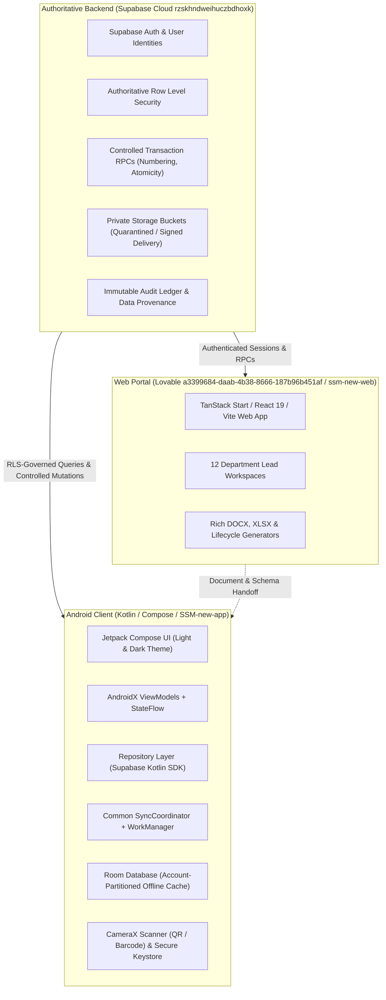
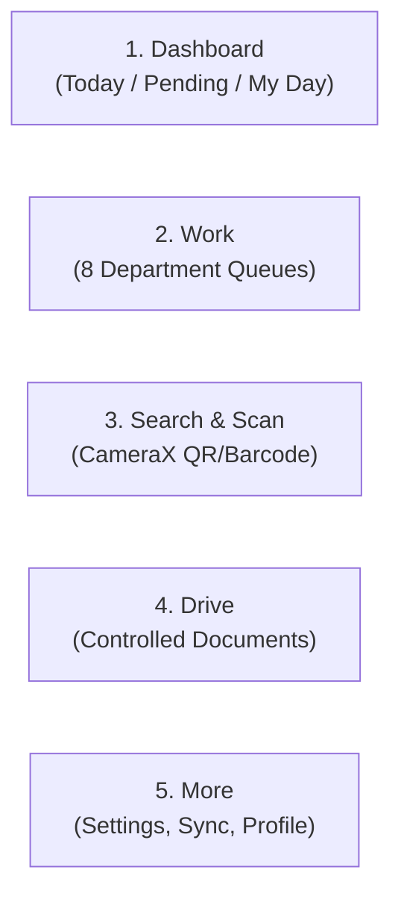
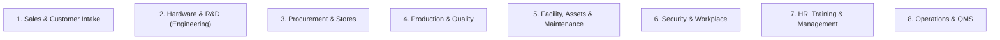
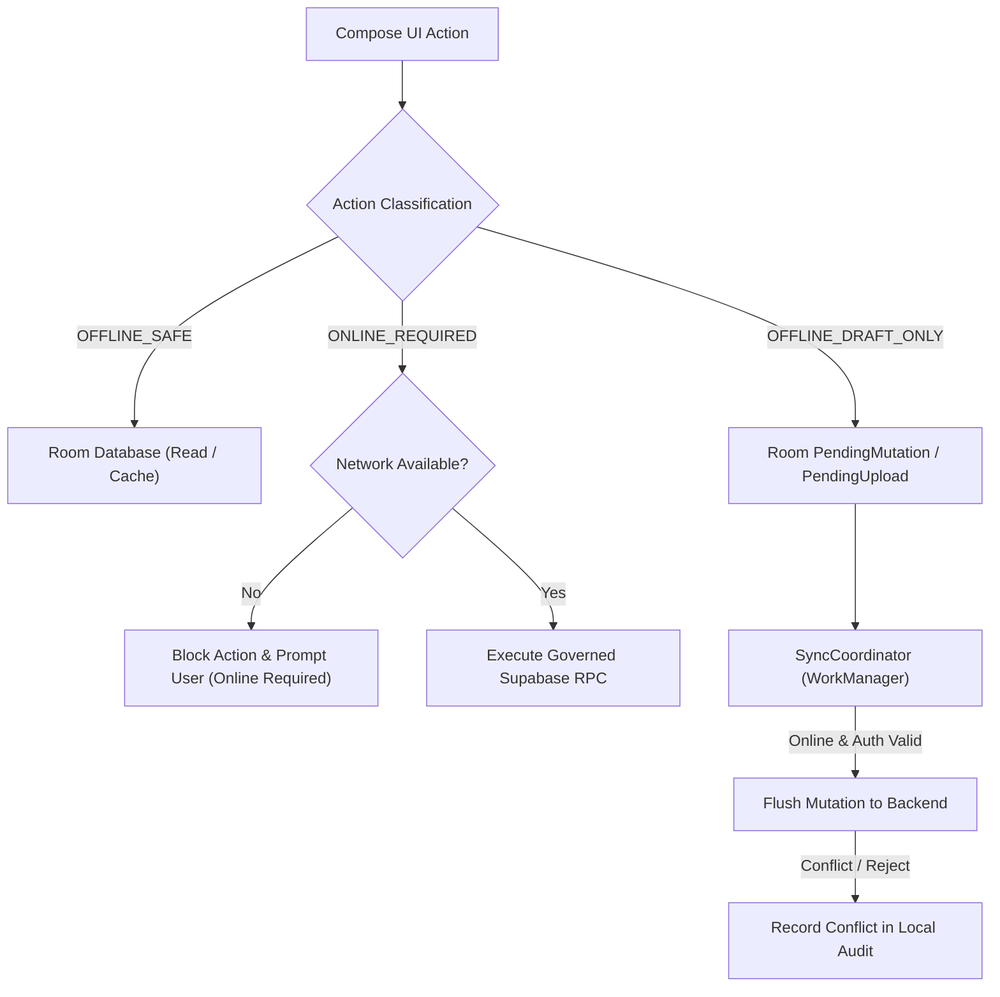
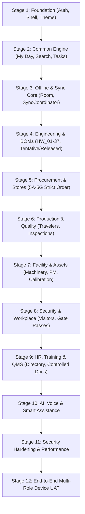

# SSM One — Android Mobile Managing Portal Master Plan

**Document Version:** 2.2 (Unified Demo Auth, Fast Inventory Search & Mobile vs. Web Architecture Parity)

**Date:** 20 October 2026

**Target Repository:** `C:/Users/Admin/AndroidStudioProjects/SSM-new/SSM-new-app`

**Cross-platform Master Plan Reference:** [SSM-new root master plan](../../../SSM_ONE_MASTER_PLAN.md). The [detailed web implementation plan](../../../ssm-new-web/SSM_ONE_WEB_PORTAL_MASTER_PLAN.md) is a subordinate web handoff; Android-local copies are historical references.
**Authoritative Backend Contracts:** [`docs/backend-handoff/mobile_backend_contract.json`](../backend-handoff/mobile_backend_contract.json), [`docs/backend-handoff/MOBILE_BACKEND_CONTRACT.md`](../backend-handoff/MOBILE_BACKEND_CONTRACT.md), [`docs/backend-handoff/ANDROID_BACKEND_HANDOFF.md`](../backend-handoff/ANDROID_BACKEND_HANDOFF.md)

---

## 1. Executive Purpose & Architectural Authority

The **SSM One Android Mobile Application** serves as the authoritative on-the-move managing and operational client for the SSM One enterprise platform. It enables engineers, storekeepers, technicians, quality inspectors, facility managers, security guards, and executives to monitor operations, scan hardware/assets/lots, execute verified draft workflows, inspect document revisions, and perform controlled transactions from Android handheld devices and tablets.

### 1.1 System Authority Split



### 1.2 Non-Negotiable Architecture Rules

1. **Backend Owns Truth**: The Supabase backend owns users, profiles, employees, roles, permissions, projects, inventory stock, official numbering, and transaction atomicity. The Android client never creates local source-of-truth business tables (e.g. no `mobile_inventory`, no `mobile_purchase_orders`).
2. **Credential Boundary**: The APK receives strictly `SUPABASE_URL` and `SUPABASE_ANON_OR_PUBLISHABLE_KEY`. It never contains `service_role`, database passwords, JWT signing secrets, or private OAuth secrets.
3. **RLS Authorization**: Authorization is strictly enforced by backend Row-Level Security. Android never overrides or replaces backend RLS with client-side UI hiding or locally cached roles. An empty response from Supabase represents denied access.
4. **Controlled Mutation Atomicity**: Critical inventory, asset, and document state changes (Final GRN, Material Issue, Material Return, Stock Transfer, Stock Adjustment, Document Release) must invoke designated server RPCs with client-generated UUID `request_key` idempotency tokens. Critical mutations remain `ONLINE_REQUIRED`.
5. **Single Common Sync Engine**: All offline caching, mutation queues, and background synchronization must use the common `SyncCoordinator`, Room database, and WorkManager infrastructure. Feature-specific synchronization daemons (e.g., `GrnSyncWorker`, `InventorySyncWorker`) are strictly prohibited.
6. **Package Path Discipline**: Package paths must not use Kotlin reserved words (e.g. use `feature.stores.returns`, never `feature.stores.return`).

### 1.3 Mobile Companion vs. Web-Authoritative Architecture Philosophy & UI Uncluttering Strategy

The core architectural boundary of the SSM One ecosystem is defined by the operational principle:
> **"Mobile for Action on the Move; Web for Deep Authoring at the Desk"**

#### A. Mobile Companion Responsibilities (Fast, Thumb-Friendly, Action-Oriented)
The mobile application is deliberately designed as an agile operational companion for engineers, managers, inspectors, and storekeepers walking the plant floor or on the move:
1. **1-Tap Daily Task Approvals & Rejections**: Instant triage of pending operational assignments without traversing complex multi-level menus.
2. **Deal & Feasibility Review Sign-Off**: Sales and technical leads can review high-level feasibility criteria and provide decisive sign-offs from anywhere.
3. **Stage Gate Overview & APQP Freeze Reviews**: Real-time visibility into the 9-stage APQP lifecycle, active stage bottlenecks, and gate prerequisite completion.
4. **Fast QR / Barcode Scan & Instant Part Lookup**: High-performance CameraX scanner resolving MPN barcodes, reels, storage bins, lots, asset tags, and employee badges in milliseconds.
5. **Real-Time Inventory Search**: Instant multi-field component filtering by MPN, description, manufacturer, category, and bin coordinate.
6. **Receiving Draft Creation & Photo Proof**: Rapid receiving voucher capture with camera photo attachment directly at the goods receiving dock.
7. **Equipment Breakdown & Urgent Incident Logging**: 30-second ticket submission with machine stoppage timers and priority classification.

#### B. Web-Authoritative Responsibilities (Desktop Workbench & Deep Governance)
Complex, document-heavy, and financially sensitive tasks belong exclusively on the Web Enterprise Portal and must **never** be crammed into mobile screens:
1. **Multi-Section A4 PDF & Controlled Document Generation**: Full 38-family document catalogue drafting, revision authoring, cryptographic hashing, and printable compilation.
2. **Multi-Column Engineering BOM Spreadsheets**: 40-column hierarchical BOM grids, Mouser parametric stock crawlers, and bulk alternate component matching.
3. **Pricing Models, Margins & Commercial Negotiation**: Proprietary cost breakdowns, profit margins, volume discounts, and payment terms.
4. **Vendor Quotation Comparison Matrices**: Side-by-side RFQ evaluation across multiple suppliers.
5. **Database Schema Administration & RLS Provisioning**: Row-level security policies, database migration execution, and enterprise role provisioning.

#### C. Mobile UI Uncluttering Rules
- **No Cluttered Megatables**: Mobile screens must never render 50-field desktop spreadsheets or unpaginated 500-row data tables.
- **Separation of Disparate Concerns**: Features belonging to distinct operational departments (e.g., Plant Maintenance, Security Gatehouse, HR Staff Matrices) must not be dumped into unrelated screens like the Parts Inventory Register.
- **Progressive Disclosure**: Mobile displays summary status, key metrics, and primary action buttons upfront. Secondary technical specifications and audit logs are accessible via bottom sheets on tap.

---

## 2. Android Experience & UI Architecture

### 2.1 Five-Tab Navigation Framework

The application implements a predictable, thumb-accessible five-tab bottom navigation structure supplemented by a dynamic top operational bar:



1. **Dashboard (My Day)**:
   - Role-aware daily cockpit showing *Today's Tasks*, *Pending Actions*, and *Overdue Items*.
   - Filtered by the active presentation department, with quick links to assigned project cards and task checklists.
   - Honest metric presentation: unavailable or restricted metrics are clearly badged as *Restricted* or *Unavailable* rather than rendering dummy zeroes.
2. **Work (Departmental Operational Queues)**:
   - Primary operational surface exposing the 12 enterprise department workflows based on user permissions.
   - Filterable by department, status, project, and priority.
3. **Search & Scan**:
   - High-performance barcode and QR scanner using CameraX and ML Kit / ZXing.
   - Instantly resolves physical items to authoritative records: components (MPN), reels, storage bins, lots, asset tags, employee badges, travelers, and purchase orders.
   - Deep-linking engine navigates directly to the resolved entity detail screen.
4. **Drive (Controlled Documents & BOMs)**:
   - Scoped departmental document roots mirroring the web portal Drive taxonomy.
   - Exposes controlled document registers, revision timelines, version tags, and project BOM linkages.
   - Native read-only previewers for PDF, images, and tabular XLSX/BOM data.
5. **More (Administration & Connectivity)**:
   - User profile, department switcher (presentation alias, without privilege elevation).
   - Sync Coordinator center: visual status of pending offline drafts, sync logs, cache size, network health.
   - App settings, theme toggle (Light / Dark / System default).

### 2.2 Dark Mode & Material 3 Theming

The application adheres to Material Design 3 with comprehensive Light and Dark theme implementations that visually align with the SSM One web portal:

- **Dynamic Theme Palette**:
  - Light Palette: High-contrast slate and industrial blue accents, clean white/gray surfaces (`#F8FAFC`, `#FFFFFF`), subtle borders (`#E2E8F0`).
  - Dark Palette: Deep charcoal surfaces (`#090D16`, `#111827`, `#1E293B`), subdued text tones (`#F1F5F9`, `#94A3B8`), and vibrant indicator accents for active, warning, and success states.
- **Theme State Management**: Integrated into `Theme.kt`, observing system theme changes and providing an explicit user override stored in encrypted preferences.

### 2.3 Governed Inventory Experience & Fast Search Architecture
In accordance with the uncluttering strategy, the mobile inventory experience (`GovernedInventoryScreen.kt`) is strictly focused on stores and material execution:
1. **Instant Real-Time Search**: An `OutlinedTextField` search bar embedded directly in `PartsRegisterTab` allows continuous filtering across MPN, description, manufacturer, category, storage location, and bin coordinates without modal friction.
2. **Clear Feedback & Zero-States**: Provides dynamic matching counts (`X parts found`), a 1-tap clear button (`✕`), and an informative empty state when search criteria yield no matches.
3. **Separation of Unrelated Domains**: Plant maintenance work orders, security gatehouse passes, and HR skill matrices are decoupled from the physical electronic components register and routed to their dedicated departmental surfaces.

### 2.4 Unified Test Persona & Authentication System (Shared Web & Android User Base)
To guarantee seamless, friction-free QA and executive demonstrations across platforms, the Android app shares the identical demo persona registry and test credentials as the web portal:
1. **1-Click Demo Persona Grid**: `AuthDialog.kt` provides a responsive quick-selection grid representing all 14 enterprise personas (Executive Admin, Tata Motors OEM client, and all 12 department leads). Tapping any persona chip auto-populates credentials and authenticates immediately.
2. **Dual-Mode Authentication**:
   - **Online Mode**: Authenticates against Supabase Cloud `/auth/v1/token?grant_type=password`.
   - **Offline / Local Demo Mode**: Gracefully issues a fully compliant local `AuthSession` populated with the persona's authentic full name, role title, and department code.
3. **Automatic Role & Signature Synchronization**: Successful login immediately dispatches `scmsRepository.switchRole(role)`, synchronizing the active actor name, authority permissions, and signature lines across the entire application.

---

## 3. Departmental Coverage & Mobile vs. Web Responsibilities Matrix (14 Entities)

The SSM One ecosystem provides unified operational coverage across 14 distinct roles and departments (Executive Admin, Tata Motors OEM Client, and 12 Enterprise Departments). Each department follows the strict separation between **Mobile Companion (pocket action)** and **Web Portal (desktop authoring)**:

### 3.0 Cross-Department Responsibility & Boundary Matrix

| # | Department Code & Name | Mobile App Scope (Action on the Move) | Web Portal Scope (Authoring & Administration) | What is Excluded from Mobile to Prevent Clutter |
| :- | :--- | :--- | :--- | :--- |
| **1** | **ADMIN** (Executive Command / MD) | • Critical Stage Gate 1–9 freeze sign-off<br>• High-value deal & CapEx approvals<br>• Cross-department bottleneck alert summary | • Enterprise settings & global policy authoring<br>• Master organization structure & permissions<br>• Comprehensive audit trail investigation | Raw SQL consoles, database migration tools, low-level server configuration |
| **2** | **CLIENT** (Tata Motors OEM Portal) | • Stage milestone acceptance & feedback<br>• Prototype dispatch delivery confirmation<br>• High-level project timeline overview | • Formal contract & statement of work (SOW) review<br>• Change request formal submission & negotiation<br>• Full engineering compliance dossier inspection | Internal cost breakdowns, proprietary supplier vendor lists, raw margins |
| **3** | **SAL** (Sales & Business Development) | • 1-tap Feasibility Review sign-off<br>• Stage 1 & 2 Deal approvals<br>• Customer contact directory & pipeline stage | • Detailed quotation authoring & price breakdown<br>• Commercial contract draft & redlining<br>• Profit margin and volume tier calculations | Financial margin spreadsheets, multi-page customer contract text editors |
| **4** | **EHW** (Hardware Engineering) | • Component inventory search & bin location<br>• Stock match review (Available vs Shortage)<br>• 1-tap schematic & layout review sign-off<br>• ECR / ECO approval queue | • Multi-sheet schematic & Gerber authoring<br>• Full 40-column BOM engineering spreadsheet<br>• Component alternative parametric comparison<br>• Thermal & signal integrity reports | Heavy CAD schematic viewers, massive 500-line unformatted BOM tables |
| **5** | **FW** (Firmware Engineering) | • Build approval & release gate review<br>• Flash programming checklist sign-off<br>• Bootloader version verification badge | • Git commit history & PR diff review<br>• Memory map & register configuration matrices<br>• Static analysis & MISRA compliance logs | In-app code editors, hex dump inspections, terminal build consoles |
| **6** | **SW** (Software Engineering) | • Daily task approval & board overview<br>• Mobile app & Cloud release sign-off<br>• API deployment status badge | • Database schema & API endpoint configuration<br>• Cloud architecture diagram authoring<br>• Deep telemetry & error log drill-down | Full API payload builders, complex database migration consoles |
| **7** | **MECH** (Mechanical Engineering) | • Enclosure fit & 3D sample sign-off<br>• Photo upload of physical test prototypes<br>• Tooling trial review approvals | • 3D CAD STEP/IGES model rendering & analysis<br>• Mold design tolerance & shrinkage spreadsheets<br>• CMM inspection coordinate reports | Heavy 3D WebGL CAD viewers, detailed dimension spreadsheets |
| **8** | **PUR** (Purchasing & SCM) | • Urgent PO sign-off & escalation queue<br>• Receiving draft creation via ASN barcode scan<br>• Part shortage alert review | • Vendor quotation comparison matrices<br>• Supplier payment terms & banking administration<br>• Global shipping & freight customs documentation | Vendor bank setup, multi-vendor pricing matrices, raw PO tax calculation |
| **9** | **QA** (Quality Assurance & APQP) | • IQC receiving inspection pass/hold tag<br>• Rapid defect logging with camera photo<br>• Stage-gate freeze sign-off & PPAP checklist | • 8D root-cause investigation authoring<br>• Full PFMEA / DFMEA risk priority matrix<br>• Gauge R&R and statistical process control (SPC) | Complex 50-row FMEA spreadsheets, statistical curve generators |
| **10** | **EMF** (Electronics Manufacturing) | • SMT reel barcode scan & feeder assignment<br>• Work traveler check-in / step completion<br>• Stencil wipe & reflow oven checklist sign-off | • SMT pick-and-place coordinate programming<br>• Production yield & scrap statistical trend charts<br>• Line balance & cycle time optimization models | Machine G-code / placement file loaders, cycle time simulation |
| **11** | **MMF** (Mechanical Manufacturing) | • CNC / stamping machine status toggle<br>• Rapid breakdown ticket logging<br>• Tool wear & lubrication daily check | • Tooling lifespan & sharpening lifecycle tracking<br>• Preventive maintenance master schedule<br>• Vendor spare parts procurement schedule | Master facility Gantt charts, deep machine telemetry diagnostics |
| **12** | **FIN** (Accounts & Finance) | • Capital expenditure (CapEx) PO approval<br>• Invoice payment release authorization<br>• Daily project budget burn summary | • General ledger reconciliation & balance sheet<br>• GST / Tax audit filings & e-invoicing<br>• Comprehensive project P&L and cash flow reports | Ledger account mapping, double-entry journal forms, tax returns |
| **13** | **SIT** (Service & IT Infrastructure) | • Urgent server/network outage alert push<br>• Physical asset quick scan & audit tag<br>• Security badge & laptop check-out | • Network topology & firewall rule management<br>• Active Directory / SSO provisioning console<br>• Cloud server infrastructure cost dashboards | Cloud CLI consoles, firewall routing tables, SSH terminals |
| **14** | **HROPS** (HR & Operations) | • Urgent leave request approval<br>• Operator station qualification scan<br>• Incident / safety hazard quick report | • Monthly payroll computation & deductions<br>• Full employee training & competency matrix<br>• Statutory compliance & labor law documentation | Full payroll spreadsheets, confidential salary review grids |

The Android app provides operational mobile clients for all enterprise departments:



### 3.1 Sales & Customer Intake
- **Mobile Scope**: Read-only commercial pipeline, active customer directories, assigned enquiries, and feasibility review status.
- **Key Tables**: `customers`, `customer_contacts`, `customer_requirements`, `customer_requirement_revisions`, `customer_portal_shares`.
- **Boundaries**: Customer quotations, pricing models, and contract signing remain web-authoritative. Mobile displays operational project links without exposing confidential financial margins.

### 3.2 Hardware & R&D (Engineering & BOM Management)
- **Mobile Scope**:
  - Project repository exploration (`projects`, `project_members`, `project_process_stage_records`).
  - Company Process Stage Tracking (Taxonomy HW_01 to HW_37) with predecessor lock indicators and evidence links.
  - **Tentative BOM vs. Released BOM Inspection**:
    * Full line-level stock match status (Exact Match, Substitute Available, Shortage, Unstocked).
    * Alternate component review rationale and datasheet links (`datasheet_cache`).
    * Revision comparison between Draft/Tentative engineering BOMs and Released production BOMs (`project_boms`).
  - Engineering Changes: Review active ECR/ECO records, linked tasks, and impacted parts.

### 3.3 Procurement & Stores (Stage 5 Detailed Delivery)
Procurement and Stores follow the strict staged execution sequence (5A through 5G):

- **5A — Procurement Read-Only**:
  - Safe operational projections: `operational_purchase_requests`, `operational_purchase_request_items`, `operational_rfqs`, `operational_po_shipments`, `operational_vendors`.
  - Excludes unit costs, margins, payment terms, and vendor bank accounts.
- **5B — Receiving Drafts**:
  - Scan PO barcode or ASN to load expected items via `operational_receiving_purchase_orders`.
  - Component verification: MPN scanning, lot number, batch code, date code, reel ID, packaging condition, MSL/ESD flags.
  - Photo evidence capture attached to local draft receiving vouchers.
  - Drafts saved locally in Room; strictly no offline Final GRN posting.
- **5C — Inventory Read-Only**:
  - Component search by MPN, manufacturer, description, category, or bin location (`components`, `inventory_lots`, `storage_locations`).
  - Stock visibility categorized as Available, Quality Hold / Quarantine, or Reserved.
  - Explicit *Cached / May-be-outdated* freshness timestamp on every stock screen.
- **5D — Material Issue & Return**:
  - Material Issue: Online posting via `post_material_issue` against valid project work orders.
  - Material Return: Online posting via `post_material_return` (package `feature.stores.returns`), preventing over-return atomically.
- **5E — Cycle Counts & Blind Picking**:
  - Assigned cycle count sheets with blind count support (system stock quantity hidden from count operator).
  - Pick list execution with barcode confirmation per line.
- **5F — Final GRN & Critical Stock Transactions**:
  - Online-only execution of `create_grn`, `post_stock_transfer`, and `post_stock_adjustment`.
  - Enforces client UUID idempotency tokens, server numbering, row-locking concurrency, and immutable audit logs.
- **Review-Based Import / Draft Handling**:
  - When PO or invoice data is scanned or imported from external supplier manifests, records are placed into a *Draft Review Queue*.
  - No inventory stock movement occurs until formally approved and received through the controlled receiving inspection gate.

### 3.4 Production & Quality
- **Mobile Scope**:
  - Traveler & Work Order Execution: `work_orders`, `production_routes`, `routing_steps`, `production_units`.
  - Step check-in/check-out with operator badge scan.
  - Quality Inspection: In-process and final inspection checklists (`inspection_records`, `ncr_records`).
  - Defect logging with camera photo evidence and quarantine tagging.
  - PPAP / First Article Inspection review summaries and dispatch packaging verification.

### 3.5 Facility, Assets & Maintenance
- **Mobile Scope**:
  - Asset Directory & Quick Scan: `assets`, `asset_categories`, `asset_assignments`.
  - Machinery Registers: Operating state, maintenance history, and assigned operators.
  - Preventive Maintenance (PM): Scheduled PM checklists with step-by-step sign-off and photo upload.
  - Breakdown Work Orders: Rapid breakdown ticket creation with priority rating, machine stoppage timer, and technician dispatch.
  - Calibration Logs: Measuring equipment calibration dates, certificate inspection, and out-of-calibration warnings (`calibration_records`).

### 3.6 Security & Workplace
- **Mobile Scope**:
  - Gatehouse Cockpit: Visitor check-in/check-out with badge generation (`visitor_logs`).
  - Material Gate Pass Verification: Inward and outward pass scanning against approved store transfers (`gate_passes`).
  - Vehicle Logistics: Truck entry/exit logging, driver details, and loading bay assignment.
  - Workplace Incident Reports: Hazard identification, injury reporting, and facility security patrols.

### 3.7 HR, Training & Management
- **Mobile Scope**:
  - Organization Directory: Department employee list with contact shortcuts (`employees`, `departments`).
  - Training & Competency Matrix: Verification of operator certifications before authorizing specialized machinery operation.
  - Personal Workspace: Leave application status, assigned training modules, and policy acknowledgements.

### 3.8 Operations & QMS (Quality Management System)
- **Mobile Scope**:
  - Controlled Document Viewer: RLS-governed access to company SOPs, manuals, work instructions, and specifications (`document_control_registers`, `document_control_events`).
  - Audit Trail Timeline: Real-time inspection of document revisions and change histories.
  - Audit & CAPA Inspection: Internal audit checklists, corrective action tracking, and KPI dashboard monitoring.

---

## 4. Offline Engine & Sync Architecture



### 4.1 Action Classification Rules

Every user action in the mobile app is strictly classified:

| Classification | Meaning | Examples |
|---|---|---|
| `OFFLINE_SAFE` | Read-only operations against cached Room tables. Stale indicators are displayed. | Browsing downloaded SOPs, reviewing cached component lists, viewing project directories. |
| `OFFLINE_DRAFT_ONLY` | Data entry that creates a local draft. Never changes server state until synced and verified online. | Receiving draft vouchers, cycle count observations, breakdown reports, visitor entries, inspection checklists. |
| `ONLINE_REQUIRED` | Cannot be performed offline. Must execute synchronously against Supabase with server-side validation and locking. | Final GRN creation, Material Issue, Material Return, Stock Transfers, Stock Adjustments, Document Release. |

### 4.2 Room Partitioning & Security

- Room database schemas are isolated per authenticated user account (`account_id` column on all cached tables).
- Logging out or switching accounts flushes uncommitted non-draft caches and resets repository state.
- Sensitive credentials, auth tokens, and session keys are kept exclusively in Android EncryptedSharedPreferences (backed by Android Keystore), never in plain Room tables.

---

## 5. Technical Implementation Stack & Directory Structure

### 5.1 Android Technology Stack

- **Language**: Kotlin 2.0+ (100% Kotlin, Coroutines, Flow).
- **UI Toolkit**: Jetpack Compose + Material 3, Navigation Compose.
- **Architecture**: Clean Architecture (Presentation → Domain → Data) + MVI / Unidirectional Data Flow.
- **Backend SDK**: Supabase Kotlin Client (`gotrue-kt`, `postgrest-kt`, `storage-kt`, `realtime-kt`).
- **Local Persistence**: Androidx Room with SQLite KSP compiler.
- **Background Work**: Androidx WorkManager with CoroutineWorker.
- **Hardware Integration**: CameraX (preview & image analysis), ML Kit Barcode Scanning / ZXing.
- **Dependency Injection / Factory**: Lightweight Repository & ViewModel providers adhering to Android lifecycle guidelines.

### 5.2 Source Code Directory Layout

```text
app/src/main/java/com/example/ssmapplication3/
├── MainActivity.kt                      # App entry point, theme provider, root navigation
├── core/
│   ├── auth/                            # Session manager, secure token storage, Google OAuth
│   ├── network/                         # SupabaseClientProvider, error parsers, interceptors
│   ├── security/                        # Capabilities, permission checkers, device security
│   ├── sync/                            # SyncCoordinator, PendingMutation, WorkManager workers
│   ├── ui/                              # Common Compose components, status badges, dialogs
│   └── util/                            # Environment config, Flow helpers, date formatters
├── data/
│   ├── local/                           # Room database, DAOs, local entity models
│   └── repository/                      # Repository implementations connecting Supabase & Room
├── domain/
│   ├── model/                           # Pure Kotlin business models & domain entities
│   └── repository/                      # Domain repository interfaces
├── feature/
│   ├── auth/                            # Sign-in screen, SSO callback, session restore
│   ├── dashboard/                       # My Day cockpit, today/pending checklists
│   ├── documents/                       # Drive document browser, controlled register viewer
│   ├── engineering/                     # Projects, BOM dual-lifecycle, stage tracking HW_01-37
│   ├── facility/                        # Asset register, PM checklists, breakdown reporting
│   ├── inventory/                       # Component lookup, lot/reel details, stock freshness
│   ├── mywork/                          # Unified work queue across permitted departments
│   ├── notifications/                   # Notification center, alert routing
│   ├── procurement/                     # PR, RFQ, PO, shipment tracking (safe projections)
│   ├── production/                      # Travelers, work orders, routing inspection
│   ├── receiving/                       # Receiving draft vouchers, PO item matching
│   ├── scanner/                         # CameraX barcode/QR scanner, deep-link resolver
│   ├── security/                        # Visitor logging, gate passes, vehicle registers
│   └── stores/                          # Critical stock transactions
│       ├── adjustments/                 # Stock adjustments (ONLINE_REQUIRED)
│       ├── issues/                      # Material issue posting (ONLINE_REQUIRED)
│       ├── returns/                     # Material return posting (ONLINE_REQUIRED)
│       └── transfers/                   # Stock transfers (ONLINE_REQUIRED)
├── navigation/                          # AppNavigation, Screen routes, DeepLinkHandler
└── ui/theme/                            # Color, Theme (Dark/Light), Type, Shape
```

---

## 6. Authoritative Handoff Contract Index

The Android client directly implements data structures and calls corresponding to the generated backend specifications:

| Backend Contract Artifact | Purpose & Android Mapping |
|---|---|
| [`mobile_backend_contract.json`](../backend-handoff/mobile_backend_contract.json) | Complete machine-readable catalog of all 180+ tables, foreign keys, columns, RPC signatures, and bucket paths. |
| [`MOBILE_BACKEND_CONTRACT.md`](../backend-handoff/MOBILE_BACKEND_CONTRACT.md) | Object classification matrix: `MOBILE_READ_SAFE`, `ONLINE_REQUIRED`, `WEB_ONLY`. |
| [`ANDROID_BACKEND_HANDOFF.md`](../backend-handoff/ANDROID_BACKEND_HANDOFF.md) | Safe configuration boundaries, operational projection specifications, RLS rules. |
| [`LIFECYCLE_ANDROID_READ_CONTRACT_2026-10-02.md`](../backend-handoff/LIFECYCLE_ANDROID_READ_CONTRACT_RENDERED_2026-10-03.txt) | Specification for displaying HW_01–HW_37 stages, department templates, and dependency chains. |
| [`VERIFIED_SAFE_PROCUREMENT_CONTRACT_2026-09-26.md`](../backend-handoff/VERIFIED_SAFE_PROCUREMENT_CONTRACT_2026-09-26.md) | Contract for `operational_*` safe views omitting financial/commercial data. |
| [`VERIFIED_MATERIAL_ISSUE_RETURN_CONTRACT_2026-09-27.md`](../backend-handoff/VERIFIED_MATERIAL_ISSUE_RETURN_CONTRACT_2026-09-27.md) | Signatures and idempotency rules for `post_material_issue` and `post_material_return`. |

---

## 7. Stage-by-Stage Implementation Roadmap

The mobile roadmap is organized into 12 controlled stages. Progress adheres to the strict engineering discipline: **INSPECT → IMPLEMENT → COMPILE → TEST → BUILD → DEVICE VERIFY → EVIDENCE → CONTINUE**.



### Stage 1: Foundation (COMPLETED / VERIFIED)
- Supabase auth integration (Email/Password, Google OAuth).
- Session manager with encrypted token storage.
- Navigation shell with 5-tab scaffold and top bar.
- Material 3 Theme foundation with Dark Mode and Light Mode support.

### Stage 2: Common Engine (COMPLETED / VERIFIED)
- Role-aware Dashboard / My Day cockpits with Today and Pending tasks.
- Unified task repository querying `project_tasks` partitioned by department.
- Deep link resolution foundation and notification badges.

### Stage 3: Offline & Sync Core (COMPLETED / VERIFIED)
- Room database schema with account isolation.
- Common `SyncCoordinator` handling draft queues (`PendingMutation`, `PendingUpload`).
- Network connectivity monitor and conflict resolution handlers.

### Stage 4: Engineering & R&D Workspace (IN PROGRESS / ACTIVE REFINEMENT)
- Project directory and project team exploration.
- Hardware process stages (HW_01 to HW_37) with predecessor lock indicators.
- **Tentative BOM vs Released BOM Inspection**:
  * Line-by-line stock match visualization (Exact, Substitute, Shortage).
  * Mouser component enrichment view (MPN, package, datasheet link).
  * Revision comparison between draft/tentative engineering BOMs and approved released production BOMs.
- Engineering Change Requests (ECR) and ECO impact review.

### Stage 5: Procurement, Stores & Receiving (STRICT 5A–5G SEQUENCE)
- **5A (Procurement Read-Only)**: PR, RFQ, PO, ASN, Vendor list using `operational_*` safe projections.
- **5B (Receiving Draft)**: PO/ASN selection, CameraX barcode scan matching, lot/batch/reel capture, draft voucher storage.
- **5C (Inventory Read-Only)**: MPN stock search, bin location lookup, stock freshness timestamps.
- **5D (Material Issue & Return)**: Online posting via `post_material_issue` and `post_material_return`.
- **5E (Cycle Counts & Picking)**: Blind count execution, pick lists with line-by-line verification.
- **5F (Final GRN & Critical Stock)**: `create_grn`, `post_stock_transfer`, `post_stock_adjustment` with UUID idempotency.
- **5G (Integration & Acceptance)**: End-to-end scanner, notifications, and regression test suite.

### Stage 6: Production & Quality Assurance
- Route station tracking and electronic travelers.
- Component lot traceability during assembly.
- In-process inspection, NCR creation with photos, PPAP sign-offs.

### Stage 7: Facility, Assets, Maintenance & Calibration
- Asset QR scanning and metadata cards (`assets`).
- Machinery operational state and breakdown ticketing.
- Preventive maintenance schedules with step checklists.
- Instrument calibration validity and certificate viewing (`calibration_records`).

### Stage 8: Security, Visitors & Workplace Logistics
- Gatehouse visitor check-in, pass generation, and host notifications.
- Material gate pass verification (inward / outward).
- Loading bay vehicle logs and incident report logging.

### Stage 9: HR, Training & Controlled Documents (QMS)
- Department staff directory and contact integration.
- Operator skill matrix verification.
- Controlled Document Register: RLS-permitted viewing of SOPs, manuals, and revision timelines.

### Stage 10: AI, Voice & Mobile Automation
- Voice-assisted inventory lookup and notes transcription.
- Intelligent scanner recognition for damaged packaging or illegible supplier labels.
- Scoped AI assistant answering procedural questions against cached SOPs.

### Stage 11: Security Hardening, Performance & Recovery
- Memory optimization and list virtualization for large BOMs and component catalogs.
- Safe file handling, sandboxed PDF rendering, and zero-cache leakage on logout.
- ProGuard / R8 code shrinking and security audit.

### Stage 12: End-to-End Multi-Role Acceptance Testing
- Live testing on physical Android devices across distinct test identities (Engineer, Storekeeper, Inspector, Manager).
- Verification of parity between web changes and mobile viewports.
- Full regression passing `:app:testDebugUnitTest` and clean `:app:assembleDebug` packaging.

---

## 8. Verification & Execution Gates

Every implementation increment must provide documented evidence meeting these gates before marking complete:

1. **Static & Syntax Gate**: `:app:compileDebugKotlin` exits with code `0`.
2. **Unit Test Gate**: `:app:testDebugUnitTest` passes all unit tests across data, domain, and ViewModels.
3. **Packaging Gate**: `:app:assembleDebug` successfully produces a valid debug APK.
4. **Device / Emulator Gate**: Verified on an Android emulator or physical device; screenshot or CLI log preserved in `docs/evidence/`.
5. **Contract Conformance Gate**: Network calls must conform strictly to `mobile_backend_contract.json` without inventing endpoints, columns, or tables.


Company-name anonymization: current repository display labels, planning/reference snapshots and synthetic examples use XYZ Pvt Ltd. Live business records, identities, backend configuration, official document codes and published Git history were not changed. Sanitized schema/reference text is not a claim of an altered installed database. Image/binary contents and historical commits require separate review; a source sync is not deployment.


## 9. Web Cross-Department Audit and Android Acceptance Dependencies — 19 October 2026

### 9.1 Status qualification

This is a documentation/handoff update, not an Android implementation or device verification. Existing stage/build claims above describe historical checkpoints; they do not prove current live integration. No Kotlin, Gradle, APK or backend changes were made for this update, and Android tests/build were not rerun for documentation alone.

The [SSM-new root master plan](../../../SSM_ONE_MASTER_PLAN.md) is the cross-platform authority. The [detailed web checkpoint](../../../ssm-new-web/SSM_ONE_WEB_PORTAL_MASTER_PLAN.md#28-cross-department-portal-correction-and-production-acceptance--19-october-2026) records fixes to department scoping, navigation, document drafts, task field retention, serialized local edits, designated approvals and client routing. Fourteen web tests, TypeScript/build and a two-tab Hardware-to-Quality round trip passed locally. These results do not certify Android behavior or shared server persistence. [Web browser evidence](../../../ssm-new-web/docs/evidence/DEPARTMENT_SCOPE_FIX_2026-10-19.md).

Live Lovable inspection found no enabled sign-in method and no organization/users or operational rows in the inspected core tables. Real organization identity and first administrator work email are required for secure provisioning; no passwords belong in plans/chat. The user approved narendok/ssm-new-web main on 19 October; web fixes and the web plan were pushed through 3403586 and received by Lovable. Live-preview Service task navigation and Finance approval scoping passed. This resolves the earlier automatic-review push block. Production publishing and Android remote sync were not performed.

### 9.2 Required Android parity checks (pending, not implemented by this plan)

| Area | Required mobile behavior | Dependency / acceptance evidence |
|---|---|---|
| Trusted identity and department | Resolve organization, department and capabilities from authenticated protected membership. Cover SAL, EHW, FW, SW, MECH, PUR, QA, EMF, MMF, FIN, SIT and HR/OPS. TST/EOL testing is a production function with QA oversight, not an active department. | Verified Auth/RLS contract; separate authorized identities. Preview roles are never operational authority. |
| My Day / Tasks / deep links | Open the actual assigned queue and task; preserve project, due date and source fields on reassignment/update. Empty and denied states are explicit. | Verified task projection/mutation; device navigation and reload tests. |
| Projects and team | Show authorized linked projects and relevant department roster. A general directory/filter must not widen access beyond server permissions. | Protected project/roster reads, cross-department denial and correct detail destinations. |
| Approval / rework / notifications | Only designated signers act; pending gates block completion. Server rechecks current state, records rationale/audit, rejects duplicate or stale decisions, and notifies the requester. | Verified online transaction; web-to-mobile and mobile-to-web round trips on independent sessions. |
| Documents and references | Use actual project sources, correct document type/revision/reference target, and explicit missing fields. Unissued local drafts remain drafts; client release needs recipient grant. | Verified controlled-document contract, private signed links, expiry and denial tests. No synthetic certification/signature accepted as evidence. |
| Client boundary | Deny internal index, financial/HR detail and unreleased files unless explicitly authorized by the canonical backend. Filename/type matching is not an access grant. | Server projection/field stripping and negative access tests. |
| Session/cache isolation | Sign-out removes session and account-scoped sensitive cache; never fall back to Admin. Another login must not inherit cached role data. | Logout, expiry, user-switch, offline-cache and deep-link tests. |
| Lifecycle / floor work | Display authoritative predecessor gates and actual inspection/BOM/build/test/dispatch/service evidence. Keep simulation isolated and labeled. | Verified lifecycle contracts; stock/release actions remain ONLINE_REQUIRED and fail closed. |

### 9.3 Execution order and release gate

1. Web/backend owner confirms environment, organization/admin, authentication, canonical schema, RLS and private storage; supplies versioned verified contracts under docs/backend-handoff. Do not infer a migration was deployed from repository files.
2. Android owner maps existing repositories/models to those contracts, preserving Stage 5A–5G order and the common SyncCoordinator. Do not create a competing backend or enable transactions from browser-local web behavior.
3. Implement and test each affected operation only after its contract is verified. Keep unavailable operations disabled with a clear reason. Official numbering, stock, approvals and releases remain authoritative server operations.
4. Run compile, unit tests and debug packaging after source changes; verify on device/emulator. Capture per-role results and negative tests under docs/evidence. Historical test counts are not evidence of this new run.
5. Complete an authenticated web/mobile lifecycle round trip with actual persisted records and source-backed documents. Final acceptance remains pending until this evidence exists; neither a plan update nor a working web demo closes Android release gates.

### 9.4 Standard task board parity — 19 October 2026

Web now uses one shared task board for all twelve department roles in My Tasks and department workspaces: Today / In Progress left, Review middle, To Do right, Completed collapsed by default with an expand arrow/count. Mobile should adopt the same task grouping and action semantics when verified task contracts are available. A task must occupy only one lane; approved/released and review take precedence over due-today/progress. Preserve assignee, project and due-date fields on updates; retain guarded approval completion. Web browser-local workStatus is not a newly verified backend column or Android contract. No Android source/build/device work is included in this board update.

### 9.5 Department project workspace parity — 19 October 2026

Web consolidates department home/summary and project navigation into one page controlled by an All projects / department-linked project dropdown. Android parity should apply one trusted project selection to task queue, project details/progress, document/reference links, approvals, department records and recorded owners. Use explicit project IDs/codes/source links, clear empty states and preserved selection when opening/returning from details. Unlinked documents must not be attributed by filename/title. This is a mobile planning requirement pending verified backend contracts and device tests, not a Kotlin/APK change.

### 9.6 Antigravity continuation plan

Continue using the [detailed portal completion handoff](../../../ssm-new-web/docs/ANTIGRAVITY_PORTAL_COMPLETION_HANDOFF_2026-10-19.md), especially sections 6–8 for backend prerequisites and Android acceptance. Workspace browser verification of web `8fabb5f` has passed (evidenced in `ssm-new-web` commit `46b1ac3` / `docs/evidence/WORKSPACE_CONSOLIDATION_2026-10-19.md`). Android runtime/source/build work was not performed in this increment. Preserve existing planning/context edits and the separate Android execution queue.

### 9.6 Canonical firmware and software department naming — 19 October 2026

Use **FW** for Firmware and **SW** for Cloud & Application Software in Android labels, role/deep-link identifiers, and new document IDs. EFW and CSW are retired transitional labels; ESW is a legacy merged-data alias only. Existing source document/entity IDs must remain intact until an explicit, reference-safe migration is approved. Legacy aliases may be normalized only through deterministic ownership mappings; ambiguous ESW records remain quarantined for owner review. Android must consume the canonical web/backend department contract and must not infer ownership from titles or filenames.


### 9.7 Production department parity — 19 October 2026

The canonical production departments are EMF (Electronics Manufacturing) and MMF (Mechanical Manufacturing). The former TST/EOL Testing department is not a separate active department; test execution belongs to the relevant production process, while QA owns criteria and independent disposition. Preserve historical TST data and identifiers pending explicit ownership mapping. EMF receives accepted outsourced PCBA and performs in-house box-build, checks and packaging; in-house SMT/PCBA assembly is out of scope. MMF owns mechanical manufacturing and assembly. PUR/QA/EHW retain their distinct supplier, quality, and design responsibilities.

### 9.8 Extensible departments and lifecycle responsibility matrix — 19 October 2026

The current 12 departments are an initial registry, not a product limit. Android must consume a backend-owned, stable-ID department registry and versioned responsibility matrix; do not encode department membership or stage owners as a closed enum or local source of truth. Lifecycle stage IDs remain stable and independent from the department chart. The matrix assigns department, role/capability, RACI, applicability, and any required signer capability to a stage and project context.

Each project uses the responsibility-matrix version accepted at its baseline. Later changes apply to new projects by default; changing an active project requires an authorized, audited change with impact review. Preserve historical stage decisions, assignments, signatures, and IDs. Department additions, splits, merges, renames, and deactivation require explicit mapping and effective dates; adding a department grants no project, document, team, or approval access by default.

Shared functions such as HR/OPS, Finance, SIT, and QA can contribute horizontally when the project/stage applicability says so. HR/OPS may manage staffing, onboarding, competency/training, and safety readiness while confidential personnel information stays restricted. RACI and notification membership never grant record access; Android must rely on server-enforced organization membership, project/record scope, and capability checks. “Informed” is notification eligibility only. Verify both old-project stability and new department routing on the same backend contract before claiming parity. This is a planning requirement; it does not claim Android implementation is complete.


### 9.9 Unified Demo Accounts and Inventory Search Implementation Checkpoint — 20 October 2026

1. **Shared Demo User Base Implemented**:
   - Updated `DepartmentRole` in `ScmsDataModels.kt` to carry authoritative demo credentials across all 14 personas (`admin@example.com`, `priya.sharma@example.com`, `morgan.reed@example.com`, etc.).
   - Integrated `signInWithPassword` and offline demo fallback into `SupabaseClient.kt` and `AuthRepository.kt`.
   - Overhauled `AuthDialog.kt` with 1-click test persona selection, explicit credential inputs, and auto-sync with `scmsRepository.switchRole(role)`.
   - Exposed demo emails directly in `RoleSwitcherDialog.kt` for instant identification.
2. **Instant Governed Inventory Search**:
   - Added real-time query filtering into `GovernedInventoryScreen.kt` (`PartsRegisterTab`) matching MPN, description, manufacturer, category, storage location, and bin coordinate.
   - Decoupled disparate facilities/security/HR tabs from the parts register to ensure a clean, uncluttered thumb-friendly UX.
3. **Verification**:
   - Android Unit Tests: `testDebugUnitTest` PASS (BUILD SUCCESSFUL).
   - Android APK Build: `assembleDebug` PASS (BUILD SUCCESSFUL, 0 errors).
   - Web Suite: `npm run test:department` PASS (82/82 PASS).
   - Synchronized with remote repository `SSM-new-app` on branch `main` at commit `b57665b`.
